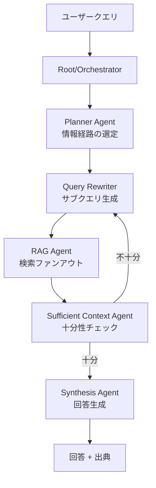

## ブログ概要（Summary）

本記事は [https://research.google/blog/unlocking-dependable-responses-with-gemini-enterprise-agent-platforms-agentic-rag/](https://research.google/blog/unlocking-dependable-responses-with-gemini-enterprise-agent-platforms-agentic-rag/) の解説記事です。

Google Researchは2026年6月、Gemini Enterprise Agent PlatformにおけるAgentic RAG（Retrieval-Augmented Generation）アーキテクチャの詳細を公開した。このブログでは、従来のRAGが抱える「単一クエリ・単一検索」の制約を、マルチエージェント構成で克服するアプローチが紹介されている。特に注目すべきは、**Planner Agent**によるサブクエリルーティング、**Sufficient Context Agent**による検索結果の十分性チェック、そして**クロスコーパス検索**による複数データソースの統合である。Google Researchによると、FramesQAベンチマークにおいて標準的なRAGと比較して**最大34%の精度向上**を達成したと報告されている。

この記事は [Zenn記事: Gemini 3.6 FlashでAgentic RAG検索ルーティングを実装する](https://zenn.dev/0h_n0/articles/74675f3607b023) の深掘りです。Zenn記事ではGemini 3.6 FlashのStructured Outputを用いた意図分類ルーターを実装しているが、Google Research自身がGemini Enterprise Agent Platformでどのようなルーティングアーキテクチャを構築しているかを理解することで、プロダクション規模でのルーティング設計の知見が得られる。

## 情報源

- **種別**: 企業テックブログ
- **URL**: [https://research.google/blog/unlocking-dependable-responses-with-gemini-enterprise-agent-platforms-agentic-rag/](https://research.google/blog/unlocking-dependable-responses-with-gemini-enterprise-agent-platforms-agentic-rag/)
- **組織**: Google Research（Google Cloudとの共同プロジェクト）
- **著者**: Cyrus Rashtchian（Research Scientist）、Da-Cheng Juan（Engineering Manager）
- **発表日**: 2026年6月5日

## 技術的背景（Technical Background）

### 従来のRAGの限界

企業環境では、ユーザーの質問に回答するために複数のデータソース（社内Wiki、コードリポジトリ、設計書、運用ドキュメントなど）を横断的に検索する必要がある。従来のRAGアーキテクチャには以下の制約があった。

**単一クエリの制約**: ユーザーの質問をそのまま1つの検索クエリとして使用するため、複合的な質問（例: 「Project Xの進捗と主要なブロッカーは？」）に対して、関連するが断片的な結果しか返せない。

**単一ソースの制約**: 1つのコーパス（ベクトルDB等）のみを検索するため、異なるチームが管理する複数のデータベースに分散した情報を統合できない。

**応答品質の不安定さ**: 検索結果が不十分な場合でも、そのまま回答生成に進んでしまい、ハルシネーションや不完全な回答が発生する。

### なぜAgentic RAGが必要か

Google Researchは、これらの制約を克服するために「エージェント的な振る舞い」をRAGパイプラインに導入した。具体的には、**計画（Planning）→ 検索（Retrieval）→ 十分性チェック（Sufficiency Check）→ 反復（Iteration）→ 統合（Synthesis）** というループ構造を採用している。ブログでは、このアプローチの核心を「persistence（粘り強さ）」と表現しており、情報が不足している場合に推測や「情報がありません」という回答を返す代わりに、追加検索を実行し続ける点を強調している。

## 実装アーキテクチャ（Architecture）

### マルチエージェント構成

Google Researchが公開したAgentic RAGは、以下の6つのエージェントで構成されるマルチエージェントワークフローである。



**Root/Orchestrator**: リクエストを受け取り、単純な質問か複合的な質問かを判断する。複合的と判断した場合、Planner Agentに委譲する。

**Planner Agent**: 質問に回答するために必要な情報経路（pathway）を特定する。ブログでは医療シナリオの例が挙げられており、「患者の退院サマリーを作成せよ」という指示に対して、Pharmacy（薬剤）、Nutrition（栄養）、Clinical Notes（診療記録）の3つの経路を特定している。クロスコーパスモードでは、どのコーパスを検索すべきかの判断もPlanner Agentが担う。

**Query Rewriter**: ユーザーの自然言語クエリを、検索に最適化された複数のサブクエリに変換する。例として、「Project Xはどうなっている？」という曖昧なクエリが「Project X Q3 ステータスレポート」「Project X チーム 主要ブロッカー」に分解されることが紹介されている。

**RAG Agent（Search Fanout）**: 生成されたサブクエリを対応するコーパスに対して並列実行し、検索結果のスニペットを収集する。

**Sufficient Context Agent**: 本アーキテクチャの中核となるエージェント。検索結果が回答生成に十分かどうかを判定する（詳細は後述）。

**Synthesis Agent**: 十分と判定されたコンテキストを基に、最終回答を生成する。

### Sufficient Context Agent の仕組み

Sufficient Context Agent（十分性チェックエージェント）は、回答生成の前に以下の3つの入力を評価する。

1. **Retrieved Snippets（検索スニペット）**: RAG Agentが取得した実際のテキストチャンク
2. **Intermediate Draft（中間ドラフト）**: プロンプトとスニペットから生成された回答の下書き
3. **Missing-Pieces Analysis（欠落分析）**: 回答に必要だが取得できていない情報の特定

評価の結果、情報が不十分と判断された場合、**Reason（理由）** と **Feedback（フィードバック）** を含むログを出力する。ブログでは、薬剤リストと低ナトリウム食の指示は取得できたが、アレルギー反応や副作用に関する情報が欠落しているケースが例示されている。このとき、Sufficient Context Agentは「『発疹』や『有害事象』について追加検索せよ」という具体的なフィードバックをQuery Rewriterに返し、ループが再実行される。

この十分性チェックのループ構造は、Zenn記事で紹介されているconfidenceベースのフォールバック（確信度0.6未満でハイブリッド検索にフォールバック）を、より体系的に拡張したものと位置づけられる。

### クロスコーパス検索

Google Researchは、複数の独立したデータソースを横断する**クロスコーパス検索**機能を実装している。ブログでは以下の例が紹介されている。

- サーバーIDがデータベースAで見つかり、そのスペック情報はデータベースBにある
- 企業内で異なるチームが管理する複数のデータベースに情報が分散している

Planner Agentは4つのコーパスから適切なものを選択するルーティングを行い、Google Researchによると、クロスコーパスモードの精度は単一コーパスモードと**ほぼ同等**で、レイテンシの差も**平均3%以内**に収まると報告されている。

## パフォーマンス最適化（Performance）

### ベンチマーク結果

Google ResearchはFramesQA（FRAMESに基づく824クエリ・2,676 PDFドキュメントのベンチマーク）で評価を行っている。

| 構成 | 精度（LLM-as-a-Judge） | レイテンシ |
|------|----------------------|-----------|
| Vanilla RAG（RAG Engine） | ベースライン | ベースライン |
| Agentic RAG（単一コーパス） | 最大+34% | - |
| Agentic RAG（クロスコーパス、4コーパス） | 90.1% | 単一コーパスの+3%以内 |

> **注意**: 上記のベースラインとなるVanilla RAGの具体的な精度値、および単一コーパスモードの具体的な精度値は、ブログ本文中では比較チャートとしてのみ公開されており、テキストとしては明示されていない。「最大34%」はブログの記述をそのまま引用したものである。

**ベースラインの構成**: Vanilla RAGとしてGoogle独自のRAG Engine（高度な検索、LLMパーサー、リランカーを含む）が使用されている。単純なベクトル検索ではなく、すでに最適化されたRAGパイプラインとの比較である点に注意が必要である。

**評価手法**: 精度はLLM-as-a-Judgeによるグラウンドトゥルースとの照合で測定されている。分散、実行回数、各エージェントのアブレーション結果はブログでは報告されていない。

### クロスコーパスのルーティング精度

4つのコーパス（FramesQAのドキュメント＋3つのディストラクタデータセット）を使用した評価では、Planner Agentが**正しいコーパスへのルーティング**を達成し、90.1%のクエリに正確に回答できたと報告されている。ディストラクタデータセットの存在下でも精度が大きく低下しないことは、ルーティングの堅牢性を示唆している。

## 運用での学び（Production Lessons）

### エージェント間の協調と障害パターン

Google Researchのブログからは、プロダクション運用において以下の知見が読み取れる。

**粘り強い検索の重要性**: 従来のRAGでは「情報が見つからない」場合に回答を諦めるか、ハルシネーションを生成する二択だった。Sufficient Context Agentによるループ構造は、この問題を「追加検索」という第三の選択肢で解決している。ただし、ループ回数の上限やタイムアウトの設定については言及がないため、無限ループ防止策の実装が必要である。

**クロスコーパスのレイテンシ管理**: 4コーパスへの検索を行いながらもレイテンシ増加を3%以内に抑えている点は、Search Fanout（並列検索実行）の効果を示している。企業環境では検索対象のコーパスが増加する傾向にあるため、並列実行とタイムアウト管理の設計が重要である。

**サブクエリの品質**: Query Rewriterの品質がパイプライン全体の精度を左右する。曖昧なクエリを具体的なサブクエリに分解する能力は、LLMの指示追従能力に依存しており、Zenn記事で紹介されているStructured Output（JSON Schemaベースの構造化出力）が有効な手法となる。

## Production Deployment Guide

### AWS実装パターン（コスト最適化重視）

Google ResearchのAgentic RAGアーキテクチャをAWS上で構築する場合のトラフィック量別推奨構成を示す。

| 規模 | 月間リクエスト | 推奨構成 | 月額コスト | 主要サービス |
|------|--------------|---------|-----------|------------|
| **Small** | ~3,000 (100/日) | Serverless | $80-200 | Lambda + Bedrock + OpenSearch Serverless |
| **Medium** | ~30,000 (1,000/日) | Hybrid | $500-1,200 | Lambda + ECS Fargate + ElastiCache + OpenSearch |
| **Large** | 300,000+ (10,000/日) | Container | $3,000-7,000 | EKS + Karpenter + OpenSearch + ElastiCache Cluster |

**Small構成の詳細**（月額$80-200）:
- **Lambda**: マルチエージェントオーケストレーション用。各エージェント（Planner, Query Rewriter, Sufficient Context等）を個別のLambda関数として実装。1GB RAM、60秒タイムアウト（$30/月）
- **Bedrock**: Claude 3.5 Haiku（意図分類・サブクエリ生成）+ Claude 3.5 Sonnet（回答生成・十分性チェック）。Prompt Caching有効化（$100/月）
- **OpenSearch Serverless**: ベクトル検索 + BM25検索のハイブリッド対応（$30/月）
- **DynamoDB**: セッション管理・ルーティングログ、On-Demand（$10/月）
- **Step Functions**: エージェント間のワークフロー制御（$5/月）

**コスト削減テクニック**: Spot Instances（最大90%削減）、Bedrock Batch API（50%割引）、Prompt Caching（30-90%削減）、ElastiCacheによるサブクエリ結果キャッシュ

**注意事項**: 上記は2026年11月時点のAWS ap-northeast-1料金に基づく概算値です。最新料金は [AWS料金計算ツール](https://calculator.aws/) で確認してください。

### Terraformインフラコード

**Small構成（Serverless）: Lambda + Step Functions + Bedrock + OpenSearch Serverless**

```hcl
module "vpc" {
  source  = "terraform-aws-modules/vpc/aws"
  version = "~> 5.0"
  name    = "agentic-rag-vpc"
  cidr    = "10.0.0.0/16"
  azs     = ["ap-northeast-1a", "ap-northeast-1c"]
  private_subnets    = ["10.0.1.0/24", "10.0.2.0/24"]
  enable_nat_gateway = false
}

resource "aws_iam_role" "agent_lambda" {
  name = "agentic-rag-lambda-role"
  assume_role_policy = jsonencode({
    Version   = "2012-10-17"
    Statement = [{ Action = "sts:AssumeRole", Effect = "Allow",
                    Principal = { Service = "lambda.amazonaws.com" } }]
  })
}

resource "aws_iam_role_policy" "bedrock_invoke" {
  role = aws_iam_role.agent_lambda.id
  policy = jsonencode({
    Version   = "2012-10-17"
    Statement = [{ Effect = "Allow",
      Action   = ["bedrock:InvokeModel", "bedrock:InvokeModelWithResponseStream"],
      Resource = "arn:aws:bedrock:ap-northeast-1::foundation-model/anthropic.claude-3-5-haiku*" }]
  })
}

resource "aws_lambda_function" "sufficiency_checker" {
  filename      = "sufficiency.zip"
  function_name = "agentic-rag-sufficiency-checker"
  role          = aws_iam_role.agent_lambda.arn
  handler       = "index.handler"
  runtime       = "python3.12"
  timeout       = 60
  memory_size   = 1024
  environment {
    variables = { BEDROCK_MODEL_ID = "anthropic.claude-3-5-haiku-20241022-v1:0", MAX_RETRY_LOOPS = "3" }
  }
}

resource "aws_opensearchserverless_collection" "rag" {
  name = "agentic-rag-docs"
  type = "VECTORSEARCH"
}

resource "aws_dynamodb_table" "routing_log" {
  name         = "agentic-rag-routing-log"
  billing_mode = "PAY_PER_REQUEST"
  hash_key     = "session_id"
  range_key    = "timestamp"
  attribute { name = "session_id"; type = "S" }
  attribute { name = "timestamp";  type = "S" }
  ttl { attribute_name = "expire_at"; enabled = true }
}

# Step Functions でエージェントオーケストレーション
# PlannerAgent → QueryRewriter → SearchFanout(並列) → SufficiencyCheck → 分岐(十分→Synthesis / 不十分→QueryRewriter)
```

**Large構成（Container）: EKS + Karpenter + OpenSearch**

```hcl
module "eks" {
  source  = "terraform-aws-modules/eks/aws"
  version = "~> 20.0"
  cluster_name    = "agentic-rag-cluster"
  cluster_version = "1.31"
  vpc_id     = module.vpc.vpc_id
  subnet_ids = module.vpc.private_subnets
  cluster_endpoint_public_access           = true
  enable_cluster_creator_admin_permissions = true
}

resource "kubectl_manifest" "karpenter_provisioner" {
  yaml_body = <<-YAML
    apiVersion: karpenter.sh/v1alpha5
    kind: Provisioner
    metadata:
      name: agentic-rag-spot
    spec:
      requirements:
        - key: karpenter.sh/capacity-type
          operator: In
          values: ["spot"]
        - key: node.kubernetes.io/instance-type
          operator: In
          values: ["m6i.xlarge", "m6i.2xlarge", "c6i.xlarge"]
      limits:
        resources: { cpu: "64", memory: "256Gi" }
      ttlSecondsAfterEmpty: 30
  YAML
}

resource "aws_opensearch_domain" "rag" {
  domain_name    = "agentic-rag-search"
  engine_version = "OpenSearch_2.13"
  cluster_config {
    instance_type = "r6g.large.search"; instance_count = 3; zone_awareness_enabled = true
  }
  ebs_options { ebs_enabled = true; volume_size = 100; volume_type = "gp3" }
  encrypt_at_rest { enabled = true }
  node_to_node_encryption { enabled = true }
}

resource "aws_budgets_budget" "monthly" {
  name = "agentic-rag-monthly"; budget_type = "COST"
  limit_amount = "7000"; limit_unit = "USD"; time_unit = "MONTHLY"
  notification {
    comparison_operator = "GREATER_THAN"; threshold = 80
    threshold_type = "PERCENTAGE"; notification_type = "ACTUAL"
    subscriber_email_addresses = ["ops@example.com"]
  }
}
```

### セキュリティベストプラクティス

EKS private endpoint、IAM最小権限+IRSA、Secrets Manager（90日ローテーション）、KMS暗号化、TLS 1.2以上、CloudTrail/Config/GuardDuty有効化を推奨。

### 運用・監視設定

**CloudWatch Logs Insights クエリ**:

```sql
-- 十分性チェックのループ回数分析
fields @timestamp, session_id, loop_count, intent
| stats avg(loop_count) as avg_loops, max(loop_count) as max_loops by intent
| filter loop_count > 1

-- エージェント別レイテンシ分析
fields @timestamp, agent_name, duration_ms
| stats pct(duration_ms, 95) as p95, pct(duration_ms, 99) as p99 by agent_name, bin(5m)
```

**CloudWatch アラーム（十分性ループ暴走検知 + Bedrockトークンスパイク）**:

```python
import boto3
cw = boto3.client('cloudwatch')
for name, ns, metric, thresh, desc in [
    ('loop-runaway', 'AgenticRAG/Custom', 'SufficiencyLoopCount', 5,
     '十分性チェックループ5回超過'),
    ('bedrock-token-spike', 'AWS/Bedrock', 'TokenUsage', 500000,
     'Bedrockトークン使用量異常'),
]:
    cw.put_metric_alarm(
        AlarmName=f'agentic-rag-{name}', ComparisonOperator='GreaterThanThreshold',
        EvaluationPeriods=1, MetricName=metric, Namespace=ns,
        Period=3600, Statistic='Sum' if 'token' in name else 'Maximum',
        Threshold=thresh, AlarmDescription=desc,
        AlarmActions=['arn:aws:sns:ap-northeast-1:ACCOUNT:agentic-rag-alerts'])
```

**X-Ray トレーシング**: `aws_xray_sdk` の `patch_all()` でboto3を自動計装し、各エージェント関数を `@xray_recorder.capture` でデコレートする。`put_annotation('agent', 'planner')` でエージェント種別、`put_metadata('context_length', len(ctx))` でコンテキストサイズを記録することで、ボトルネックの特定が可能になる。

### コスト最適化チェックリスト

**アーキテクチャ選択（トラフィック量で判断）**:
- [ ] ~100 req/日 → Lambda + Step Functions + Bedrock（Serverless）- $80-200/月
- [ ] ~1,000 req/日 → ECS Fargate + Bedrock（Hybrid）- $500-1,200/月
- [ ] 10,000+ req/日 → EKS + Spot + OpenSearch Cluster（Container）- $3,000-7,000/月

**リソース最適化**: Spot Instances優先（最大90%削減）、Reserved Instances 1年コミット（72%削減）、Lambda PowerTuning、EKSアイドル時スケールダウン、OpenSearch UltraWarm活用

**LLMコスト削減**: Bedrock Batch API（50%割引）、Prompt Caching（30-90%削減）、モデル選択ロジック（Haiku:ルーティング / Sonnet:生成）、max_tokens制限、サブクエリ結果キャッシュ

**監視・アラート**: AWS Budgets（80%警告）、CloudWatch十分性ループ監視、Cost Anomaly Detection、日次コストレポート

**リソース管理**: Trusted Advisor、環境別タグ、OpenSearchライフサイクル管理、DynamoDB TTL設定

## 学術研究との関連（Academic Connection）

Google ResearchのAgentic RAGアーキテクチャは、以下の学術研究と関連が深い。

**Adaptive-RAG**（Jeong et al., 2024）: クエリの複雑度に応じて検索なし・単一ステップ検索・マルチステップ推論を切り替える手法。Google ResearchのPlanner Agentが行うルーティング判断は、この複雑度分類を暗黙的に含んでいる。

**FRAMES**（Google, 2024）: Google Researchの評価に使用されたFramesQAの基盤となるベンチマーク。824クエリと2,676 PDFドキュメントで構成される、マルチホップ質問応答タスクである。

**Self-RAG**（Asai et al., 2024）: 検索結果の自己評価と再検索の仕組みを持つ。Sufficient Context Agentの十分性チェックは、Self-RAGの自己反映メカニズムを、独立したエージェントとして外在化したものと解釈できる。

## まとめと実践への示唆

Google Researchが公開したGemini Enterprise Agent PlatformのAgentic RAGアーキテクチャからは、以下の実践的な知見が得られる。

1. **十分性チェックの重要性**: 検索→生成の一方通行ではなく、検索結果の品質を評価し不足があれば再検索するループ構造が、精度向上の鍵となる
2. **サブクエリへの分解**: 曖昧なユーザークエリを具体的なサブクエリに分解するQuery Rewriterが、ルーティング精度とリトリーバル品質の両方を改善する
3. **クロスコーパス対応**: 複数のデータソースを横断するルーティングが、レイテンシ3%増で実現可能であると報告されている
4. **段階的な導入**: Zenn記事で実装したLLMベースの意図分類ルーターは、このアーキテクチャの入口として有効であり、十分性チェックやクロスコーパス対応へと段階的に拡張できる

ただし、ブログでは各エージェントの具体的なプロンプト、使用されたGeminiモデルのバージョン、十分性判定の閾値やスコアリング関数は公開されていない。プロダクション実装にあたっては、これらの詳細を自身のユースケースに合わせて設計する必要がある。

## 参考文献

- **Blog URL**: [Unlocking dependable responses with Gemini Enterprise Agent Platform's Agentic RAG](https://research.google/blog/unlocking-dependable-responses-with-gemini-enterprise-agent-platforms-agentic-rag/)
- **Related Papers**:
  - Jeong et al., "Adaptive-RAG: Learning to Adapt Retrieval-Augmented Large Language Models through Question Complexity," 2024
  - Asai et al., "Self-RAG: Learning to Retrieve, Generate, and Critique through Self-Reflection," 2024
  - FRAMES benchmark (Google Research)
- **Related Zenn article**: [Gemini 3.6 FlashでAgentic RAG検索ルーティングを実装する](https://zenn.dev/0h_n0/articles/74675f3607b023)
