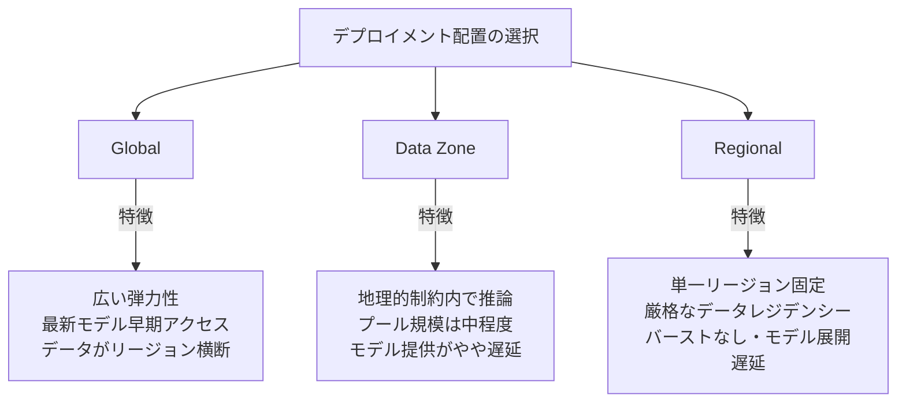
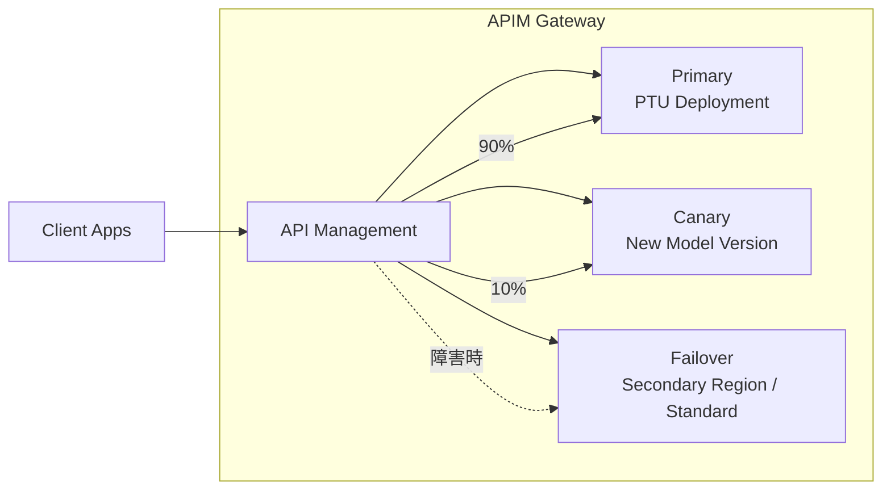

## ブログ概要（Summary）

本記事は [https://techcommunity.microsoft.com/blog/microsoftmissioncriticalblog/azure-openai-architecture-the-decisions-that-actually-matter-part-1/4525976](https://techcommunity.microsoft.com/blog/microsoftmissioncriticalblog/azure-openai-architecture-the-decisions-that-actually-matter-part-1/4525976) の解説記事です。

Microsoft Tech Communityの「Azure OpenAI Architecture: The Decisions That Actually Matter (Part 1)」は、Azure OpenAIを本番環境で運用する際に避けて通れない5つのアーキテクチャ設計判断を体系的に解説したブログ記事である。著者のluciacasucci氏（Microsoft社員）は、キャパシティモデルの選定、デプロイメント配置、ガバナンスゲートウェイの導入、RAG（Retrieval-Augmented Generation）の採否、そしてクォータエンジニアリングという5つの意思決定を、実際のプロジェクト事例と判断マトリクスとともに提示している。

この記事は [Zenn記事: Azure OpenAI負荷分散の負荷テスト戦略：Locust×Azure Load Testingで本番品質を検証する](https://zenn.dev/0h_n0/articles/25e17663c0f245) の深掘りです。Zenn記事がLocust×Azure Load Testingによる負荷テスト手法に焦点を当てているのに対し、本ブログはテスト対象となるアーキテクチャそのものの設計判断を扱っており、両者は相互補完の関係にある。

## 情報源

- **種別**: 企業テックブログ（Microsoft Tech Community / Mission Critical Blog）
- **URL**: [https://techcommunity.microsoft.com/blog/microsoftmissioncriticalblog/azure-openai-architecture-the-decisions-that-actually-matter-part-1/4525976](https://techcommunity.microsoft.com/blog/microsoftmissioncriticalblog/azure-openai-architecture-the-decisions-that-actually-matter-part-1/4525976)
- **組織**: Microsoft（Mission Critical Blog）
- **著者**: luciacasucci
- **発表日**: 2026年6月8日（更新: 2026年6月5日）

## 技術的背景（Technical Background）

Azure OpenAI Serviceは、OpenAIのモデル（GPT-4o、GPT-4、GPT-3.5等）をAzure上でホスティングされたAPIとして利用できるマネージドサービスである。エンタープライズでの採用が進む中、単にAPIを呼び出すだけの段階から、本番運用の品質・コスト・可用性を制御する段階へと課題がシフトしている。

ブログでは、多くのチームが「とりあえず動く」構成から始めてしまい、トラフィック増加やコスト増大に直面してから設計を見直す事態に陥っていると述べられている。本ブログが提示する5つの設計判断は、このような後追い対応を防ぐためのフレームワークとして位置づけられている。

Zenn記事で扱われている負荷テスト戦略（TTFT/TBT計測、PTU Utilization V2監視、サーキットブレーカーテスト等）は、本ブログで解説されるアーキテクチャ選択の結果として決まる構成に対して実施されるものである。たとえば、PTUとPay-as-you-goのどちらを選択するかによって、負荷テストの設計（429エラーの発生パターン、スピルオーバー検証の要否）は根本的に変わる。

## 実装アーキテクチャ（Architecture）

### 意思決定1: キャパシティモデルの選定

ブログでは、Azure OpenAIの4つのキャパシティ階層を以下のように整理している。

| 階層 | 課金モデル | レイテンシSLA | ユースケース |
|------|-----------|-------------|-------------|
| **Standard（PAYGO）** | トークン従量課金 | なし（共有リソース） | 低〜中トラフィック、予測困難な負荷 |
| **Priority Processing** | トークン従量課金（高単価） | SLA保証あり | リアルタイム応答が必要だがPTUコミットは避けたい場合 |
| **Batch** | トークン従量課金（約50%引） | 最大24時間以内 | 非同期処理、大量データ前処理 |
| **PTU（Provisioned Throughput Unit）** | 時間課金（使用有無に関わらず） | 安定レイテンシ保証 | 高トラフィック、SLA必須の本番環境 |

ブログでは、Priority ProcessingがGlobal StandardおよびData Zone Standard（US）デプロイメントで利用可能であり、モデルバージョン2025-12-01以降が必要と述べられている。APIレベルでは`service_tier`属性（`auto` / `default` / `priority`）をリクエスト単位で指定でき、PTUの上に弾力的なレーンとして重ねることも可能とされている。

**キャパシティ選択の判断基準**として、ブログでは以下のルールを提示している：
- ユーザーがレスポンスを待つ場合 → リアルタイム階層（Standard / Priority / PTU）
- 厳密なレイテンシSLAかつ高負荷・予測可能 → PTU
- SLA必要だがPTUコミット不要 → Priority Processing
- 非同期処理可能 → Batch（約50%コスト削減）

**実例**: ブログでは、ニュース分析ボットがオンデマンド処理からBatchへの移行により、エンドユーザーレイテンシを80%削減し、コストを半減させた事例が紹介されている。

### 意思決定2: デプロイメント配置



ブログでは、あるRegionalデプロイメントを選択した企業が、使用モデルが当該リージョンで数ヶ月間利用不可となり、Data Zoneへの移行を余儀なくされた事例が紹介されている。配置の選択は、モデルの可用性とデータレジデンシー要件のトレードオフとして位置づけられている。

### 意思決定3: ガバナンスゲートウェイ（APIM）

ブログでは、Azure API Management（APIM）をAzure OpenAIの前段に配置するガバナンスゲートウェイの導入を推奨している。複数のアプリケーションやチームがサービスを利用し始めた段階で導入を検討すべきとされている。

**ゲートウェイが提供する機能**:
1. **認証統合**: Entra ID認証（APIキーの分散管理を回避）
2. **アプリ単位のRBAC**: アプリケーションごとのアクセス制御
3. **トークン/リクエストクォータ**: アプリ単位のレート制限（Azureの制限に到達する前にゲートウェイ側で制御）
4. **インテリジェントルーティング**: プライマリ → カナリア（新モデルバージョン） → フェイルオーバー（セカンダリリージョンまたはStandard階層）
5. **中央集約ログ**: コスト帰属とトラフィック分析



**実例**: ブログでは、Eコマース企業がAPIMゲートウェイ導入後、追跡されていなかった直接API呼び出しによるコストスパイクを発見し、トークン消費量トップの呼び出し元を特定できた事例が紹介されている。

### 意思決定4: RAGの採否判断

ブログでは、RAG（Retrieval-Augmented Generation）が200〜500msのレイテンシ増加をもたらし、パイプライン全体のコストが基本モデルの3〜5倍になるとの業界推計が引用されている。そのため、以下の条件を満たす場合にのみRAGを採用すべきとされている：
- プロプライエタリなデータが必要
- 動的に更新されるデータが必要
- 回答に引用元の提示が必要

**実例**: コンサルティング企業のRAG Q&Aボットが検索オーバーヘッドにより約5秒のレイテンシに達した事例が紹介されている。

### 意思決定5: クォータエンジニアリング

ブログでは、Azure OpenAIの制限として以下の4種類が挙げられている：
- **TPM（Tokens Per Minute）**: 1分あたりの処理トークン数
- **RPM（Requests Per Minute）**: 1分あたりのリクエスト数
- **同時リクエスト数**: 並行処理可能なリクエスト数
- **モデル固有の制限**: モデルごとの追加制約

これらの制限を超過した場合、HTTP 429（クォータ超過）またはHTTP 503（サービスストレス時）が返される。

**キャパシティプランニングの推奨事項**として、ブログでは以下が述べられている：

1. **ピークで設計する**（平均ではない）: あるチームが通常負荷でサイジングした結果、約3倍のスパイク時に過負荷となった事例が紹介されている
2. **ピーク計算式**: ピークTPM = リクエストあたり最大トークン数（プロンプト+コンプリーション） × ピークRPM + ヘッドルーム
3. **使用率の目安**: 通常使用をTPM/RPM制限の約70%以下に維持し、P95が約85%を常時超過する場合はスケールアップまたは最適化を検討
4. **リトライ戦略**: 指数バックオフ＋ジッタ（リトライストーム防止）
5. **ユーザー分離**: 1つのデプロイメントのクォータがボトルネックの場合、ユーザーを複数デプロイメントに分割

**実例**: ブログでは、トレーディングチャットボットが市場急変時にリトライ遅延なしで再送を繰り返し、自己誘発的な障害を引き起こした事例が紹介されている。これはZenn記事で解説されているサーキットブレーカーとリトライポリシーの2層構造が有効な典型的シナリオである。

## Production Deployment Guide

### AWS実装パターン（コスト最適化重視）

ブログで解説されているAzure OpenAIの設計判断を、AWS上のLLMサービング構成に読み替えた場合の推奨構成を以下に示す。

**トラフィック量別の推奨構成**:

| 規模 | 月間リクエスト | 推奨構成 | 月額コスト | 主要サービス |
|------|--------------|---------|-----------|------------|
| **Small** | ~3,000 (100/日) | Serverless | $50-150 | Lambda + Bedrock + DynamoDB |
| **Medium** | ~30,000 (1,000/日) | Hybrid | $300-800 | Lambda + ECS Fargate + ElastiCache |
| **Large** | 300,000+ (10,000/日) | Container | $2,000-5,000 | EKS + Karpenter + EC2 Spot |

**Small構成の詳細** (月額$50-150):
- **Lambda**: 1GB RAM, 60秒タイムアウト ($20/月)
- **Bedrock**: Claude 3.5 Haiku, Prompt Caching有効 ($80/月)
- **DynamoDB**: On-Demand ($10/月)
- **CloudWatch**: 基本監視 ($5/月)
- **API Gateway**: REST API + 使用量プラン ($5/月)

**Medium構成の詳細** (月額$300-800):
- **Lambda**: イベント処理 ($50/月)
- **ECS Fargate**: 0.5 vCPU, 1GB RAM × 2タスク ($120/月)
- **Bedrock**: Claude 3.5 Sonnet, Batch API活用 ($400/月)
- **ElastiCache Redis**: cache.t3.micro ($15/月)
- **Application Load Balancer**: ($20/月)

**Large構成の詳細** (月額$2,000-5,000):
- **EKS**: コントロールプレーン ($72/月)
- **EC2 Spot Instances**: g5.xlarge × 2-4台 (平均$800/月)
- **Karpenter**: 自動スケーリング（追加コストなし）
- **Bedrock Batch**: 50%割引活用 ($2,000/月)
- **S3**: プロンプトキャッシュストレージ ($20/月)
- **CloudWatch + X-Ray**: 詳細監視 ($100/月)

**コスト削減テクニック**:
- Spot Instances使用で最大90%削減（EKS + Karpenter）
- Reserved Instances購入で最大72%削減（1年コミット）
- Bedrock Batch API使用で50%削減
- Prompt Caching有効化で30-90%削減
- アイドルタイムのAuto Scaling to Zero（Fargate/Lambda）

**コスト試算の注意事項**:
- 上記は2026年11月時点のAWS ap-northeast-1（東京）リージョン料金に基づく概算値です
- 実際のコストはトラフィックパターン、リージョン、バースト使用量により変動します
- 最新料金は [AWS料金計算ツール](https://calculator.aws/) で確認してください
- 開発環境とステージング環境のコストは別途考慮が必要です

### Terraformインフラコード

**Small構成 (Serverless): Lambda + Bedrock + DynamoDB**

```hcl
# --- VPC基盤 ---
module "vpc" {
  source  = "terraform-aws-modules/vpc/aws"
  version = "~> 5.0"

  name = "llm-vpc"
  cidr = "10.0.0.0/16"
  azs  = ["ap-northeast-1a", "ap-northeast-1c"]
  private_subnets = ["10.0.1.0/24", "10.0.2.0/24"]

  enable_nat_gateway   = false
  enable_dns_hostnames = true
}

# --- IAMロール（最小権限） ---
resource "aws_iam_role" "lambda_bedrock" {
  name = "lambda-bedrock-role"

  assume_role_policy = jsonencode({
    Version = "2012-10-17"
    Statement = [{
      Action = "sts:AssumeRole"
      Effect = "Allow"
      Principal = { Service = "lambda.amazonaws.com" }
    }]
  })
}

resource "aws_iam_role_policy" "bedrock_invoke" {
  role = aws_iam_role.lambda_bedrock.id
  policy = jsonencode({
    Version = "2012-10-17"
    Statement = [{
      Effect   = "Allow"
      Action   = ["bedrock:InvokeModel", "bedrock:InvokeModelWithResponseStream"]
      Resource = "arn:aws:bedrock:ap-northeast-1::foundation-model/anthropic.claude-3-5-haiku*"
    }]
  })
}

# --- Lambda関数 ---
resource "aws_lambda_function" "llm_handler" {
  filename      = "lambda.zip"
  function_name = "llm-bedrock-handler"
  role          = aws_iam_role.lambda_bedrock.arn
  handler       = "index.handler"
  runtime       = "python3.12"
  timeout       = 60
  memory_size   = 1024

  environment {
    variables = {
      BEDROCK_MODEL_ID    = "anthropic.claude-3-5-haiku-20241022-v1:0"
      DYNAMODB_TABLE      = aws_dynamodb_table.cache.name
      ENABLE_PROMPT_CACHE = "true"
    }
  }
}

# --- DynamoDB (On-Demand) ---
resource "aws_dynamodb_table" "cache" {
  name         = "llm-prompt-cache"
  billing_mode = "PAY_PER_REQUEST"
  hash_key     = "prompt_hash"

  attribute {
    name = "prompt_hash"
    type = "S"
  }

  ttl {
    attribute_name = "expire_at"
    enabled        = true
  }
}

# --- CloudWatch アラーム（コスト監視） ---
resource "aws_cloudwatch_metric_alarm" "lambda_cost" {
  alarm_name          = "lambda-cost-spike"
  comparison_operator = "GreaterThanThreshold"
  evaluation_periods  = 1
  metric_name         = "Duration"
  namespace           = "AWS/Lambda"
  period              = 3600
  statistic           = "Sum"
  threshold           = 100000
  alarm_description   = "Lambda実行時間異常（コスト急増の可能性）"

  dimensions = {
    FunctionName = aws_lambda_function.llm_handler.function_name
  }
}
```

**Large構成 (Container): EKS + Karpenter + Spot Instances**

```hcl
# --- EKSクラスタ ---
module "eks" {
  source  = "terraform-aws-modules/eks/aws"
  version = "~> 20.0"

  cluster_name    = "llm-inference-cluster"
  cluster_version = "1.31"

  vpc_id     = module.vpc.vpc_id
  subnet_ids = module.vpc.private_subnets

  cluster_endpoint_public_access = true
  enable_cluster_creator_admin_permissions = true
}

# --- Karpenter (自動スケーリング) ---
resource "kubectl_manifest" "karpenter_nodepool" {
  yaml_body = <<-YAML
    apiVersion: karpenter.sh/v1
    kind: NodePool
    metadata:
      name: spot-gpu
    spec:
      template:
        spec:
          requirements:
            - key: karpenter.sh/capacity-type
              operator: In
              values: ["spot"]
            - key: node.kubernetes.io/instance-type
              operator: In
              values: ["g5.xlarge", "g5.2xlarge"]
          expireAfter: 720h
      limits:
        cpu: "32"
        memory: "128Gi"
      disruption:
        consolidationPolicy: WhenEmptyOrUnderutilized
        consolidateAfter: 30s
  YAML
}

# --- Secrets Manager ---
resource "aws_secretsmanager_secret" "bedrock_config" {
  name = "llm-bedrock-config"
}

resource "aws_secretsmanager_secret_version" "bedrock_config" {
  secret_id = aws_secretsmanager_secret.bedrock_config.id
  secret_string = jsonencode({
    model_id = "anthropic.claude-3-5-sonnet-20241022-v2:0"
    region   = "ap-northeast-1"
  })
}

# --- Cost Explorer予算アラート ---
resource "aws_budgets_budget" "llm_monthly" {
  name         = "llm-monthly-budget"
  budget_type  = "COST"
  limit_amount = "5000"
  limit_unit   = "USD"
  time_unit    = "MONTHLY"

  notification {
    comparison_operator        = "GREATER_THAN"
    threshold                  = 80
    threshold_type             = "PERCENTAGE"
    notification_type          = "ACTUAL"
    subscriber_email_addresses = ["ops-team@example.com"]
  }
}
```

### セキュリティベストプラクティス

**本番環境での推奨設定**:

1. **ネットワークセキュリティ**: EKSは`cluster_endpoint_public_access = false`に設定しVPN経由アクセス、Lambda はVPC内配置、セキュリティグループは443のみ開放
2. **認証・認可**: IAMロール最小権限、MFA必須、IRSA（IAM Roles for Service Accounts）
3. **シークレット管理**: AWS Secrets Manager使用、90日ごとローテーション、Terraform StateはS3 + KMS暗号化
4. **監査**: CloudTrail全リージョン有効化、Config有効化、GuardDuty有効化
5. **データ保護**: TLS 1.2以上、S3/DynamoDB/EBS全てKMS暗号化

### 運用・監視設定

**CloudWatch Logs Insights クエリ**:

```sql
-- コスト異常検知: 1時間あたりのトークン使用量
fields @timestamp, model_id, input_tokens, output_tokens
| stats sum(input_tokens + output_tokens) as total_tokens by bin(1h)
| filter total_tokens > 100000

-- レイテンシ分析: P95, P99
fields @timestamp, duration_ms
| stats pct(duration_ms, 95) as p95, pct(duration_ms, 99) as p99 by bin(5m)
```

**CloudWatch アラーム（コスト重視）**:

```python
import boto3

cloudwatch = boto3.client('cloudwatch')

cloudwatch.put_metric_alarm(
    AlarmName='bedrock-token-spike',
    ComparisonOperator='GreaterThanThreshold',
    EvaluationPeriods=1,
    MetricName='TokenUsage',
    Namespace='AWS/Bedrock',
    Period=3600,
    Statistic='Sum',
    Threshold=500000,
    ActionsEnabled=True,
    AlarmActions=['arn:aws:sns:ap-northeast-1:123456789:cost-alerts'],
    AlarmDescription='Bedrockトークン使用量異常'
)

cloudwatch.put_metric_alarm(
    AlarmName='lambda-duration-spike',
    ComparisonOperator='GreaterThanThreshold',
    EvaluationPeriods=2,
    MetricName='Duration',
    Namespace='AWS/Lambda',
    Period=300,
    Statistic='Average',
    Threshold=30000,
    AlarmDescription='Lambda実行時間異常'
)
```

**X-Ray トレーシング設定**:

```python
from aws_xray_sdk.core import xray_recorder, patch_all

patch_all()

@xray_recorder.capture('bedrock_inference')
def call_bedrock(prompt: str) -> dict:
    xray_recorder.put_annotation('model', 'claude-3-5-haiku')
    xray_recorder.put_metadata('prompt_length', len(prompt))
    response = bedrock.invoke_model(
        modelId='anthropic.claude-3-5-haiku-20241022-v1:0',
        body=json.dumps({'prompt': prompt})
    )
    xray_recorder.put_metadata('token_count', response['usage']['total_tokens'])
    return response
```

**Cost Explorer自動レポート**:

```python
import boto3
from datetime import datetime, timedelta

ce = boto3.client('ce')

response = ce.get_cost_and_usage(
    TimePeriod={
        'Start': (datetime.now() - timedelta(days=1)).strftime('%Y-%m-%d'),
        'End': datetime.now().strftime('%Y-%m-%d')
    },
    Granularity='DAILY',
    Metrics=['UnblendedCost'],
    GroupBy=[
        {'Type': 'SERVICE', 'Key': 'SERVICE'},
        {'Type': 'USAGE_TYPE', 'Key': 'USAGE_TYPE'}
    ]
)

for result in response['ResultsByTime']:
    for group in result['Groups']:
        service = group['Keys'][0]
        cost = float(group['Metrics']['UnblendedCost']['Amount'])
        if cost > 100:
            pass  # SNS通知を送信
```

### コスト最適化チェックリスト

**アーキテクチャ選択（トラフィック量で判断）**:
- [ ] ~100 req/日 → Lambda + Bedrock (Serverless) - $50-150/月
- [ ] ~1,000 req/日 → ECS Fargate + Bedrock (Hybrid) - $300-800/月
- [ ] 10,000+ req/日 → EKS + Spot Instances (Container) - $2,000-5,000/月

**リソース最適化**:
- [ ] EC2: Spot Instances優先（Karpenter自動管理）
- [ ] Reserved Instances: 1年コミットで最大72%削減（予測可能な負荷）
- [ ] Savings Plans: Compute Savings Plans検討
- [ ] Lambda: メモリサイズ最適化（CloudWatch Insights分析）
- [ ] ECS/EKS: アイドルタイムのスケールダウン（夜間0台）

**LLMコスト削減**:
- [ ] Bedrock Batch API: 50%割引（非リアルタイム処理）
- [ ] Prompt Caching: 30-90%削減（システムプロンプト固定部分）
- [ ] モデル選択ロジック: 開発はHaiku ($0.25/MTok)、本番複雑タスクはSonnet ($3/MTok)
- [ ] トークン数制限: `max_tokens`設定で過剰生成防止

**監視・アラート（コスト異常の即時検知）**:
- [ ] AWS Budgets: 月額予算設定（80%で警告、100%でアラート）
- [ ] CloudWatch アラーム: トークン使用量スパイク検知
- [ ] Cost Anomaly Detection: 自動異常検知
- [ ] 日次コストレポート: SNS/Slackへ自動送信

**リソース管理**:
- [ ] 未使用リソース削除: Lambda Insights, Trusted Advisor活用
- [ ] タグ戦略: 環境別（dev/staging/prod）、プロジェクト別でコスト可視化
- [ ] ライフサイクルポリシー: S3古いキャッシュ自動削除（30日）
- [ ] RDS/ElastiCache: 開発環境は夜間停止

## パフォーマンス最適化（Performance）

ブログでは直接的なベンチマーク数値は提示されていないが、パフォーマンスに関する以下の知見が述べられている。

**キャパシティ階層ごとのレイテンシ特性**:
- **Standard**: 共有リソースのため、他テナントの負荷状況に依存する。SLAなし
- **Priority Processing**: SLA保証付きの低レイテンシ。Standard同等のクォータプールを使用
- **PTU**: 予約済みキャパシティにより安定したレイテンシを実現。出力トークンがプロンプトトークンより重く使用率に影響

**RAGのレイテンシ影響**: ブログでは、RAGパイプラインが200〜500msのレイテンシを追加すると述べられている。コンサルティング企業の事例では、検索オーバーヘッドにより約5秒のレイテンシに達している。

**最適化アプローチ**として、ブログでは以下が推奨されている：
- 非同期処理可能な部分はBatch階層に移行（コスト50%削減＋ユーザー体感レイテンシ改善）
- RAGプロンプトの動的コンテンツは末尾に配置（KVキャッシュヒット率向上）
- 出力トークン数の制限（レイテンシに直結）
- 可能な限り小型モデルを選択

## 運用での学び（Production Lessons）

ブログでは、実際のプロジェクトから得られた以下の教訓が紹介されている。

### 障害事例: リトライストームによる自己誘発障害

トレーディングチャットボットが市場急変時にリトライ遅延なしで再送を繰り返した結果、Azure OpenAIの制限をさらに悪化させ、自己誘発的な障害を引き起こした。ブログでは、指数バックオフ＋ジッタの実装が必須であると述べられている。

この事例は、Zenn記事で解説されているサーキットブレーカーとリトライポリシーの2層構造の重要性を裏付けるものである。APIMのサーキットブレーカーがバックエンド切替を担当し、リトライポリシーが個別リクエストの再送を制御する2段階設計により、このような連鎖障害を防止できる。

### コスト可視性: ゲートウェイ導入前後

Eコマース企業では、APIMゲートウェイ導入前は各チームがAzure OpenAIを直接呼び出しており、コストの帰属先が不明確だった。ゲートウェイ導入後、トークン消費量トップの呼び出し元が可視化され、不要な呼び出しの削減につながった。

### キャパシティプランニングの落とし穴

あるチームが通常負荷でサイジングした結果、約3倍のスパイク時にシステムが過負荷となった。ブログでは、ピークTPM/RPMで設計し、通常使用を制限の70%以下に維持することが推奨されている。これはZenn記事で解説されている負荷テスト戦略の「推定本番の110%」でテストする指針と整合する。

## 学術研究との関連（Academic Connection）

ブログで解説されている設計判断は、以下の学術的テーマと密接に関連している。

- **キャパシティプランニング**: LLM推論サービスのキャパシティ予測は、LLM-Pilot（Łazuka et al., SC'24, arXiv:2410.02425）が生産環境のトレースに基づく予測モデルを提案している。ブログの「ピークで設計する」原則は、この研究のワークロードジェネレータが重視する実際の負荷分布を反映したテストと同じ方向性にある
- **負荷分散ルーティング**: ブログのゲートウェイルーティング（Primary → Canary → Failover）は、Intelligent Router for LLM Workloads（Jain et al., arXiv:2408.13510）が提案するワークロード特性に基づくルーティング最適化と共通の問題意識を持つ。同論文では、プリフィル・デコードの負荷バランスを考慮したルーティングにより11%のレイテンシ改善が報告されている
- **Prefill/Decodeの分離**: ブログが前提とするPTUのキャパシティモデルは、DistServe（Zhong et al., OSDI'24, arXiv:2401.09670）が提案するプリフィルとデコードの分離サービング技術の商用実装と見ることができる

## まとめと実践への示唆

ブログで提示された5つの設計判断は、Azure OpenAIの本番運用において初期段階で検討すべきフレームワークとして位置づけられる。特にキャパシティモデルの選定（PTU/PAYGO/Priority Processing/Batch）とガバナンスゲートウェイ（APIM）の導入判断は、後続のすべての運用設計（負荷テスト戦略、障害シナリオ設計、コスト管理）の基盤となる。

Zenn記事で扱われている負荷テスト戦略を実施する前提として、本ブログの設計判断を先に確定させることで、テスト対象の構成が明確になり、テストシナリオの設計精度が向上する。ブログで紹介されたリトライストーム事例やキャパシティプランニングの落とし穴は、負荷テストで事前に検出すべき重要なシナリオである。

## 参考文献

- **Blog URL**: [Azure OpenAI Architecture: The Decisions That Actually Matter (Part 1)](https://techcommunity.microsoft.com/blog/microsoftmissioncriticalblog/azure-openai-architecture-the-decisions-that-actually-matter-part-1/4525976)
- **Part 2**: [Azure OpenAI Architecture: The Decisions That Actually Matter (Part 2)](https://techcommunity.microsoft.com/blog/microsoftmissioncriticalblog/azure-openai-architecture-the-decisions-that-actually-matter-part-2/4525983)
- **Azure OpenAI PTU Guide**: [Operate provisioned throughput deployments](https://learn.microsoft.com/en-us/azure/foundry/openai/how-to/provisioned-get-started)
- **Azure APIM AI Gateway**: [AI Gateway Capabilities in Azure API Management](https://learn.microsoft.com/en-us/azure/api-management/genai-gateway-capabilities)
- **Related Zenn article**: [Azure OpenAI負荷分散の負荷テスト戦略](https://zenn.dev/0h_n0/articles/25e17663c0f245)

---

:::message
この記事はAI（Claude Code）により自動生成されました。内容の正確性については情報源の原文もご確認ください。
:::
