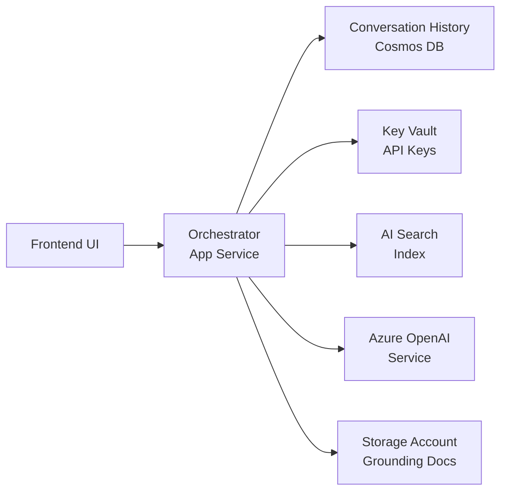

## ブログ概要（Summary）

本記事は [https://techcommunity.microsoft.com/blog/azure-ai-foundry-blog/load-testing-rag-based-generative-ai-applications/4086993](https://techcommunity.microsoft.com/blog/azure-ai-foundry-blog/load-testing-rag-based-generative-ai-applications/4086993) の解説記事です。

MicrosoftのKranthi Manchikantiが2024年5月にMicrosoft Tech Communityで公開したこのブログ記事では、RAG（Retrieval-Augmented Generation）パターンを用いた生成AIアプリケーションに対する負荷テスト戦略が体系的に解説されている。Azure Load TestingサービスとAzure OpenAIベンチマークツールを組み合わせ、アプリケーション全体のエンドツーエンドテストとモデル単体のスループットテストを両立させるアプローチが提示されている。

この記事は [Zenn記事: Azure OpenAI負荷分散の負荷テスト戦略：Locust×Azure Load Testingで本番品質を検証する](https://zenn.dev/0h_n0/articles/25e17663c0f245) の深掘りです。

## 情報源

- **種別**: 企業テックブログ（Microsoft Tech Community / Azure AI Foundry Blog）
- **URL**: [https://techcommunity.microsoft.com/blog/azure-ai-foundry-blog/load-testing-rag-based-generative-ai-applications/4086993](https://techcommunity.microsoft.com/blog/azure-ai-foundry-blog/load-testing-rag-based-generative-ai-applications/4086993)
- **組織**: Microsoft（Azure AI Foundry チーム）
- **著者**: Kranthi Manchikanti
- **発表日**: 2024年5月27日

## 技術的背景（Technical Background）

RAGアーキテクチャを用いたアプリケーションでは、ユーザーの質問に対してまずAI Searchからドキュメントを検索し、その検索結果をコンテキストとしてAzure OpenAIに送信して回答を生成する。この処理パイプラインでは、従来のWeb APIとは異なる特性を持つ複数のサービスが直列に接続されるため、負荷テストの設計に固有の課題がある。

ブログでは、RAGアプリケーションの負荷テストが特に重要な理由として以下を挙げている。

1. **LLMの応答時間が長い**: 従来のAPIが数十msで応答するのに対し、LLMは数百ms〜数秒を要するため、並行リクエスト数の影響が大きい
2. **トークン単位の課金**: リクエスト数だけでなくトークン消費量がコストに直結する
3. **RAGパイプラインの複雑さ**: 検索→コンテキスト構築→LLM生成の各段階でボトルネックが発生しうる
4. **キャッシュの影響**: 同一クエリの繰り返しでは現実の負荷特性を再現できない

これらの特性は、Azure OpenAI Serviceの負荷分散設計において、TPM（Tokens Per Minute）やRPM（Requests Per Minute）のクォータ管理と密接に関係している。

## 実装アーキテクチャ（Architecture）

### Enterprise RAG Solution Accelerator のシステム構成

ブログでは、Microsoft公式のEnterprise RAG Solution Accelerator（通称gpt-rag）のアーキテクチャを参照している。このシステムは以下のコンポーネントで構成される。



### テスト対象の2つのレイヤー

ブログでは、負荷テストを2つのレイヤーに分けて実施することが推奨されている。

| レイヤー | テスト対象 | ツール | 測定対象 |
|---------|----------|-------|---------|
| **アプリケーション全体** | エンドツーエンドのユーザー体験 | Azure Load Testing（JMeterベース） | 応答時間、エラー率、スループット |
| **モデル単体** | Azure OpenAIデプロイメントの性能 | Azure OpenAIベンチマークツール | TTFT、TBT、トークン処理速度、PTU使用率 |

ブログによれば、開発の早期段階ではモデル単体のベンチマークから始め、アプリケーション統合後にエンドツーエンドテストを追加する段階的アプローチが効果的であるとされている。

## 負荷推定とテスト計画（Load Estimation & Test Planning）

### RPM推定式

ブログでは、期待されるリクエスト数の推定に以下の数式が提示されている。

$$
\text{RPM} = \frac{u \times p \times s \times i}{n \times 60}
$$

ここで、
- $u$: 総ユーザー数
- $p$: ピーク時にアクティブなユーザーの割合
- $s$: ユーザーあたりのセッション数
- $i$: セッションあたりのインタラクション数
- $n$: ピーク持続時間（時間単位）

**具体例**（ブログより）: 総ユーザー10,000人、ピーク時アクティブ率10%、セッション数1、インタラクション数2、ピーク持続1時間の場合：

$$
\text{RPM} = \frac{10{,}000 \times 0.1 \times 1 \times 2}{1 \times 60} \approx 33 \text{ RPM}
$$

ブログでは、推定値の約110%でテストすることが推奨されている。これは予期しないバーストに対するマージンを確保するためである。

### テスト段階の設計

ブログでは、負荷テストを以下の4段階で実施するアプローチが推奨されている。

| 段階 | 目的 | 仮想ユーザー数 | 期間 |
|------|-----|-------------|------|
| **1. ローカル検証** | スクリプト動作確認 | 2-5 | 数分 |
| **2. スモークテスト** | 接続・認証の検証 | 10-20 | 5-10分 |
| **3. 負荷テスト** | SLO達成可否の判定 | 推定ピークの110% | 10分以上 |
| **4. ストレステスト** | 限界点の把握 | 推定ピークの200%以上 | 10分以上 |

### テストデータの設計

ブログでは、同一クエリの繰り返しを避けることが強調されている。その理由は以下のとおりである。

- **キャッシュ効果の除外**: 同一プロンプトではAzure OpenAIのKVキャッシュがヒットし、実際のレイテンシより低い値が計測される
- **統計的信頼性**: 多様なクエリにより、平均値やパーセンタイルが意味を持つ
- **ドメインの網羅**: 異なるジャンルのクエリにより、検索品質のばらつきも含めてテストできる

ブログでは、ドメインエキスパートやLLMを使って合成データセットを生成する方法が提案されている。

## Azure Load Testingによるエンドツーエンドテスト（Application-Level Testing）

### Azure Load Testingの主要概念

Azure Load Testingは、Apache JMeterスクリプトを実行するマネージドサービスである。ブログでは、以下の主要概念が説明されている。

- **スレッド数**: エンジンあたり最大250仮想ユーザー
- **仮想ユーザー数**: スレッド数 × エンジンインスタンス数
- **ランプアップ**: 最大仮想ユーザー数に到達するまでの時間
- **環境変数・シークレット**: Key Vault統合によるAPIキーの安全な管理
- **サーバーサイドメトリクス**: Azure Monitorとの統合で、テスト対象リソースのメトリクスも同時監視

### ベストプラクティス

ブログでは、Azure Load Testingの実行に際して以下のベストプラクティスが挙げられている。

1. **ウォームアップ期間**: 測定前に20〜60秒のウォームアップを設ける
2. **シンクタイム**: リクエスト間にユーザーの思考時間を挿入して、現実のトラフィックパターンを模倣する
3. **複数リージョン**: ユーザーの地理的分布を反映したマルチリージョンテスト
4. **CI/CDパイプライン統合**: Azure DevOpsやGitHub Actionsからの自動実行が可能

```bash
# Azure CLI によるテスト実行（ブログより）
az loadtest create \
  --name "rag-load-test" \
  --resource-group "rg-loadtest" \
  --location "eastus"

az loadtest run \
  --test-id "rag-stress-test" \
  --test-file "jmeter-script.jmx" \
  --configuration-file "config.yaml"
```

## Azure OpenAIベンチマークツールによるモデルテスト（Model-Level Benchmarking）

### ツール概要

ブログでは、コミュニティリポジトリ [azure-openai-benchmark](https://github.com/michaeltremeer/azure-openai-benchmark) が紹介されている。このツールはAzure OpenAIデプロイメントに対する負荷生成とメトリクス収集を自動化する。

### 主要コンポーネント

| コンポーネント | 用途 | 推奨場面 |
|-------------|------|---------|
| `benchmark.bench` | 基本的な負荷テスト | 単一ワークロードプロファイルのテスト |
| `benchmark.contrib.batch_runner` | 複数ワークロードのバッチ実行 | PTUベンチマーク、複合負荷テスト |
| `benchmark.contrib.combine_logs` | ログの統合 | 複数回実行の結果マージ |

### 主要パラメータ

| パラメータ | 説明 | 推奨値 |
|----------|------|-------|
| `rate` | リクエスト/秒 | テスト対象のTPMから逆算 |
| `clients` | 同時接続数 | 段階的に増加 |
| `context-generation-method` | コンテキスト生成方法（generate/replay） | generate（キャッシュ回避） |
| `shape-profile` | 負荷プロファイル（balanced/context/generation/custom） | balanced（標準テスト） |
| `context-tokens` | 入力トークン数 | ワークロードに合わせて設定 |
| `max-tokens` | 最大出力トークン数 | ワークロードに合わせて設定 |
| `aggregation-window` | 集計ウィンドウ（秒） | 60秒以上（ブログ推奨） |

### 実行例

ブログでは、以下の2つのシナリオが具体的に示されている。

**シナリオ1: 単一ワークロード**

```bash
python -m benchmark.bench load \
  --deployment gpt-4 \
  --rate 60 \
  --retry none \
  --log-save-dir logs/ \
  https://<endpoint>.openai.azure.com
```

ブログの出力例によれば、開始直後は約1 RPMから始まり、3秒後に8 RPM、平均TTFT 0.913秒、P95 TTFT 1.304秒、PTU使用率1.3%に到達したと報告されている。

**シナリオ2: batch_runnerによる複合テスト**

```bash
python -m benchmark.contrib.batch_runner \
  --workloads "500ctx_100gen:rate=20,context=500,max_tokens=100" \
              "3500ctx_300gen:rate=7.5,context=3500,max_tokens=300" \
  --duration 130 \
  --aggregation-window 120 \
  --batch-repeat 5 \
  --log-save-dir logs/ \
  https://<endpoint>.openai.azure.com
```

ブログでは、`batch_runner`がPTUエンドポイントを自動検出してウォームアップを実施し、フル使用率に到達してからベンチマークを開始するとされている。

### メトリクス定義

ブログで報告されるメトリクスは以下のとおりである。

| メトリクス | 定義 | 統計量 |
|----------|------|-------|
| **TTFT** | リクエスト送信から最初のトークン受信まで | 平均、P95 |
| **TBT** | トークン間の生成間隔 | 平均、P95 |
| **E2E** | リクエスト送信から最後のトークン受信まで | 平均、P95 |
| **context_tpr** | リクエストあたりのコンテキストトークン数 | 平均、P95 |
| **gen_tpr** | リクエストあたりの生成トークン数 | 平均、P95 |
| **util** | PTU使用率（PTUデプロイメントのみ） | 平均、P95 |

### PTUテストの留意事項

ブログでは、PTUデプロイメントのベンチマークに際して以下が特に強調されている。

1. **ウォームアップの重要性**: PTUはバースト容量を持っており、使用率が100%に達するまでは余剰性能を提供する。ウォームアップなしではこのバースト容量を測定してしまい、定常状態の性能を過大評価する
2. **十分な実行時間**: ブログでは180秒以上の実行を推奨している。スループットが安定するまでにこの程度の時間が必要とされている
3. **retry設定**: `retry=none`の使用が推奨されている。バックアップリソースが設定されていない状態で`exponential`リトライを使うと、非現実的なレイテンシが計測されるためである

## サーバーサイドメトリクスの監視（Server-Side Monitoring）

### Azure Monitor統合

ブログでは、Azure OpenAIリソースの診断設定を有効にし、Log Analyticsと連携させることが推奨されている。

```sql
-- KQLクエリ例: ChatCompletions操作の分析（ブログより）
AzureDiagnostics
| where OperationName == "ChatCompletions_Create"
| summarize
    avg_duration = avg(DurationMs),
    p95_duration = percentile(DurationMs, 95),
    total_requests = count(),
    error_count = countif(ResultType != "Success")
  by bin(TimeGenerated, 5m)
```

### 監視対象メトリクス一覧

| サービス | メトリクス | 意味 |
|---------|----------|------|
| **Azure OpenAI** | Total Requests | 総リクエスト数 |
| **Azure OpenAI** | Generated Completion Tokens | 生成トークン数 |
| **Azure OpenAI** | Processed Inference Tokens | 処理済み推論トークン数 |
| **Azure OpenAI** | Provisioned-Managed Utilization V2 | PTU使用率 |
| **App Service** | CPU / Memory % | Orchestratorリソース使用率 |
| **Cosmos DB** | Total Requests / Normalized RU | データベース負荷 |
| **API Management** | Total Requests / Capacity | ゲートウェイ負荷 |

## パフォーマンス最適化（Performance）

### アプリケーション設計の最適化

ブログでは、負荷テスト結果を踏まえた最適化手法として以下が挙げられている。

1. **非同期処理**: バッチ処理やキュー経由でLLMリクエストを処理し、ユーザーの待ち時間を短縮する
2. **セマンティックキャッシュ**: Redisを用いたセマンティックキャッシュ、またはAPIMポリシーによるキャッシュで重複リクエストを削減する
3. **指数バックオフ**: 429エラーに対して、`Retry-After`ヘッダーを尊重したジッタ付き指数バックオフを実装する
4. **バッチLLMリクエスト**: 複数の小さなリクエストをまとめて1つのバッチリクエストとして処理する

### プロンプト設計の最適化

ブログでは、プロンプト設計がレイテンシとコストに与える影響について以下のように述べられている。

- **出力トークン50%削減 → レイテンシ約50%削減**: 出力トークン数はレイテンシに線形に影響する（OpenAIの知見として引用）
- **入力トークン50%削減 → レイテンシ1〜5%削減**: 入力トークンの影響は相対的に小さい
- **動的コンテンツの配置**: RAGの検索結果はプロンプトの末尾に配置することで、KVキャッシュのヒット率を向上させる
- **モデル選択**: 要件を満たす範囲で小さいモデルを使用する

### アーキテクチャ選択

ブログでは、負荷テスト結果に基づくアーキテクチャ判断として以下が推奨されている。

- **安定したレイテンシが必要**: PTU（Provisioned Throughput）を採用する
- **エンドポイントの負荷分散**: Azure Samplesの `openai-aca-lb` パターンを参照する
- **リソースのスケーリング**: 各サービスのボトルネックに応じてスケールアウトまたはスケールアップする
- **地理的近接性**: ユーザーに近いリージョンにリソースを配置する

## 運用での学び（Production Lessons）

### よくある落とし穴

ブログでは、負荷テストに関する一般的な落とし穴として以下が暗示されている。

1. **平均負荷での設計**: 平均ではなくピーク負荷を見積もるべきである。ブログの推定式はピーク時のアクティブ率を明示的に使用している
2. **単一クエリのテスト**: キャッシュヒットにより非現実的に低いレイテンシが計測される
3. **ウォームアップの省略**: 特にPTUでは、バースト容量が定常性能を覆い隠す
4. **短時間のテスト**: 180秒未満ではスループットが安定しない

### モニタリング戦略

ブログでは、負荷テストと並行してAzure Monitorの以下の指標を監視することが推奨されている。

- **PTU使用率（Provisioned-Managed Utilization V2）**: 100%到達で429エラーが発生開始
- **正規化RU消費（Cosmos DB）**: 検索やヒストリ保存のボトルネック検出
- **CPU/メモリ使用率（App Service）**: Orchestratorのリソース逼迫検出
- **APIM容量**: ゲートウェイレイヤーの飽和検出

## 学術研究との関連（Academic Connection）

このブログの手法は、LLMサービングシステムの性能評価に関する学術研究と密接に関連している。

- **LLM-Pilot（Łazuka et al., SC'24）**: LLM推論サービスの性能特性化と最適化を行うフレームワーク。本ブログと同様にTTFTとITL（Inter-Token Latency）をメトリクスとして使用し、実運用トレースに基づくワークロード生成を提案している
- **DistServe（Zhong et al., OSDI'24）**: PrefillとDecodingの分離による性能最適化。本ブログが扱うTTFTとTPOTの独立した最適化を、システムアーキテクチャレベルで実現している

## Production Deployment Guide

### AWS実装パターン（コスト最適化重視）

ブログで紹介されているAzure Load Testing + Azure OpenAIベンチマークの構成をAWS上で再現する場合の推奨構成を以下に示す。

**トラフィック量別の推奨構成**:

| 規模 | 月間リクエスト | 推奨構成 | 月額コスト | 主要サービス |
|------|--------------|---------|-----------|------------|
| **Small** | ~3,000 (100/日) | Serverless | $50-150 | Lambda + Bedrock + DynamoDB |
| **Medium** | ~30,000 (1,000/日) | Hybrid | $300-800 | Lambda + ECS Fargate + ElastiCache |
| **Large** | 300,000+ (10,000/日) | Container | $2,000-5,000 | EKS + Karpenter + EC2 Spot |

**Small構成の詳細**（月額$50-150）:
- **Lambda**: 1GB RAM, 60秒タイムアウト ($20/月)
- **Bedrock**: Claude 3.5 Haiku, Prompt Caching有効 ($80/月)
- **DynamoDB**: On-Demand ($10/月)
- **CloudWatch**: 基本監視 ($5/月)
- **API Gateway**: REST API ($5/月)

**Medium構成の詳細**（月額$300-800）:
- **Lambda**: イベント処理 ($50/月)
- **ECS Fargate**: 0.5 vCPU, 1GB RAM × 2タスク ($120/月)
- **Bedrock**: Claude 3.5 Sonnet, Batch API活用 ($400/月)
- **ElastiCache Redis**: cache.t3.micro ($15/月)
- **Application Load Balancer**: ($20/月)

**コスト試算の注意事項**:
- 上記は2026年11月時点のAWS ap-northeast-1（東京）リージョン料金に基づく概算値です
- 実際のコストはトラフィックパターン、リージョン、バースト使用量により変動します
- 最新料金は [AWS料金計算ツール](https://calculator.aws/) で確認してください

### Terraformインフラコード

**Small構成（Serverless）**: `terraform-aws-modules/vpc/aws ~> 5.0`でVPC（NAT Gateway不使用でコスト削減）、Lambda（Python 3.12、1GB RAM、60秒タイムアウト）、Bedrock IAMロール（最小権限: `bedrock:InvokeModel`のみ）、DynamoDB（On-Demand、TTL付きキャッシュテーブル）、CloudWatchアラーム（Lambda実行時間異常検知）で構成する。

**Large構成（Container）**: `terraform-aws-modules/eks/aws ~> 20.0`でEKSクラスタ（v1.31）を構築し、Karpenter NodePoolでSpot Instances（g5.xlarge/g5.2xlarge）を自動管理する。AWS Budgetsで月額$5,000の予算アラートを設定する。

### 運用・監視設定

**CloudWatch Logs Insights クエリ**:

```sql
-- コスト異常検知: 1時間あたりのトークン使用量
fields @timestamp, model_id, input_tokens, output_tokens
| stats sum(input_tokens + output_tokens) as total_tokens by bin(1h)
| filter total_tokens > 100000

-- レイテンシ分析: P95, P99
fields @timestamp, duration_ms
| stats pct(duration_ms, 95) as p95, pct(duration_ms, 99) as p99 by bin(5m)
```

**CloudWatch アラーム**: `put_metric_alarm`でBedrockトークン使用量（50万トークン/時間超過）とLambda実行時間（平均30秒超過）の2つのアラームを設定し、SNSトピック経由で通知する。

**X-Ray トレーシング**: `aws_xray_sdk`の`patch_all()`でboto3を自動計装し、`@xray_recorder.capture`デコレータでBedrock呼び出しにアノテーション（model名）とメタデータ（prompt_length, token_count）を記録する。

### コスト最適化チェックリスト

**アーキテクチャ選択**:
- [ ] ~100 req/日 → Lambda + Bedrock（Serverless）- $50-150/月
- [ ] ~1,000 req/日 → ECS Fargate + Bedrock（Hybrid）- $300-800/月
- [ ] 10,000+ req/日 → EKS + Spot Instances（Container）- $2,000-5,000/月

**リソース最適化**:
- [ ] EC2: Spot Instances優先（Karpenter自動管理）
- [ ] Reserved Instances: 1年コミットで最大72%削減
- [ ] Savings Plans: Compute Savings Plans検討
- [ ] Lambda: メモリサイズ最適化（CloudWatch Insights分析）
- [ ] ECS/EKS: アイドルタイムのスケールダウン（夜間0台）

**LLMコスト削減**:
- [ ] Bedrock Batch API: 非リアルタイム処理に50%割引
- [ ] Prompt Caching: 30-90%削減（システムプロンプト固定）
- [ ] モデル選択: 開発はHaiku ($0.25/MTok)、本番複雑タスクはSonnet ($3/MTok)
- [ ] トークン数制限: max_tokens設定で過剰生成防止

**監視・アラート**:
- [ ] AWS Budgets: 月額予算設定（80%で警告、100%でアラート）
- [ ] CloudWatch アラーム: トークン使用量スパイク検知
- [ ] Cost Anomaly Detection: 自動異常検知
- [ ] 日次コストレポート: SNS/Slackへ自動送信

**リソース管理**:
- [ ] 未使用リソース削除: Lambda Insights, Trusted Advisor活用
- [ ] タグ戦略: 環境別（dev/staging/prod）でコスト可視化
- [ ] ライフサイクルポリシー: S3キャッシュ30日自動削除
- [ ] RDS/ElastiCache: 開発環境は夜間停止

## まとめと実践への示唆

Microsoftのこのブログ記事は、RAGベースの生成AIアプリケーションに対する負荷テスト戦略を体系的にまとめたリファレンスとして位置づけられる。RPM推定式による負荷見積もり、Azure Load Testingによるエンドツーエンドテスト、Azure OpenAIベンチマークツールによるモデル単体テストという2層アプローチは、LLMアプリケーションの品質検証において実用的な方法論を提供している。

特に、PTUデプロイメントのウォームアップ、十分なテスト時間の確保、多様なテストデータの使用といった留意点は、実運用で見落とされがちな重要事項である。ブログの手法を自社の環境に適用する際は、ワークロードの特性（入出力トークン比率、同時接続数パターン）に応じたパラメータ調整が求められる。

## 参考文献

- **Blog URL**: [Load Testing RAG based Generative AI Applications - Microsoft Tech Community](https://techcommunity.microsoft.com/blog/azure-ai-foundry-blog/load-testing-rag-based-generative-ai-applications/4086993)
- **Azure OpenAI Benchmark Tool**: [GitHub - azure-openai-benchmark](https://github.com/michaeltremeer/azure-openai-benchmark)
- **Enterprise RAG Solution Accelerator**: [aka.ms/gpt-rag](https://aka.ms/gpt-rag)
- **Related Zenn article**: [Azure OpenAI負荷分散の負荷テスト戦略](https://zenn.dev/0h_n0/articles/25e17663c0f245)
