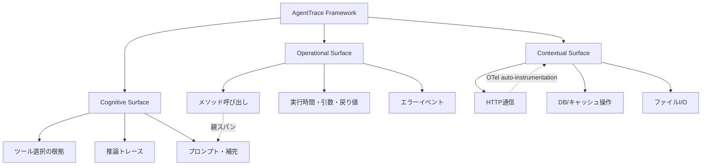

## 論文概要（Abstract）

本記事は [AgentTrace: A Structured Logging Framework for Agent System Observability](https://arxiv.org/abs/2602.10133) の解説記事です。

AgentTraceは、LLMエージェントの実行時動作を**操作（Operational）・認知（Cognitive）・コンテキスト（Contextual）**の3つの観測面（surface）で構造化ログとして収集するフレームワークである。著者らは、既存のプロキシレベルのフィルタリングやモデル内部のグラスボックス分析では、エージェントの推論過程・状態変化・外部環境とのインタラクションを十分に可視化できないと指摘している。AgentTraceはOpenTelemetryとの統合により、既存のオブザーバビリティ基盤にエージェント固有のテレメトリを追加できる点が特徴である。

この記事は [Zenn記事: AgentCore Runtimeに社内ヘルプデスクをデプロイしOTelトレース監視を実装する](https://zenn.dev/0h_n0/articles/fea34d154cdffc) の深掘りです。

## 情報源

- **arXiv ID**: 2602.10133
- **URL**: [https://arxiv.org/abs/2602.10133](https://arxiv.org/abs/2602.10133)
- **著者**: Adam AlSayyad, Kelvin Yuxiang Huang, Richik Pal（University of California, Berkeley）
- **発表年**: 2026年（AAAI 2026 Workshop LaMAS）
- **分野**: cs.SE, cs.AI

## 背景と動機（Background & Motivation）

LLMベースのエージェントは、外部ツール呼び出し・マルチステップ推論・動的なコンテキスト管理を組み合わせて複雑なタスクを遂行する。しかし、その非決定論的な性質が本番環境での監査やデバッグを困難にしている。

著者らは既存のアプローチの限界を以下のように整理している。

1. **プロキシレベルのフィルタリング**: 入出力のみを監視し、エージェント内部の推論過程やツール選択の根拠が不可視
2. **モデルのグラスボックス分析**: アテンションマップやアクティベーションの解析は可能だが、エージェントレベルの行動（ツール呼び出し順序、外部サービスとの通信パターン）を捉えられない
3. **従来のアプリケーションログ**: 非構造化テキストログでは因果関係の追跡やクロスサービス相関が困難

これらの課題に対し、AgentTraceはエージェント固有の3つの観測面を定義し、スキーマベースの構造化ログでランタイム情報を体系的に収集するアプローチを提案している。

## 主要な貢献（Key Contributions）

- **貢献1**: エージェントのコード変更なしにランタイムで計装できるスキーマベースのロギングフレームワーク。Pythonのイントロスペクション機能を活用し、エージェントクラスの公開メソッドを動的にラップする
- **貢献2**: 認知（Cognitive）・操作（Operational）・コンテキスト（Contextual）の3観測面によるエージェント行動の分類体系。推論・実行・環境の各層を独立して観測可能にする
- **貢献3**: OpenTelemetryとの統合による既存オブザーバビリティ基盤（Jaeger、Grafana Tempo等）との互換性確保

## 技術的詳細（Technical Details）

### ログモデルの形式化

著者らはエージェントログを関数 $L$ としてモデル化している。

$$
L(S, E, C) \rightarrow R
$$

ここで、
- $S$: 観測面（Surface）— Operational, Cognitive, Contextualのいずれか
- $E$: イベント内容（Event）— メソッド呼び出し、LLM応答、外部I/Oなど
- $C$: メタデータ（Context）— タイムスタンプ、トレースID、スパンIDなど
- $R$: 構造化レコード（Record）— スキーマに準拠した出力

このモデルに対して、著者らは4つの設計目標を定めている。

| 目標 | 説明 |
|------|------|
| **Consistency（一貫性）** | 同一セッション内のすべてのログが共通スキーマに準拠 |
| **Causality（因果性）** | トレースID・スパンIDにより親子関係と実行順序を再構成可能 |
| **Fidelity（忠実性）** | エージェントの実際の振る舞いを高精度に反映 |
| **Interoperability（相互運用性）** | OpenTelemetry標準に準拠し、既存ツールと統合可能 |

### 3つの観測面（Three Surfaces）



**Operational Surface（操作面）** は、エージェントクラスの公開メソッドをPythonのイントロスペクション機能でラップし、各メソッド呼び出しに対して `start`・`complete`・`error` の3種のイベントを発行する。各イベントには実行時間、引数の要約、戻り値の要約が含まれる。

**Cognitive Surface（認知面）** は、LLMへのプロンプト・補完テキスト・推論過程を収集する。出力にデリミタ付きの推論セグメント（例: `<thinking>` タグ）が含まれる場合、AgentTraceはこれを応答テキストから分離し、独立した認知イベントとして記録する。認知スパンは操作スパンの子としてネストされる。著者らは抽出手法としてマーカー検出、XMLタグパース、JSONフィールド抽出の3方式をサポートしていると述べている。

**Contextual Surface（コンテキスト面）** は、OpenTelemetryの自動計装（auto-instrumentation）を利用し、`requests`、`sqlalchemy`、`redis` などのライブラリをモンキーパッチして外部I/Oを記録する。記録対象はHTTP通信のURL・ステータスコード、SQLクエリと行数、キャッシュのヒット/ミス、ベクトルストア操作、ファイルI/Oなどである。

### メソッドラッピングアルゴリズム

論文のAlgorithm 1に基づく操作面の計装手法を以下に示す（論文の擬似コードを再構成）。

```python
import functools, time, uuid
from typing import Any, Callable

def instrument_agent(agent: object, name: str, methods: list[str] | None = None) -> None:
    """エージェントの公開メソッドをstart/complete/errorイベント付きでラップする。"""
    targets = methods or [m for m in dir(agent) if not m.startswith("_") and callable(getattr(agent, m))]
    for method_name in targets:
        original = getattr(agent, method_name)
        @functools.wraps(original)
        def wrapper(*args: Any, _orig=original, _mname=method_name, **kw: Any) -> Any:
            eid, sid, tid = str(uuid.uuid4()), generate_span_id(), get_current_trace_id()
            emit_event("start", surface="operational", event_id=eid, agent=name,
                        method=_mname, trace_id=tid, span_id=sid)
            t0 = time.monotonic()
            try:
                result = _orig(*args, **kw)
                emit_event("complete", surface="operational", event_id=eid,
                            duration_ms=(time.monotonic()-t0)*1000, trace_id=tid, span_id=sid)
                return result
            except Exception as exc:
                emit_event("error", surface="operational", event_id=eid,
                            duration_ms=(time.monotonic()-t0)*1000,
                            error_type=type(exc).__name__, trace_id=tid, span_id=sid)
                raise
        setattr(agent, method_name, wrapper)
```

### イベントエンベロープ

すべてのイベントは以下のフィールドを持つ共通エンベロープに格納される。

| フィールド | 型 | 説明 |
|-----------|-----|------|
| `event_id` | UUID | イベントの一意識別子 |
| `surface` | enum | operational / cognitive / contextual |
| `trace_id` | string | リクエスト全体を追跡するトレースID |
| `span_id` | string | 個別操作を識別するスパンID |
| `timestamp` | ISO 8601 | UTC基準のタイムスタンプ |
| `event_type` | string | start / complete / error |
| `agent_name` | string | エージェントの識別名 |

### ストレージとフォールバック

著者らは2つのストレージパスを設計している。

1. **Operational / Cognitive イベント**: append-only JSONL ファイルに書き込み。各行が1イベントに対応し、`jq` やログ集約ツールで直接クエリ可能
2. **Contextual イベント**: OpenTelemetryのスパンとしてエクスポート。オプションでJSONLへのミラーリングも可能

OTelエクスポートが失敗した場合、AgentTraceはローカルJSONLへのフォールバックを行い、**ロギングエラーがエージェントの実行をブロックしない**設計としている。

## 実装のポイント（Implementation）

AgentTraceの実装はPythonパッケージとして提供され、APIは最小限に設計されている。

```python
from agenttrace import init, instrument_agent, ALogger

# 1. 初期化: シンクとOTelエクスポーターの設定
init(
    sinks=["jsonl", "otlp"],
    otlp_endpoint="http://collector.example.com:4318",
    service_name="helpdesk-agent",
)

# 2. エージェントの計装（コード変更不要）
instrument_agent(agent, name="helpdesk", methods=None)

# 3. 認知面の手動ログ（オプション）
logger = ALogger(surface="cognitive")
logger.log(event_type="reasoning", content="ユーザーの質問をFAQ検索に分類")
```

**実装上の注意点**:

- `instrument_agent` は対象オブジェクトの**公開メソッドのみ**をラップする。プライベートメソッド（`_` プレフィックス）は計装されない
- 認知面の推論トレース抽出は、LLMの出力フォーマットに依存する。`<thinking>` タグ、JSON `reasoning` フィールド、カスタムマーカーの3方式に対応
- OTelバッチエクスポートにより、典型的な成功呼び出しでは2イベント（start + complete）が発行される
- 論文執筆時点でコードリポジトリやパッケージ名は公開されていない

**AgentCoreとの関連**:

Zenn記事で紹介したStrands SDKの `StrandsTelemetry` がModel invoke・Tool callのスパンを生成するのに対し、AgentTraceは認知面（推論過程の抽出）という追加レイヤーを提供する。両者はOpenTelemetryのトレースID・スパンIDで相関可能であり、AgentCoreのCloudWatch Transaction Searchと組み合わせることで、「なぜそのツールを呼び出したのか」という意思決定の根拠までトレース可能になる。

## Production Deployment Guide

### AWS実装パターン（コスト最適化重視）

AgentTraceのようなエージェントオブザーバビリティ基盤をAWS上に構築する場合、トラフィック量に応じた3段階の構成を検討できる。

| 規模 | 月間リクエスト | 推奨構成 | 月額コスト目安 | 主要サービス |
|------|--------------|---------|-------------|------------|
| **Small** | ~3,000 (100/日) | Serverless | $50-150 | Lambda + Bedrock + DynamoDB + CloudWatch |
| **Medium** | ~30,000 (1,000/日) | Hybrid | $300-800 | Lambda + ECS Fargate + ElastiCache + OpenSearch Serverless |
| **Large** | 300,000+ (10,000/日) | Container | $2,000-5,000 | EKS + Karpenter + OpenTelemetry Collector + OpenSearch |

**Small構成の詳細**（月額$50-150）:
- **Lambda**: エージェント実行、1GB RAM、60秒タイムアウト（$20/月）
- **Bedrock**: Claude 3.5 Haiku、Prompt Caching有効（$80/月）
- **DynamoDB**: JSONL構造化ログ保存、On-Demand（$10/月）
- **CloudWatch**: OTelスパン受信・可視化（$10/月）
- **API Gateway**: REST API エンドポイント（$5/月）

**Medium構成の詳細**（月額$300-800）:
- **ECS Fargate**: OTel Collector（0.5 vCPU, 1GB RAM × 2タスク）（$120/月）
- **OpenSearch Serverless**: スパン検索・分析（$200/月）
- **ElastiCache Redis**: ログバッファリング、cache.t3.micro（$15/月）
- **Lambda**: エージェント実行（$50/月）
- **Bedrock**: Claude 3.5 Sonnet（$400/月）

**Large構成の詳細**（月額$2,000-5,000）:
- **EKS**: OTel Collector + エージェントワーカー（$72/月 コントロールプレーン）
- **EC2 Spot**: g5.xlarge × 2-4台（平均$800/月）
- **OpenSearch**: 専用インスタンス、スパン長期保存（$500/月）
- **Karpenter**: 自動スケーリング（追加コストなし）
- **S3**: JSONLログアーカイブ（$20/月）

**コスト削減テクニック**:
- Spot Instances使用で最大90%削減（EKS + Karpenter）
- Bedrock Batch API使用で50%削減（非リアルタイム処理時）
- Prompt Caching有効化で30-90%削減
- CloudWatch Logsのログクラス設定でInfrequent Access（$0.05/GB、標準の半額）を活用

**コスト試算の注意事項**: 上記は2026年11月時点のAWS ap-northeast-1（東京）リージョン料金に基づく概算値です。実際のコストはトラフィックパターン、リージョン、バースト使用量により変動します。最新料金は [AWS料金計算ツール](https://calculator.aws/) で確認してください。

### Terraformインフラコード

**Small構成（Serverless）の主要リソース**:

```hcl
resource "aws_lambda_function" "agent_handler" {
  filename      = "lambda.zip"
  function_name = "agenttrace-handler"
  role          = aws_iam_role.lambda_agenttrace.arn
  handler       = "index.handler"
  runtime       = "python3.12"
  timeout       = 60
  memory_size   = 1024

  environment {
    variables = {
      OTEL_EXPORTER_OTLP_ENDPOINT = "https://otel-collector.example.com:4318"
      OTEL_SERVICE_NAME           = "agenttrace-helpdesk"
      DYNAMODB_TABLE              = aws_dynamodb_table.agenttrace_logs.name
    }
  }
}

resource "aws_dynamodb_table" "agenttrace_logs" {
  name         = "agenttrace-structured-logs"
  billing_mode = "PAY_PER_REQUEST"
  hash_key     = "trace_id"
  range_key    = "event_id"

  attribute {
    name = "trace_id"
    type = "S"
  }
  attribute {
    name = "event_id"
    type = "S"
  }

  ttl {
    attribute_name = "expire_at"
    enabled        = true
  }
}
```

**Large構成（Container）**: EKS + Karpenter（Spot優先）+ OpenSearch。Karpenter ProvisionerでSpot Instancesを優先し `ttlSecondsAfterEmpty: 30` でアイドルノードを即回収する。AWS Budgetsで月額$5,000のアラートを設定する。

### セキュリティベストプラクティス

1. **ネットワーク**: Lambda/EKSはVPC内配置、OTel Collectorへの通信はVPCエンドポイント経由
2. **IAMロール**: 最小権限の原則。Bedrock InvokeModel + DynamoDB PutItem/Query のみ
3. **シークレット管理**: OTelエンドポイントのAPIキーはSecrets Managerで管理
4. **データ保護**: 認知面ログにはプロンプト・応答が含まれるため、KMS暗号化必須。PII検出にはMacie連携を検討
5. **監査**: CloudTrail全リージョン有効化

### 運用・監視設定

**CloudWatch Logs Insights クエリ**:

```sql
-- エージェントのエラーイベントを検出
fields @timestamp, @message
| filter @message like /surface.*operational/
| filter @message like /event_type.*error/
| stats count() as error_count by bin(1h)

-- 認知面の推論トレース分析（レイテンシ）
fields @timestamp, @message
| filter @message like /surface.*cognitive/
| stats avg(duration_ms) as avg_reasoning_ms by bin(5m)
```

**CloudWatch アラーム**: Lambda Errors 5分間10件超過で SNS 通知。X-Rayトレーシングは `aws_xray_sdk` の `patch_all()` で boto3 を自動計装し、`put_annotation('agent_name', 'helpdesk')` でフィルタリング属性を付与する。Cost Explorer日次レポートはサービス別コストを取得し $100/日 超過で通知する。

### コスト最適化チェックリスト

**アーキテクチャ選択**:
- [ ] ~100 req/日 → Lambda + CloudWatch（Serverless）: $50-150/月
- [ ] ~1,000 req/日 → ECS Fargate + OpenSearch Serverless（Hybrid）: $300-800/月
- [ ] 10,000+ req/日 → EKS + Spot + OpenSearch（Container）: $2,000-5,000/月

**リソース最適化**:
- [ ] EC2 Spot Instances優先（Karpenter自動管理で最大90%削減）
- [ ] Reserved Instances: 1年コミットで最大72%削減
- [ ] Lambda: メモリサイズ最適化（Power Tuning実行）
- [ ] ECS/EKS: アイドルタイムのスケールダウン（夜間0台）
- [ ] CloudWatch Logs: Infrequent Accessクラスで50%削減

**LLMコスト削減**:
- [ ] Bedrock Batch API: 50%割引（非リアルタイム）
- [ ] Prompt Caching: 30-90%削減
- [ ] モデル選択: 簡易タスクにHaiku、複雑タスクにSonnet
- [ ] max_tokens設定で過剰生成防止

**監視・アラート**:
- [ ] AWS Budgets: 月額予算設定（80%警告、100%アラート）
- [ ] CloudWatch: エラー率・レイテンシスパイク検知
- [ ] Cost Anomaly Detection: 自動異常検知
- [ ] 日次コストレポート: SNS/Slack自動送信

**リソース管理**:
- [ ] 未使用リソース削除（Trusted Advisor活用）
- [ ] タグ戦略: 環境別（dev/staging/prod）でコスト可視化
- [ ] S3ライフサイクル: JSONLログ30日でGlacier移行
- [ ] DynamoDB TTL: 古いログレコード自動削除

## 実験結果（Results）

著者らは論文中で定量的な評価実験やベンチマーク結果を報告していない。「最小限のオーバーヘッド（minimal overhead）」という主張は本文中に記載されているが、具体的な計測値（レイテンシ増加、メモリ使用量、スループット低下等）は示されていない。

これはAgentTraceがAAAI 2026 Workshop（LaMAS）で発表されたワークショップ論文であり、フルペーパーと比較して実験セクションの要件が緩い点を考慮する必要がある。ただし、本番環境での採用を検討する場合は、以下の点を独自に検証することが推奨される。

| 検証項目 | 測定方法 | 許容範囲の目安 |
|---------|---------|--------------|
| レイテンシ増加 | A/Bテスト（計装あり/なし） | P99で+10ms以下 |
| メモリ使用量 | cgroup metrics | +50MB以下 |
| ログ出力量 | JSONL行数 × 平均サイズ | 1リクエストあたり10KB以下 |
| OTelエクスポート遅延 | バッチ送信の完了時間 | 5秒以内 |

## 実運用への応用（Practical Applications）

AgentTraceのアーキテクチャは、Zenn記事で紹介したAgentCore + Strands SDKの構成と相補的に活用できる。

**Strands SDKとの統合**: Strands SDKの `StrandsTelemetry` はModel invokeとTool callのスパンを生成するが、エージェントの推論過程（なぜそのツールを選択したか）は記録しない。AgentTraceのCognitive Surfaceを併用することで、ツール選択の根拠や推論チェーンの分岐点を可視化できる。

**CloudWatch Transaction Searchとの連携**: AgentTraceが生成するOpenTelemetryスパンはCloudWatch Transaction Searchに直接送信可能であり、Strands SDKのスパンと同一のトレースID配下で表示される。これにより、「Model invoke → 推論 → Tool選択根拠 → Tool call」の完全なフローを単一ダッシュボードで追跡できる。

**セキュリティ監査**: AgentTraceの認知面ログは、エージェントがどのような推論を経てアクションを決定したかの監査証跡となる。金融・医療などの規制業界では、エージェントの意思決定プロセスの説明可能性が求められるケースが増えており、構造化された認知ログはコンプライアンス対応の基盤となる。

**デバッグの効率化**: 本番環境でエージェントが予期しない動作（無限ループ、不適切なツール選択等）を示した場合、3つの観測面を組み合わせることで原因の特定が容易になる。操作面でループを検知し、認知面で推論の破綻箇所を特定し、コンテキスト面で外部サービスの応答異常を確認できる。

## 関連研究（Related Work）

- **AgentSight**（arXiv 2508.02736）: eBPFを用いたシステムレベルのエージェントオブザーバビリティ。AgentTraceがアプリケーションレベルの計装であるのに対し、AgentSightはプロセス外のシステムアクション（ファイルI/O、ネットワーク通信）をカーネルレベルで捕捉する。両者は異なるレイヤーで動作し、組み合わせることでより包括的な監視が可能
- **llmmas-otel**（arXiv 2608.24271）: OpenTelemetryトレーシングとフォールト注入を組み合わせたマルチエージェントシステム向けツール。AgentTraceが単一エージェントの内部可視化に焦点を置くのに対し、llmmas-otelはエージェント間通信と障害伝播の分析に特化している
- **OpenTelemetry GenAI Semantic Conventions**: LLM呼び出しのスパン属性を標準化する取り組み。`gen_ai.request.model`、`gen_ai.usage.prompt_tokens` 等の属性名を定義しており、AgentTraceのContextual Surfaceはこの規約に準拠している

## まとめと今後の展望

AgentTraceは、LLMエージェントのオブザーバビリティを操作・認知・コンテキストの3観測面で体系的に収集する構造化ロギングフレームワークである。コード変更不要のランタイム計装とOpenTelemetry互換のエクスポートにより、既存のオブザーバビリティ基盤（Jaeger、Grafana Tempo、CloudWatch等）への統合が容易である。

ただし、定量的な性能評価が論文中に含まれていない点は本番採用の判断材料として不十分であり、オーバーヘッドの実測が必要である。著者らは今後の方向として、脅威モデリング、リスク検出、評価メトリクスの自動生成などを挙げている。

Zenn記事で紹介したAgentCore + Strands SDKの構成にAgentTraceの認知面ロギングを追加することで、「何が起きたか」だけでなく「なぜそうなったか」まで追跡可能なオブザーバビリティスタックを構築できる可能性がある。

## 参考文献

- **arXiv**: [https://arxiv.org/abs/2602.10133](https://arxiv.org/abs/2602.10133)
- **関連Zenn記事**: [AgentCore Runtimeに社内ヘルプデスクをデプロイしOTelトレース監視を実装する](https://zenn.dev/0h_n0/articles/fea34d154cdffc)
- **AgentSight**: [https://arxiv.org/abs/2508.02736](https://arxiv.org/abs/2508.02736)
- **llmmas-otel**: [https://arxiv.org/abs/2608.24271](https://arxiv.org/abs/2608.24271)
- **OpenTelemetry GenAI Semantic Conventions**: [https://opentelemetry.io/docs/specs/semconv/gen-ai/](https://opentelemetry.io/docs/specs/semconv/gen-ai/)
- **Amazon Bedrock AgentCore Observability**: [https://docs.aws.amazon.com/bedrock-agentcore/latest/devguide/observability.html](https://docs.aws.amazon.com/bedrock-agentcore/latest/devguide/observability.html)
