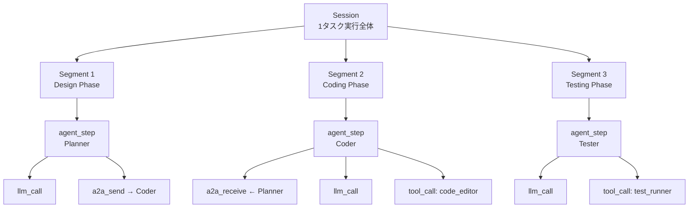

## 論文概要（Abstract）

本記事は [https://arxiv.org/abs/2608.24271](https://arxiv.org/abs/2608.24271) の解説記事です。

llmmas-otelは、LLMベースのマルチエージェントシステム（MAS）を対象として、OpenTelemetry準拠の分散トレーシングとフォールトインジェクションを組み合わせたフレームワーク非依存のツールである。著者らは、ソフトウェアエンジニアリング領域でのLLM-MASにおいて、ワークフローフェーズ・エージェント間通信・ツール呼び出し・LLM推論の各レイヤでスパンを記録し、同一構造のベースラインと障害注入トレースを比較可能にするアプローチを提案している。デモワークフローと実際のLLM-MAS（ChatDev）での初期検証が報告されている。

この記事は [Zenn記事: AgentCore Runtimeに社内ヘルプデスクをデプロイしOTelトレース監視を実装する](https://zenn.dev/0h_n0/articles/fea34d154cdffc) の深掘りです。

## 情報源

- **arXiv ID**: 2608.24271
- **URL**: [https://arxiv.org/abs/2608.24271](https://arxiv.org/abs/2608.24271)
- **著者**: Zahra Seyedghorban, Egor Klimov, Arie van Deursen, Annibale Panichella, Burcu Kulahcioglu Ozkan（Delft University of Technology, JetBrains Research）
- **発表年**: 2026
- **会議**: ICST 2026（IEEE International Conference on Software Testing, Verification and Validation）
- **DOI**: 10.1109/ICST69053.2026.00037
- **分野**: cs.SE（ソフトウェア工学）

## 背景と動機（Background & Motivation）

LLMベースのマルチエージェントシステムは、コード生成・テスト・レビューなどのソフトウェアエンジニアリングタスクで実用化が進んでいる。ChatDevやMetaGPTのようなフレームワークでは、複数のLLMエージェントがPlannerやCoderといった役割を分担し、エージェント間通信（Agent-to-Agent, A2A）を介して協調動作する。

しかし著者らは、こうしたLLM-MASの**オブザーバビリティ**と**耐障害性テスト**の双方が不十分だと指摘している。従来のモノリシックなLLMアプリケーション向けのトレーシングツール（LangSmith、Langfuse等）は単一エージェントの入出力を記録するのに適しているが、マルチエージェント間の因果関係やメッセージフローの追跡には不向きである。さらに、本番環境で発生しうるネットワーク遅延・API障害・メッセージ欠損といった障害がMAS全体の振る舞いにどう影響するかを体系的にテストする手段がなかった。

この課題に対し、著者らはOpenTelemetryの分散トレーシング標準にフォールトインジェクション機構を組み合わせることで、**観測可能性**と**耐障害性評価**を一つのツールで実現するアプローチを提案している。

## 主要な貢献（Key Contributions）

著者らは論文中で以下の3つの貢献を主張している。

- **貢献1**: llmmas-otelツールの設計と実装。既存のMASフレームワークを改変せず外側から計装できるフレームワーク非依存のアプローチ
- **貢献2**: セッション・セグメント・エージェントステップ・LLM呼び出し・A2A通信・ツール呼び出しを階層的に記録するトレースモデルの定義
- **貢献3**: デモワークフローおよびChatDev上での初期検証（ProgramDevベンチマーク30タスク）

## 技術的詳細（Technical Details）

### トレースモデルとスパン階層

llmmas-otelのトレースモデルは、OpenTelemetryのトレース・スパンモデルを拡張し、MAS固有の階層構造を定義している。



各スパンレベルの定義は以下のとおりである。

| スパンレベル | 説明 | 主要属性（論文Table Iより） |
|---|---|---|
| **Session** | 1つのタスク実行全体 | `session.id` |
| **Segment** | ワークフローフェーズ | `segment.name`, `segment.order` |
| **agent_step** | エージェント1ステップ | `agent.id`, `step.index` |
| **llm_call** | LLM推論1回 | `provider.name`, `request.model`, `request.id` |
| **a2a_send / a2a_receive** | エージェント間メッセージ | `source_agent.id`, `target_agent.id`, `edge.id`, `message.id`, `channel` |
| **tool_call** | ツール呼び出し | `tool.name`, `tool.call.id` |

### コンテンツのプライバシー保護

著者らは、LLMへのプロンプトや応答をトレースに含める際のプライバシーリスクに配慮し、オプショナルな`*.preview`属性（先頭Nトークンのプレビュー）と`*.sha256`属性（コンテンツのハッシュ値）を採用している。これにより、全文を記録せずともコンテンツの同一性検証が可能になる。

### トレースコンテキスト伝播

A2Aメッセージを介したエージェント間通信では、送信側がメッセージキャリアにOpenTelemetryのトレースコンテキストを注入（inject）し、受信側がそれを復元（extract）する。これにより、異なるエージェント間のスパンが同一トレース内で因果関係を保って記録される。

```python
from opentelemetry import context, propagate

def send_message(target_agent: str, message: dict) -> None:
    """A2Aメッセージ送信時のコンテキスト伝播"""
    carrier: dict[str, str] = {}
    propagate.inject(carrier)
    message["_otel_context"] = carrier
    # メッセージキューやHTTP経由で送信
    transport.send(target_agent, message)

def receive_message(message: dict) -> None:
    """A2Aメッセージ受信時のコンテキスト復元"""
    carrier = message.get("_otel_context", {})
    ctx = propagate.extract(carrier)
    token = context.attach(ctx)
    try:
        process_message(message)
    finally:
        context.detach(token)
```

### フォールトインジェクション機構

llmmas-otelのフォールトインジェクションは、トレーシングのフックポイント（LLM呼び出し・ツール呼び出し・A2A送信/受信）に設定ベースのルールを適用する仕組みである。論文Table IIに記載された障害タイプは以下のとおりである。

| 境界 | 障害タイプ | 説明 |
|---|---|---|
| **A2A send** | `delay` | メッセージ送信の遅延 |
| **A2A send** | `drop` | メッセージの破棄 |
| **A2A send** | `truncate` | メッセージの切り詰め |
| **A2A receive** | `delay` | メッセージ受信の遅延 |
| **A2A receive** | `drop` | メッセージの破棄 |
| **Tool call** | `delay` | ツール実行の遅延 |
| **Tool call** | `not_installed` | ツール未インストールエラー |
| **Tool call** | `timeout` | ツールのタイムアウト |
| **Tool call** | `malformed_response` | 不正なレスポンス返却 |
| **LLM call** | `delay` | LLM応答の遅延 |
| **LLM call** | `rate_limit` | レートリミットエラー（429） |
| **LLM call** | `timeout` | LLM呼び出しのタイムアウト |
| **LLM call** | `network_error` | ネットワーク障害 |
| **LLM call** | `malformed_response` | 不正なJSON応答 |

障害が注入されたスパンには`llmmas.fault.injected`（真偽値）、`llmmas.fault.type`（障害タイプ）、`llmmas.fault.spec_id`（例: `A2_A2A_DELAY`）が自動的に付与される。これにより、ベースライントレースと障害注入トレースの構造が同一に保たれ、差分分析が可能になる。

### 増幅率（Amplification）の定義

著者らは障害の影響度を定量化するために**増幅率**（amplification）を導入している。

$$
\text{Amplification} = \frac{T_{\text{fault}} - T_{\text{baseline}}}{\Delta_{\text{injected}}}
$$

ここで、
- $T_{\text{fault}}$: 障害注入時のエンドツーエンド実行時間
- $T_{\text{baseline}}$: ベースライン（障害なし）の実行時間
- $\Delta_{\text{injected}}$: 注入した遅延量（例: 1000ms）

増幅率が1に近い場合、障害の影響は線形的（注入した遅延がそのまま加算される程度）である。1を大きく上回る場合、注入した障害がシステム内で連鎖的に増幅されていることを示す。

## 実装のポイント（Implementation）

### 計装のアプローチ

llmmas-otelはフレームワーク非依存を設計原則としている。ユーザは既存のMASコードに薄いデコレータとコンテキストマネージャを少数箇所に追加するだけで計装が完了する。

```python
from llmmas_otel import instrument, FaultConfig

# セグメント（ワークフローフェーズ）の境界を定義
@instrument.segment(name="design_phase", order=1)
def design_phase(task: str) -> str:
    planner = PlannerAgent()
    return planner.run(task)

# フォールト設定（JSON/YAMLで外部化も可能）
fault_config = FaultConfig(rules=[
    {
        "boundary": "llm_call",
        "target": {"segment": "design_phase"},
        "fault": {"type": "delay", "delay_ms": 1000}
    }
])
```

### ChatDevへの適用

著者らはChatDevをllmmas-otelで計装した事例を報告している。ChatDevは設計・コーディング・テストなど複数のフェーズを持つLLMベースのソフトウェア開発MASであり、各フェーズ間でエージェントがA2Aメッセージを交換する。llmmas-otelの計装コードと関連ファイルはGitHubリポジトリ（[https://github.com/vagabondboffin/llmmas-otel](https://github.com/vagabondboffin/llmmas-otel)）に公開されている。

### 実行ワークフロー

推奨される利用手順は次の3ステップである。

1. **計装**: ワークフロー境界にデコレータを追加
2. **ベースライン取得**: 障害なしで実行し、正常時のトレースを記録
3. **障害注入テスト**: フォールトルールを有効化して再実行し、ベースラインとの差分を分析

## Production Deployment Guide

### AWS実装パターン（コスト最適化重視）

llmmas-otelのトレーシング基盤を本番環境に適用する場合の推奨AWS構成を示す。

| 規模 | 月間リクエスト | 推奨構成 | 月額コスト | 主要サービス |
|------|--------------|---------|-----------|------------|
| **Small** | ~3,000 (100/日) | Serverless | $50-150 | Lambda + OpenTelemetry Collector + CloudWatch |
| **Medium** | ~30,000 (1,000/日) | Hybrid | $300-800 | ECS Fargate + ADOT Collector + X-Ray |
| **Large** | 300,000+ (10,000/日) | Container | $2,000-5,000 | EKS + Karpenter + Grafana Tempo |

**Small構成の詳細**（月額$50-150）:
- **Lambda**: MASエージェント実行環境、1GB RAM、120秒タイムアウト（$30/月）
- **ADOT Collector（Lambda Layer）**: OTLPスパン収集・転送（追加コストなし）
- **CloudWatch Logs**: スパンストレージ、Transaction Search有効（$15/月）
- **X-Ray**: トレース可視化、1%サンプリング（$5/月）

**Medium構成の詳細**（月額$300-800）:
- **ECS Fargate**: MASエージェントコンテナ、0.5 vCPU × 1GB × 2タスク（$120/月）
- **ADOT Collector（Sidecar）**: 各タスクにサイドカーとして配置（$40/月）
- **X-Ray + CloudWatch**: サンプリング率5%（$80/月）
- **S3**: トレースアーカイブ用（$10/月）

**Large構成の詳細**（月額$2,000-5,000）:
- **EKS**: マルチエージェントオーケストレーション（$72/月コントロールプレーン）
- **EC2 Spot Instances**: g5.xlarge × 2-4台（$800/月平均）
- **Grafana Tempo**: 大規模トレースストレージ（$200/月）
- **Karpenter**: 自動スケーリング（追加コストなし）

**コスト試算の注意事項**:
- 上記は2026年11月時点のAWS ap-northeast-1（東京）リージョン料金に基づく概算値です
- 実際のコストはエージェント数、LLM呼び出し頻度、トレースサンプリング率により変動します
- 最新料金は [AWS料金計算ツール](https://calculator.aws/) で確認してください

### Terraformインフラコード

**Small構成（Serverless）: Lambda + ADOT Collector + CloudWatch**

```hcl
module "vpc" {
  source  = "terraform-aws-modules/vpc/aws"
  version = "~> 5.0"

  name = "mas-otel-vpc"
  cidr = "10.0.0.0/16"
  azs  = ["ap-northeast-1a", "ap-northeast-1c"]
  private_subnets = ["10.0.1.0/24", "10.0.2.0/24"]

  enable_nat_gateway   = false
  enable_dns_hostnames = true
}

resource "aws_iam_role" "lambda_otel" {
  name = "lambda-otel-role"

  assume_role_policy = jsonencode({
    Version = "2012-10-17"
    Statement = [{
      Action = "sts:AssumeRole"
      Effect = "Allow"
      Principal = { Service = "lambda.amazonaws.com" }
    }]
  })
}

resource "aws_iam_role_policy" "xray_write" {
  role = aws_iam_role.lambda_otel.id

  policy = jsonencode({
    Version = "2012-10-17"
    Statement = [{
      Effect   = "Allow"
      Action   = ["xray:PutTraceSegments", "xray:PutTelemetryRecords"]
      Resource = "*"
    }]
  })
}

resource "aws_lambda_function" "mas_agent" {
  filename      = "agent.zip"
  function_name = "mas-agent-handler"
  role          = aws_iam_role.lambda_otel.arn
  handler       = "main.handler"
  runtime       = "python3.12"
  timeout       = 120
  memory_size   = 1024

  layers = [
    "arn:aws:lambda:ap-northeast-1:901920570463:layer:aws-otel-python-amd64-ver-1-25-0:1"
  ]

  environment {
    variables = {
      AWS_LAMBDA_EXEC_WRAPPER            = "/opt/otel-instrument"
      OTEL_TRACES_EXPORTER               = "otlp"
      OTEL_EXPORTER_OTLP_PROTOCOL        = "http/protobuf"
      OTEL_RESOURCE_ATTRIBUTES           = "service.name=mas-agent"
      OTEL_TRACES_SAMPLER                = "traceidratio"
      OTEL_TRACES_SAMPLER_ARG            = "0.05"
    }
  }
}

resource "aws_cloudwatch_metric_alarm" "trace_error_rate" {
  alarm_name          = "mas-trace-error-spike"
  comparison_operator = "GreaterThanThreshold"
  evaluation_periods  = 2
  metric_name         = "FaultCount"
  namespace           = "AWS/X-Ray"
  period              = 300
  statistic           = "Sum"
  threshold           = 10
  alarm_description   = "MASトレースにおけるエラースパン急増検知"
}
```

**Large構成（Container）: EKS + Grafana Tempo**

```hcl
module "eks" {
  source  = "terraform-aws-modules/eks/aws"
  version = "~> 20.0"

  cluster_name    = "mas-otel-cluster"
  cluster_version = "1.31"

  vpc_id     = module.vpc.vpc_id
  subnet_ids = module.vpc.private_subnets

  cluster_endpoint_public_access = true
  enable_cluster_creator_admin_permissions = true
}

resource "kubectl_manifest" "karpenter_provisioner" {
  yaml_body = <<-YAML
    apiVersion: karpenter.sh/v1alpha5
    kind: Provisioner
    metadata:
      name: spot-provisioner
    spec:
      requirements:
        - key: karpenter.sh/capacity-type
          operator: In
          values: ["spot"]
        - key: node.kubernetes.io/instance-type
          operator: In
          values: ["m7i.xlarge", "m7i.2xlarge"]
      limits:
        resources:
          cpu: "32"
          memory: "128Gi"
      ttlSecondsAfterEmpty: 30
  YAML
}

resource "aws_budgets_budget" "mas_monthly" {
  name         = "mas-otel-monthly-budget"
  budget_type  = "COST"
  limit_amount = "5000"
  limit_unit   = "USD"
  time_unit    = "MONTHLY"

  notification {
    comparison_operator        = "GREATER_THAN"
    threshold                  = 80
    threshold_type             = "PERCENTAGE"
    notification_type          = "ACTUAL"
    subscriber_email_addresses = ["ops@example.com"]
  }
}
```

### セキュリティベストプラクティス

1. **ネットワークセキュリティ**: EKSではクラスタエンドポイントをプライベートに設定し、VPN/Direct Connect経由でアクセス
2. **認証・認可**: IAMロールは最小権限の原則に従い、X-RayへのPut権限のみ付与
3. **シークレット管理**: AWS Secrets Managerを使用し、LLM APIキーの環境変数ハードコードを禁止
4. **データ保護**: llmmas-otelの`*.sha256`属性を活用し、プロンプト全文をトレースに記録しない運用を推奨
5. **監査**: CloudTrailで全リージョンのAPI呼び出しを記録

### 運用・監視設定

**CloudWatch Logs Insights クエリ**:

```sql
-- フォールトインジェクション結果の分析: 増幅率の計算
fields @timestamp, @message
| filter @message like /llmmas.fault.injected/
| stats avg(@duration) as avg_latency_ms by bin(1h)

-- エージェント間通信の遅延分布
fields @timestamp, @message
| filter @message like /a2a_send/
| stats pct(@duration, 95) as p95_ms, pct(@duration, 99) as p99_ms by bin(5m)
```

**CloudWatch アラーム（コスト重視）**:

```python
import boto3

cloudwatch = boto3.client('cloudwatch')

cloudwatch.put_metric_alarm(
    AlarmName='mas-trace-volume-spike',
    ComparisonOperator='GreaterThanThreshold',
    EvaluationPeriods=1,
    MetricName='SpanCount',
    Namespace='AWS/X-Ray',
    Period=3600,
    Statistic='Sum',
    Threshold=100000,
    ActionsEnabled=True,
    AlarmActions=['arn:aws:sns:ap-northeast-1:123456789:mas-alerts'],
    AlarmDescription='トレーススパン数の異常増加（コスト急増の可能性）'
)
```

### コスト最適化チェックリスト

**アーキテクチャ選択**:
- [ ] ~100 req/日 → Lambda + ADOT Layer（Serverless） - $50-150/月
- [ ] ~1,000 req/日 → ECS Fargate + ADOT Sidecar（Hybrid） - $300-800/月
- [ ] 10,000+ req/日 → EKS + Grafana Tempo（Container） - $2,000-5,000/月

**リソース最適化**:
- [ ] EC2: Spot Instances優先（Karpenter自動管理）
- [ ] Reserved Instances: 1年コミットで最大72%削減
- [ ] Lambda: メモリサイズ最適化（Power Tuning実行）
- [ ] ECS/EKS: アイドルタイムのスケールダウン

**トレーシングコスト削減**:
- [ ] サンプリング率: 本番は1-5%、開発は100%
- [ ] X-Rayインデックス: デフォルト1%サンプリング活用
- [ ] スパンストレージ: S3 Glacier移行で長期保存コスト削減
- [ ] CloudWatch Logs: 保持期間設定（30日推奨）

**監視・アラート**:
- [ ] AWS Budgets: 月額予算設定（80%で警告）
- [ ] CloudWatch アラーム: スパン数スパイク検知
- [ ] Cost Anomaly Detection: 自動異常検知
- [ ] 日次コストレポート: SNS/Slack通知

**リソース管理**:
- [ ] 未使用リソース削除: Trusted Advisor活用
- [ ] タグ戦略: 環境別（dev/staging/prod）でコスト可視化
- [ ] ライフサイクルポリシー: 古いトレースデータの自動削除
- [ ] 開発環境: 夜間のFargateタスク停止

## 実験結果（Results）

著者らはProgramDevベンチマークの30タスクを用いて、各条件につき5回実行の検証を行っている。

### 実験条件

- **ベースライン**: 障害注入なし
- **LLM delay**: 最初のプランニングフェーズのLLM呼び出しに1,000msの遅延を注入
- **A2A delay**: Planner → Coderへの送信に1,000msの遅延を注入

### 増幅率の結果（論文Table IIIより）

| システム | シナリオ | 増幅率（平均） | 増幅率（中央値） |
|---|---|---|---|
| **Demo** (Planner→Coder) | LLM delay | 1.053 | 1.036 |
| **Demo** | A2A delay | 1.295 | 1.390 |
| **ChatDev** | LLM delay | 48.1 | 13.9 |
| **ChatDev** | A2A delay | 59.2 | 6.6 |

### 結果の解釈

著者らは以下の知見を報告している。

**デモワークフロー**: LLM遅延の増幅率は平均1.053であり、ほぼ線形的な影響（注入した1,000msの遅延がそのまま53ms程度の追加オーバーヘッドで伝播）にとどまる。一方、A2A遅延の増幅率は平均1.295であり、エージェント間通信への障害がLLM呼び出し障害よりも大きな影響を及ぼしている。

**ChatDev**: LLM遅延の増幅率は平均48.1（中央値13.9）、A2A遅延の増幅率は平均59.2（中央値6.6）と報告されている。平均と中央値の乖離が大きく、一部のタスクで障害が連鎖的に増幅されるケースがあることを示唆している。著者らは、ChatDevの複数フェーズ（設計→コーディング→テスト）を跨ぐ障害伝播が原因だと考察している。

**制約事項**: 論文中に分散（標準偏差）や統計的有意性検定の報告はない。平均と中央値のみが提示されている点に注意が必要である。

## 実運用への応用（Practical Applications）

llmmas-otelのアプローチは、AgentCore Runtimeのようなマネージドエージェント実行環境においても有用な知見を提供する。

**MASのカオスエンジニアリング**: 本番環境のマルチエージェントシステムに対し、フォールトインジェクションを段階的に適用することで耐障害性を検証できる。特にA2A通信障害の増幅率が高いというChatDevの結果は、エージェント間メッセージングの冗長化やリトライ戦略の重要性を示唆している。

**ボトルネック分析**: OpenTelemetryのスパン階層を活用することで、どのワークフローフェーズ・どのエージェント間通信がレイテンシのボトルネックになっているかを特定できる。AgentCore Observabilityのトレース分析と併用すれば、Model invokeスパンとA2Aスパンの比較が容易になる。

**回帰テスト**: MASのフレームワーク更新やモデル変更の際に、同一タスクセットで増幅率を測定し、耐障害性の変化を定量的に追跡できる。

**制約**: 著者ら自身が認めているとおり、現時点ではペアラントレースの差分表示、トレース要約、根本原因の自動ランキングなどの分析機能は実装されていない。ユーザがトレースとアーティファクトを直接検査する必要がある。

## 関連研究（Related Work）

- **AgentTrace（arXiv 2602.10133）**: UC Berkeleyによるエージェントオブザーバビリティフレームワーク。構造化ログを運用面・認知面・コンテキスト面の3面で記録する。llmmas-otelとの違いは、AgentTraceが単一エージェントのログ記録に焦点を当てているのに対し、llmmas-otelはマルチエージェント間のA2A通信とフォールトインジェクションをカバーしている点にある
- **AgentSight（arXiv 2508.02736）**: eBPFを用いたシステムレベルのエージェントオブザーバビリティ。アプリケーションレベルのトレースツールでは捕捉できないOS外部のプロセス動作を記録する
- **AgentOps Survey（arXiv 2508.02121）**: エージェント運用ツールの分類調査。Langfuse、LangSmith、OpenLLMetryなどのツールをメトリクス・ログ・トレースの3本柱で整理している

## まとめと今後の展望

llmmas-otelは、LLMベースのマルチエージェントシステムにOpenTelemetry準拠のトレーシングとフォールトインジェクションを組み合わせた初のフレームワーク非依存ツールとして位置付けられる。ChatDevでの実験では、わずか1,000msの遅延注入がエンドツーエンド実行時間を最大数十倍に増幅するケースが観測されており、MASの耐障害性テストの必要性を示す結果となっている。

ただし、論文の検証は30タスク×5回の限定的な規模であり、統計的有意性検定の報告がない点は今後の課題である。また、メモリやワークフロー調整レベルの障害注入は未対応であり、著者らも今後の拡張として言及している。

AgentCore Runtimeのようなマネージド環境でエージェントを運用する際には、llmmas-otelのフォールトインジェクションの考え方を障害対策の設計に取り入れることが有用である。

## 参考文献

- **arXiv**: [https://arxiv.org/abs/2608.24271](https://arxiv.org/abs/2608.24271)
- **DOI**: [10.1109/ICST69053.2026.00037](https://doi.org/10.1109/ICST69053.2026.00037)
- **Code**: [https://github.com/vagabondboffin/llmmas-otel](https://github.com/vagabondboffin/llmmas-otel)
- **Related Zenn article**: [https://zenn.dev/0h_n0/articles/fea34d154cdffc](https://zenn.dev/0h_n0/articles/fea34d154cdffc)
