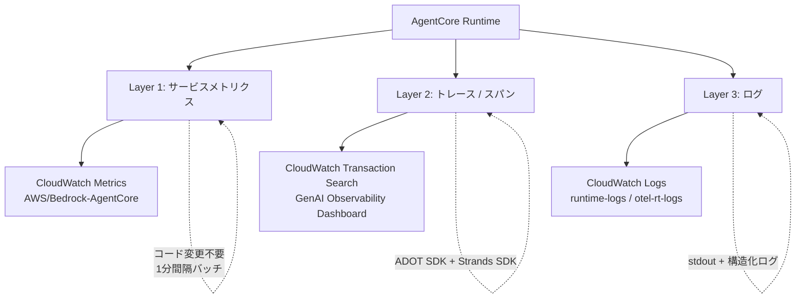
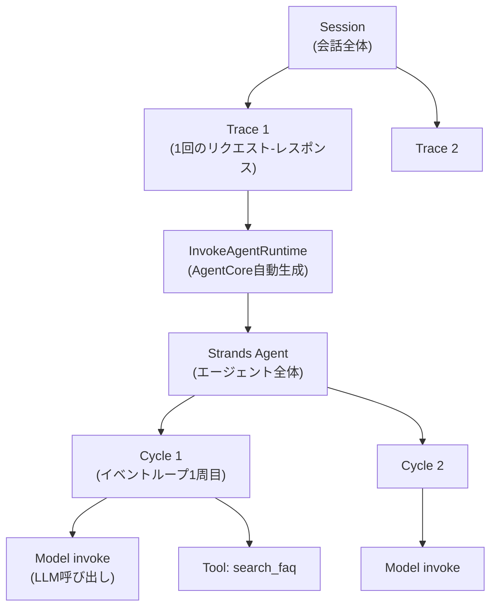

## ブログ概要（Summary）

本記事は [Debugging production agents with Amazon Bedrock AgentCore Observability](https://aws.amazon.com/blogs/machine-learning/debugging-production-agents-with-amazon-bedrock-agentcore-observability/) の解説記事です。

AWSは2026年にAmazon Bedrock AgentCoreのObservability機能に関する公式ブログを公開し、本番環境で稼働するAIエージェントのデバッグ手法を体系的に解説しています。ブログでは、AgentCore Observabilityが提供する**3層テレメトリモデル**（サービスメトリクス・トレース/スパン・ログ）を活用して、無限ループの検出、ツール呼び出し失敗の原因特定、レイテンシのボトルネック分析といった本番運用の典型的な問題に対処するアプローチが述べられています。CloudWatch Transaction Searchの有効化からCloudWatch Logs Insightsクエリの実践まで、実運用に必要な手順が一貫して示されている点が特徴的です。

この記事は [Zenn記事: AgentCore Runtimeに社内ヘルプデスクをデプロイしOTelトレース監視を実装する](https://zenn.dev/0h_n0/articles/fea34d154cdffc) の深掘りです。

## 情報源

- **種別**: 企業テックブログ（AWS Machine Learning Blog）
- **URL**: [https://aws.amazon.com/blogs/machine-learning/debugging-production-agents-with-amazon-bedrock-agentcore-observability/](https://aws.amazon.com/blogs/machine-learning/debugging-production-agents-with-amazon-bedrock-agentcore-observability/)
- **組織**: Amazon Web Services
- **発表時期**: 2026年

## 技術的背景（Technical Background）

### なぜ本番エージェントのデバッグが難しいのか

LLMベースのAIエージェントは、従来のソフトウェアとは根本的に異なるデバッグ上の課題を持っています。従来のマイクロサービスでは入力と出力の関係が決定論的であり、スタックトレースやログから問題箇所を特定できました。一方、エージェントは以下の特性により、問題の再現と原因特定が困難です。

- **非決定論的な動作**: 同じ入力でもLLMの応答が異なり、ツール選択やイベントループの実行パスが毎回変化する
- **マルチステップの推論**: エージェントは「入力→モデル呼び出し→ツール実行→結果解釈→次のアクション決定」というサイクルを複数回繰り返すため、問題の発生箇所が不明確になる
- **外部依存の連鎖**: FAQデータベース、チケットシステム、ナレッジベースなど複数の外部サービスに依存し、いずれかの障害がエージェント全体の動作に波及する

AWSブログでは、こうした課題に対して**OpenTelemetry互換のテレメトリ基盤**を用いた体系的なデバッグアプローチを提示しています。

### 学術研究との関連

エージェントのObservabilityに関する学術研究も活発です。UC BerkeleyのAgentTrace（arXiv: 2602.10133）は、コード変更なしでランタイム計装を注入する構造化ログフレームワークを提案しており、操作面（Operational）・認知面（Cognitive）・文脈面（Contextual）の3つの観測面を定義しています。また、TU DelftのSeyedghorbanらによるllmmas-otel（arXiv: 2608.24271, ICST 2026採択）は、OpenTelemetryトレースにフォールトインジェクションを組み合わせた手法を提案し、マルチエージェントシステムの障害伝播を定量評価しています。AgentCore Observabilityは、これらの学術的アプローチと同じOTel標準を基盤としつつ、AWSのマネージドサービスとして実運用向けに統合されたソリューションです。

## 実装アーキテクチャ（Architecture）

### AgentCore Observabilityの3層テレメトリモデル

AWSブログでは、AgentCore Observabilityが3つの層でテレメトリを収集すると説明されています。



#### Layer 1: サービスメトリクス（自動収集）

コード変更なしで自動収集される基本メトリクスです。AWSブログによると、`AWS/Bedrock-AgentCore`名前空間で1分間隔のバッチ送信が行われます。

| メトリクス | 説明 | 活用例 |
|---|---|---|
| `Invocations` | エージェント呼び出し回数 | トラフィック監視 |
| `Latency` | エンドツーエンドのレイテンシ | SLO監視（P99） |
| `OverheadLatency` | プラットフォーム処理時間 | インフラ側のボトルネック |
| `SystemErrors` | 500系エラー数 | インフラ障害検知 |
| `UserErrors` | 400系エラー数 | 入力バリデーション不備 |
| `Throttles` | 429スロットリング数 | クォータ管理 |
| `SessionCount` | 累積セッション数 | 利用状況把握 |
| `ActiveSessionCount` | アクティブセッション数（ゲージ） | 同時接続監視 |

#### Layer 2: トレースとスパン（ADOT SDK必要）

Model invokeやTool callの**詳細スパン**を取得するには、AWS Distro for OpenTelemetry（ADOT）SDK（`aws-opentelemetry-distro>=0.18.0`）とStrands SDKのテレメトリ機能が必要です。

スパンの階層構造は以下のとおりです。



各スパンにはGenAIセマンティックコンベンションに準拠した属性が付与されます。

| スパンレベル | 主要属性 |
|---|---|
| **Agent** | `gen_ai.agent.name`, `gen_ai.request.model`, `gen_ai.usage.total_tokens` |
| **Cycle** | `event_loop.cycle_id`, `gen_ai.choice.message` |
| **Model invoke** | `gen_ai.operation.name`, `gen_ai.usage.prompt_tokens`, `gen_ai.usage.completion_tokens` |
| **Tool** | `gen_ai.tool.name`, `gen_ai.tool.call.id`, `tool.status` |

2026年11月16日以降に作成されたエージェントでは、スパンはエージェント専用ロググループ `/aws/bedrock-agentcore/runtimes/<agent_id>-<endpoint_name>` に送信されます。それ以前のエージェントでは共有の `/aws/spans/default` に送信されるため、環境変数 `UNIFIED_TRACES_DESTINATION_ENABLED=true` を設定して切り替える必要があります。

#### Layer 3: ログ

ランタイムログは2種類のストリームで管理されます。

| ストリーム | 内容 | 用途 |
|---|---|---|
| `runtime-logs` | stdout/stderr出力 | アプリケーションログ、print文の確認 |
| `otel-rt-logs` | OTEL構造化ログ | 相関IDによるトレースとの紐付け |

### CloudWatch Transaction Searchの有効化

AWSブログでは、トレースをCloudWatchで可視化するための前提条件として**Transaction Searchの有効化**が必須であると強調されています。公式ドキュメントでも「最も頻繁に報告される問題」として記載されているとのことです。

AWS CLI での有効化手順は以下のとおりです。

```bash
# 1. リソースポリシーの設定
aws logs put-resource-policy \
  --policy-name AgentCoreObservabilityPolicy \
  --policy-document '{
    "Version": "2012-10-17",
    "Statement": [{
      "Sid": "AllowXRayToWriteSpans",
      "Effect": "Allow",
      "Principal": {"Service": "xray.amazonaws.com"},
      "Action": "logs:PutLogEvents",
      "Resource": [
        "arn:aws:logs:<region>:<account>:log-group:aws/spans:*",
        "arn:aws:logs:<region>:<account>:log-group:/aws/application-signals/data:*"
      ]
    }]
  }'

# 2. トレースの宛先設定
aws xray update-trace-segment-destination \
  --destination CloudWatchLogs

# 3. インデックスサンプリング比率の設定（本番は5%推奨）
aws xray update-indexing-rule \
  --name "Default" \
  --rule '{"Probabilistic": {"DesiredSamplingPercentage": 5}}'
```

サンプリング比率はTransaction Searchのインデックスストレージが従量課金であるため、開発環境で100%、本番環境で1〜5%に設定することがブログで推奨されています。

### ADOT SDKによる自動計装

ADOT SDKの導入は依存関係の追加とコマンドの変更のみで完了します。

```toml
# pyproject.toml に追加
[project]
dependencies = [
    "aws-opentelemetry-distro>=0.18.0",
    "boto3>=1.35.0",
]
```

```bash
# 自動計装付きで起動
opentelemetry-instrument python my_agent.py

# コンテナ環境では Dockerfile の CMD を変更
CMD ["opentelemetry-instrument", "python", "main.py"]
```

## 本番デバッグのパターンと手法

### 無限ループの検出

AWSブログでは、エージェントが同じツールを繰り返し呼び出す**無限ループ**が本番環境で頻発する問題として取り上げられています。ブログで推奨されている対策は以下のとおりです。

1. **セッション単位のトークン上限**: `max_tokens_per_session` を設定して暴走を防止
2. **推論ステップ数の制限**: イベントループの最大サイクル数を設定
3. **繰り返し検出**: 同一アクションが3回連続した場合に強制終了

CloudWatch Logs Insightsでの検出クエリ例を以下に示します。

```sql
-- 同一ツールが短時間に繰り返し呼ばれるパターンを検出
fields @timestamp, @message
| filter @message like /gen_ai.tool.name/
| stats count(*) as call_count by bin(5m), @message
| filter call_count > 10
| sort call_count desc
| limit 20
```

### ツール呼び出し失敗の原因特定

AWSブログでは、ツール呼び出しの失敗原因として以下の2つのカテゴリが挙げられています。

**認証エラー（403/401）**: Gateway Service Roleの権限不足が原因です。エージェントがツールを呼び出す際、AgentCore GatewayのIAMロールが対象サービスへのアクセス権を持っている必要があります。

```sql
-- 認証エラーの検出
fields @timestamp, @message
| filter @message like /tool.status/
| filter @message like /ERROR/ or @message like /403/ or @message like /401/
| sort @timestamp desc
| limit 50
```

**バリデーションエラー（400）**: LLMが生成したツール入力がスキーマに合致しない場合に発生します。ツール定義の`Args`型アノテーションが不十分だと、LLMが不正な形式で引数を生成する可能性があります。

### レイテンシボトルネックの分析

```sql
-- Model invokeのレイテンシ分布を1時間ごとに集計
fields @timestamp, @message
| filter @message like /Model invoke/
| stats avg(@duration) as avg_ms,
        pct(@duration, 95) as p95_ms,
        pct(@duration, 99) as p99_ms
  by bin(1h)
```

## Production Deployment Guide

### AWS実装パターン（コスト最適化重視）

AgentCore Observabilityの導入にあたり、トラフィック量に応じた推奨構成を以下に示します。コスト試算は2026年11月時点のAWS ap-northeast-1（東京）リージョン料金に基づく概算値です。

| 規模 | 月間リクエスト | 推奨構成 | 月額コスト | 主要サービス |
|------|--------------|---------|-----------|------------|
| **Small** | ~3,000 (100/日) | Serverless | $80-200 | AgentCore CodeZip + CloudWatch基本 |
| **Medium** | ~30,000 (1,000/日) | Hybrid | $400-1,000 | AgentCore CodeZip + Transaction Search 5% |
| **Large** | 300,000+ (10,000/日) | Container | $2,500-6,000 | AgentCore Runtime Instances + Full Observability |

**Small構成の詳細**（月額$80-200）:
- **AgentCore CodeZip Runtime**: マイクロVMベース（$30/月、推定使用量）
- **Bedrock モデル呼び出し**: Claude Haiku相当（$30/月）
- **CloudWatch Logs**: runtime-logs + otel-rt-logs（$10/月）
- **CloudWatch Metrics**: サービスメトリクス自動収集（$5/月）
- **Transaction Search**: インデックス1%（無料枠内）

**Medium構成の詳細**（月額$400-1,000）:
- **AgentCore CodeZip Runtime**: 複数エンドポイント（$100/月）
- **Bedrock モデル呼び出し**: Claude Sonnet 5.5（$500/月）
- **CloudWatch Transaction Search**: 5%サンプリング（$50/月）
- **CloudWatch Logs Insights**: クエリ実行（$20/月）
- **CloudWatch アラーム**: 10個（$10/月）

**Large構成の詳細**（月額$2,500-6,000）:
- **AgentCore Runtime Instances**: EC2ベース、最大14日セッション（$500/月）
- **Bedrock モデル呼び出し**: 大量推論（$3,000/月）
- **CloudWatch 全機能**: Transaction Search + Logs Insights + ダッシュボード（$200/月）
- **X-Ray**: 詳細トレーシング（$50/月）
- **SNS**: アラート通知（$5/月）

**コスト試算の注意事項**:
- 上記は2026年11月時点のAWS東京リージョン料金に基づく概算値です
- AgentCoreの料金体系はプレビューからGAにかけて変更される可能性があります
- 実際のコストはトラフィックパターン、モデル選択、スパンのサンプリング比率により大幅に変動します
- 最新料金は [AWS料金計算ツール](https://calculator.aws/) で確認してください

**コスト削減テクニック**:
- Transaction Searchのサンプリング比率を本番で1-5%に抑える（インデックスストレージ従量課金のため）
- Bedrock Batch APIで非リアルタイム処理を50%削減
- Prompt Caching有効化で入力トークンを30-90%削減
- 開発環境ではCodeZip Runtime（マイクロVM）、本番の長時間セッションのみRuntime Instances（EC2）を使い分け

### Terraformインフラコード

**Small構成（Serverless）: AgentCore + CloudWatch Observability**

```hcl
# --- CloudWatch Transaction Search リソースポリシー ---
resource "aws_cloudwatch_log_resource_policy" "agentcore_spans" {
  policy_name     = "agentcore-observability-spans"
  policy_document = jsonencode({
    Version = "2012-10-17"
    Statement = [{
      Sid    = "AllowXRayToWriteSpans"
      Effect = "Allow"
      Principal = {
        Service = "xray.amazonaws.com"
      }
      Action   = "logs:PutLogEvents"
      Resource = [
        "arn:aws:logs:${data.aws_region.current.name}:${data.aws_caller_identity.current.account_id}:log-group:aws/spans:*",
        "arn:aws:logs:${data.aws_region.current.name}:${data.aws_caller_identity.current.account_id}:log-group:/aws/application-signals/data:*"
      ]
    }]
  })
}

data "aws_region" "current" {}
data "aws_caller_identity" "current" {}

# --- CloudWatch アラーム: エラー率監視 ---
resource "aws_cloudwatch_metric_alarm" "agent_error_rate" {
  alarm_name          = "agentcore-high-error-rate"
  comparison_operator = "GreaterThanThreshold"
  evaluation_periods  = 2
  metric_name         = "TotalErrors"
  namespace           = "AWS/Bedrock-AgentCore"
  period              = 300
  statistic           = "Sum"
  threshold           = 10
  alarm_description   = "AgentCore: 5分間のエラー数が10件を超過"
  alarm_actions       = [aws_sns_topic.alerts.arn]

  dimensions = {
    AgentId = var.agent_id
  }
}

# --- CloudWatch アラーム: レイテンシ監視 ---
resource "aws_cloudwatch_metric_alarm" "agent_latency" {
  alarm_name          = "agentcore-high-latency"
  comparison_operator = "GreaterThanThreshold"
  evaluation_periods  = 2
  extended_statistic  = "p99"
  metric_name         = "Latency"
  namespace           = "AWS/Bedrock-AgentCore"
  period              = 300
  threshold           = 30000
  alarm_description   = "AgentCore: P99レイテンシが30秒を超過"
  alarm_actions       = [aws_sns_topic.alerts.arn]

  dimensions = {
    AgentId = var.agent_id
  }
}

# --- CloudWatch アラーム: スロットリング監視 ---
resource "aws_cloudwatch_metric_alarm" "agent_throttles" {
  alarm_name          = "agentcore-throttling"
  comparison_operator = "GreaterThanThreshold"
  evaluation_periods  = 1
  metric_name         = "Throttles"
  namespace           = "AWS/Bedrock-AgentCore"
  period              = 300
  statistic           = "Sum"
  threshold           = 5
  alarm_description   = "AgentCore: スロットリング発生"
  alarm_actions       = [aws_sns_topic.alerts.arn]

  dimensions = {
    AgentId = var.agent_id
  }
}

# --- SNS通知先 ---
resource "aws_sns_topic" "alerts" {
  name = "agentcore-observability-alerts"
}

resource "aws_sns_topic_subscription" "email" {
  topic_arn = aws_sns_topic.alerts.arn
  protocol  = "email"
  endpoint  = var.alert_email
}

variable "agent_id" {
  type        = string
  description = "AgentCore Agent ID"
}

variable "alert_email" {
  type        = string
  description = "アラート通知先メールアドレス"
}
```

**Large構成（Full Observability）: 複数エージェント監視**

```hcl
# --- 複数エージェント用のダッシュボード ---
resource "aws_cloudwatch_dashboard" "agentcore_fleet" {
  dashboard_name = "agentcore-fleet-overview"
  dashboard_body = jsonencode({
    widgets = [
      {
        type   = "metric"
        x      = 0
        y      = 0
        width  = 12
        height = 6
        properties = {
          metrics = [
            for agent_id in var.agent_ids :
            ["AWS/Bedrock-AgentCore", "Invocations", "AgentId", agent_id]
          ]
          period = 300
          stat   = "Sum"
          title  = "エージェント別呼び出し数"
        }
      },
      {
        type   = "metric"
        x      = 12
        y      = 0
        width  = 12
        height = 6
        properties = {
          metrics = [
            for agent_id in var.agent_ids :
            ["AWS/Bedrock-AgentCore", "Latency", "AgentId", agent_id]
          ]
          period = 300
          stat   = "p99"
          title  = "エージェント別P99レイテンシ"
        }
      }
    ]
  })
}

# --- Cost Explorer予算アラート ---
resource "aws_budgets_budget" "agentcore_monthly" {
  name         = "agentcore-monthly-budget"
  budget_type  = "COST"
  limit_amount = var.monthly_budget
  limit_unit   = "USD"
  time_unit    = "MONTHLY"

  cost_filter {
    name   = "Service"
    values = ["Amazon Bedrock"]
  }

  notification {
    comparison_operator       = "GREATER_THAN"
    threshold                 = 80
    threshold_type            = "PERCENTAGE"
    notification_type         = "ACTUAL"
    subscriber_email_addresses = [var.alert_email]
  }
}

variable "agent_ids" {
  type        = list(string)
  description = "監視対象のAgentCore Agent IDリスト"
}

variable "monthly_budget" {
  type        = string
  default     = "5000"
  description = "月額予算上限（USD）"
}
```

### セキュリティベストプラクティス

AWSブログの推奨事項に加え、本番環境で重要なセキュリティ設定を以下に整理します。

1. **IAMロール**: AgentCore Runtime Execution Roleは最小権限の原則を厳守。Bedrockモデル呼び出しとCloudWatch書き込みのみに制限
2. **Gateway Service Role**: ツールが外部サービスにアクセスする場合、Gateway Roleの権限不足が認証エラー（403）の主因。ツールごとに必要最小限の権限を付与
3. **シークレット管理**: APIキーや認証情報はAWS Secrets Managerで管理。環境変数へのハードコード禁止
4. **トレースの機密情報**: `OTEL_INSTRUMENTATION_GENAI_CAPTURE_MESSAGE_CONTENT`を本番では`NO_CONTENT`に設定し、プロンプト・レスポンス本文がスパン属性に記録されることを防止
5. **Terraform State**: S3バックエンド + KMS暗号化 + バージョニング有効化

### 運用・監視設定

**CloudWatch Logs Insights クエリ集**:

```sql
-- コスト異常検知: 1時間あたりのトークン使用量
fields @timestamp, @message
| filter @message like /gen_ai.usage.total_tokens/
| stats sum(gen_ai_usage_total_tokens) as total_tokens by bin(1h)
| filter total_tokens > 100000

-- レイテンシ分析: Model invoke の P95, P99
fields @timestamp, @duration
| filter @message like /Model invoke/
| stats avg(@duration) as avg_latency,
        pct(@duration, 95) as p95_latency,
        pct(@duration, 99) as p99_latency
  by bin(5m)

-- 無限ループ検出: 同一ツールの連続呼び出し
fields @timestamp, @message
| filter @message like /gen_ai.tool.name/
| stats count(*) as call_count by bin(5m)
| filter call_count > 15
| sort call_count desc
```

**CloudWatchアラーム設定（Python SDK）**:

```python
import boto3

cloudwatch = boto3.client("cloudwatch")

# セッション数急増アラート
cloudwatch.put_metric_alarm(
    AlarmName="agentcore-session-spike",
    ComparisonOperator="GreaterThanThreshold",
    EvaluationPeriods=1,
    MetricName="SessionCount",
    Namespace="AWS/Bedrock-AgentCore",
    Period=3600,
    Statistic="Sum",
    Threshold=1000,
    ActionsEnabled=True,
    AlarmActions=["arn:aws:sns:us-east-1:123456789:agentcore-alerts"],
    AlarmDescription="AgentCore: 1時間のセッション数が1000を超過",
    Dimensions=[
        {"Name": "AgentId", "Value": "<agent-id>"},
    ],
)

# OverheadLatency監視（プラットフォーム側のボトルネック検出）
cloudwatch.put_metric_alarm(
    AlarmName="agentcore-overhead-latency",
    ComparisonOperator="GreaterThanThreshold",
    EvaluationPeriods=2,
    MetricName="OverheadLatency",
    Namespace="AWS/Bedrock-AgentCore",
    Period=300,
    ExtendedStatistic="p99",
    Threshold=5000,
    AlarmDescription="AgentCore: プラットフォームオーバーヘッドP99が5秒超過",
)
```

**X-Rayトレーシング設定**:

```python
from aws_xray_sdk.core import xray_recorder, patch_all

patch_all()

@xray_recorder.capture("agent_invocation")
def invoke_agent(prompt: str) -> dict:
    xray_recorder.put_annotation("agent_type", "helpdesk")
    xray_recorder.put_metadata("prompt_length", len(prompt))

    # AgentCore Runtime への呼び出し
    response = bedrock_agent_runtime.invoke_agent_runtime(
        agentId="<agent-id>",
        endpointName="<endpoint>",
        payload={"prompt": prompt},
    )

    xray_recorder.put_metadata(
        "token_count",
        response.get("usage", {}).get("total_tokens", 0),
    )
    return response
```

### コスト最適化チェックリスト

**アーキテクチャ選択（トラフィック量で判断）**:
- [ ] ~100 req/日 → AgentCore CodeZip + CloudWatch基本 → $80-200/月
- [ ] ~1,000 req/日 → AgentCore CodeZip + Transaction Search 5% → $400-1,000/月
- [ ] 10,000+ req/日 → Runtime Instances + Full Observability → $2,500-6,000/月

**Observabilityコスト最適化**:
- [ ] Transaction Searchサンプリング: 本番1-5%（開発100%）
- [ ] スパン送信先: エージェント専用ロググループ（フィルタリング容易）
- [ ] ログ保持期間: CloudWatch Logsの保持を30日に設定（コスト削減）
- [ ] カスタムメトリクス: EMFで`bedrock-agentcore`名前空間に集約

**LLMコスト削減**:
- [ ] Bedrock Batch API: 非リアルタイム処理に50%割引適用
- [ ] Prompt Caching: システムプロンプト固定で30-90%削減
- [ ] モデル選択: 簡易問い合わせはHaiku、複雑な推論はSonnet
- [ ] `max_tokens`設定: 過剰生成防止

**監視・アラート**:
- [ ] AWS Budgets: 月額予算設定（80%警告、100%アラート）
- [ ] CloudWatchアラーム: Errors、Latency、Throttles、SessionCount
- [ ] Cost Anomaly Detection: 自動異常検知有効化
- [ ] OverheadLatency監視: プラットフォーム側ボトルネック検出

**リソース管理**:
- [ ] 未使用エージェントの削除
- [ ] タグ戦略: 環境別（dev/staging/prod）でコスト可視化
- [ ] ログのライフサイクルポリシー: 古いスパンデータの自動削除
- [ ] 開発環境: CodeZip Runtime使用（Runtime Instancesは本番のみ）

## パフォーマンス最適化（Performance）

### トレース情報に基づくボトルネック特定

AWSブログでは、AgentCore Observabilityを活用したチームが**ツール呼び出しのエラー原因特定時間をトレースなし時の数時間から数分に短縮した**と報告されています。

GenAI Observabilityダッシュボードでは以下の分析が可能です。

- **トレースのタイムライン**: 各スパンの開始・終了時刻と所要時間を視覚化し、どのModel invokeやTool callがボトルネックになっているか特定
- **エラーの内訳**: ユーザーエラー（400系）、システムエラー（500系）、スロットリング（429）の分布を時系列で確認
- **トークン使用量**: `gen_ai.usage.prompt_tokens`と`gen_ai.usage.completion_tokens`の推移から、コスト効率の変化を追跡

### サンプリング戦略

| 環境 | サンプリング比率 | 理由 |
|---|---|---|
| 開発 | 100% | 全トレースを確認してデバッグ |
| ステージング | 10-20% | 負荷テスト時の代表的パターンを確認 |
| 本番 | 1-5% | コスト効率とカバレッジのバランス |

## 運用での学び（Production Lessons）

### 2026年7月のUnified Observabilityアップデート

AWSは2026年7月に、トレース・プロンプト・ログをエージェントごとの**単一CloudWatchロググループ**に統合するアップデートをリリースしました。これにより、以前は別々のロググループに分散していたデータが1箇所で確認できるようになり、エンドツーエンドのデバッグが容易になったとAWSは説明しています。

### よくある問題と解決方法

| 問題 | 原因 | 解決方法 |
|---|---|---|
| トレースがCloudWatchに表示されない | Transaction Search未有効化 | CloudWatch → Application Signals → Transaction Searchで有効化 |
| スパンにModel invoke/Tool callがない | ADOT SDK未インストール | `aws-opentelemetry-distro>=0.18.0`を追加 |
| `OTEL_RESOURCE_ATTRIBUTES`が反映されない | ADOT 0.18.0未満 | ADOT 0.18.0以降ではマージ動作（旧バージョンは上書き） |
| ツール呼び出しで403エラー | Gateway Service Roleの権限不足 | ツールが呼び出す外部サービスへのアクセス権をIAMロールに追加 |
| 無限ループが発生 | LLMが同一ツールを繰り返し呼び出し | セッションのトークン上限設定 + 3回同一アクション検出で強制終了 |
| ダッシュボードのリージョンが異なる | リージョンミスマッチ | デプロイリージョンとCloudWatchコンソールのリージョンを一致 |

### ADOT SDKバージョンの重要性

2026年11月16日を境に、`OTEL_RESOURCE_ATTRIBUTES`の動作がADOTバージョンによって異なります。

- **ADOT 0.18.0以降**: AgentCoreが設定するリソース属性と**マージ**される（推奨）
- **ADOT 0.18.0未満**: カスタム設定がAgentCoreのデフォルトを**上書き**する（エージェントIDなどの必須属性が消える）

## 学術研究との関連（Academic Connection）

AgentCore Observabilityの3層テレメトリモデルは、学術研究で提案されているエージェント観測フレームワークと共通の設計原則を持っています。

- **AgentTrace（2602.10133）**: 操作面・認知面・文脈面の3つの観測面を定義し、OpenTelemetryバックエンドへのエクスポートを実現。AgentCoreのメトリクス/トレース/ログの3層と対応関係がある
- **llmmas-otel（2608.24271）**: session → segment → agent_step → llm_call/tool_callというスパン階層を定義しており、AgentCoreのsession → trace → cycle → model_invoke/toolスパンと類似した設計
- **AgentOps Survey（2508.02121）**: エージェント運用ツールの体系的調査で、metrics/logs/tracesパラダイムにエージェント固有の機能を拡張する方向性を整理

これらの学術成果はAgentCore Observabilityの設計を直接的に裏付けるものではないものの、同じOpenTelemetry標準を基盤として収束していることは注目に値します。

## まとめと実践への示唆

AWSブログでは、AgentCore Observabilityの3層テレメトリモデルを活用することで、本番AIエージェントのデバッグを体系化できると解説されています。要点は以下のとおりです。

- **サービスメトリクス**はコード変更なしで自動収集され、SLA監視の基盤となる
- **トレース/スパン**はADOT SDK + Strands SDKの組み合わせで取得し、Model invokeやTool callの詳細な実行パスを可視化する
- **CloudWatch Transaction Search**の事前有効化が必須の前提条件であり、見落としやすい
- 無限ループ検出にはセッション単位のトークン上限と繰り返し検出ルールが有効
- ツール呼び出し失敗の多くはGateway Service Roleの権限不足が原因

本番運用においては、まずサービスメトリクスのアラーム設定から始め、問題が発生した際にトレースで詳細を掘り下げる段階的なアプローチが実践的です。

## 参考文献

- **Blog URL**: [Debugging production agents with Amazon Bedrock AgentCore Observability](https://aws.amazon.com/blogs/machine-learning/debugging-production-agents-with-amazon-bedrock-agentcore-observability/)
- **AWS Docs**: [AgentCore Observability公式ドキュメント](https://docs.aws.amazon.com/bedrock-agentcore/latest/devguide/observability.html)
- **Related Blog**: [Build trustworthy AI agents with Amazon Bedrock AgentCore Observability](https://aws.amazon.com/blogs/machine-learning/build-trustworthy-ai-agents-with-amazon-bedrock-agentcore-observability/)
- **Related Blog**: [Amazon Bedrock AgentCore unified observability](https://aws.amazon.com/about-aws/whats-new/2026/07/amazon-bedrock-agentcore-unified-observability-single-log-group/)
- **Related Paper**: [AgentTrace: A Structured Logging Framework (arXiv: 2602.10133)](https://arxiv.org/abs/2602.10133)
- **Related Paper**: [Observability and Fault Injection for LLM-Based MAS (arXiv: 2608.24271)](https://arxiv.org/abs/2608.24271)
- **Related Zenn article**: [AgentCore Runtimeに社内ヘルプデスクをデプロイしOTelトレース監視を実装する](https://zenn.dev/0h_n0/articles/fea34d154cdffc)
