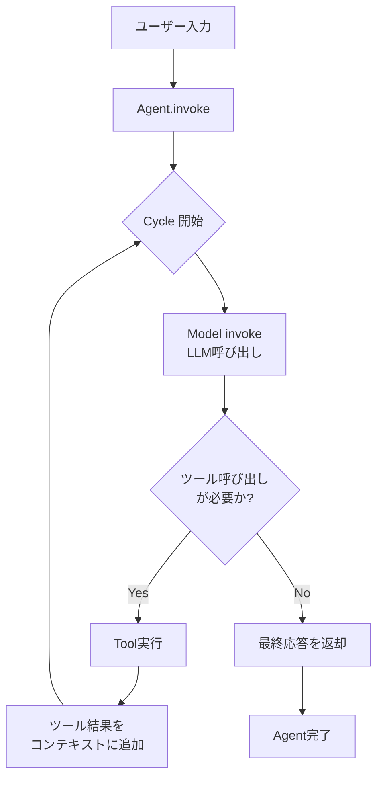
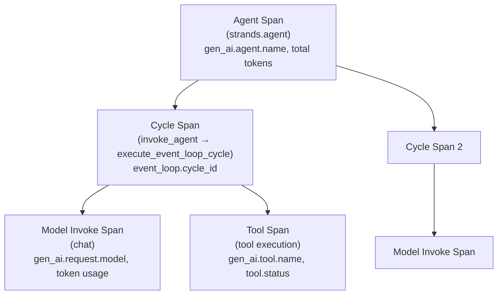

## ブログ概要（Summary）

本記事は [Strands Agents SDK: A technical deep dive into agent architectures and observability](https://aws.amazon.com/blogs/machine-learning/strands-agents-sdk-a-technical-deep-dive-into-agent-architectures-and-observability/) の解説記事です。

AWSが公開したこの技術ブログでは、Strands Agents SDKの内部アーキテクチャ——イベントループ型のエージェント実行モデル、ツール呼び出しメカニズム、そしてOpenTelemetry（OTel）準拠のトレース統合——が詳細に解説されている。Strands Agents SDKは、LLMベースのAIエージェントを構築するためのオープンソースSDKであり、Amazon Bedrock AgentCore Runtimeへのデプロイを前提として設計されている。ブログでは、SDKが自動的に生成するスパン階層（Agent → Cycle → Model invoke / Tool call）と、`StrandsTelemetry`クラスによるOTLPエクスポートの設定方法が具体的なコード例とともに示されている。

この記事は [Zenn記事: AgentCore Runtimeに社内ヘルプデスクをデプロイしOTelトレース監視を実装する](https://zenn.dev/0h_n0/articles/fea34d154cdffc) の深掘りです。

## 情報源

- **種別**: 企業テックブログ（AWS Machine Learning Blog）
- **URL**: [https://aws.amazon.com/blogs/machine-learning/strands-agents-sdk-a-technical-deep-dive-into-agent-architectures-and-observability/](https://aws.amazon.com/blogs/machine-learning/strands-agents-sdk-a-technical-deep-dive-into-agent-architectures-and-observability/)
- **組織**: Amazon Web Services
- **発表時期**: 2026年
- **関連ドキュメント**: [Strands Agents SDK公式ドキュメント - Traces](https://strandsagents.com/docs/user-guide/sdk/observability-evaluation/traces/)

## 技術的背景（Technical Background）

### なぜエージェント専用のSDKが必要か

LLMベースのAIエージェントは、複数回のモデル呼び出しとツール実行をループで繰り返す。AWSブログでは、この実行モデルにおける3つの課題が指摘されている。

1. **非決定性**: 同じ入力でもツール呼び出しの順序や回数が実行ごとに異なる
2. **長時間セッション**: 秒〜分単位の実行時間になり、従来のAPIコール監視では対応できない
3. **可観測性の欠如**: 従来のAPMではエージェント内部の判断過程を可視化できない

Strands SDKはイベントループ型アーキテクチャとOpenTelemetry準拠のテレメトリでこれらに対処する。OTelコミュニティで策定が進むGenAIセマンティックコンベンション（`gen_ai.request.model`等の属性名標準）に準拠し、Jaeger、Grafana Tempo、AWS X-Ray、Datadog等にベンダー非依存で送信できる。

## 実装アーキテクチャ（Architecture）

### イベントループ型エージェントモデル

AWSブログによると、Strands SDKのエージェントは以下のイベントループを実行する。



1つのエージェント呼び出し（`Agent.__call__`または`Agent.invoke`）は、**1つ以上のサイクル（Cycle）**で構成される。各サイクルでは、LLMへの推論リクエスト（Model invoke）が1回行われ、LLMがツール呼び出しを要求した場合はツールが実行される。ツールの結果はコンテキストに追加され、次のサイクルでLLMが再度判断を行う。LLMが最終応答を返すまでこのループが継続する。

### スパン階層構造

Strands SDKが自動的に生成するOpenTelemetryスパンの親子関係は、以下の4層構造になっている。



各スパンに付与される主要属性は以下のとおりである。

| スパン階層 | 主要属性 | 説明 |
|---|---|---|
| **Agent Span** | `gen_ai.system`, `gen_ai.agent.name`, `gen_ai.user.message`, `gen_ai.choice`, `gen_ai.request.model`, `gen_ai.event.start_time`/`end_time`, `gen_ai.usage.*` | エージェント全体の実行。累計トークン数とサイクル数を記録 |
| **Cycle Span** | `event_loop.cycle_id`, `gen_ai.assistant.message`, `gen_ai.choice.message`, `gen_ai.choice.tool.result` | イベントループの1サイクル。LLM判断とツール実行の1往復 |
| **Model Invoke Span** | `gen_ai.operation.name`, `gen_ai.usage.prompt_tokens`, `gen_ai.usage.completion_tokens` | LLMへの1回のリクエスト。プロンプト・完了・トークン使用量 |
| **Tool Span** | `gen_ai.tool.name`, `gen_ai.tool.call.id`, `tool.status` | ツールの実行。ツール名、呼び出しID、成功/エラーステータス |

**キャッシュトークン属性の変遷**: Strands SDKのドキュメントによると、`gen_ai.usage.cache_read.input_tokens`および`gen_ai.usage.cache_creation.input_tokens`が新しい属性名として導入されている。旧属性名（`gen_ai.usage.cache_read_input_tokens`等のアンダースコア区切り）は互換性のために引き続き出力されるが、環境変数`OTEL_SEMCONV_STABILITY_OPT_IN=gen_ai_latest_experimental`を設定すると旧属性名が削除される。

### StrandsTelemetry APIの設計

AWSブログおよびStrands SDK公式ドキュメントによると、テレメトリの設定は`StrandsTelemetry`クラスを通じて行う。APIはメソッドチェーンパターンを採用しており、3行の追加でOTLPエクスポートが有効になる。

```python
from strands.telemetry import StrandsTelemetry

strands_telemetry = StrandsTelemetry()
strands_telemetry.setup_otlp_exporter()
```

`StrandsTelemetry`クラスの主要メソッドは以下のとおりである。

| メソッド | 引数 | 説明 |
|---|---|---|
| `StrandsTelemetry(tracer_provider=None)` | 既存のTracerProvider（省略時はグローバル登録） | インスタンス生成。引数なしの場合、グローバルTracerProviderを自動生成・登録 |
| `setup_otlp_exporter(**kwargs)` | `OTLPSpanExporter`に渡されるキーワード引数（endpoint, headers等） | OTLPプロトコルでスパンを外部コレクターに送信 |
| `setup_console_exporter(**kwargs)` | `ConsoleSpanExporter`に渡されるキーワード引数（out, formatter等） | 標準出力にスパンを出力（デバッグ用） |
| `setup_meter(enable_console_exporter, enable_otlp_exporter)` | 各エクスポーターの有効/無効フラグ | メトリクス用のグローバルMeterProviderを設定 |
| `setup_baggage_processor(predicate)` | キーを受け取りboolを返す関数 | OpenTelemetry Baggageの値をスパン属性に転記 |

メソッドチェーンが可能なため、複数のエクスポーターを1文で設定できる。

```python
strands_telemetry = StrandsTelemetry()
strands_telemetry.setup_otlp_exporter(
    endpoint="http://collector.example.com:4318"
).setup_console_exporter()
```

### エージェントへのカスタム属性付与

エージェント生成時に`trace_attributes`パラメータを指定することで、すべてのスパンにカスタム属性を追加できる。

```python
from strands import Agent

agent = Agent(
    system_prompt="You are a helpful assistant.",
    trace_attributes={"session.id": "abc-1234", "deployment.environment": "production"},
)
```

この機能により、セッションID、環境名、ユーザーIDなどのアプリケーション固有のコンテキストをトレースデータに埋め込み、フィルタリングや分析に活用できる。

### TypeScript対応とOTelなしメトリクス

TypeScript版でも同等のテレメトリ機能を提供している。

```typescript
import { setupTracer } from '@strands-agents/sdk/telemetry';
setupTracer({ exporters: { otlp: true, console: true } });
```

また、OTelエクストラをインストールしなくても`result.metrics.get_summary()`でトークン使用量やサイクル数を確認できる。スパン階層やエクスポート機能には`[otel]`エクストラが必要である。

### 環境変数による動作制御

主要な環境変数は以下のとおりである。

| 環境変数 | 設定例 |
|---|---|
| `OTEL_EXPORTER_OTLP_ENDPOINT` | `http://collector.example.com:4318` |
| `OTEL_SEMCONV_STABILITY_OPT_IN` | `gen_ai_latest_experimental,gen_ai_tool_definitions` |
| `OTEL_TRACES_SAMPLER` / `_ARG` | `traceidratio` / `0.1` |
| `OTEL_RESOURCE_ATTRIBUTES` | `service.name=helpdesk,deployment.environment.name=production` |

AgentCore Runtime上では`OTEL_EXPORTER_OTLP_ENDPOINT`がランタイムにより自動設定されるため、明示的な指定は不要である。

### AgentCore Runtimeとの統合

AgentCore Runtimeにデプロイする場合、`StrandsTelemetry`がスパンを生成し、ADOT SDKがランタイムのコレクター経由でCloudWatch Logs（スパン）とCloudWatch Metrics（メトリクス）に送信する。2026年11月16日以降のエージェントではエージェント専用ロググループがデフォルトで使用される。

## Production Deployment Guide

### AWS実装パターン（コスト最適化重視）

Strands Agents SDKで構築したエージェントをAWS上で本番運用する際の、トラフィック量別推奨構成は以下のとおりである。

**トラフィック量別の推奨構成**:

| 規模 | 月間リクエスト | 推奨構成 | 月額コスト | 主要サービス |
|------|--------------|---------|-----------|------------|
| **Small** | ~3,000 (100/日) | AgentCore CodeZip | $80-200 | AgentCore Runtime + Bedrock + CloudWatch |
| **Medium** | ~30,000 (1,000/日) | AgentCore + ElastiCache | $400-1,000 | AgentCore Runtime + Bedrock + ElastiCache + CloudWatch |
| **Large** | 300,000+ (10,000/日) | AgentCore Runtime Instances | $2,500-6,000 | Runtime Instances (EC2) + Bedrock Batch + CloudWatch |

**Small構成の詳細**（月額$80-200）:
- **AgentCore Runtime（CodeZip）**: マイクロVMベース、セッション持続最大8時間（$0/月、リクエスト課金）
- **Bedrock**: Claude Sonnet 5.5、Prompt Caching有効化（$120/月）
- **CloudWatch**: Transaction Search（1%サンプリング、無料枠内）+ ログ保存（$10/月）
- **ADOT SDK**: オーバーヘッドコストなし（エージェント内で動作）

**Medium構成の詳細**（月額$400-1,000）:
- **AgentCore Runtime（CodeZip）**: 同時実行数制御あり（$0/月、リクエスト課金）
- **Bedrock**: Claude Sonnet 5.5 + Haiku使い分け（$500/月）
- **ElastiCache Redis**: FAQ検索結果キャッシュ、cache.t3.micro（$15/月）
- **CloudWatch**: Transaction Search（5%サンプリング）+ カスタムメトリクス（$30/月）
- **DynamoDB**: セッション状態の永続化（On-Demand、$20/月）

**Large構成の詳細**（月額$2,500-6,000）:
- **AgentCore Runtime Instances**: EC2ベース、最大14日間セッション持続（$500/月）
- **Bedrock**: Claude Sonnet 5.5 + Batch API活用で50%削減（$3,000/月）
- **CloudWatch**: 詳細監視 + Transaction Search（5%サンプリング）（$100/月）
- **X-Ray**: 完全トレース（$50/月）

**コスト試算の注意事項**:
- 上記は2026年11月時点のAWS us-east-1リージョン料金に基づく概算値です
- AgentCore Runtimeの料金体系は従量課金であり、実際のコストはセッション時間とリクエスト数に依存します
- 最新料金は [AWS料金計算ツール](https://calculator.aws/) で確認してください

### Terraformインフラコード

**Small構成（AgentCore CodeZip + CloudWatch Observability）の要点**:

```hcl
# --- IAMロール（AgentCore Runtime用、最小権限） ---
resource "aws_iam_role" "agentcore_runtime" {
  name = "agentcore-strands-runtime-role"
  assume_role_policy = jsonencode({
    Version = "2012-10-17"
    Statement = [{
      Action    = "sts:AssumeRole"
      Effect    = "Allow"
      Principal = { Service = "bedrock-agentcore.amazonaws.com" }
    }]
  })
}

resource "aws_iam_role_policy" "bedrock_invoke" {
  role = aws_iam_role.agentcore_runtime.id
  policy = jsonencode({
    Version = "2012-10-17"
    Statement = [
      {
        Effect   = "Allow"
        Action   = ["bedrock:InvokeModel", "bedrock:InvokeModelWithResponseStream"]
        Resource = "arn:aws:bedrock:us-east-1::foundation-model/us.anthropic.claude-sonnet-5-5*"
      },
      {
        Effect   = "Allow"
        Action   = ["logs:CreateLogGroup", "logs:CreateLogStream", "logs:PutLogEvents"]
        Resource = "arn:aws:logs:us-east-1:*:log-group:/aws/bedrock-agentcore/*"
      }
    ]
  })
}

# --- CloudWatchアラーム（エラー率 + レイテンシP99） ---
resource "aws_cloudwatch_metric_alarm" "agent_error_rate" {
  alarm_name          = "strands-agent-high-error-rate"
  comparison_operator = "GreaterThanThreshold"
  evaluation_periods  = 2
  metric_name         = "TotalErrors"
  namespace           = "AWS/Bedrock-AgentCore"
  period              = 300
  statistic           = "Sum"
  threshold           = 10
  alarm_actions       = [aws_sns_topic.alerts.arn]
}

resource "aws_cloudwatch_metric_alarm" "agent_latency" {
  alarm_name          = "strands-agent-high-latency"
  comparison_operator = "GreaterThanThreshold"
  evaluation_periods  = 2
  metric_name         = "Latency"
  namespace           = "AWS/Bedrock-AgentCore"
  period              = 300
  extended_statistic  = "p99"
  threshold           = 30000
  alarm_actions       = [aws_sns_topic.alerts.arn]
}

resource "aws_sns_topic" "alerts" { name = "strands-agent-alerts" }
```

### セキュリティベストプラクティス

1. **IAMロール**: 最小権限原則。Bedrockモデルアクセスは特定モデルARNに限定
2. **シークレット管理**: AWS Secrets Manager使用。環境変数ハードコード禁止
3. **トレースデータ**: `OTEL_INSTRUMENTATION_GENAI_CAPTURE_MESSAGE_CONTENT=NO_CONTENT`でPII含有リスクを軽減
4. **監査**: CloudTrail + Transaction Searchでエージェント動作を監査

### 運用・監視設定

**CloudWatch Logs Insightsクエリ**:

```sql
-- ツール呼び出し別のレイテンシ分析
fields @timestamp, @message
| filter @message like /gen_ai.tool.name/
| stats avg(@duration) as avg_ms,
        pct(@duration, 95) as p95_ms,
        pct(@duration, 99) as p99_ms
  by bin(1h)

-- サイクル数が多いリクエスト（無限ループ候補の検出）
fields @timestamp, @message
| filter @message like /event_loop.cycle_id/
| stats count(*) as cycle_count by @traceId
| filter cycle_count > 10
| sort cycle_count desc
| limit 20
```

**CloudWatch アラーム設定（Python）**:

```python
import boto3
cloudwatch = boto3.client('cloudwatch')

cloudwatch.put_metric_alarm(
    AlarmName='strands-agent-token-spike',
    ComparisonOperator='GreaterThanThreshold',
    EvaluationPeriods=1,
    MetricName='TokenUsage',
    Namespace='bedrock-agentcore',
    Period=3600, Statistic='Sum', Threshold=500000,
    AlarmActions=['arn:aws:sns:us-east-1:123456789:agent-alerts'],
    AlarmDescription='トークン使用量異常（50万/時間超過）'
)
```

### コスト最適化チェックリスト

- [ ] トラフィック量でアーキテクチャ選択（~100/日: CodeZip $80-200、~1,000/日: +キャッシュ $400-1,000、10,000+/日: Runtime Instances $2,500-6,000）
- [ ] Prompt Caching有効化（`gen_ai.usage.cache_read.input_tokens`でヒット率監視）
- [ ] タスク複雑度に応じたモデル選択（Haiku: 簡易、Sonnet: 複雑）
- [ ] Bedrock Batch API使用（非リアルタイムで50%削減）
- [ ] Transaction Searchサンプリング: 開発100%、本番1-5%
- [ ] `OTEL_TRACES_SAMPLER=traceidratio`でサンプリング制御
- [ ] AWS Budgets月額予算設定（80%警告、100%アラート）
- [ ] Cost Anomaly Detection有効化

## パフォーマンス最適化（Performance）

### トレーシングオーバーヘッドとボトルネック特定

SDKドキュメントではオーバーヘッドは「minimal」と記載されているが、具体的なベンチマーク結果は公開されていない。一般的にBatchSpanProcessorのオーバーヘッドはリクエストあたり数百マイクロ秒程度であり、LLM推論の数秒〜数十秒に対して無視できる。本番環境では`ConsoleSpanExporter`（同期I/O）は避け、`OTLPSpanExporter`（バッチ非同期）を使用すること。

スパン階層を利用したボトルネック特定手順は以下のとおりである。

1. **Agent Span**の総実行時間を確認
2. **Cycle Span**の数を確認（多い場合はツール選択精度の低下を疑う）
3. 各**Model Invoke Span**のレイテンシを比較（コンテキスト長増大の影響を検出）
4. 各**Tool Span**の実行時間を確認（外部APIタイムアウトやDB遅延を検出）

## 運用での学び（Production Lessons）

### セマンティックコンベンション移行とログ分離

`gen_ai_latest_experimental`を有効化すると旧キャッシュトークン属性名が削除される。既存ダッシュボードのクエリが空になる問題を防ぐため、新旧属性名の両方をOR条件でクエリしてから切り替えること。

AWSドキュメントによると、2026年11月16日以降のエージェントではエージェント専用ロググループがデフォルトとなる。既存エージェントでは`UNIFIED_TRACES_DESTINATION_ENABLED=true`を設定しないと共有ロググループ（`/aws/spans/default`）に混在する。

## 学術研究との関連（Academic Connection）

Strands SDKのトレーシングアーキテクチャは、以下の学術研究と関連がある。

- **OpenTelemetry GenAIセマンティックコンベンション**: OTelコミュニティで策定が進むLLMアプリケーション向けの属性標準。Strands SDKはこのコンベンションに準拠することで、ベンダーロックインを回避している
- **AgentTrace（arXiv: 2602.10133）**: UC Berkeleyの研究チームが提案したエージェント可観測性フレームワーク。Operational / Cognitive / Contextualの3層ログモデルを提案しており、Strands SDKのスパン階層と共通する設計思想（イベント駆動、OTel準拠）を持つ
- **AgentOps Survey（arXiv: 2508.02121）**: エージェント運用ツールの体系的調査。Langfuse、OpenLLMetry、Strands SDKを含む主要ツールのOTel対応状況を比較している

Strands SDKには学術研究で提案されているCognitive Surface（推論過程のキャプチャ）やFault Injection（障害注入テスト）は含まれていない。

## まとめと実践への示唆

AWSブログおよびStrands SDK公式ドキュメントで解説されている内容をまとめると、以下の3点が実務上の要点である。

1. **3行の追加でプロダクショングレードのトレーシング**: `StrandsTelemetry`クラスを使い、`setup_otlp_exporter()`を呼ぶだけでModel invoke・Tool callの詳細スパンがOTLPエンドポイントに送信される。AgentCore Runtime上ではエンドポイントが自動設定されるため、設定の手間はさらに少ない

2. **スパン階層によるボトルネック分析**: Agent → Cycle → Model invoke / Tool callの4層構造により、「どのサイクルのどのツール呼び出しが遅いか」を定量的に特定できる。サイクル数の監視は無限ループ検出にも有効である

3. **環境変数による柔軟な制御**: サンプリング比率、セマンティックコンベンションのバージョン、コンテンツキャプチャの有無を環境変数で制御できるため、開発環境と本番環境で同じコードベースを使いつつテレメトリの粒度を切り替えられる

**制約事項**: OTelトレーシングオーバーヘッドの定量的ベンチマークは公開されていない。本番導入前には自環境での検証を推奨する。

## 参考文献

- **Blog URL**: [Strands Agents SDK: A technical deep dive into agent architectures and observability](https://aws.amazon.com/blogs/machine-learning/strands-agents-sdk-a-technical-deep-dive-into-agent-architectures-and-observability/)
- **SDK Docs - Traces**: [Strands Agents SDK - Traces Guide](https://strandsagents.com/docs/user-guide/sdk/observability-evaluation/traces/)
- **SDK Docs - Telemetry API**: [StrandsTelemetry Config API](https://strandsagents.com/docs/api/python/strands.telemetry.config/)
- **AgentCore Observability Docs**: [Amazon Bedrock AgentCore Observability](https://docs.aws.amazon.com/bedrock-agentcore/latest/devguide/observability.html)
- **Related arXiv**: [AgentTrace: A Structured Logging Framework for Agent System Observability (2602.10133)](https://arxiv.org/abs/2602.10133)
- **Related Zenn article**: [AgentCore Runtimeに社内ヘルプデスクをデプロイしOTelトレース監視を実装する](https://zenn.dev/0h_n0/articles/fea34d154cdffc)
