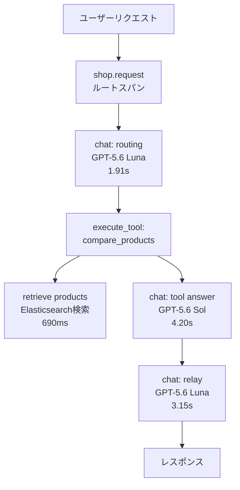

## ブログ概要（Summary）

本記事は [https://www.elastic.co/observability-labs/blog/ai-agent-observability-opentelemetry](https://www.elastic.co/observability-labs/blog/ai-agent-observability-opentelemetry) の解説記事です。

Elastic Observability Labsの Jeffrey Rengifo 氏が2026年11月5日に公開したブログ記事「Three model calls, 92% of the wait」では、LangChainベースのショッピングアシスタントエージェントをOpenTelemetry GenAIセマンティックコンベンションで計装し、Elastic APMのトレースウォーターフォールでボトルネックを特定する手法が紹介されている。ブログの実験結果より、1リクエスト10.10秒のうち3回のモデル呼び出しが約92%の待ち時間を占めること、高性能モデル（Sol）を低コストモデル（Luna）に切り替えることで1,000リクエストあたりのコストを$4.465から$0.889へ76〜83%削減できることが報告されている。

この記事は [Zenn記事: AgentCore Runtimeに社内ヘルプデスクをデプロイしOTelトレース監視を実装する](https://zenn.dev/0h_n0/articles/fea34d154cdffc) の深掘りです。Zenn記事ではAWS AgentCore Runtime上のStrands SDKによるOTelトレースを扱っているが、本記事ではElastic APM上でLangChainエージェントを計装するアプローチを通じて、OpenTelemetry GenAIコンベンションの実践的な活用方法とコスト最適化分析の手法を掘り下げる。

## 情報源

- **種別**: 企業テックブログ（Elastic Observability Labs）
- **URL**: [https://www.elastic.co/observability-labs/blog/ai-agent-observability-opentelemetry](https://www.elastic.co/observability-labs/blog/ai-agent-observability-opentelemetry)
- **著者**: Jeffrey Rengifo
- **発表日**: 2026年11月5日
- **実装コード**: [elastic/elastic-labs GitHub リポジトリ](https://github.com/elastic/elastic-labs/blob/main/supporting-blog-content/observability-labs/langchain-agent-observability-opentelemetry/langchain-agent-observability-opentelemetry.ipynb)

## 技術的背景（Technical Background）

AIエージェントの本番運用では、単一のHTTPリクエストの背後に複数のLLM呼び出し、ツール実行、検索処理が連鎖する。エンドポイントのレスポンスタイムだけを見ても、どのステップがボトルネックか、どのモデル呼び出しがコストを支配しているかは判別できない。

OpenTelemetryプロジェクトは2024年以降、GenAI（生成AI）領域向けのセマンティックコンベンションを策定しており、LLM呼び出し・ツール実行・エージェント起動に対して標準的なスパン属性を定義している。これにより、異なるフレームワーク（LangChain、Strands、CrewAI等）で構築されたエージェントであっても、同一のトレースフォーマットで可視化できる基盤が整いつつある。

ブログで使用されている `opentelemetry-instrumentation-genai-langchain`（バージョン1.1b1）はOpenTelemetryプロジェクト公式のLangChain計装ライブラリであり、Elastic独自のものではない点が重要である。これはElastic、Datadog、Jaeger、Grafana Tempoなど、任意のOTel互換バックエンドにスパンを送信できることを意味する。

### OpenTelemetry GenAIセマンティックコンベンションの主要属性

ブログで使用されているGenAI属性は以下のとおりである。

| 属性名 | スパン種別 | 説明 |
|---|---|---|
| `gen_ai.operation.name` | 全スパン | 操作種別（`invoke_agent`, `execute_tool`, `chat`） |
| `gen_ai.agent.name` | Agent | エージェント名 |
| `gen_ai.tool.name` | Tool | ツール名 |
| `gen_ai.request.model` | Chat | リクエスト時のモデル指定 |
| `gen_ai.response.model` | Chat | 実際に応答したモデル |
| `gen_ai.provider.name` | Chat | プロバイダー名 |
| `gen_ai.usage.input_tokens` | Chat | 入力トークン数 |
| `gen_ai.usage.output_tokens` | Chat | 出力トークン数 |
| `gen_ai.usage.cache_read.input_tokens` | Chat | キャッシュ読み取りトークン数 |
| `gen_ai.usage.reasoning.output_tokens` | Chat | 推論トークン数（出力として課金） |

ブログでは、`gen_ai.usage.input_tokens`にはキャッシュ読み取りトークンが含まれており、コスト計算時にはキャッシュトークンを別単価で計上する必要があると注意を促している。また、推論モデルでは`gen_ai.usage.output_tokens`に推論トークンが含まれるかどうかをプロバイダーごとに確認すべきとされている。

## 実装アーキテクチャ（Architecture）

### システム構成

ブログで実装されているショッピングアシスタントは、コーヒーメーカーの比較とストアポリシーの案内を行うLangChainエージェントである。



ブログの計測結果より、エージェントは1リクエストで以下の3回のモデル呼び出しを行う。

1. **ルーティング呼び出し（Luna）**: ユーザーの質問を分類し適切なツールへ振り分ける（1.91秒）
2. **ツール応答生成（Sol / Luna）**: 商品比較にはSolモデル、ポリシー回答にはLunaモデルを使用（Sol: 4.20秒）
3. **リレー呼び出し（Luna）**: ツールの出力をユーザー向けに整形して返す（3.15秒）

### 計装の実装方法

ブログでは、以下のバージョン構成で検証が行われている。

| コンポーネント | バージョン |
|---|---|
| Python | 3.12 |
| LangChain | 1.4.0 |
| OpenTelemetry SDK | 1.44.0 |
| GenAI LangChain計装 | 1.1b1 |
| Elastic Cloud Hosted | 9.6 |

計装のセットアップは2段階で行われる。まず`TracerProvider`を設定し、次にLangChain計装を有効化する。

```python
from opentelemetry import trace
from opentelemetry.sdk.trace import TracerProvider
from opentelemetry.sdk.trace.export import BatchSpanProcessor
from opentelemetry.exporter.otlp.proto.http.trace_exporter import OTLPSpanExporter
from opentelemetry.sdk.resources import Resource
from opentelemetry.instrumentation.genai.langchain import LangChainInstrumentor

resource = Resource.create({"service.name": "shop-assistant"})
provider = TracerProvider(resource=resource)
processor = BatchSpanProcessor(OTLPSpanExporter(
    endpoint=os.environ["OTEL_EXPORTER_OTLP_ENDPOINT"],
    headers={"Authorization": os.environ["OTEL_EXPORTER_OTLP_HEADERS"]},
))
provider.add_span_processor(processor)
trace.set_tracer_provider(provider)

LangChainInstrumentor().instrument()
```

ブログでは、ゼロコード計装の代替手段として、EDOT Python（Elastic Distribution of OpenTelemetry）+ LangChain計装ライブラリを`opentelemetry-instrument`コマンドで起動する方法も紹介されている。ただし、OpenLLMetryとGenAI LangChain計装を同時にインストールすると、両者が`langchain`という同じ計装名を登録するため競合する点に注意が必要である。

### プロンプト・レスポンスの取得モード

`OTEL_INSTRUMENTATION_GENAI_CAPTURE_MESSAGE_CONTENT`環境変数で、プロンプトとレスポンスの記録方法を制御できる。

| モード | 動作 | 用途 |
|---|---|---|
| `NO_CONTENT`（デフォルト） | テキスト記録なし | 本番環境（PII保護） |
| `SPAN_ONLY` | スパン属性に記録 | 開発・デバッグ |
| `EVENT_ONLY` | 別OTelログイベントに記録 | 本番（リダクション・個別保持期間対応） |
| `SPAN_AND_EVENT` | 両方に記録 | 開発（全情報取得） |

ブログでは、`SPAN_ONLY`を使うとスパン属性がすべてのトレースとともにインデックス化されるため、ストレージコストとPII露出リスクが増大すると指摘されている。本番環境では`NO_CONTENT`または`EVENT_ONLY`が推奨される。

### エージェント呼び出し時のメタデータ

LangChain計装（バージョン1.1b1）では、`agent.invoke()`に`config={"metadata": {"agent_name": "shop_assistant"}}`を渡さないと、トップレベルのスパンが`invoke_workflow`として記録される。エージェント名を明示的に渡すことで`invoke_agent shop_assistant`としてトレースに表示される。

## パフォーマンス最適化（Performance）

### レイテンシ分析

ブログの計測結果より、コンパクトな質問（1件の商品比較）に対する処理時間の内訳は以下のとおりである。

| ステップ | 所要時間 | 割合 |
|---|---|---|
| ルーティング（Luna） | 1.91秒 | 18.9% |
| Elasticsearch検索 | 0.69秒 | 6.8% |
| ツール応答生成（Sol） | 4.20秒 | 41.6% |
| リレー呼び出し（Luna） | 3.15秒 | 31.2% |
| その他のオーバーヘッド | 0.15秒 | 1.5% |
| **合計** | **10.10秒** | **100%** |

3回のモデル呼び出しで合計9.26秒、全体の約92%を占めている。ブログでは、ツールスパンの`duration`にはその子スパン（モデル呼び出し＋検索）が含まれるため、単純加算するとダブルカウントになると注意を促している。エンドツーエンドの所要時間はルートスパンで確認すべきである。

Solモデルの1回の呼び出しで、入力680トークン・出力268トークンを消費し、コストは$0.00404であった（ブログの計測結果より）。リクエスト全体のコスト$0.00454のうち89%をこの1回のSol呼び出しが占めている。

### モデル置換実験

ブログでは、商品比較ツールのモデルをSol（高性能・高コスト）からLuna（低コスト）に切り替える実験を、5種類の質問 × 3回の繰り返し（温度0、リトライ無効）で実施している。

| 指標 | Sol（ベースライン） | Luna（候補） | 変化率 |
|---|---|---|---|
| コスト/1,000リクエスト（compact質問） | $4.465 | $0.889 | **-80.1%** |
| 平均レイテンシ（compact質問） | 8.89秒 | 8.54秒 | -3.9% |
| 正答チェック | パス | パス | 同等 |

ブログの実験結果より、全30リクエストの総プロバイダー報告コストは$0.05347であった。コストは76〜83%削減された一方、レイテンシは5つの質問のうち4つで悪化しており、cost/latencyトレードオフが存在することが示されている。

ブログの著者は、「コストとレイテンシは別々に計測すべきであり、本番環境でモデルを変更する前により大規模なテストが必要」と結論付けている。

### リレー呼び出しの排除

ブログでは、`compare_products`ツールに`@tool(return_direct=True)`を設定することで、3回目のリレー呼び出し（3.15秒）をスキップし、ツールの出力をそのままユーザーに返す最適化が提案されている。この変更によりレイテンシとコストの両方が削減される可能性があるが、ブログでは実測結果は報告されておらず、同じ5つの質問で再検証することが推奨されている。

## 運用での学び（Production Lessons）

### コスト追跡の実装パターン

ブログでは、OpenTelemetryのGenAIコンベンションがトークン数のみを標準属性として定義しており、金額ベースのコストは標準化されていない点が指摘されている。ブログの実装では、以下の方法でリクエスト単位のコストを追跡している。

1. OpenRouterのAPIレスポンスに含まれる`usage.cost`フィールドをLangChainのコールバックで収集
2. リクエスト全体のコストを合算し、ルートスパンのカスタム属性`app.model_cost.usd`に記録
3. ES|QLクエリでこの属性を集約し、質問パターンごとの平均コストを分析

この`app.model_cost.usd`にはモデル使用料のみが含まれ、Elasticsearch検索コスト・推論インフラコスト・ネットワークコストは含まれない。トークンから金額を推定する場合は、キャッシュトークンと推論トークンの単価差を考慮する必要がある。

### ES|QLによるトレース分析

ブログでは、`traces-generic.otel-default`インデックスに対するES|QLクエリで、モデル別の呼び出し回数・平均レイテンシ・トークン消費量を分析している。ブログの分析結果より、Sol（15回呼び出し、平均3,151ms）とLuna（78回呼び出し、平均2,276ms）のパフォーマンス差が定量化されている。

```sql
-- モデル別のパフォーマンス分析クエリ（ブログで紹介されている形式）
FROM traces-generic.otel-default
| WHERE attributes.gen_ai.operation.name == "chat"
| STATS
    call_count = COUNT(*),
    avg_duration_ms = AVG(duration),
    total_input_tokens = SUM(attributes.gen_ai.usage.input_tokens),
    total_output_tokens = SUM(attributes.gen_ai.usage.output_tokens)
  BY attributes.gen_ai.response.model
```

### A/Bテスト実験のクエリパターン

ブログでは、実験のベースライン/候補を`app.case`と`app.variant`というカスタムスパン属性で区別し、ES|QLで集約する手法が紹介されている。このクエリをElasticsearchのクエリルールとして登録すれば、コストや平均レイテンシが閾値を超えた場合にアラートを発火できる。

## Production Deployment Guide

### AWS実装パターン（コスト最適化重視）

ブログのアーキテクチャ（LangChain + OpenTelemetry + Elastic APM）をAWS上で本番運用する場合の構成を示す。コスト試算は2026年11月時点のAWS ap-northeast-1（東京）リージョン料金に基づく概算値であり、実際のコストはトラフィックパターンやバースト使用量により変動する。最新料金は[AWS料金計算ツール](https://calculator.aws/)で確認すること。

**トラフィック量別の推奨構成**:

| 規模 | 月間リクエスト | 推奨構成 | 月額コスト | 主要サービス |
|------|--------------|---------|-----------|------------|
| **Small** | ~3,000 (100/日) | Serverless | $80-200 | Lambda + Bedrock + OpenSearch Serverless + Elastic Cloud |
| **Medium** | ~30,000 (1,000/日) | Hybrid | $400-1,000 | ECS Fargate + Bedrock + ElastiCache + Elastic Cloud |
| **Large** | 300,000+ (10,000/日) | Container | $2,500-6,000 | EKS + Karpenter + Bedrock Batch + Elastic Cloud |

**Small構成の詳細**（月額$80-200）:
- **Lambda**: 1GB RAM, 60秒タイムアウト（$25/月）
- **Bedrock**: Claude 3.5 Haiku, Prompt Caching有効（$80/月）
- **OpenSearch Serverless**: 商品検索用（$25/月、最小OCU）
- **Elastic Cloud**: Observability用（$30/月、Standard tier）
- **OTel Collector**: Lambda Layer経由（追加コストなし）
- **CloudWatch**: 基本監視（$5/月）

**Medium構成の詳細**（月額$400-1,000）:
- **ECS Fargate**: 0.5 vCPU, 1GB RAM × 2タスク（$120/月）
- **Bedrock**: Claude 3.5 Sonnet, Prompt Caching有効（$500/月）
- **ElastiCache Redis**: cache.t3.micro, レスポンスキャッシュ（$15/月）
- **OpenSearch Serverless**: 商品検索（$50/月）
- **Elastic Cloud**: Observability + APM（$80/月）
- **ALB**: Application Load Balancer（$20/月）

**コスト削減テクニック**:
- Spot Instances使用で最大90%削減（EKS + Karpenter）
- Bedrock Batch API使用で50%削減（非リアルタイム処理）
- Prompt Caching有効化で30-90%削減
- ブログの実験結果に倣い、高コストモデルから低コストモデルへの切り替えで76-83%削減

### Terraformインフラコード

**Small構成（Serverless）: Lambda + Bedrock + OTel計装**

```hcl
# --- IAMロール（最小権限） ---
resource "aws_iam_role" "lambda_agent" {
  name = "langchain-agent-role"

  assume_role_policy = jsonencode({
    Version = "2012-10-17"
    Statement = [{
      Action = "sts:AssumeRole"
      Effect = "Allow"
      Principal = { Service = "lambda.amazonaws.com" }
    }]
  })
}

resource "aws_iam_role_policy" "bedrock_invoke" {
  role = aws_iam_role.lambda_agent.id

  policy = jsonencode({
    Version = "2012-10-17"
    Statement = [{
      Effect   = "Allow"
      Action   = ["bedrock:InvokeModel", "bedrock:InvokeModelWithResponseStream"]
      Resource = "arn:aws:bedrock:ap-northeast-1::foundation-model/anthropic.claude-3-5-haiku*"
    }]
  })
}

# --- Lambda関数（OTel計装付き） ---
resource "aws_lambda_function" "agent_handler" {
  filename      = "lambda.zip"
  function_name = "langchain-agent-handler"
  role          = aws_iam_role.lambda_agent.arn
  handler       = "index.handler"
  runtime       = "python3.12"
  timeout       = 60
  memory_size   = 1024

  layers = [
    "arn:aws:lambda:ap-northeast-1:901920570463:layer:aws-otel-python-amd64-ver-1-25-0:1"
  ]

  environment {
    variables = {
      AWS_LAMBDA_EXEC_WRAPPER                              = "/opt/otel-instrument"
      OTEL_SERVICE_NAME                                    = "shop-assistant"
      OTEL_EXPORTER_OTLP_ENDPOINT                         = var.elastic_otlp_endpoint
      OTEL_EXPORTER_OTLP_HEADERS                          = "Authorization=ApiKey ${var.elastic_api_key}"
      OTEL_INSTRUMENTATION_GENAI_CAPTURE_MESSAGE_CONTENT   = "NO_CONTENT"
      BEDROCK_MODEL_ID                                     = "anthropic.claude-3-5-haiku-20241022-v1:0"
    }
  }
}

# --- CloudWatchアラーム（コスト監視） ---
resource "aws_cloudwatch_metric_alarm" "lambda_duration" {
  alarm_name          = "agent-duration-spike"
  comparison_operator = "GreaterThanThreshold"
  evaluation_periods  = 2
  metric_name         = "Duration"
  namespace           = "AWS/Lambda"
  period              = 300
  statistic           = "Average"
  threshold           = 30000
  alarm_description   = "エージェント平均レイテンシ30秒超過（ブログ実験値10秒の3倍）"

  dimensions = {
    FunctionName = aws_lambda_function.agent_handler.function_name
  }
}
```

**Large構成（Container）: EKS + Karpenter + Spot Instances**

```hcl
# --- EKSクラスタ ---
module "eks" {
  source  = "terraform-aws-modules/eks/aws"
  version = "~> 20.0"

  cluster_name    = "agent-observability-cluster"
  cluster_version = "1.31"

  vpc_id     = module.vpc.vpc_id
  subnet_ids = module.vpc.private_subnets

  cluster_endpoint_public_access = true
  enable_cluster_creator_admin_permissions = true
}

# --- Karpenter（Spot優先スケーリング） ---
resource "kubectl_manifest" "karpenter_provisioner" {
  yaml_body = <<-YAML
    apiVersion: karpenter.sh/v1alpha5
    kind: Provisioner
    metadata:
      name: spot-provisioner
    spec:
      requirements:
        - key: karpenter.sh/capacity-type
          operator: In
          values: ["spot"]
        - key: node.kubernetes.io/instance-type
          operator: In
          values: ["m6i.xlarge", "m6i.2xlarge"]
      limits:
        resources:
          cpu: "32"
          memory: "128Gi"
      ttlSecondsAfterEmpty: 30
  YAML
}

# --- OTel Collector DaemonSet ---
resource "kubectl_manifest" "otel_collector" {
  yaml_body = <<-YAML
    apiVersion: apps/v1
    kind: DaemonSet
    metadata:
      name: otel-collector
      namespace: observability
    spec:
      selector:
        matchLabels:
          app: otel-collector
      template:
        metadata:
          labels:
            app: otel-collector
        spec:
          containers:
            - name: collector
              image: otel/opentelemetry-collector-contrib:0.115.0
              ports:
                - containerPort: 4318
                  protocol: TCP
              volumeMounts:
                - name: config
                  mountPath: /etc/otelcol-contrib
          volumes:
            - name: config
              configMap:
                name: otel-collector-config
  YAML
}

# --- Cost Explorer予算アラート ---
resource "aws_budgets_budget" "agent_monthly" {
  name         = "agent-monthly-budget"
  budget_type  = "COST"
  limit_amount = "6000"
  limit_unit   = "USD"
  time_unit    = "MONTHLY"

  notification {
    comparison_operator        = "GREATER_THAN"
    threshold                  = 80
    threshold_type             = "PERCENTAGE"
    notification_type          = "ACTUAL"
    subscriber_email_addresses = ["ops@example.com"]
  }
}
```

### セキュリティベストプラクティス

**本番環境での推奨設定**:

1. **プロンプト・レスポンスの保護**: `OTEL_INSTRUMENTATION_GENAI_CAPTURE_MESSAGE_CONTENT=NO_CONTENT`を本番環境で使用し、PII漏洩を防止。デバッグ時のみ`EVENT_ONLY`に切り替え
2. **OTelエクスポーターの認証**: APIキーはAWS Secrets Manager経由で注入。環境変数へのハードコード禁止
3. **ネットワーク分離**: OTel CollectorはVPC内のプライベートサブネットに配置。Elastic Cloudへの送信はVPCエンドポイント経由
4. **IAMロール**: Bedrock `InvokeModel`の最小権限。モデルARNを明示的に指定
5. **トレースデータの保持期間**: ES|QLクエリで必要な期間のみインデックス保持。コスト削減のためILM（Index Lifecycle Management）を設定

### 運用・監視設定

**CloudWatch Logs Insightsクエリ**:

```sql
-- Lambda実行時間の異常検知
fields @timestamp, @duration
| filter @type = "REPORT"
| stats avg(@duration) as avg_ms,
        pct(@duration, 95) as p95_ms,
        pct(@duration, 99) as p99_ms
  by bin(1h)
| filter p99_ms > 30000
```

**ES|QLによるコスト異常検知**:

```sql
-- ブログで紹介されたモデル別コスト分析（Elastic APM側）
FROM traces-generic.otel-default
| WHERE attributes.gen_ai.operation.name == "chat"
| STATS
    call_count = COUNT(*),
    avg_duration_ms = AVG(duration),
    total_input = SUM(attributes.gen_ai.usage.input_tokens),
    total_output = SUM(attributes.gen_ai.usage.output_tokens)
  BY attributes.gen_ai.response.model
| SORT total_output DESC
```

**CloudWatchアラーム設定（Python）**:

```python
import boto3

cloudwatch = boto3.client('cloudwatch')

cloudwatch.put_metric_alarm(
    AlarmName='agent-latency-p99',
    ComparisonOperator='GreaterThanThreshold',
    EvaluationPeriods=2,
    MetricName='Duration',
    Namespace='AWS/Lambda',
    Period=300,
    ExtendedStatistic='p99',
    Threshold=30000,
    AlarmDescription='エージェントP99レイテンシ30秒超過',
    AlarmActions=['arn:aws:sns:ap-northeast-1:123456789:agent-alerts'],
)
```

**X-Rayトレーシング設定**:

```python
from aws_xray_sdk.core import xray_recorder, patch_all

patch_all()

@xray_recorder.capture('langchain_agent_invoke')
def invoke_agent(query: str) -> str:
    xray_recorder.put_annotation('agent_name', 'shop-assistant')
    xray_recorder.put_metadata('query_length', len(query))
    result = agent.invoke({"input": query})
    xray_recorder.put_metadata('token_count', result.get('total_tokens', 0))
    return result['output']
```

### コスト最適化チェックリスト

**アーキテクチャ選択（トラフィック量で判断）**:
- [ ] ~100 req/日 → Lambda + Bedrock（Serverless） - $80-200/月
- [ ] ~1,000 req/日 → ECS Fargate + Bedrock（Hybrid） - $400-1,000/月
- [ ] 10,000+ req/日 → EKS + Spot Instances（Container） - $2,500-6,000/月

**リソース最適化**:
- [ ] EC2: Spot Instances優先（最大90%削減、Karpenter自動管理）
- [ ] Reserved Instances: 1年コミットで72%削減（予測可能な負荷）
- [ ] Lambda: メモリサイズ最適化（CloudWatch Lambda Insights分析）
- [ ] ECS/EKS: アイドルタイムのスケールダウン（夜間0台）
- [ ] OTel Collector: DaemonSetで共有（Pod単位のサイドカーより効率的）

**LLMコスト削減**（ブログの実験手法を適用）:
- [ ] トレースベースのモデル選択最適化: 高コストモデルが不要なステップを特定し低コストモデルに切り替え（76-83%削減の可能性）
- [ ] Bedrock Batch API: 非リアルタイム処理で50%削減
- [ ] Prompt Caching有効化: 30-90%削減
- [ ] `@tool(return_direct=True)`: 不要なリレー呼び出しの排除
- [ ] トークン数制限: `max_tokens`設定で過剰生成防止

**監視・アラート（コスト異常の即時検知）**:
- [ ] AWS Budgets: 月額予算設定（80%で警告、100%でアラート）
- [ ] Elastic APM: ES|QLクエリでモデル別コスト推移を監視
- [ ] CloudWatch アラーム: Lambda実行時間スパイク検知
- [ ] Cost Anomaly Detection: 自動異常検知

**リソース管理**:
- [ ] Elasticsearchインデックスライフサイクル: 30日でhot→warm、90日で削除
- [ ] タグ戦略: 環境別（dev/staging/prod）でコスト可視化
- [ ] OTelサンプリング: 本番は`traceidratio`で5-10%サンプリング
- [ ] 未使用リソース: Lambda Insights + Trusted Advisorで検出

## 学術研究との関連（Academic Connection）

OpenTelemetry GenAIセマンティックコンベンションは、学術分野でのLLMオブザーバビリティ研究と密接に関連している。AgentTrace（arXiv: 2602.10133、UC Berkeley、2026年）は、エージェントのオペレーショナル・コグニティブ・コンテクスチュアルの3つの表面でOTelスパンを生成するフレームワークを提案しており、ブログで使用されているGenAI属性体系と共通の設計思想を持つ。

また、llmmas-otel（arXiv: 2608.24271、TU Delft、2026年）は、OTelトレーシングにフォルト注入を組み合わせたマルチエージェントシステム向けツールであり、ブログのA/Bテスト手法を障害耐性テストに拡張する方向性を示している。

ブログの手法は、学術的なオブザーバビリティフレームワークを実践的なコスト最適化分析に応用した具体例として位置づけられる。

## まとめと実践への示唆

ブログで紹介された手法の要点は以下の3つである。

1. **OpenTelemetry GenAIコンベンションによる標準化**: LangChain計装ライブラリ（OTelプロジェクト公式）を使うことで、フレームワーク非依存のトレース基盤を構築できる。Elastic以外のバックエンド（Jaeger、Grafana Tempo、AWS X-Ray等）にも同一のスパンを送信可能
2. **トレースベースのコスト分析**: モデル別のトークン消費量とレイテンシをスパン属性から定量化し、どのステップがコストを支配しているかを特定する。ブログの実験ではSolモデルの1回の呼び出しがリクエストコストの89%を占めることが判明
3. **データ駆動のモデル選択**: 高コストモデルから低コストモデルへの切り替えは、コスト（76-83%削減）とレイテンシ（質問によっては悪化）のトレードオフがあり、本番環境での十分なA/Bテストが必要

Zenn記事で扱っているAWS AgentCore + Strands SDK環境では、`StrandsTelemetry.setup_otlp_exporter()`により同等のGenAIスパンが生成される。ブログの分析手法（ES|QLクエリ、モデル別集約、A/Bテスト設計）はCloudWatch Logs InsightsやTransaction Searchにも応用できるため、バックエンドに依存しない汎用的なアプローチといえる。

## 参考文献

- **Blog URL**: [Three model calls, 92% of the wait: AI agent observability with OpenTelemetry](https://www.elastic.co/observability-labs/blog/ai-agent-observability-opentelemetry)
- **実装コード**: [elastic/elastic-labs GitHub](https://github.com/elastic/elastic-labs/blob/main/supporting-blog-content/observability-labs/langchain-agent-observability-opentelemetry/langchain-agent-observability-opentelemetry.ipynb)
- **OpenTelemetry GenAI Semantic Conventions**: [opentelemetry.io](https://opentelemetry.io/docs/specs/semconv/gen-ai/)
- **Related arXiv (AgentTrace)**: [arXiv:2602.10133](https://arxiv.org/abs/2602.10133)
- **Related arXiv (llmmas-otel)**: [arXiv:2608.24271](https://arxiv.org/abs/2608.24271)
- **Related Zenn article**: [AgentCore Runtimeに社内ヘルプデスクをデプロイしOTelトレース監視を実装する](https://zenn.dev/0h_n0/articles/fea34d154cdffc)
