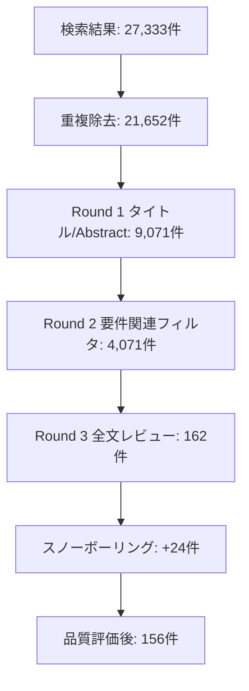
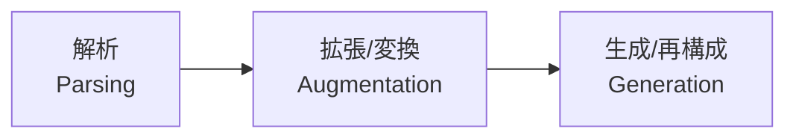

## 論文概要（Abstract）

本記事は [https://arxiv.org/abs/2502.18694](https://arxiv.org/abs/2502.18694) の解説記事です。

Requirements-Driven Automated Software Testing（REDAST）とは、ソフトウェアの要件仕様を入力としてテスト成果物を自動生成する研究領域である。Wang, Arora, Tantithamthavorn, Huang, Aletiの5名（Monash大学）は、6つの学術データベースから27,333件の論文を収集し、最終的に156件の一次研究を選定して体系的レビューを実施した。著者らは、要件入力・変換技術・テスト成果物・評価手法の4段階タクソノミーを提案し、自然言語やルールベース技術が主流である一方、機械学習ベースの手法やLLM活用が大幅に不足していると報告している。本レビューはTOSEM（ACM Transactions on Software Engineering and Methodology）に採録されている。

この記事は [Zenn記事: Kiroスペック駆動開発×git worktreeでモノレポリファクタリングを並列化しCI検証を自動化する](https://zenn.dev/0h_n0/articles/8a678eb93c4aca) の深掘りです。Kiroのスペック駆動開発では要件（requirements.md）からタスク（tasks.md）を自動生成するが、本サーベイはその延長線上にある「要件からテストを自動生成する」研究の全体像を俯瞰するものである。

## 情報源

- **arXiv ID**: 2502.18694
- **URL**: [https://arxiv.org/abs/2502.18694](https://arxiv.org/abs/2502.18694)
- **著者**: Fanyu Wang, Chetan Arora, Chakkrit Tantithamthavorn, Kaicheng Huang, Aldeida Aleti（Monash University）
- **発表年**: 2025（v1: 2025年2月、v2: 2025年8月改訂）
- **採録先**: TOSEM（ACM Transactions on Software Engineering and Methodology）
- **分野**: cs.SE（ソフトウェア工学）

## 背景と動機（Background & Motivation）

ソフトウェアテストの自動化において、コードからテストを生成する手法（例：ファジングや記号実行）は広く研究されてきた。しかし、**要件仕様を起点とする**テスト自動生成は、異なる課題を持つ。要件は自然言語やUMLモデルなど多様な形式で記述され、曖昧性を含むことが多い。一方で、要件に基づくテストは受入テストやシステムテストとして品質保証の根幹を担う。

著者らは、既存のサーベイが30件以下の論文しかカバーしていない（Mustafa et al., 2021は30件、Unterkalmsteiner et al., 2015はアラインメントのみ）ことを指摘し、REDAST概念の初出である1992年から2024年までの約30年間を包括的にカバーする必要性を主張している。

スペック駆動開発の文脈では、Kiroのようなツールが要件→設計→タスクの変換を自動化しているが、**要件→テストの変換**はまだ成熟していない領域である。本サーベイはその現状と課題を明らかにするものである。

## 主要な貢献（Key Contributions）

- **貢献1**: 6データベースから27,333件を収集し、156件の一次研究を選定した大規模体系的レビュー
- **貢献2**: 要件入力→変換技術→テスト成果物→評価の4段階タクソノミーの提案
- **貢献3**: テスト成果物の標準化された語彙の定義（テスト計画、テストケース、テストシナリオ、テストベクタ、テストモデル、テストオラクル、テストスクリプト、テストデータ、テストレポート、テスト分析の10種類）
- **貢献4**: 要件形式・変換技術・テスト成果物間のクロス分析
- **貢献5**: LLM活用を含む10項目の研究ロードマップの提示

## 体系的レビューの方法論（Methodology）

### 文献選定プロセス

著者らはKitchenham et al.（2022）のSLRガイドライン、Petersen et al.（2015）のマッピング手法、Wohlin（2014）のスノーボーリング手法に基づき、以下の4段階で文献を選定したと報告している。

**検索対象データベース（6つ）**: IEEE Xplore、ACM Digital Library、Wiley、Scopus、Web of Science、ScienceDirect

**検索クエリ**: 4つの用語グループ（Test: `test*`、Requirement: `requirement* OR use case* OR user stor* OR specification*`、Software: `software* OR system*`、Method: `generat* OR deriv* OR map* OR creat* OR extract* OR design* OR priorit* OR construct* OR transform*`）をAbstractに対して適用。

**選定基準**:
- 包含: 要件駆動型のシステム/受入テスト生成に関する研究、査読付き学術論文
- 除外: コードのみからの生成、要件入力なし、5ページ未満、二次/三次研究、ビジョン論文/灰色文献

### 品質評価

4項目の品質評価基準（QA1-QA4）を設定し、すべての156件が要件からテスト生成への明確な方法論を持つことを確認したと著者らは報告している。

## 技術的詳細：4段階タクソノミー

### RQ1: 要件入力（Requirements Input）

著者らの分類によると、156件の研究における要件入力は以下のように分布する。

**入力形式（複数ラベルのため合計は156を超える）**:

| 形式 | 研究数 | 割合 |
|------|--------|------|
| テキスト形式 | 105 | 67.3% |
| モデルベース | 54 | 34.6% |
| 形式的/半形式的 | 20 | 12.8% |
| 表形式/マトリクス | 7 | 4.5% |

**記法（Notation）**:

| 記法 | 研究数 |
|------|--------|
| UML | 50 |
| 自然言語（NL） | 49 |
| DSL（ドメイン固有言語） | 32 |
| 制約付き自然言語（CNL） | 23 |
| SCR（Software Cost Reduction） | 3 |

著者らは、ほぼすべての研究が**機能要件**を対象としており、非機能要件（NFR）を扱う研究は約21件にとどまると指摘している。NFRの研究は安全性が重要なシステムや組込みシステムに集中している。

Kiroのスペック駆動開発との関連では、requirements.mdはEARS記法（制約付き自然言語の一種）で記述される。CNLは23件の研究で使用されており、テスト生成の入力として一定の基盤がある。

### RQ2: 変換技術（Transformation）

変換プロセスは3つのフェーズで構成される。

**各フェーズの技術別研究数**:

| 技術 | 解析 | 拡張/変換 | 生成/再構成 |
|------|------|----------|------------|
| ルールベース | 44 | 83 | 55 |
| ツール支援 | 84 | 50 | 74 |
| グラフベース | 6 | 29 | 35 |
| MLベース | 10 | 6 | 5 |
| 手動介入 | 41 | — | — |

著者らは、**ルールベース手法が全フェーズで主流**であり、MLベース手法は解析フェーズでわずか10件、拡張で6件、生成で5件にとどまると報告している。特に、解析フェーズでは約26%の研究が手動介入を必要としており、完全自動化の障壁となっている。

**中間表現（Intermediate Representation）**:

| 中間表現タイプ | 研究数 |
|-------------|--------|
| モデルベース | 59 |
| グラフベース | 35 |
| 構造的/形式的 | 34 |
| テスト関連 | 15 |

著者らの分析によると、**66件の研究が逐次的フレームワークと単一の中間表現の組み合わせ**を採用しており、これが最も一般的なパターンである。並列処理やループ構造を持つフレームワークは少数にとどまる。

**追加入力**: 履歴データ（2件）、要件文書（3件）、ソースコード（2件）など、文脈情報を活用する研究は極めて少ない。著者らは、RAG（Retrieval-Augmented Generation）やLLMを活用した文脈的入力の活用を今後の重要方向として提案している。

### RQ3: テスト成果物（Test Artifacts）

**テスト開発段階別の成果物数**:

| 段階 | 成果物数 |
|------|---------|
| 設計（Designing） | 120 |
| 実行（Execution） | 25 |
| 計画（Planning） | 13 |
| レポート（Reporting） | 3 |

**テスト成果物タイプ別**:

| 成果物 | 研究数 | 段階 |
|--------|--------|------|
| テストケース | 81 | 設計 |
| テストシナリオ | 19 | 設計 |
| テストスクリプト | 16 | 実行 |
| テストケース優先順位付け | 13 | 計画 |
| テストオラクル | 6 | 実行 |
| テストモデル | 5 | 設計 |
| テストベクタ | 4 | 設計 |

著者らは、テストケース生成が研究の中心であり、**テストオラクルの自動生成やレポート段階の自動化は大きな未開拓領域**であると指摘している。

**カバレッジ基準**:

| 基準 | 研究数 |
|------|--------|
| 要件/ユースケースカバレッジ | 61 |
| 振る舞い/シナリオカバレッジ | 37 |
| パスカバレッジ | 16 |
| 機能カバレッジ | 11 |
| 判定/分岐カバレッジ | 6 |
| 文カバレッジ | 5 |
| コードカバレッジ | 2 |

要件カバレッジが最も一般的な基準であり、コードカバレッジはわずか2件にとどまる。これは、REDAST研究がコードレベルではなく**仕様レベルでのテスト十分性**を重視していることを示している。

**最頻出の変換パイプライン**: テキスト入力 → ツール支援変換 → テストケース生成（21件）

### RQ4: 評価手法（Results Demonstration）

| 評価タイプ | 研究数 |
|-----------|--------|
| 概念的ケースデモ | 69 |
| 実産業ケースデモ | 66 |
| データセット評価 | 4 |
| 評価なし | 23 |

著者らは、**標準ベンチマークの欠如**がREDAST研究の最大の障壁の一つであると指摘している。データセットを使用した評価はわずか4件にとどまり、再現性と比較可能性が著しく制限されている。

対象システム分野では、自動車（20件）、制御システム（18件）、安全関連（17件）、受注システム（16件）が上位を占めている。

### RQ5: 自動化レベルと課題

**自動化レベル別研究数**:

| レベル | 研究数 |
|--------|--------|
| 高度自動化（Highly） | 77 |
| 半自動化（Semi） | 39 |
| 完全自動化（Fully） | 35 |
| 低自動化（Low） | 5 |

著者らの分析によると、**完全自動化を達成している研究は156件中わずか35件（22.4%）**にとどまる。解析フェーズの手動介入（26%の研究）が完全自動化の主要なボトルネックとなっている。

**主要な課題（制限事項別）**:

| 課題 | 研究数 |
|------|--------|
| フレームワーク設計 | 41 |
| 制限事項の記載なし | 28 |
| 評価/デモの不足 | 20 |
| スケーラビリティ | 20 |
| 入力品質への過度な依存 | 16 |
| 方法論の複雑さ | 15 |
| 自動化のギャップ | 27（3サブタイプ合計） |

## 研究トレンドの時系列分析

著者らは、REDAST研究のトレンドを以下のように報告している。

- 最初の研究は1993年。2008年頃に研究数が急増
- 掲載先: 56.41%がカンファレンス、32.69%がジャーナル、115の異なる掲載先
- NLPパイプライン手法は2008年以前の20%から2008-2013年の31.9%に増加
- グラフベース手法は同期間に35%から19.14%に減少

## 将来の研究方向（Roadmap）

著者らは10項目の研究ロードマップを提案している。

**1. 自然言語要件の標準化**: CNLテンプレートとベンチマークの整備。RUCM（Restricted Use Case Modeling）スタイルのハイブリッドアプローチを有望視。

**2. 非機能要件への拡張**: NFRタクソノミー、テンプレート、生成手法の構築。現状21件にとどまるNFR研究の拡充。

**3. 解析フェーズの自動化向上**: 適応的・半教師付きパーサーの開発。現状26%が手動介入を必要とする解析の自動化。

**4. 中間表現の標準化**: マルチモーダル中間表現標準と実証比較の確立。

**5. 文脈的・追加入力の活用**: 履歴データ、ソースコード、RAGベースLLMによる文脈理解の向上。

**6. 包括的ベンチマークの構築**: 156件中わずか4-5件のみがデータセット評価を実施。標準ベンチマークの整備が急務。

**8. 産業グレードツールの構築**: 実用的で使いやすいツールの開発。

**9. テスト段階と技術のマッチング**: シナリオにはグラフベースプランナー、スクリプトにはルールベースツール、計画・レポートにはML/LLMを推奨。

**10. LLM課題への対処**: ハルシネーション、マルチモーダル入力、トレーサビリティと説明可能性、プライバシー（ローカル実行の小規模モデルを推奨）、LLM-as-a-Judgeの専門家判断との整合。

## スペック駆動開発への示唆（Practical Applications）

本サーベイの知見は、Kiroのスペック駆動開発と密接に関連する。

**要件→テストの自動変換パイプライン**: Kiroのrequirements.md（EARS記法）は制約付き自然言語（CNL）の一種である。サーベイによると、CNLを入力とする23件の研究が存在し、テスト生成の入力として適用可能な基盤がある。Kiroが生成するrequirements.mdの「WHEN...THE SYSTEM SHALL...」構造は、テストケースの前提条件と期待結果に直接マッピングできる。

**タクソノミーの実務応用**: 4段階タクソノミー（入力→変換→成果物→評価）は、CIパイプラインにおけるテスト自動生成ステージの設計指針となる。例えば、Kiro Hooksの`PostTaskExecution`イベントで要件変更を検知し、変換パイプラインを起動してテストケースを更新する構成が考えられる。

**MLベース手法の可能性**: 著者らが指摘する「MLベース手法の不足」は、逆に言えば大きな研究機会である。LLMを用いた要件解析（現状10件のみ）とテスト生成（5件のみ）は、スペック駆動開発の次のフロンティアとなる可能性がある。

**自動化レベルの現実**: 完全自動化が22.4%にとどまる現状は、Kiroのようなエージェント型ツールがHuman-in-the-loopの設計を維持すべきことを示唆している。要件のレビューゲート（Requirements-Firstモード）は、入力品質に過度に依存するREDASTの課題に対する実践的な対処法である。

## 関連研究（Related Work）

- **Mustafa et al.（2021）**: 30件の論文を対象とした先行サーベイ。2018年以前の研究のみを対象とし、テストケース生成に限定。本サーベイはこれを5倍以上の規模で拡張している。
- **Unterkalmsteiner et al.（2015）**: 要件とテストの整合性（alignment）のみを対象とした研究。REDASTの全体像はカバーしていない。
- **Bruel et al.（2021）**: 要件形式の分類スキーマを提案。本サーベイでは表形式（tabular）カテゴリを追加し、「シームレス」仕様を除外して拡張している。
- **Gorschek and Wohlin（2006）**: 要件の抽象度レベル（製品→機能→関数→コンポーネント）の枠組みを提案。本サーベイのRQ1で活用されている。

## まとめと今後の展望

本サーベイは、30年間にわたるREDAST研究156件を包括的にレビューし、以下の知見を明らかにした。

**現状の課題**:
- 自然言語・ルールベースが主流で、ML/LLM活用は大幅に不足（生成フェーズでMLベースはわずか5件）
- 完全自動化は22.4%にとどまり、解析フェーズの手動介入が主要ボトルネック
- 標準ベンチマークの欠如が研究の再現性・比較可能性を制限
- テストオラクルやレポート段階の自動化は未開拓

**スペック駆動開発への影響**: Kiroのrequirements.md（EARS/CNL形式）からテストケースを自動生成するパイプラインは、既存研究の基盤（CNL入力23件、テストケース生成81件）の上に構築可能である。ただし、ML/LLM手法の成熟とベンチマーク整備が必要であり、現時点ではルールベース手法との組み合わせが現実的なアプローチと考えられる。

著者らは、LLMの活用（ハルシネーション対策、マルチモーダル入力、トレーサビリティ）と標準ベンチマークの構築を最優先の研究方向として提案している。

## 参考文献

- **arXiv**: [https://arxiv.org/abs/2502.18694](https://arxiv.org/abs/2502.18694)
- **Related Zenn article**: [https://zenn.dev/0h_n0/articles/8a678eb93c4aca](https://zenn.dev/0h_n0/articles/8a678eb93c4aca)
- **先行サーベイ（Mustafa et al., 2021）**: 30件の論文を対象としたREDAST先行レビュー
- **EARS記法**: Easy Approach to Requirements Syntax（テスト可能な要件定義フォーマット）
- **Kitchenham et al.（2022）**: 体系的文献レビューのガイドライン
