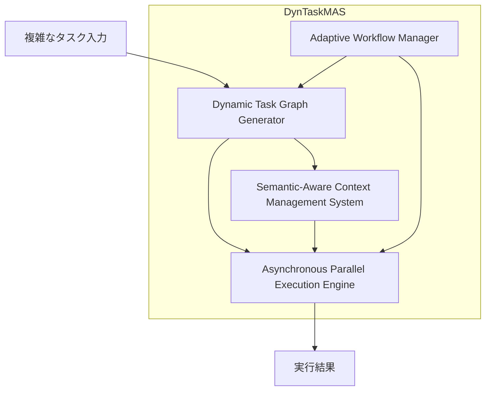

## 論文概要（Abstract）

本記事は [https://arxiv.org/abs/2503.07675](https://arxiv.org/abs/2503.07675) の解説記事です。

DynTaskMASは、LLMベースのマルチエージェントシステム（MAS）におけるリソース管理・タスク協調・実行効率の課題を解決するために設計された動的タスクグラフ駆動フレームワークである。著者らは、タスクの依存関係を有向非巡回グラフ（DAG）として表現し、独立したタスクを非同期かつ並列に実行する4つのコンポーネントを提案している。著者らの報告によれば、複雑なタスクで最大33%の実行時間削減、リソース利用率の35.4%向上、16エージェントまでの近似線形スケーリングを達成した。

この記事は [Zenn記事: Kiroスペック駆動開発×git worktreeでモノレポリファクタリングを並列化しCI検証を自動化する](https://zenn.dev/0h_n0/articles/8a678eb93c4aca) の深掘りです。Zenn記事で紹介したKiroのWave分割による並列タスク実行の概念を、学術的に厳密なDAGスケジューリングの観点から理解するために本論文を取り上げます。

## 情報源

- **会議名**: ICAPS 2025（35th International Conference on Automated Planning and Scheduling）
- **年**: 2025
- **URL**: [https://arxiv.org/abs/2503.07675](https://arxiv.org/abs/2503.07675)
- **著者**: Junwei Yu（東京大学）, Yepeng Ding（広島大学）（equal contribution）, Hiroyuki Sato（国立情報学研究所）
- **DOI**: 10.1609/icaps.v35i1.36130

## カンファレンス情報

**ICAPSについて**: ICAPSは自動計画とスケジューリング分野における主要な国際会議であり、AIエージェントのタスク分解・スケジューリング・並列実行に関する最先端の研究が発表される。DynTaskMASはLLMエージェントのタスクスケジューリングという新しい応用領域で採択された。

## 背景と動機（Background & Motivation）

LLMベースのマルチエージェントシステム（AutoGPT、MetaGPT、CAMEL等）は、複数のLLMエージェントが協調して複雑なタスクを遂行するアプローチとして注目されている。しかし、著者らは既存フレームワークに以下の課題があると指摘している。

1. **逐次実行の非効率性**: 多くのMASフレームワークはタスクを直列に処理するため、独立したサブタスクが存在しても並列化の恩恵を受けられない
2. **静的なタスク管理**: タスクの依存関係が事前に固定されており、実行時の動的な変更に対応できない
3. **コンテキスト管理の困難**: エージェント間で共有すべき情報の範囲と粒度の制御が不十分

これらの課題はZenn記事で紹介したKiroのWave分割と共通する問題意識である。Kiroはtasks.mdの依存グラフから独立タスクを特定して並列実行するが、DynTaskMASは同じ問題をより一般的な枠組みで定式化している。

## 主要な貢献（Key Contributions）

著者らは論文のIntroductionで以下の4つの貢献を主張している。

- **貢献1**: LLMベースMAS向けの動的タスクオーケストレーションフレームワーク。複雑なタスクを意味的一貫性と因果依存関係を保ちながら分解する
- **貢献2**: 非同期エージェント間インタラクションと並列実行の抽象化。リソース利用率の向上を目的とする
- **貢献3**: 情報共有と計算コストのバランスを取るコンテキスト管理アプローチ
- **貢献4**: 実験による検証として、実行時間21-33%削減、リソース利用率35.4%向上、16エージェントまでの近似線形スループットスケーリング

## 技術的詳細（Technical Details）

### アーキテクチャ概要

DynTaskMASは4つの主要コンポーネントで構成される。



### Dynamic Task Graph Generator（DTGG）

DTGGはタスクの依存関係をDAG（有向非巡回グラフ）として表現する。タスクグラフは以下のように定義される。

$$
G = (V, E, W)
$$

ここで、
- $V$: サブタスクの集合（頂点）
- $E$: タスク間の依存関係の集合（有向辺）
- $W$: 辺に割り当てられた正の重み

タスクの分解は再帰的に行われる。タスク $t_i$ が粒度閾値に達するまで以下のように分解される。

$$
D(t_i) = \{s_{i1}, s_{i2}, \ldots, s_{ik}\}
$$

辺の重みは、後続タスクの計算コストとコンテキスト転送コストの加重和として定義される。

$$
W(v_i, v_j) = \alpha \cdot C(v_j) + \beta \cdot I(v_i, v_j)
$$

ここで、
- $C(v_j)$: 後続サブタスク $v_j$ の推定計算コスト
- $I(v_i, v_j)$: SACSMが管理するコンテキスト転送時間
- $\alpha, \beta$: 重み係数。著者らは $\alpha = 1/T_c$、$\beta = 1/T_t$ を推奨しており、$\alpha/\beta$ 比は通常0.5〜2.0の範囲（論文Section IIIより）

タスクグラフの更新は以下の漸化式で表される。

$$
G_{t+1} = U(G_t, \Delta_t)
$$

著者らのAlgorithm 1では、新規タスクの分解結果をサブタスクとして追加し、変更を適用する手順が記述されている。

**サイクルの扱い**: 真の循環依存はリフレクションループ（エージェントが自身の出力を批評・改善するプロセス）に限定される。著者らはこれを最大 $N \leq 3$ 回の反復に制限し、品質が閾値を満たすか改善幅が $\varepsilon$ 未満になった時点で早期終了する設計としている。

### Asynchronous Parallel Execution Engine（APEE）

APEEは以下の5つのサブコンポーネントで構成される。

| サブコンポーネント | 役割 |
|---|---|
| Task Scheduler | タスクの優先度計算とスケジューリング |
| Execution Queue Manager | 実行待ちキューの管理 |
| Agent Pool Manager | エージェントプールの割り当て |
| Load Balancer | 負荷分散 |
| Asynchronous Communication Handler | イベント駆動の非同期通信 |

タスクの優先度は以下の再帰的な式で計算される（論文Eq. 5）。

$$
P(v_i) = \frac{C(v_i)}{\max_{j \in \text{succ}(v_i)} \left( W(v_i, v_j) + P(v_j) \right)}
$$

ここで $\text{succ}(v_i)$ は $v_i$ の後続タスクの集合であり、シンクノード（後続タスクなし）では $P(v) = C(v)$ となる。

著者らのAlgorithm 2では、前提タスクがないノード（入次数0）をレディキューに初期投入し、タスク完了イベントに基づいてキューを更新する手順が記述されている。これはZenn記事で解説したKiroのWave分割と類似した概念であり、KiroがWave 1（前提なしタスク）→ Wave 2（Wave 1完了後に実行可能になるタスク）という段階的実行を行うのに対し、DynTaskMASはより細粒度のイベント駆動スケジューリングを採用している。

通信はイベント駆動型で、タスク完了・エージェント利用可能・タスク失敗の3種類のイベントに基づく。

### Semantic-Aware Context Management System（SACMS）

SACSMはエージェント間のコンテキスト共有を効率的に管理する。

**コンテキストリポジトリ**: コンテキストツリーのフォレスト（森）として構造化される。各ノードはID、データ、子ノード、意味タグを保持する。

**関連度計算**: あるコンテキスト更新 $u$ とエージェント $a$ の関連度は、意味タグのJaccard類似度で計算される（論文Eq. 12）。

$$
\text{Relevance}(u, a) = \frac{|T_u \cap T_a|}{|T_u \cup T_a|}
$$

閾値 $\theta$ を超えるエージェントにのみ更新が配信される。この仕組みにより、すべてのエージェントにすべてのコンテキストをブロードキャストする非効率を回避している。

**クエリ処理**: エージェントからのコンテキスト問い合わせは、意味ベクトルのコサイン類似度にアクセスレベルフィルタを組み合わせて処理される（論文Eq. 15）。

### Adaptive Workflow Manager（AWM）

AWMはスループット、レイテンシ、利用率、完了率の指標 $M(t)$ を追跡し、ワークフロー構成 $\omega$ を最適化する。

$$
\min_\omega f(\omega, M(t))
$$

著者らのAlgorithm 4では、候補を生成しGreedy探索で最適な構成を選択する手順が記述されている。リソース更新は以下で表される。

$$
R(t+1) = R(t) + \Delta R(t)
$$

## 実装のポイント（Implementation）

著者らの実験環境は以下の通り（論文Section IVより）。

| 項目 | 設定 |
|---|---|
| LLMモデル | Llama-3.1-8B |
| 推論エンジン | TensorRT-LLM 0.7.1 |
| 量子化 | INT8 |
| バッチサイズ | 32 |
| シーケンス長 | 2048 |
| バッチ方式 | Continuous Batching |
| GPU | RTX 3090（24GB） |
| CPU | AMD EPYC 7763 |
| メモリ | 512GB RAM |
| OS | Ubuntu 22.04, CUDA 12.1 |

実装上の注意点として、著者らは以下を挙げている。

1. **DAGの粒度閾値**: タスクの再帰的分解をどこで停止するかが性能に直結する。粒度が細かすぎるとスケジューリングオーバーヘッドが増加し、粗すぎると並列化の恩恵が減少する
2. **リフレクションループの制限**: $N \leq 3$ の反復制限と品質閾値による早期終了は、無限ループを防ぎつつ出力品質を維持するためのトレードオフ
3. **$\alpha/\beta$ 比のチューニング**: 計算コストとコンテキスト転送コストの重み付けは、タスクの性質とハードウェア構成によって調整が必要

## Production Deployment Guide

### AWS実装パターン（コスト最適化重視）

DynTaskMASのようなマルチエージェント並列実行フレームワークをAWS上にデプロイする場合のトラフィック量別推奨構成を示す。

| 規模 | 月間リクエスト | 推奨構成 | 月額コスト | 主要サービス |
|------|--------------|---------|-----------|------------|
| **Small** | ~3,000 (100/日) | Serverless | $80-200 | Lambda + Bedrock + SQS + DynamoDB |
| **Medium** | ~30,000 (1,000/日) | Hybrid | $500-1,200 | ECS Fargate + Bedrock + ElastiCache + SQS |
| **Large** | 300,000+ (10,000/日) | Container | $3,000-8,000 | EKS + Karpenter + EC2 Spot + ElastiCache |

**Small構成の詳細**（月額$80-200）:
- **Lambda**: エージェントごとに1つのLambda関数、1GB RAM、90秒タイムアウト（$30/月）
- **SQS**: タスクグラフのイベント駆動通信（$5/月）
- **Bedrock**: Claude 3.5 Haiku、エージェント呼び出し（$100/月）
- **DynamoDB**: コンテキストリポジトリ、On-Demand（$10/月）
- **Step Functions**: DAGのワークフロー管理（$5/月）

**Medium構成の詳細**（月額$500-1,200）:
- **ECS Fargate**: エージェントプール、0.5 vCPU × 1GB RAM × 4タスク（$150/月）
- **Bedrock**: Claude 3.5 Sonnet、Batch API活用（$600/月）
- **ElastiCache Redis**: SACSMコンテキストキャッシュ（$30/月）

**コスト削減テクニック**:
- Spot Instances使用で最大90%削減（Karpenter自動管理）
- Bedrock Batch API使用で50%削減（非リアルタイム処理）
- SQS + Lambda構成でアイドルタイムのコストゼロ

**コスト試算の注意事項**:
- 上記は2026年11月時点のAWS ap-northeast-1（東京）リージョン料金に基づく概算値です
- 実際のコストはエージェント数、タスク複雑度、LLM呼び出し頻度により変動します
- 最新料金は [AWS料金計算ツール](https://calculator.aws/) で確認してください

### Terraformインフラコード

**Small構成（Serverless）: Lambda + SQS + DynamoDB**

```hcl
module "vpc" {
  source  = "terraform-aws-modules/vpc/aws"
  version = "~> 5.0"

  name = "dyntaskmas-vpc"
  cidr = "10.0.0.0/16"
  azs  = ["ap-northeast-1a", "ap-northeast-1c"]
  private_subnets = ["10.0.1.0/24", "10.0.2.0/24"]

  enable_nat_gateway   = false
  enable_dns_hostnames = true
}

resource "aws_iam_role" "agent_lambda" {
  name = "dyntaskmas-agent-role"

  assume_role_policy = jsonencode({
    Version = "2012-10-17"
    Statement = [{
      Action = "sts:AssumeRole"
      Effect = "Allow"
      Principal = { Service = "lambda.amazonaws.com" }
    }]
  })
}

resource "aws_iam_role_policy" "bedrock_invoke" {
  role = aws_iam_role.agent_lambda.id
  policy = jsonencode({
    Version = "2012-10-17"
    Statement = [{
      Effect   = "Allow"
      Action   = ["bedrock:InvokeModel", "bedrock:InvokeModelWithResponseStream"]
      Resource = "arn:aws:bedrock:ap-northeast-1::foundation-model/anthropic.claude-3-5-haiku*"
    }]
  })
}

resource "aws_sqs_queue" "task_events" {
  name                       = "dyntaskmas-task-events"
  visibility_timeout_seconds = 120
  message_retention_seconds  = 86400
}

resource "aws_lambda_function" "agent_executor" {
  filename      = "agent_executor.zip"
  function_name = "dyntaskmas-agent-executor"
  role          = aws_iam_role.agent_lambda.arn
  handler       = "index.handler"
  runtime       = "python3.12"
  timeout       = 90
  memory_size   = 1024

  environment {
    variables = {
      BEDROCK_MODEL_ID  = "anthropic.claude-3-5-haiku-20241022-v1:0"
      SQS_QUEUE_URL     = aws_sqs_queue.task_events.url
      DYNAMODB_TABLE    = aws_dynamodb_table.context_store.name
    }
  }
}

resource "aws_dynamodb_table" "context_store" {
  name         = "dyntaskmas-context"
  billing_mode = "PAY_PER_REQUEST"
  hash_key     = "context_id"
  range_key    = "agent_id"

  attribute {
    name = "context_id"
    type = "S"
  }
  attribute {
    name = "agent_id"
    type = "S"
  }

  ttl {
    attribute_name = "expire_at"
    enabled        = true
  }
}

resource "aws_cloudwatch_metric_alarm" "agent_duration" {
  alarm_name          = "dyntaskmas-agent-duration-spike"
  comparison_operator = "GreaterThanThreshold"
  evaluation_periods  = 1
  metric_name         = "Duration"
  namespace           = "AWS/Lambda"
  period              = 3600
  statistic           = "Average"
  threshold           = 60000
  alarm_description   = "エージェント平均実行時間が60秒超過"

  dimensions = {
    FunctionName = aws_lambda_function.agent_executor.function_name
  }
}
```

Large構成では、EKS + Karpenter（Spot優先）+ AWS Budgetsの組み合わせを推奨する。Karpenter ProvisionerでSpot Instancesを優先し、`ttlSecondsAfterEmpty: 60`でアイドルリソースを即座に解放する構成が有効である。

### 運用・監視設定

**CloudWatch Logs Insights クエリ**:

```sql
-- エージェント実行時間の分析（P95, P99）
fields @timestamp, agent_id, task_id, duration_ms
| stats pct(duration_ms, 95) as p95, pct(duration_ms, 99) as p99 by bin(5m)

-- タスクグラフの並列度監視
fields @timestamp, concurrent_agents, queue_depth
| stats avg(concurrent_agents) as avg_parallel, max(queue_depth) as max_queue by bin(10m)
| filter avg_parallel < 2
```

**CloudWatch アラーム**: `put_metric_alarm()`でLambda実行時間（閾値60秒）とSQSキュー深度（閾値100メッセージ）を監視し、異常時にSNS通知を送信する。エージェント実行時間の増加はタスク分解の粒度見直し、キュー深度の増加はエージェント数のスケールアウトを示唆する。

**X-Ray トレーシング**: `aws_xray_sdk`の`patch_all()`でboto3を自動計装し、タスクグラフ実行のWaveごとにサブセグメントを記録する。`put_annotation`でタスク数と並列度を記録し、ボトルネック分析に活用する。

**Cost Explorer自動レポート**: `boto3`の`ce.get_cost_and_usage()`で日次コストを取得し、Bedrock/Lambda/EKS別にコストを抽出する。$100/日超過時はSNS通知を送信する構成を推奨する。

### コスト最適化チェックリスト

**アーキテクチャ選択（エージェント数とタスク頻度で判断）**:
- [ ] ~4エージェント、~100タスク/日 → Lambda + SQS（Serverless）- $80-200/月
- [ ] ~8エージェント、~1000タスク/日 → ECS Fargate + SQS（Hybrid）- $500-1,200/月
- [ ] 16+エージェント、10000+タスク/日 → EKS + Spot（Container）- $3,000-8,000/月

**リソース最適化**:
- [ ] EC2 Spot Instances優先（最大90%削減、Karpenter自動管理）
- [ ] Reserved Instances: 1年コミットで72%削減（予測可能な負荷のベースライン）
- [ ] Savings Plans: Compute Savings Plans検討（柔軟性重視）
- [ ] Lambda: メモリサイズ最適化（Power Tuning実行）
- [ ] ECS/EKS: アイドル時のスケールダウン（夜間0台）

**LLMコスト削減**:
- [ ] Bedrock Batch API: 50%割引（非リアルタイムのタスク分解処理）
- [ ] Prompt Caching: 30-90%削減（タスクグラフ生成のシステムプロンプト固定）
- [ ] モデル選択: 簡易タスクにHaiku($0.25/MTok)、複雑タスクにSonnet($3/MTok)
- [ ] max_tokens制限: エージェント出力の過剰生成防止

**監視・アラート（コスト異常の即時検知）**:
- [ ] AWS Budgets: 月額予算設定（80%で警告、100%でアラート）
- [ ] CloudWatch: エージェント実行時間・SQSキュー深度の監視
- [ ] Cost Anomaly Detection: 自動異常検知
- [ ] 日次コストレポート: SNS/Slackへ自動送信

**リソース管理**:
- [ ] 未使用リソース削除: Lambda Insights、Trusted Advisor活用
- [ ] タグ戦略: 環境別（dev/staging/prod）、エージェント別でコスト可視化
- [ ] DynamoDB TTL: 古いコンテキストの自動削除（24時間）
- [ ] S3ライフサイクル: ログの自動アーカイブ（30日でGlacier）

## 実験結果（Results）

### タスク複雑度別の実行時間比較

著者らは、タスクの複雑度を3段階（Simple: 5-10サブタスク、Medium: 20-30サブタスク、Complex: 50+サブタスク）に分け、逐次実行（Traditional）との比較を行っている。

論文Table Iより:

| 複雑度 | Traditional (s) | DynTaskMAS (s) | 改善率 |
|---|---|---|---|
| Simple (5-10サブタスク) | 4.7 ± 0.3 | 3.7 ± 0.2 | 21.3% |
| Medium (20-30サブタスク) | 9.8 ± 0.5 | 7.1 ± 0.3 | 27.6% |
| Complex (50+サブタスク) | 18.5 ± 0.8 | 12.4 ± 0.5 | 33.0% |

著者らは、複雑なタスクほど改善率が大きくなる理由として以下の3点を挙げている。(1) 複雑なグラフほど並列化可能なサブタスクが多い、(2) SACSMによるコンテキスト転送の冗長性削減効果が大きい、(3) GPUの利用率がスケジューリングにより向上する。

### エージェント数とスケーラビリティ

論文Table IIより:

| エージェント数 | スループット (tasks/s) | レイテンシ (ms) |
|---|---|---|
| 4 | 12.3 ± 0.4 | 81.3 ± 3.2 |
| 8 | 23.1 ± 0.6 | 86.5 ± 3.8 |
| 16 | 42.7 ± 0.9 | 93.8 ± 4.1 |
| 32 | 76.4 ± 1.2 | 104.2 ± 5.3 |

4エージェントから16エージェントへの4倍スケールアップで、スループットは3.47倍に向上しており、著者らはこれを約87%のスケーリング効率と評価している。一方、32エージェントでは8倍スケールに対して6.21倍の向上に留まり、SACSMのコンテキスト競合とAPEEのスケジューリングオーバーヘッドが原因と分析されている。

### 旅行計画ケーススタディ

著者らは7つの専門エージェント（ユーザー嗜好、目的地、交通、宿泊、観光地、料理、旅程統合）を用いた旅行計画タスクで実証評価を行っている。

論文Table IIIより:

| 指標 | Traditional | DynTaskMAS |
|---|---|---|
| エンドツーエンド時間 (s) | 4.7 ± 0.3 | 3.7 ± 0.2 |
| エージェント協調オーバーヘッド (ms) | 850 ± 45 | 320 ± 25 |
| コンテキストスイッチ回数 | 42 ± 3 | 18 ± 2 |
| リソース利用率 (%) | 65 ± 5 | 88 ± 3 |

リソース利用率は65%から88%へと35.4%向上（$(88 - 65) / 65 \approx 35.4\%$）しており、著者らはこれをGPU利用率の改善として報告している。コンテキストスイッチの削減（42→18回）はSACSMの意味タグベースフィルタリングの効果と説明されている。

**分析上の注意点**: Table IIIのエンドツーエンド時間（4.7s / 3.7s）はTable Iの「Simple」タスクと完全に一致している。また、ベースラインの「Traditional」は逐次実行を意味するが、比較対象として他のMASフレームワーク（MetaGPT、CAMEL等）は含まれていない点に留意が必要である。

## 実運用への応用（Practical Applications）

DynTaskMASのアーキテクチャは、Zenn記事で紹介したKiroのWave分割＋git worktree並列化パターンを、より汎用的なマルチエージェントシステムとして実装する際の設計指針となる。

**モノレポリファクタリングへの応用**:
- tasks.mdの依存グラフをDTGGのDAGとして表現し、パッケージ単位のリファクタリングタスクを並列実行できる
- SACSMのコンテキスト管理は、共有型定義（shared-types）の変更情報を関連パッケージのエージェントにのみ配信する仕組みとして利用可能
- AWMのワークフロー最適化は、CIパイプラインの実行順序最適化に応用できる

**実運用上の課題**:
- 論文の実験ではLlama-3.1-8Bを使用しているが、プロダクション環境ではモデルサイズとコストのトレードオフを検討する必要がある
- スケーリング実験で32エージェント時に効率が低下しているため、エージェント数の上限設計が重要
- 出力品質の定量評価が論文に含まれていないため、タスク完了の正確性については別途検証が必要

## 関連研究（Related Work）

- **AutoGPT (Yang et al., 2023)**: 汎用的なLLMエージェントフレームワーク。タスクの逐次実行が中心で並列化は限定的
- **MetaGPT (Hong et al., 2023)**: ソフトウェア開発に特化したマルチエージェントシステム。役割分担に基づく協調だが、動的タスクグラフは持たない
- **CAMEL (Li et al., NeurIPS 2023)**: ロールプレイングベースのマルチエージェント会話フレームワーク
- **AgentScope (Gao et al., 2024)**: 大規模MAS向けのプラットフォーム
- **Kwok and Ahmad (1999)**: タスクグラフスケジューリングアルゴリズムの古典的研究。DynTaskMASのDAG/優先度設計の理論的基盤

DynTaskMASは、既存のMASフレームワークが並列・逐次処理の適切な組み合わせを提供していないというギャップを指摘し、DAGベースのスケジューリングでこの問題を解決しようとしている。

## まとめと今後の展望

DynTaskMASは、LLMベースのマルチエージェントシステムにおけるタスク依存関係をDAGとして形式化し、非同期並列実行エンジンにより実行効率を向上させるフレームワークである。著者らの報告では、複雑なタスクで最大33%の実行時間削減、35.4%のリソース利用率向上、16エージェントまでの近似線形スケーリングが達成されている。

ただし、以下の制約に留意が必要である。
- ベースラインが逐次実行のみであり、他のMASフレームワークとの比較がない
- 出力品質の定量評価が含まれていない
- ハードウェア記述にセットアップセクション（4GPU）とFigure 3キャプション（1GPU）で矛盾がある
- 実験の試行回数（±の根拠）が明記されていない

Zenn記事で解説したKiroのWave分割が開発ツールとしての実践的アプローチであるのに対し、DynTaskMASはその背後にある理論的基盤を提供する研究として位置づけられる。モノレポのリファクタリングを含む複雑なソフトウェアエンジニアリングタスクにおいて、タスク依存関係の形式的分析と動的並列実行の組み合わせが有効であることを示唆している。

## 参考文献

- **Conference URL**: [https://arxiv.org/abs/2503.07675](https://arxiv.org/abs/2503.07675)
- **DOI**: [10.1609/icaps.v35i1.36130](https://doi.org/10.1609/icaps.v35i1.36130)
- **Related Zenn article**: [https://zenn.dev/0h_n0/articles/8a678eb93c4aca](https://zenn.dev/0h_n0/articles/8a678eb93c4aca)

---

:::message
この記事はAI（Claude Code）により自動生成されました。内容の正確性については原論文もご確認ください。
:::
