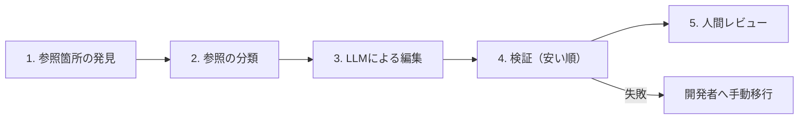

## 論文概要（Abstract）

本記事は [https://arxiv.org/abs/2504.09691](https://arxiv.org/abs/2504.09691) の解説記事です。

Googleの巨大モノレポにおいて、32ビット整数識別子を64ビットへ移行する大規模コードマイグレーションをLLMで自動化した事例研究である。著者らは、参照箇所の発見・分類からLLMによる編集、検証、人間レビューまでの一連のパイプラインを構築し、12ヶ月にわたり3名の開発者が39件のマイグレーションを実施した結果について報告している。論文Table 1より、595件のコード変更と93,574件の編集のうち、LLMが74.45%のコード変更と69.46%の編集を自動生成したとされる。開発者へのヒアリングでは、従来の手作業による移行と比較して作業時間が約50%短縮されたと推定されている。

この記事は [Zenn記事: Kiroスペック駆動開発×git worktreeでモノレポリファクタリングを並列化しCI検証を自動化する](https://zenn.dev/0h_n0/articles/8a678eb93c4aca) の深掘りです。

## 情報源

- **会議名**: FSE 2025（ACM International Conference on the Foundations of Software Engineering）
- **年**: 2025
- **URL**: [https://arxiv.org/abs/2504.09691](https://arxiv.org/abs/2504.09691)
- **著者**: Celal Ziftci, Stoyan Nikolov, Anna Sjövall, Bo Kim, Daniele Codecasa, Max Kim（全員Google所属、equal contribution）
- **投稿日**: 2025年4月13日（arXiv v1）

## カンファレンス情報

**FSE（Foundations of Software Engineering）について**:
FSEはソフトウェア工学分野の最高峰会議の一つであり、ACMが主催する。ソフトウェアの設計・実装・テスト・保守に関する理論と実践の両面をカバーし、産業界からの事例報告も積極的に採択される。本論文はGoogleにおける実運用事例のIndustry Track論文として採択された。

## 背景と動機（Background & Motivation）

Googleのモノレポは数十億行規模のコードベースであり、API変更や型変更を伴う大規模マイグレーションは避けて通れない運用課題である。著者らが取り組んだのは、Protocol Buffersのフィールド型を`int32`から`int64`に変更するマイグレーションであり、直接参照だけでなく間接参照（ハードコードされたビットシフト値`31→63`やテスト値のint32範囲超え対応など）まで追跡・変更が必要となる。

著者らは論文中で、過去の類似マイグレーションには約2年を要し、正規表現による検索と手動編集、回帰テストのトリアージを数百〜数千のコード変更にわたって行っていたと述べている。この手作業ベースのアプローチは、コスト・時間・ヒューマンエラーの観点から持続可能ではなく、LLMによる自動化が強く動機づけられた。

## 主要な貢献（Key Contributions）

- **貢献1**: 参照箇所発見からLLM編集、検証、人間レビューまでをカバーするエンドツーエンドの自動マイグレーションワークフローの設計と実装
- **貢献2**: 39件のIDマイグレーションにおける定量的評価（LLMΔとHumanΔのメトリクス）
- **貢献3**: 開発者体験と教訓の報告（著者らはこれを最大規模のLLMベースコードマイグレーション事例研究と位置づけている）

## 技術的詳細（Technical Details）

### パイプラインアーキテクチャ

著者らが設計したマイグレーションパイプラインは5段階で構成される。



### ステージ1: 参照箇所の発見（Find Potential References）

Googleのモノリポジトリはコードインデックスシステム**Kythe**でインデックスされている。システムはまず対象フィールドの直接参照を検出し、次に間接参照を最大距離5まで追跡する。著者らは、データフロー解析やAST解析は計算コストが高く多言語対応の保守も困難であるため、意図的に過剰近似（over-approximation）を採用し、無関係な結果を含むリスクを受け入れつつ取りこぼしを最小化する方針を選択したと述べている。

### ステージ2: 参照の分類（Categorize References）

検出された各参照箇所を4つのバケットに分類する。

| バケット | 信頼度 | 説明 | 例 |
|---------|--------|------|-----|
| Not-migrated | 100% | 正規表現ルールで既に範囲内と判定 | 値が既にint64の範囲内 |
| Irrelevant | 100% | クラス定義やメソッド定義など変更不要 | `class ToyIdHandler` |
| Relevant | 要調査 | LLMまたは開発者による変更が必要 | `int toy_id = getToyId()` |
| Left-over | 要判断 | 開発者が手動で分類し設定に保存 | 曖昧な使用パターン |

### ステージ3: LLMによる編集（Change with LLM）

使用モデルはGoogle内部のGeminiバージョンで、DIDAICTフレームワークによりGoogleのコードでファインチューニングされている。ただし、このマイグレーションタスク固有のファインチューニングは行わず、プロンプトエンジニアリングのみで対応している。温度パラメータは0.0に固定されている。

プロンプトには対象ファイルの全文が含まれ、変更が必要な行番号がコメントとして挿入される。LLMの出力はdiff形式であり、**編集距離ベースのファジーマッチングアルゴリズム**で適用される。各ファイルに対して3回の試行が行われ、成功した試行からランダムに1つが選択される（LLM出力の非決定性を考慮した設計）。

### ステージ4: 検証（Validate, Cheapest First）

検証は計算コストの安い順に6段階で実行される。いずれかの段階で失敗したファイルは破棄され、開発者に手動マイグレーションが委任される。

$$
V = \{v_{\text{success}}, v_{\text{whitespace}}, v_{\text{AST}}, v_{\text{punt}}, v_{\text{build}}, v_{\text{test}}\}
$$

各検証ステップの定義：

1. **Success**: LLM呼び出しが完了したか（サーバ稼働、クォータ、コンテキスト長）
2. **Whitespace**: 変更がホワイトスペースのみでないか
3. **AST**: ファイルがパースでき、ASTが元のファイルと異なるか
4. **Punt**: LLMに変更前後を提示し「この変更は必要か？」と問う。「No」なら棄却
5. **Build**: コードがコンパイルできるか
6. **Test**: 回帰テストをパスするか

この「安い順」戦略は計算資源の効率化に直結する。軽量チェック（Success, Whitespace）で多くの無効な変更を早期に排除することで、高コストなビルド・テスト検証の回数を最小化する。

### ステージ5: 人間レビュー（Human Review）

検証を通過したコード変更は、GoogleのコードレビューシステムCritiqueを通じて開発者レビューに送られる。開発者は目視確認と最終編集を行い、コードオーナーの承認を経て提出される。

### 運用モデル

システムは毎晩自動実行され、未処理の参照箇所がなくなるまで継続する。マイグレーションはウォーターフォールの一括処理ではなく、セッションと開発者をまたいで連続的に進行する設計である。

## 実験結果（Results）

### 定量的評価メトリクス

著者らはLLMの貢献度を測定するために2つのメトリクスを定義している。

- **LLMΔ**: ベースラインと最初のLLMスナップショット間のレーベンシュタイン編集距離
- **HumanΔ**: LLMスナップショットと最終提出版間の編集距離（人間のみの変更では、ベースラインと最終版間）

### 全体結果（論文Table 1より）

| 指標 | 値 |
|------|-----|
| マイグレーション対象ID数 | 39 |
| 開発者数 | 3名（290件, 251件, 54件のコード変更を担当） |
| コード変更総数 | 595件 |
| LLM-Only | 214件（35.97%） |
| LLM-then-Human | 229件（38.48%） |
| Human-Only | 152件（25.55%） |
| LLM関与率 | 443/595（74.45%） |
| 編集総数（TotalΔ） | 93,574 |
| LLMΔ | 64,996（69.46%） |
| HumanΔ | 28,578（30.54%） |
| レビュアー数 | 306名 |
| チーム数 | 149 |
| オフィス数 | 37 |
| タイムゾーン数 | 12 |

### ID別の規模差

論文Table 1の個別データより、マイグレーションの規模は大きく異なる。

| ID | TotalΔ | コード変更数 | ファイル数 | 言語数 |
|----|--------|------------|----------|--------|
| ID-30 | 23,800 | 39 | 418 | 2 |
| ID-32 | 22,822 | 185 | 392 | 5 |
| ID-20 | 16,406 | 28 | 175 | 2 |
| ID-28 | 7,059 | 29 | 89 | 1 |

著者らは、開発者が小規模でローカルなIDから着手し、徐々に大規模なIDへ移行していったと述べており、ID間のLLMΔ/HumanΔの差異はこの学習効果も一因であるとしている。

### 開発者フィードバック

著者らの報告によると、開発者は以下の点を評価している。
- エンドツーエンドの自動化と毎晩の自動実行
- 検証を通過した変更のみが提示される安心感
- LLMが多言語（コードとSQLなど）の協調編集を自然言語プロンプトから処理できること

一方で、以下の課題も報告されている。
- **非決定性**: 同一入力に対するLLM出力のばらつきに対する開発者の反応は分かれた
- **コンテキスト長制限**: 大きなファイルでは処理が失敗する
- **ハルシネーション**: 不要なリフォーマットやコメント追加
- **言語サポート**: Dartの対応が弱い
- **既存テスト失敗**: マイグレーション以前から失敗していたテストへの対処
- **ゴールデンファイル**: 専用ツールが必要だがシステムは実行できない

## 実装のポイント（Implementation）

### 大規模マイグレーション実装の要点

1. **過剰近似による安全性確保**: 見逃しよりも誤検出を許容し、検証パイプラインで不要な変更を除去する。
2. **安い順の検証**: 計算コストの低い検証から順に実行し、高コストのビルド・テストに到達する変更を最小化する。
3. **ファジーdiff適用**: LLM出力のフォーマットが完全でなくても、編集距離ベースのマッチングで実用的な適用率を確保する。
4. **3回試行ランダム選択**: LLMの非決定性を逆手にとり、複数候補から成功例を選ぶ。
5. **夜間バッチ実行**: 毎晩実行し漸進的に処理することで、一括処理のリスクを回避する。

### マイグレーション対象のモデリング

```python
from dataclasses import dataclass, field
from enum import Enum
from typing import Optional


class ReferenceCategory(Enum):
    """参照箇所の分類バケット"""
    NOT_MIGRATED = "not_migrated"
    IRRELEVANT = "irrelevant"
    RELEVANT = "relevant"
    LEFT_OVER = "left_over"


class ValidationStep(Enum):
    """検証ステップ（安い順）"""
    SUCCESS = 1
    WHITESPACE = 2
    AST = 3
    PUNT = 4
    BUILD = 5
    TEST = 6


@dataclass
class MigrationReference:
    """マイグレーション対象の参照箇所"""
    file_path: str
    line_number: int
    category: ReferenceCategory
    max_distance: int = 5

    def needs_llm_edit(self) -> bool:
        """LLMによる編集が必要かどうか"""
        return self.category == ReferenceCategory.RELEVANT


@dataclass
class MigrationResult:
    """マイグレーション結果のメトリクス"""
    total_delta: int = 0
    llm_delta: int = 0
    human_delta: int = 0
    llm_only_changes: int = 0
    llm_then_human_changes: int = 0
    human_only_changes: int = 0

    @property
    def llm_involvement_rate(self) -> float:
        """LLM関与率を計算"""
        total = (self.llm_only_changes
                 + self.llm_then_human_changes
                 + self.human_only_changes)
        if total == 0:
            return 0.0
        return (self.llm_only_changes + self.llm_then_human_changes) / total
```

### 検証パイプラインの実装イメージ

```python
from abc import ABC, abstractmethod


class ValidationCheck(ABC):
    """検証ステップの基底クラス"""
    @abstractmethod
    def validate(self, original: str, modified: str) -> bool:
        ...

    @abstractmethod
    def cost(self) -> int:
        """相対的な計算コスト（1が最軽量）"""
        ...


class WhitespaceCheck(ValidationCheck):
    """ホワイトスペースのみの変更を検出"""
    def validate(self, original: str, modified: str) -> bool:
        return original.split() != modified.split()

    def cost(self) -> int:
        return 1


class ASTCheck(ValidationCheck):
    """AST差分の検証"""
    def validate(self, original: str, modified: str) -> bool:
        import ast
        try:
            orig_tree = ast.dump(ast.parse(original))
            mod_tree = ast.dump(ast.parse(modified))
            return orig_tree != mod_tree
        except SyntaxError:
            return False

    def cost(self) -> int:
        return 2


def run_validation_pipeline(
    original: str,
    modified: str,
    checks: list[ValidationCheck],
) -> tuple[bool, Optional[str]]:
    """安い順にソートして検証を実行

    Returns:
        (passed, failed_step_name)
    """
    sorted_checks = sorted(checks, key=lambda c: c.cost())
    for check in sorted_checks:
        if not check.validate(original, modified):
            return False, type(check).__name__
    return True, None
```

## Production Deployment Guide

### AWS実装パターン（コスト最適化重視）

本論文のマイグレーションパイプラインをAWS上で再現する場合のアーキテクチャを示す。Google内部のKytheやCritiqueに相当するAWSサービスへのマッピングを含む。

**コスト試算の注意事項**: 以下は2026年11月時点のAWS ap-northeast-1（東京）リージョン料金に基づく概算値です。実際のコストはトラフィックパターン、リージョン、バースト使用量により変動します。最新料金は [AWS料金計算ツール](https://calculator.aws/) で確認してください。

**トラフィック量別の推奨構成**:

| 規模 | 月間マイグレーション | 推奨構成 | 月額コスト | 主要サービス |
|------|-------------------|---------|-----------|------------|
| **Small** | 1-3件 | Serverless | $100-300 | Lambda + Bedrock + DynamoDB |
| **Medium** | 5-10件 | Hybrid | $500-1,200 | Step Functions + ECS Fargate + Bedrock |
| **Large** | 20件+ | Container | $3,000-8,000 | EKS + Batch + Bedrock Batch API |

**Small構成の詳細**（月額$100-300）:
- **Lambda**: 参照分類・検証パイプライン、1GB RAM、5分タイムアウト（$30/月）
- **Bedrock**: Claude 3.5 Haiku、コード編集生成（$150/月）
- **DynamoDB**: マイグレーション状態管理、On-Demand（$10/月）
- **Step Functions**: パイプラインオーケストレーション（$5/月）
- **CodeBuild**: ビルド・テスト検証（$30/月）

**Large構成の詳細**（月額$3,000-8,000）:
- **EKS**: コントロールプレーン（$72/月）
- **AWS Batch**: 検証ジョブの並列実行（$500/月）
- **Bedrock Batch API**: 50%割引で大量編集生成（$3,000/月）
- **EC2 Spot**: g5.xlarge × 2-4台、ビルド検証用（$400/月）
- **S3**: コード変更・diff保存（$20/月）

**コスト削減テクニック**:
- Bedrock Batch API使用で50%削減（夜間バッチ処理に最適）
- Spot Instances使用でビルド検証コスト最大90%削減
- DynamoDBのTTL設定で古いマイグレーション状態を自動削除
- Step Functionsの Express Workflows でショートランニング処理のコスト最適化

### Terraformインフラコード

**Small構成（Serverless）: Step Functions + Lambda + Bedrock**

```hcl
# --- IAMロール（最小権限） ---
resource "aws_iam_role" "migration_lambda" {
  name = "code-migration-lambda-role"

  assume_role_policy = jsonencode({
    Version = "2012-10-17"
    Statement = [{
      Action = "sts:AssumeRole"
      Effect = "Allow"
      Principal = { Service = "lambda.amazonaws.com" }
    }]
  })
}

resource "aws_iam_role_policy" "bedrock_invoke" {
  role = aws_iam_role.migration_lambda.id
  policy = jsonencode({
    Version = "2012-10-17"
    Statement = [{
      Effect   = "Allow"
      Action   = ["bedrock:InvokeModel"]
      Resource = "arn:aws:bedrock:ap-northeast-1::foundation-model/anthropic.claude-3-5-haiku*"
    }]
  })
}

# --- Lambda: 参照分類 ---
resource "aws_lambda_function" "classify_references" {
  filename      = "classify.zip"
  function_name = "migration-classify-references"
  role          = aws_iam_role.migration_lambda.arn
  handler       = "index.handler"
  runtime       = "python3.12"
  timeout       = 300
  memory_size   = 1024

  environment {
    variables = {
      DYNAMODB_TABLE = aws_dynamodb_table.migration_state.name
    }
  }
}

# --- Lambda: LLM編集生成 ---
resource "aws_lambda_function" "llm_edit" {
  filename      = "llm_edit.zip"
  function_name = "migration-llm-edit"
  role          = aws_iam_role.migration_lambda.arn
  handler       = "index.handler"
  runtime       = "python3.12"
  timeout       = 300
  memory_size   = 2048

  environment {
    variables = {
      BEDROCK_MODEL_ID = "anthropic.claude-3-5-haiku-20241022-v1:0"
      MAX_ATTEMPTS     = "3"
    }
  }
}

# --- DynamoDB: マイグレーション状態管理 ---
resource "aws_dynamodb_table" "migration_state" {
  name         = "code-migration-state"
  billing_mode = "PAY_PER_REQUEST"
  hash_key     = "migration_id"
  range_key    = "reference_path"

  attribute {
    name = "migration_id"
    type = "S"
  }
  attribute {
    name = "reference_path"
    type = "S"
  }

  ttl {
    attribute_name = "expire_at"
    enabled        = true
  }
}

# --- Step Functions: パイプラインオーケストレーション ---
resource "aws_sfn_state_machine" "migration_pipeline" {
  name     = "code-migration-pipeline"
  role_arn = aws_iam_role.step_functions.arn

  definition = jsonencode({
    StartAt = "ClassifyReferences"
    States = {
      ClassifyReferences = {
        Type     = "Task"
        Resource = aws_lambda_function.classify_references.arn
        Next     = "FilterRelevant"
      }
      FilterRelevant = {
        Type       = "Choice"
        Choices    = [{
          Variable     = "$.relevant_count"
          NumericGreaterThan = 0
          Next         = "LLMEdit"
        }]
        Default = "NoChangesNeeded"
      }
      LLMEdit = {
        Type     = "Task"
        Resource = aws_lambda_function.llm_edit.arn
        Next     = "Validate"
        Retry    = [{ ErrorEquals = ["States.TaskFailed"], MaxAttempts = 2 }]
      }
      Validate = {
        Type     = "Task"
        Resource = "arn:aws:lambda:ap-northeast-1:ACCOUNT:function:migration-validate"
        End      = true
      }
      NoChangesNeeded = { Type = "Succeed" }
    }
  })
}

# --- CloudWatch: コスト監視 ---
resource "aws_cloudwatch_metric_alarm" "bedrock_cost" {
  alarm_name          = "migration-bedrock-cost-spike"
  comparison_operator = "GreaterThanThreshold"
  evaluation_periods  = 1
  metric_name         = "InvocationCount"
  namespace           = "AWS/Bedrock"
  period              = 3600
  statistic           = "Sum"
  threshold           = 1000
  alarm_description   = "Bedrock呼び出し数異常（コスト急増の可能性）"
}
```

### セキュリティベストプラクティス

**本番環境での推奨設定**:

1. **ネットワークセキュリティ**: Lambda VPC内配置、パブリックサブネット不使用、セキュリティグループは443のみ開放
2. **認証・認可**: IAMロール最小権限、MFA必須、コードリポジトリアクセスはOIDC連携
3. **シークレット管理**: AWS Secrets Manager使用、環境変数ハードコード禁止、90日ごとローテーション
4. **監査**: CloudTrail全リージョン有効化、Config有効化、GuardDuty脅威検知
5. **データ保護**: TLS 1.2以上必須、S3/DynamoDB KMS暗号化、コード変更diffの暗号化保存

### 運用・監視設定

**CloudWatch Logs Insights クエリ**:

```sql
-- マイグレーション成功率の監視
fields @timestamp, migration_id, validation_step, result
| stats count(*) as total,
        sum(case when result = 'pass' then 1 else 0 end) as passed
  by migration_id
| sort total desc

-- LLM編集のレイテンシ分析
fields @timestamp, duration_ms, file_size_bytes
| filter function_name = 'migration-llm-edit'
| stats pct(duration_ms, 95) as p95, pct(duration_ms, 99) as p99 by bin(1h)
```

**CloudWatch アラーム（Python）**:

```python
import boto3

cloudwatch = boto3.client('cloudwatch')

cloudwatch.put_metric_alarm(
    AlarmName='migration-validation-failure-rate',
    ComparisonOperator='GreaterThanThreshold',
    EvaluationPeriods=1,
    MetricName='ValidationFailureRate',
    Namespace='CodeMigration',
    Period=3600,
    Statistic='Average',
    Threshold=0.5,
    ActionsEnabled=True,
    AlarmActions=['arn:aws:sns:ap-northeast-1:123456789:migration-alerts'],
    AlarmDescription='検証失敗率50%超過（LLM出力品質低下の可能性）'
)
```

**Cost Explorer自動レポート**:

```python
import boto3
from datetime import datetime, timedelta

ce = boto3.client('ce')

response = ce.get_cost_and_usage(
    TimePeriod={
        'Start': (datetime.now() - timedelta(days=1)).strftime('%Y-%m-%d'),
        'End': datetime.now().strftime('%Y-%m-%d')
    },
    Granularity='DAILY',
    Metrics=['UnblendedCost'],
    GroupBy=[{'Type': 'SERVICE', 'Key': 'SERVICE'}]
)

for result in response['ResultsByTime']:
    for group in result['Groups']:
        service = group['Keys'][0]
        cost = float(group['Metrics']['UnblendedCost']['Amount'])
        if cost > 50:
            print(f"⚠️ {service}: ${cost:.2f}/日")
```

### コスト最適化チェックリスト

**アーキテクチャ選択**:
- [ ] 月1-3件マイグレーション → Lambda + Step Functions（Serverless）$100-300/月
- [ ] 月5-10件 → ECS Fargate + Step Functions（Hybrid）$500-1,200/月
- [ ] 月20件+ → EKS + AWS Batch（Container）$3,000-8,000/月

**リソース最適化**:
- [ ] Lambda: メモリ最適化（Power Tuning実行）
- [ ] CodeBuild: ビルドキャッシュ有効化（S3バックエンド）
- [ ] EC2: ビルド検証にSpot Instances使用（最大90%削減）
- [ ] Step Functions: Express Workflowsで短時間処理のコスト削減
- [ ] EventBridge: 夜間バッチスケジュールでアイドル時間ゼロ

**LLMコスト削減**:
- [ ] Bedrock Batch API: 夜間バッチ処理で50%割引
- [ ] Prompt Caching: 同一ファイルの3回試行でシステムプロンプトキャッシュ活用
- [ ] モデル選択: 分類タスクはHaiku（$0.25/MTok）、編集生成はSonnet（$3/MTok）
- [ ] max_tokens制限: diff出力に必要な最小トークン数を設定

**監視・アラート**:
- [ ] AWS Budgets: 月額予算設定（80%警告、100%アラート）
- [ ] CloudWatch: 検証失敗率・LLMレイテンシ監視
- [ ] Cost Anomaly Detection: 自動異常検知
- [ ] 日次コストレポート: SNS/Slack通知

**リソース管理**:
- [ ] DynamoDB TTL: 完了済みマイグレーション状態の自動削除（30日）
- [ ] S3ライフサイクル: 古いdiffファイルのGlacier移行（90日）
- [ ] Lambda: 未使用関数の定期棚卸し
- [ ] タグ戦略: マイグレーションID別のコスト可視化

## 実運用への応用（Practical Applications）

### Zenn記事との関連

Zenn記事で解説されているKiroのスペック駆動開発とgit worktreeによる並列リファクタリングは、コード変更の「計画と実行」を分離するアプローチである。本論文のGoogleのマイグレーションパイプラインも同様の思想に基づいており、参照箇所の発見・分類（計画）とLLM編集・検証（実行）を明確に分離している。

特にZenn記事のKiro Hooksによるタスク完了時の自動テスト実行は、本論文の「安い順の検証パイプライン」と同じ品質ゲートの設計思想である。モノレポにおける大規模コード変更を安全に自動化するための鍵は、**変更の生成**と**変更の検証**を独立したステージとして設計し、検証を段階的に実行することにある。

### スケーリング上の考慮事項

- 著者らの手法は306名のレビュアー、149チーム、37オフィスにまたがるコード変更を処理しており、組織横断的なマイグレーションのスケーラビリティが実証されている
- 一方で、コンテキスト長制限や言語固有の対応が課題として残る
- 夜間バッチ実行モデルは、CI/CDパイプラインとの統合が自然であり、Zenn記事のGitHub Actions連携パターンと組み合わせやすい

## 関連研究（Related Work）

- **ルールベース変換**: TXL, Stratego/XT, Rascalなどのプログラム変換言語。正確だがルール作成のコストが高い
- **LLMベース翻訳**: TransCoder, CoTran, UniTrans, TRANSAGENTなど言語間の変換。本論文は同一言語内の変更である点が異なる
- **変換例からの学習**: PyCraft, InferRules, MELT。入出力ペアからルールを推論する
- **リポジトリレベル変更**: CodePlanが大規模コード変更の計画を扱うが、本論文はより実運用に近い
- **LLMリファクタリング**: LM-Assist, Revamp。メソッドレベルの変更が主であり、リポジトリ全体の移行は扱っていない

## まとめと今後の展望

著者らは、LLMによる大規模コードマイグレーションが実運用レベルで有効であることを示した。39件のマイグレーションで74.45%のコード変更をLLMが自動生成し、開発者は移行時間50%削減を推定している。

今後の研究方向として、著者らはより大きなコンテキストウィンドウの活用、多言語サポートの改善、ハルシネーションの低減、そしてLLMを変更箇所の発見にも活用することを挙げている。

モノレポの大規模リファクタリングを計画している組織にとって、本論文の「検出→分類→LLM編集→段階的検証→人間レビュー」のパイプラインは参考になる設計パターンである。

## 参考文献

- **Conference URL**: [https://arxiv.org/abs/2504.09691](https://arxiv.org/abs/2504.09691)
- **Related Zenn article**: [https://zenn.dev/0h_n0/articles/8a678eb93c4aca](https://zenn.dev/0h_n0/articles/8a678eb93c4aca)

---

:::message
この記事はAI（Claude Code）により自動生成されました。内容の正確性については原論文と照合の上ご確認ください。
:::
