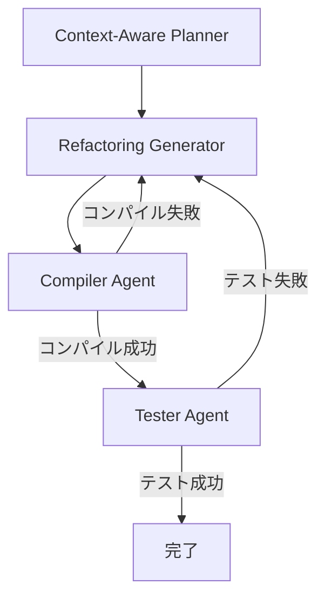

## 論文概要（Abstract）

本記事は [https://arxiv.org/abs/2511.03153](https://arxiv.org/abs/2511.03153) の解説記事です。

RefAgentは、LLMベースの4つの専門エージェントが協調してソフトウェアリファクタリングを自動的に実行するマルチエージェントフレームワークである。著者らは、従来の単一プロンプト方式やシングルエージェント方式と比較して、コンパイル成功率やユニットテスト合格率で大幅な改善を達成したと報告している。8つのオープンソースApache Javaプロジェクトで評価を行い、GPT-4oを用いた場合のユニットテスト合格率中央値90%、コードスメル削減率中央値52.5%を達成した（論文Table 3より）。

この記事は [Zenn記事: Kiroスペック駆動開発×git worktreeでモノレポリファクタリングを並列化しCI検証を自動化する](https://zenn.dev/0h_n0/articles/8a678eb93c4aca) の深掘りです。

## 情報源

- **arXiv ID**: 2511.03153
- **URL**: [https://arxiv.org/abs/2511.03153](https://arxiv.org/abs/2511.03153)
- **著者**: Khouloud Oueslati, Maxime Lamothe, Foutse Khomh（Polytechnique Montreal）
- **発表年**: 2025（v1: 2025年11月、v2: 2026年3月改訂）
- **分野**: cs.SE（ソフトウェア工学）

## 背景と動機（Background & Motivation）

ソフトウェアリファクタリングは、外部振る舞いを変えずにコードの内部構造を改善する作業であり、保守性や可読性の向上に不可欠である。しかし、大規模なコードベースでのリファクタリングは手動では膨大な時間と労力を要する。Kimら（2014）によるMicrosoft社の調査では、開発者の28%がリファクタリングの困難さを報告している。

従来のLLMを用いたリファクタリング手法は、単一プロンプトでコード全体の変更を試みるシングルエージェント方式が主流であった。しかし、この方式にはコンパイルエラーやテスト失敗に対する自己修復能力が欠如しており、実用性に限界があった。著者らは、ソフトウェアリファクタリングが計画（Planning）、実行（Execution）、検証（Verification）の複数フェーズから成る複雑なタスクであることに着目し、各フェーズに特化したエージェントが協調するマルチエージェント構成を提案した。

## 主要な貢献（Key Contributions）

- **貢献1**: RefAgentフレームワークの提案。4つの専門エージェント（Context-Aware Planner、Refactoring Generator、Compiler、Tester）が協調してリファクタリングを自動化する初のマルチエージェント手法
- **貢献2**: コンパイルエラーとテスト失敗に対するフィードバックループの実装。最大20回の反復修正により、自動的にコードを修正する自己修復機構
- **貢献3**: 8つのApache Javaプロジェクトでの包括的評価。コードスメル削減、品質属性改善、開発者リファクタリングとの整合性を多角的に検証
- **貢献4**: シングルエージェントベースライン（Pass@1、Pass@3）および検索ベースツールRefGenとの比較分析

## 技術的詳細（Technical Details）

### アーキテクチャ

RefAgentは、Root-canal refactoring（Fernandesら、2020）のアプローチに基づき、プロジェクト内の各クラスを対象に以下の4エージェントがパイプラインで処理する。



**1. Context-Aware Planner Agent**

対象クラスの依存関係と品質メトリクスを収集し、リファクタリング計画を立案する。具体的には以下のツールを使用する。

- **jdeps**: クラスレベルの依存関係グラフを構築。対象クラスの1次依存先のソースコードも取得する
- **DesigniteJava 2.5.2**: 循環的複雑度（Cyclomatic Complexity）や凝集度の欠如（Lack of Cohesion）等のソフトウェアメトリクスを抽出。ただしスメル検出の出力は意図的に使用しない（Plannerの判断にバイアスを与えないため）

Plannerは収集した情報をもとに、対象クラス内のリファクタリング対象領域（メソッド、フィールド、変数）とリファクタリング手順を含む計画を生成する。

**2. Refactoring Generator Agent**

Plannerが生成した計画に従い、元のクラスのソースコード、依存クラスのソースコード、メトリクス情報を入力として、リファクタリング後のJavaクラスを生成する。CompilerやTesterからのフィードバックを受けた場合は、エラー情報に基づいて修正版を再生成する。

**3. Compiler Agent**

Maven compileコマンド（テストなし）でシンタックスチェックを実行する。コンパイルが成功すればTester Agentに制御を渡し、失敗した場合はLLMがエラーログを要約して修正指示を生成し、Generatorに再生成を要求する。最大20回まで反復する。

**4. Tester Agent**

開発者が記述したテストと、**EvoSuite**がリファクタリング前のコードから自動生成したJUnit 4回帰テストの両方を実行する。EvoSuiteはカバレッジ最適化で生成されるため、リファクタリングによる外部振る舞いの変化を検出できる。テスト失敗時は、失敗テストのログを要約してGeneratorに修正を要求する。

### アルゴリズム

RefAgentの全体処理フローを擬似コードで示す。

```python
from dataclasses import dataclass

@dataclass
class RefactoringResult:
    """リファクタリング結果"""
    target_class: str
    success: bool
    iterations: int
    test_pass_rate: float

def refagent_pipeline(
    project_path: str,
    target_class: str,
    max_iterations: int = 20
) -> RefactoringResult:
    """RefAgentのメイン処理パイプライン

    Args:
        project_path: プロジェクトルートパス
        target_class: リファクタリング対象クラス
        max_iterations: 最大反復回数

    Returns:
        リファクタリング結果
    """
    # Phase 1: Context-Aware Planning
    dep_graph = run_jdeps(project_path, target_class)
    metrics = run_designite_java(project_path, target_class)
    source_code = retrieve_source(target_class, dep_graph)
    plan = planner_agent.generate_plan(source_code, metrics, dep_graph)

    # Phase 2: Refactoring Generation with feedback loops
    refactored_code = generator_agent.generate(source_code, plan)

    for iteration in range(max_iterations):
        # Phase 3: Compilation check
        compile_result = compiler_agent.compile(project_path, refactored_code)
        if not compile_result.success:
            fix_instructions = compiler_agent.summarize_errors(compile_result)
            refactored_code = generator_agent.fix(refactored_code, fix_instructions)
            continue

        # Phase 4: Test execution
        test_result = tester_agent.run_tests(
            project_path, refactored_code,
            developer_tests=find_related_tests(dep_graph),
            evosuite_tests=generate_regression_tests(source_code)
        )
        if test_result.all_passed:
            return RefactoringResult(
                target_class=target_class,
                success=True,
                iterations=iteration + 1,
                test_pass_rate=test_result.pass_rate
            )

        fix_instructions = tester_agent.summarize_failures(test_result)
        refactored_code = generator_agent.fix(refactored_code, fix_instructions)

    return RefactoringResult(
        target_class=target_class,
        success=False,
        iterations=max_iterations,
        test_pass_rate=0.0
    )
```

著者らは、フィードバックループの反復回数について、Choiら（2024）の知見に基づき最大20回に設定している。また、Shinnら（2023）のReflexionに倣い、言語的自己反省（linguistic self-reflection）を導入して修正精度を向上させている。

## 実装のポイント（Implementation）

RefAgentの実装において、以下の点が実務上重要である。

**評価対象の選定**: 著者らは4,096トークン以下のクラスのみを対象としている。これはStarCoder2やDeepSeek-Coderなど8Kコンテキストのオープンモデルでコンテキスト枠を確保するための制約である。実務で適用する際は、使用するLLMのコンテキスト長に応じて対象クラスのサイズ制限を調整する必要がある。

**ツール検証の信頼性**: 著者らが380クラスの手動レビューで検証した結果、EvoSuiteの生成テストの真陽性率は約91%（偽陽性率1.2%）、RefactoringMiner 3.0の検出精度は98.24%（偽陽性率0.12%）、DesigniteJavaの実装スメル検出精度は93.6%であった（論文Section 6より）。

**フィードバックの安定化**: 論文の実験結果では、テスト合格率とコンパイル合格率は反復12回目付近で安定に達する（論文Figure 7, 8より）。実務では計算コストとのバランスで反復回数を10〜15回に設定することが推奨される。

**LLMの選択**: GPT-4o、StarCoder2-15B-Instruct、DeepSeek-Coder-33B-Instructの3モデル間でリファクタリング品質に統計的有意差は認められなかった（Wilcoxon符号順位検定、p値0.053〜0.252、論文Table 3より）。コスト効率を考慮すると、オープンモデルの利用も選択肢となる。

## Production Deployment Guide

### AWS実装パターン（コスト最適化重視）

RefAgentのようなマルチエージェントリファクタリングシステムをAWS上で稼働させる場合のアーキテクチャパターンを示す。

**トラフィック量別の推奨構成**:

| 規模 | 月間リクエスト | 推奨構成 | 月額コスト | 主要サービス |
|------|--------------|---------|-----------|------------|
| **Small** | ~3,000 (100/日) | Serverless | $80-200 | Lambda + Bedrock + DynamoDB |
| **Medium** | ~30,000 (1,000/日) | Hybrid | $500-1,200 | Step Functions + ECS Fargate + Bedrock |
| **Large** | 300,000+ (10,000/日) | Container | $3,000-8,000 | EKS + Karpenter + EC2 Spot |

**Small構成の詳細** (月額$80-200):
- **Lambda**: 各エージェントを個別Lambda関数で実装。1GB RAM、300秒タイムアウト ($30/月)
- **Step Functions**: 4エージェントのパイプラインをステートマシンで管理。フィードバックループをChoice/Waitステートで実装 ($5/月)
- **Bedrock**: Claude 3.5 Haiku使用。Prompt Caching有効化でシステムプロンプト再利用 ($100/月)
- **DynamoDB**: リファクタリング結果・メトリクスの永続化。On-Demand ($10/月)
- **S3**: ソースコードとリファクタリング成果物の保存 ($5/月)

**Medium構成の詳細** (月額$500-1,200):
- **Step Functions**: パイプラインオーケストレーション ($10/月)
- **ECS Fargate**: CompilerとTesterをコンテナで実行。Maven/Gradle環境を内包 ($200/月)
- **Bedrock**: Claude 3.5 Sonnet、Batch API活用で50%割引 ($500/月)
- **ElastiCache Redis**: 依存関係グラフとメトリクスのキャッシュ ($30/月)
- **CodeBuild**: コンパイル検証の並列実行 ($50/月)

**コスト削減テクニック**:
- Bedrock Batch APIで非リアルタイム処理を50%割引
- Prompt Cachingで同一プロジェクト内の繰り返しコンテキストを最大90%削減
- Fargate Spotで最大70%削減（コンパイル・テスト実行は中断耐性あり）
- Step Functionsのタイムアウト設定でLLMの無限ループを防止

**コスト試算の注意事項**:
- 上記は2026年11月時点のAWS ap-northeast-1（東京）リージョン料金に基づく概算値
- 実際のコストはリファクタリング対象のプロジェクト規模、LLMの応答長、フィードバック反復回数により変動
- 最新料金は [AWS料金計算ツール](https://calculator.aws/) で確認を推奨

### Terraformインフラコード

**Small構成 (Serverless): Step Functions + Lambda + Bedrock**

```hcl
module "vpc" {
  source  = "terraform-aws-modules/vpc/aws"
  version = "~> 5.0"

  name = "refagent-vpc"
  cidr = "10.0.0.0/16"
  azs  = ["ap-northeast-1a", "ap-northeast-1c"]
  private_subnets = ["10.0.1.0/24", "10.0.2.0/24"]

  enable_nat_gateway   = false
  enable_dns_hostnames = true
}

resource "aws_iam_role" "refagent_lambda" {
  name = "refagent-lambda-role"

  assume_role_policy = jsonencode({
    Version = "2012-10-17"
    Statement = [{
      Action = "sts:AssumeRole"
      Effect = "Allow"
      Principal = { Service = "lambda.amazonaws.com" }
    }]
  })
}

resource "aws_iam_role_policy" "bedrock_invoke" {
  role = aws_iam_role.refagent_lambda.id
  policy = jsonencode({
    Version = "2012-10-17"
    Statement = [{
      Effect   = "Allow"
      Action   = ["bedrock:InvokeModel", "bedrock:InvokeModelWithResponseStream"]
      Resource = "arn:aws:bedrock:ap-northeast-1::foundation-model/anthropic.claude-3-5-haiku*"
    }]
  })
}

resource "aws_lambda_function" "planner_agent" {
  filename      = "planner.zip"
  function_name = "refagent-planner"
  role          = aws_iam_role.refagent_lambda.arn
  handler       = "index.handler"
  runtime       = "python3.12"
  timeout       = 300
  memory_size   = 1024

  environment {
    variables = {
      BEDROCK_MODEL_ID = "anthropic.claude-3-5-haiku-20241022-v1:0"
      DYNAMODB_TABLE   = aws_dynamodb_table.refactoring_results.name
    }
  }
}

resource "aws_dynamodb_table" "refactoring_results" {
  name         = "refagent-results"
  billing_mode = "PAY_PER_REQUEST"
  hash_key     = "project_id"
  range_key    = "class_name"

  attribute {
    name = "project_id"
    type = "S"
  }
  attribute {
    name = "class_name"
    type = "S"
  }

  ttl {
    attribute_name = "expire_at"
    enabled        = true
  }
}

resource "aws_cloudwatch_metric_alarm" "iteration_overflow" {
  alarm_name          = "refagent-iteration-overflow"
  comparison_operator = "GreaterThanThreshold"
  evaluation_periods  = 1
  metric_name         = "IterationCount"
  namespace           = "RefAgent"
  period              = 3600
  statistic           = "Maximum"
  threshold           = 15
  alarm_description   = "フィードバックループ反復回数が閾値超過（コスト急増リスク）"
}
```

### 運用・監視設定

**CloudWatch Logs Insights クエリ**:

```sql
-- フィードバックループの反復回数分布を可視化
fields @timestamp, project_id, class_name, iteration_count, success
| stats avg(iteration_count) as avg_iter, max(iteration_count) as max_iter,
        count(*) as total by bin(1h)
| filter iteration_count > 12

-- コンパイルエラーの頻出パターンを特定
fields @timestamp, error_type, error_message
| filter agent_type = "compiler" AND success = false
| stats count(*) as error_count by error_type
| sort error_count desc
| limit 20
```

**CloudWatch アラーム（コスト重視）**:

```python
import boto3

cloudwatch = boto3.client('cloudwatch')

cloudwatch.put_metric_alarm(
    AlarmName='refagent-bedrock-token-spike',
    ComparisonOperator='GreaterThanThreshold',
    EvaluationPeriods=1,
    MetricName='TokenUsage',
    Namespace='RefAgent/Bedrock',
    Period=3600,
    Statistic='Sum',
    Threshold=200000,
    ActionsEnabled=True,
    AlarmActions=['arn:aws:sns:ap-northeast-1:123456789:cost-alerts'],
    AlarmDescription='Bedrockトークン使用量異常（フィードバックループ暴走の可能性）'
)
```

**X-Ray トレーシング設定**:

```python
from aws_xray_sdk.core import xray_recorder, patch_all

patch_all()

@xray_recorder.capture('refagent_pipeline')
def run_refactoring(project_path: str, target_class: str) -> dict:
    """RefAgentパイプラインの1クラス処理をトレース"""
    xray_recorder.put_annotation('project', project_path)
    xray_recorder.put_annotation('target_class', target_class)

    for iteration in range(20):
        xray_recorder.put_metadata('iteration', iteration)
        subsegment = xray_recorder.begin_subsegment(f'iteration_{iteration}')
        try:
            result = execute_iteration(project_path, target_class, iteration)
            xray_recorder.put_metadata('compile_success', result['compile_ok'])
            xray_recorder.put_metadata('test_success', result['test_ok'])
            if result['test_ok']:
                return result
        finally:
            xray_recorder.end_subsegment()

    return {'success': False, 'iterations': 20}
```

### コスト最適化チェックリスト

**アーキテクチャ選択**:
- [ ] ~100 req/日 → Step Functions + Lambda (Serverless) - $80-200/月
- [ ] ~1000 req/日 → Step Functions + ECS Fargate (Hybrid) - $500-1,200/月
- [ ] 10000+ req/日 → EKS + Spot Instances (Container) - $3,000-8,000/月

**リソース最適化**:
- [ ] Lambda: メモリサイズをPlannerとGenerator（1GB）、Compiler/Tester（2GB）で分離
- [ ] Fargate Spot: コンパイル・テスト実行は中断耐性ありのためSpot活用（最大70%削減）
- [ ] Step Functions Express: 短時間実行はExpress Workflowsで最大90%割引
- [ ] ECS/EKS: 夜間・週末のスケールダウン（リファクタリングは通常業務時間内）

**LLMコスト削減**:
- [ ] Bedrock Batch API: 非リアルタイムのリファクタリングバッチ処理で50%割引
- [ ] Prompt Caching: プロジェクト固有コンテキスト（依存グラフ、メトリクス）を再利用し30-90%削減
- [ ] モデル選択: Planner/GeneratorはClaude Sonnet、Compiler/TesterのエラーサマリはHaikuで分離
- [ ] 反復回数上限: 12回で打ち切り（論文実験で12回で安定に達する）
- [ ] トークン制限: max_tokens設定でGenerator出力の過剰生成を防止

**監視・アラート**:
- [ ] AWS Budgets: 月額予算設定（80%で警告、100%でアラート）
- [ ] CloudWatch: フィードバックループ反復回数の監視（15回超過でアラート）
- [ ] Cost Anomaly Detection: 自動異常検知
- [ ] X-Ray: パイプライン全体のレイテンシとボトルネック可視化

**リソース管理**:
- [ ] DynamoDB TTL: 古いリファクタリング結果を30日で自動削除
- [ ] S3ライフサイクル: ソースコードスナップショットを90日で Glacier移行
- [ ] Lambda Insights: メモリ・CPU使用率の最適化分析
- [ ] タグ戦略: プロジェクト別・エージェント別でコスト可視化

## 実験結果（Results）

### リファクタリング品質（RQ1）

著者らは8つのApache Javaプロジェクト（JClouds、Accumulo、SystemML、Apex-Core、SkyWalking、DeltaSpike、JMeter、OpenMeetings、107K〜658K LOC）で評価を行った。以下は論文Table 3からの結果である。

| LLM | ユニットテスト合格率 (中央値/平均) | コンパイル合格率 (中央値/平均) | スメル削減率 (中央値/平均) |
|---|---|---|---|
| GPT-4o | 90 / 86.8 | 87 / 89.6 | 52.5 / 53.75 |
| StarCoder2-15B | 85 / 83.8 | 84 / 83.6 | 50 / 50.3 |
| DeepSeek-Coder-33B | 90 / 98.5 | 88 / 91.8 | 53.5 / 52.54 |

Wilcoxon符号順位検定の結果、3モデル間に統計的有意差は認められなかった（p値: 0.053, 0.064, 0.252）。著者らは、RefAgentのフレームワーク設計がLLMの選択に依存しない汎用性を持つと主張している。

RefAgentは計23種のリファクタリングタイプを適用した。GPT-4oとDeepSeek-Coderは「Rename Attribute」「Change Method Access Modifier」をStarCoder2より約30%多く適用し、StarCoder2は「Remove Variable Modifier」「Replace Conditional With Ternary」の適用が約60%少なかった（論文Section 5.1より）。

### 開発者リファクタリングとの整合性（RQ2）

論文Table 4より、開発者が実際に行ったリファクタリングとの整合性は以下の通りである。

| ベースライン | 適合率 (中央値) | 再現率 (中央値) | F1 (中央値) |
|---|---|---|---|
| 開発者 (GPT-4o) | 78 | 81 | 80 |
| 開発者 (StarCoder2) | 72 | 73 | 73 |
| RefGen (GPT-4o) | 75 | 70 | 72 |

開発者マッチングでは、同一クラス・メソッド・行範囲・リファクタリングタイプの一致を必要とする厳密な基準を用いている。F1中央値80%は、RefAgentが開発者の判断と高い整合性を持つことを示唆している。

### QMOOD品質属性改善（RQ2続き）

論文Table 5より、QMOOD（Quality Model for Object-Oriented Design）に基づく品質属性の改善率を示す。

| 属性 | RefAgent (GPT-4o) | RefGen |
|---|---|---|
| Reusability（再利用性） | +8.16% | +16.5% |
| Flexibility（柔軟性） | -0.62% | -5.9% |
| Understandability（理解容易性） | -14.34% | -19.7% |
| Functionality（機能性） | +4.75% | 0% |
| Effectiveness（有効性） | +4.28% | -9.7% |

RefAgentはFunctionality（+4.75%）とEffectiveness（+4.28%）でRefGenを上回った一方、Reusabilityでは劣後した（+8.16% vs +16.5%）。Understandabilityが両手法とも低下している点について、著者らはリファクタリングの複雑性に起因する課題として指摘し、今後の改善方向としてhuman-in-the-loop型の「user proxy agent」を提案している。Wilcoxon検定でRefAgentとRefGenの間に統計的有意差は認められなかった（p ≥ 0.05）。

### シングルエージェントとの比較（RQ3）

論文Table 6より、シングルエージェント方式（Pass@1: 1回生成、Pass@3: 3回生成から最良を選択）との比較結果を示す。

| モデル | 指標 | RefAgent (中央値) | Pass@1 (中央値) | Pass@3 (中央値) |
|---|---|---|---|---|
| GPT-4o | ユニットテスト合格率 | 90 | 44.5 | 56 |
| GPT-4o | コンパイル合格率 | 87 | 48 | 62 |
| GPT-4o | スメル削減率 | 52.5 | 38.1 | 42.5 |

RefAgentはGPT-4oベースのPass@1と比較してユニットテスト合格率で+45.5ポイント（90 vs 44.5）、コンパイル合格率で+39ポイント（87 vs 48）の改善を達成した。これらの差は統計的に有意であった（p = 0.001〜0.039、論文Section 5.3より）。この大幅な改善は、マルチエージェント構成とフィードバックループによる自己修復能力が、シングルプロンプト方式の限界を克服していることを示している。

### アブレーション研究

論文Figure 7, 8より、著者らはコンテキスト取得機能（依存関係分析、コード検索モジュール）を除去した場合、テスト合格率とコンパイル合格率が大幅に低下し、性能の安定性も著しく損なわれることを報告している。また、フィードバックの反復回数に関しては、テスト合格率・コンパイル合格率ともに約12回の反復で中央値90%前後に安定化する傾向が確認された。

## 実運用への応用（Practical Applications）

RefAgentのアプローチは、Zenn記事で解説されているKiroのスペック駆動開発と組み合わせることで、モノレポリファクタリングの自動化パイプラインをさらに強化できる。具体的な応用シナリオは以下の通りである。

**CI/CDパイプラインへの統合**: Kiro HooksのPostTaskExecutionイベントでRefAgentパイプラインを起動し、リファクタリング後のコンパイル・テスト検証を自動化する。RefAgentの4エージェント構成は、Step FunctionsやGitHub Actionsのジョブとして実装可能であり、各worktreeで独立に実行できる。

**段階的適用**: 著者らの実験設計のように、4,096トークン以下のクラスから段階的に適用範囲を拡大するアプローチが推奨される。大規模クラスにはKiroのスペック駆動でタスク分割を行い、分割された各タスクにRefAgentを適用する二段階方式が考えられる。

**品質ゲートとの統合**: RefAgentのスメル削減率（中央値52.5%）とテスト合格率（中央値90%）をCI品質ゲートの閾値として活用できる。ただし、Understandabilityの低下(-14.34%)を考慮し、人間レビューのゲートを併設することが重要である。

## 関連研究（Related Work）

- **MANTRA** (arXiv:2503.14340): RAGとマルチエージェントLLMによるメソッドレベルリファクタリング。703メソッドで82.8%の成功率を報告。RefAgentがクラスレベル、MANTRAがメソッドレベルという粒度の違いがある
- **AutoCodeRover** (Zhang et al., 2024): LLMエージェントによるバグ修正フレームワーク。RefAgentと同様にツール呼び出しとフィードバックループを用いるが、リファクタリングではなくバグ修正に特化
- **RefGen** (Morales et al., 2018): 検索ベース（NSGA-III）のリファクタリング手法。RefAgentとQMOODメトリクスで比較され、統計的有意差なしと報告された（論文Table 5より）

## まとめと今後の展望

RefAgentは、4つの専門エージェントの協調によりソフトウェアリファクタリングの自動化を実現するフレームワークである。著者らは8つのApache Javaプロジェクトでの評価を通じて、シングルエージェント方式に対するユニットテスト合格率の大幅な改善（+45.5ポイント）と、開発者リファクタリングとの高い整合性（F1中央値80%）を報告している。

今後の課題として、著者らは品質改善と理解容易性のトレードオフの解決、human-in-the-loop型エージェントの導入、そしてJava以外の言語への適用を挙げている。モノレポ環境でのリファクタリング自動化を検討する際に、RefAgentのマルチエージェント設計パターンは有力な参考事例となる。

## 参考文献

- **arXiv**: [https://arxiv.org/abs/2511.03153](https://arxiv.org/abs/2511.03153)
- **Code**: [https://github.com/anonymAgent/RefAgent](https://github.com/anonymAgent/RefAgent)
- **Related Zenn article**: [https://zenn.dev/0h_n0/articles/8a678eb93c4aca](https://zenn.dev/0h_n0/articles/8a678eb93c4aca)

---

:::message
この記事はAI（Claude Code）により自動生成されました。内容の正確性については論文の原文と照合の上ご確認ください。
:::
