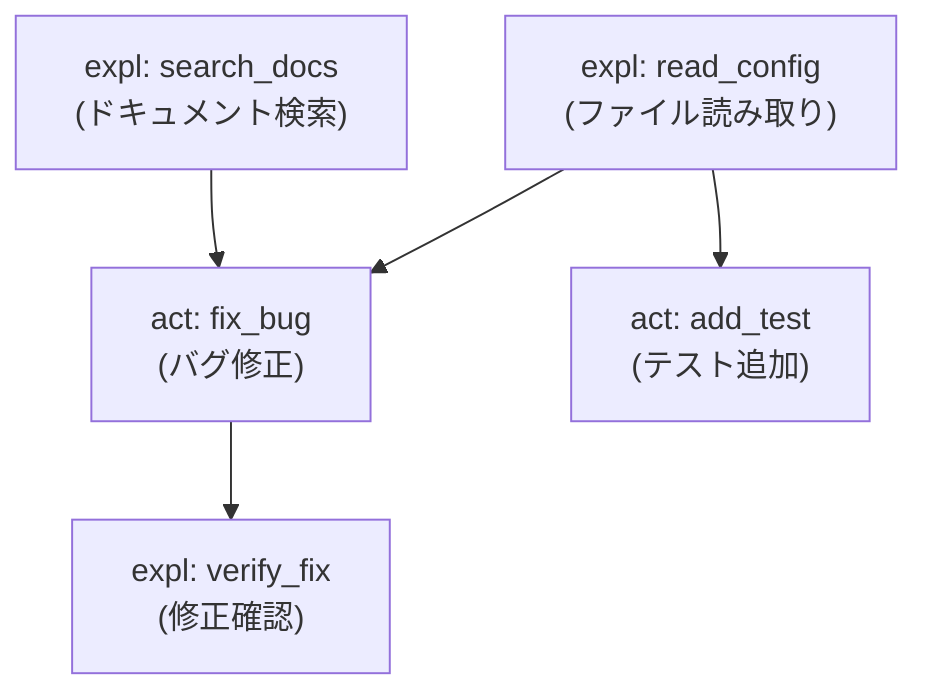

## 論文概要（Abstract）

本記事は [https://arxiv.org/abs/2606.11213](https://arxiv.org/abs/2606.11213) の解説記事です。

Semenov & Dorofeev（2026）は、LLMエージェントの長時間セッションにおけるコンテキスト管理手法として **Context Window Lifecycle（CWL）** を提案している。CWLは、エージェントの作業履歴を**型付きエピソード**として構造化し、依存関係グラフに基づく**決定論的なevictionポリシー**でコンテキストを管理する。著者らは、要約ベースのCompactionが持つ情報損失・因果構造の破壊・LLM呼び出しコストといった課題を回避しつつ、89タスクを1セッションで連続処理し、個別セッションと同等の精度を維持したと報告している。

この記事は [Zenn記事: AIエージェントのコンテキスト3層管理：Compaction×Clearing×Memory](https://zenn.dev/0h_n0/articles/c1d44153ca0dda) の深掘りです。

## 情報源

- **arXiv ID**: 2606.11213
- **URL**: [https://arxiv.org/abs/2606.11213](https://arxiv.org/abs/2606.11213)
- **著者**: Andrew Semenov, Svyatoslav Dorofeev（Kiz8）
- **発表年**: 2026
- **分野**: cs.CL
- **コード**: [https://github.com/Kiz8-Team/pi-cwl](https://github.com/Kiz8-Team/pi-cwl)

## 背景と動機（Background & Motivation）

LLMエージェントが長時間にわたるタスク（リポジトリ規模のコード修正、マルチステップの研究調査など）を処理する場合、コンテキストウィンドウの管理が根本的な課題となる。ツール呼び出し結果やアシスタント応答が蓄積し、数十ターンで容易に200Kトークンを超える。

著者らは、現行のエージェントフレームワークで主流となっている**要約ベースのCompaction**について、以下の4つの限界を指摘している（論文Section 2より）。

1. **予測不可能な情報損失**: 要約モデルがどの情報を保持しどの情報を落とすかが制御不能である
2. **因果構造の破壊**: ステップAの結果がステップBの前提条件であるような依存関係が、要約によって失われる
3. **ブロッキングなLLM呼び出し**: Compaction自体にモデル呼び出しが必要で、タスク実行を中断しコストが発生する
4. **圧縮誘発の幻覚**: 長さ制約の下で要約を生成する際に、事実と異なる内容が混入するリスクがある

これらの課題に対して、CWLは**LLM呼び出しを一切行わない決定論的なeviction**というアプローチで対処する。エージェントが自身の作業履歴を構造化アノテーションし、グラフ走査とルールベースの優先度でコンテキストを削減する設計である。

## 主要な貢献（Key Contributions）

- **Context Window Lifecycle（CWL）フレームワーク**: typed episodes、依存関係グラフ、graduated eviction policyの3要素から構成されるコンテキスト管理スキーム
- **決定論的eviction**: LLM呼び出し不要で、グラフ走査のみによるコンテキスト削減を実現
- **長期セッションの実証**: 89タスク・80Mトークンの連続セッションで、個別セッションと同等の精度を維持しながら推論コスト20〜70%削減を報告
- **オープンソース実装**: pi.devハーネスのフォークとして公開（[GitHub](https://github.com/Kiz8-Team/pi-cwl)）

## 技術的詳細（Technical Details）

### エピソードの型システム

CWLの中核は、エージェントの作業履歴を**typed episodes**として構造化する点にある。エージェントには`delimiter`という専用ツールが提供され、以下のパラメータでエピソードの開始・終了をアノテーションする。

| パラメータ | 説明 | 必須タイミング |
|-----------|------|--------------|
| `action` | `start` または `end` | 常に必須 |
| `name` | エピソードの識別名 | 常に必須 |
| `type` | `"expl"`（探索）または `"act"`（実行） | 常に必須 |
| `dependencies` | 依存する探索エピソード名のリスト | `act`の`start`時 |
| `description` | エピソードの要約文 | `expl`の`end`時 |

エピソードは2つの型に分類される。

- **Exploratoryエピソード（`expl`）**: ファイル読み取り、Web検索、調査など情報収集を行うエピソード。eviction時にはclosing descriptionのみが保持される
- **Actionエピソード（`act`）**: ファイル編集、コマンド実行など環境への書き込みを行うエピソード。結果が環境に永続化されているため、最優先のeviction候補となる

### エピソード依存関係グラフ

エピソード間の依存関係は**有向非巡回グラフ（DAG）**として表現される。



このグラフは3つの不変条件を維持する（論文Section 3.2より）。

1. **非循環性**: 依存関係は常にDAGを形成する
2. **型付きエッジ**: 依存エッジはexploratoryエピソードからactionエピソードへのみ許可される
3. **Protected prologue**: システムプロンプト、ツール定義、初期ユーザーターンは決してevictされない

### Graduated Eviction Policy

evictionはターンごとに実行され、コンテキストが予算 $\tau$ を超えた場合にトリガーされる。著者らは $\tau = 80{,}000$ トークン（モデルウィンドウの約30%）を使用している。

evictionは以下の4つのレベルで段階的に進行する。

$$
\text{Level 1} \rightarrow \text{Level 2} \rightarrow \text{Level 3} \rightarrow \text{Level 4}
$$

| レベル | 対象 | 削減内容 |
|-------|------|---------|
| Level 1: Reasoning-trace stripping | 推論トレース | thinking/reasoningブロックの除去 |
| Level 2: Bulk-output stripping | 大量出力 | grep結果、glob結果、ディレクトリリスト等の除去 |
| Level 3: Intermediate-artifact stripping | 中間成果物 | ファイル読み取り結果、bash出力等の除去 |
| Level 4: Full episode removal | エピソード全体 | エピソード自体の完全な除去 |

各パスでは、**最も古い eligible なactionエピソード**から優先的に処理される。actionエピソードが存在しない場合のみ、exploratoryエピソードが対象となる。ただし、exploratoryエピソードは、それに依存するすべてのactionエピソードが完全にevictされた後にのみeligibleとなる。

```python
def select_eviction_target(graph: EpisodeGraph) -> Episode | None:
    """Eviction対象のエピソードを選択する

    Args:
        graph: エピソード依存関係グラフ

    Returns:
        Eviction対象のエピソード。なければNone
    """
    # Active（未完了）エピソードは対象外
    completed = [e for e in graph.episodes if e.is_completed]

    # 1. 最も古いeligibleなactionエピソードを探す
    for episode in sorted(completed, key=lambda e: e.start_time):
        if episode.type == "act" and not episode.is_active:
            return episode

    # 2. actionがなければ、依存actionがすべてevict済みのexplを探す
    for episode in sorted(completed, key=lambda e: e.start_time):
        if episode.type == "expl":
            dependents = graph.get_dependent_actions(episode)
            if all(d.is_evicted for d in dependents):
                return episode

    return None
```

### Evictionの実行例

具体的なevictionの流れを示す。エージェントがバグ修正タスクを処理中に、コンテキストが $\tau = 80{,}000$ トークンを超えた場合を考える。

1. **Level 1**: 古いターンのthinkingブロックを除去（例: 5Kトークン削減）
2. **Level 2**: 過去のgrep検索結果を除去（例: 15Kトークン削減）
3. **Level 3**: 既に修正完了したファイルの読み取り結果を除去（例: 20Kトークン削減）
4. **Level 4**: 修正済みバグに関するactionエピソード全体を除去し、依存元のexploratoryエピソードのclosing descriptionのみ保持

Level 4でexploratoryエピソードが除去される場合、closing description（例: 「config.yamlの認証セクションにタイムアウト設定が欠如していることを確認」）のみが残り、調査の詳細なツール出力は失われる。ただし、修正結果は環境（ファイルシステム）に永続化されているため、エージェントは必要に応じて再取得できる。

## 実装のポイント（Implementation）

### delimiterツールの設計

著者らはpi.devハーネスのフォークとして実装を公開している。エージェントのシステムプロンプトに`delimiter`ツールの使用ガイドラインを含め、エピソード境界での呼び出しを促す設計である。

実装上の注意点として以下が挙げられる。

- **アノテーション品質**: エージェントが`delimiter`を適切に呼び出さない場合、依存関係が正しく記録されず、必要な情報が早期にevictされるリスクがある。著者らはこれを主要な限界として認めている
- **トークン予算 $\tau$ の調整**: $\tau$ を小さくするほどコスト削減効果は大きいが、wall-clock timeが増加する。著者らは80K〜120Kトークンがパレートフロンティア付近であると報告している（論文Section 6.3のablation結果より）
- **KV-cache無効化**: 高頻度のevictionはKVキャッシュのプレフィックスを無効化する。最大利用率での運用では、CWLがキャッシュにとってネットマイナスになる可能性がある

### GPT-5.4での実装

著者らはGPT-5.4を使用して評価を行っている。CWLはモデル非依存の設計であるが、`delimiter`ツールの適切な使用にはエージェントのツール呼び出し能力に依存する点に注意が必要である。

## Production Deployment Guide

CWLのエピソードベースコンテキスト管理をAWSで本番運用する場合の構成を示す。

### AWS実装パターン（コスト最適化重視）

| 規模 | 月間リクエスト | 推奨構成 | 月額コスト | 主要サービス |
|------|--------------|---------|-----------|------------|
| **Small** | ~3,000 (100/日) | Serverless | $50-150 | Lambda + Bedrock + DynamoDB |
| **Medium** | ~30,000 (1,000/日) | Hybrid | $300-800 | Lambda + ECS Fargate + ElastiCache |
| **Large** | 300,000+ (10,000/日) | Container | $2,000-5,000 | EKS + Karpenter + EC2 Spot |

**Small構成の詳細**（月額$50-150）:
- **Lambda**: 1GB RAM, 60秒タイムアウト（$20/月）。エピソードグラフの走査とeviction判定は軽量なCPU処理のためLambdaで十分
- **Bedrock**: Claude 3.5 Haiku, Prompt Caching有効（$80/月）。CWL自体はLLM呼び出し不要だが、エージェントの推論に必要
- **DynamoDB**: On-Demand（$10/月）。エピソードグラフとclosing descriptionの永続化
- **CloudWatch**: 基本監視（$5/月）

**Medium構成の詳細**（月額$300-800）:
- **ECS Fargate**: 0.5 vCPU, 1GB RAM × 2タスク（$120/月）。長時間セッションのステートフル管理
- **ElastiCache Redis**: cache.t3.micro（$15/月）。エピソードグラフのインメモリ管理で走査レイテンシを低減
- **Bedrock**: Claude 3.5 Sonnet, Batch API活用（$400/月）

**コスト削減テクニック**:
- CWLのevictionによりコンテキストを $\tau$ 以下に維持することで、Bedrock入力トークンコストを20〜70%削減（論文の報告値）
- Spot Instances使用で最大90%削減（EKS + Karpenter）
- Bedrock Batch API使用で50%削減（非リアルタイム処理時）

**コスト試算の注意事項**: 上記は2026年11月時点のAWS ap-northeast-1（東京）リージョン料金に基づく概算値です。実際のコストはトラフィックパターン、リージョン、バースト使用量により変動します。最新料金は [AWS料金計算ツール](https://calculator.aws/) で確認してください。

### Terraformインフラコード

**Small構成（Serverless）: Lambda + DynamoDB（エピソードグラフ永続化）**

```hcl
# --- IAMロール（最小権限） ---
resource "aws_iam_role" "cwl_lambda" {
  name = "cwl-episode-manager-role"

  assume_role_policy = jsonencode({
    Version = "2012-10-17"
    Statement = [{
      Action = "sts:AssumeRole"
      Effect = "Allow"
      Principal = { Service = "lambda.amazonaws.com" }
    }]
  })
}

resource "aws_iam_role_policy" "cwl_policy" {
  role = aws_iam_role.cwl_lambda.id

  policy = jsonencode({
    Version = "2012-10-17"
    Statement = [
      {
        Effect   = "Allow"
        Action   = ["bedrock:InvokeModel", "bedrock:InvokeModelWithResponseStream"]
        Resource = "arn:aws:bedrock:ap-northeast-1::foundation-model/anthropic.claude-3-5-haiku*"
      },
      {
        Effect   = "Allow"
        Action   = ["dynamodb:PutItem", "dynamodb:GetItem", "dynamodb:Query", "dynamodb:UpdateItem"]
        Resource = aws_dynamodb_table.episode_graph.arn
      }
    ]
  })
}

# --- DynamoDB（エピソードグラフ永続化） ---
resource "aws_dynamodb_table" "episode_graph" {
  name         = "cwl-episode-graph"
  billing_mode = "PAY_PER_REQUEST"
  hash_key     = "session_id"
  range_key    = "episode_id"

  attribute {
    name = "session_id"
    type = "S"
  }

  attribute {
    name = "episode_id"
    type = "S"
  }

  ttl {
    attribute_name = "expire_at"
    enabled        = true
  }
}

# --- Lambda関数（Eviction Engine） ---
resource "aws_lambda_function" "cwl_eviction" {
  filename      = "cwl_eviction.zip"
  function_name = "cwl-eviction-engine"
  role          = aws_iam_role.cwl_lambda.arn
  handler       = "index.handler"
  runtime       = "python3.12"
  timeout       = 60
  memory_size   = 512

  environment {
    variables = {
      EPISODE_TABLE    = aws_dynamodb_table.episode_graph.name
      TOKEN_BUDGET_TAU = "80000"
      BEDROCK_MODEL_ID = "anthropic.claude-3-5-haiku-20241022-v1:0"
    }
  }
}

# --- CloudWatchアラーム（eviction頻度監視） ---
resource "aws_cloudwatch_metric_alarm" "eviction_frequency" {
  alarm_name          = "cwl-eviction-frequency-high"
  comparison_operator = "GreaterThanThreshold"
  evaluation_periods  = 1
  metric_name         = "Invocations"
  namespace           = "AWS/Lambda"
  period              = 3600
  statistic           = "Sum"
  threshold           = 500
  alarm_description   = "Eviction頻度が高すぎる（τの調整を検討）"

  dimensions = {
    FunctionName = aws_lambda_function.cwl_eviction.function_name
  }
}
```

### 運用・監視設定

**CloudWatch Logs Insightsクエリ（eviction分析）**:

```sql
-- エピソードタイプ別のeviction回数と削減トークン数
fields @timestamp, episode_type, eviction_level, tokens_freed
| stats count(*) as eviction_count, sum(tokens_freed) as total_freed
  by episode_type, eviction_level
| sort eviction_count desc

-- セッションあたりのコンテキスト使用量推移
fields @timestamp, session_id, context_tokens, tau_budget
| stats avg(context_tokens) as avg_ctx, max(context_tokens) as max_ctx
  by bin(5m), session_id
```

**CloudWatchアラーム（コスト監視）**:

```python
import boto3

cloudwatch = boto3.client('cloudwatch')

cloudwatch.put_metric_alarm(
    AlarmName='cwl-token-budget-exceeded',
    ComparisonOperator='GreaterThanThreshold',
    EvaluationPeriods=1,
    MetricName='ContextTokens',
    Namespace='CWL/Agent',
    Period=300,
    Statistic='Maximum',
    Threshold=120000,
    AlarmDescription='コンテキストがτ上限を大幅に超過（eviction不具合の可能性）'
)
```

### コスト最適化チェックリスト

**アーキテクチャ選択**:
- [ ] ~100 req/日 → Lambda + DynamoDB（$50-150/月）
- [ ] ~1000 req/日 → ECS Fargate + ElastiCache（$300-800/月）
- [ ] 10000+ req/日 → EKS + Spot（$2,000-5,000/月）

**CWL固有の最適化**:
- [ ] $\tau$ パラメータのチューニング（80K-120Kが推奨レンジ）
- [ ] エピソードグラフのTTL設定（DynamoDB TTLで古いセッションを自動削除）
- [ ] closing descriptionの品質モニタリング（eviction後の再探索頻度を追跡）

**LLMコスト削減**:
- [ ] CWLによるコンテキスト圧縮で入力トークン20-70%削減
- [ ] Bedrock Batch API使用で50%削減
- [ ] Prompt Caching有効化（CWLのevictionがキャッシュプレフィックスを壊さないよう注意）
- [ ] モデル選択: 開発時はHaiku、本番はSonnet

**監視・アラート**:
- [ ] AWS Budgets: 月額予算設定
- [ ] CloudWatch: eviction頻度・トークン使用量監視
- [ ] Cost Anomaly Detection: 自動異常検知
- [ ] セッションあたりのeviction回数ダッシュボード

**リソース管理**:
- [ ] DynamoDB TTLでエピソードグラフ自動削除（30日）
- [ ] Lambda Insightsでメモリ使用最適化
- [ ] タグ戦略: 環境別（dev/staging/prod）でコスト可視化
- [ ] 開発環境は夜間停止

## 実験結果（Results）

著者らは4つのベンチマークで評価を行っている。CWL条件ではすべてのタスクを1セッションで連続処理し、ベースライン条件では各タスクを新しいセッションで個別に処理している（論文Table 1より）。

| ベンチマーク | CWL | ベースライン | 差分 | 備考 |
|-------------|-----|------------|------|------|
| Terminal Bench 2.0 | 68.25% | 68.40% | -0.15% | 89タスク、n=5 |
| SWE Bench Lite | 43.00% | 40.00% | +3.00% | 50タスクサンプル、n=3 |
| Recovery Bench | 66.80% | 69.75% | -2.95% | n=3 |
| LongCLI Bench | 20.00% | 20.00% | ±0.00% | n=3 |

著者ら自身が指摘しているように、CWLとベースラインは厳密な比較ではない。ベースラインはコンテキスト圧力を受けないため、「リーダーボード・スコアとの比較はapples-to-applesではない」と述べている（論文Section 6.1より）。

**コストと規模**: 89タスクの連続セッションは80Mトークン以上を処理し、1回あたり約$55のコストが報告されている。uncappedセッションと比較して推論コスト20〜70%削減を達成したとされる（タスクの種類による）。

**予算感度分析**（論文Section 6.3より）: $\tau$ を50Kトークンに設定した場合、推論コストは120K以上の予算と比較して最大3倍削減されたが、wall-clock timeは最大2倍増加したと報告されている。これは、タイトな予算がまだ必要な探索結果をevictし、エージェントが再探索を行うためである。

## 実運用への応用（Practical Applications）

CWLは以下のユースケースで実用的な価値を持つと考えられる。

**リポジトリ規模のコード修正**: 著者らはExcalidraw、Redis、Linuxカーネルでの定性的ケーススタディを報告している。CWLはCompaction（GPT-5.4のデフォルト）と比較して23%のコスト削減を達成したが、LinuxカーネルのQEMU関連タスクではループに陥り手動介入が必要であった（論文Section 6.4より）。

**マルチタスクの連続処理**: テスト実行、依存関係更新、ドキュメント生成など、関連する複数タスクを1セッションで連続処理する場合に、タスク間のコンテキスト共有を維持しつつコスト効率を高められる可能性がある。

**制約事項**: CWLはlinear trajectoryを前提としており、並列サブタスクの分岐は依存関係エッジでのみ表現される。また、`delimiter`ツールのアノテーション負荷がエージェントの推論コストに上乗せされる点にも留意が必要である。

## 関連研究（Related Work）

- **Summarization-based Compaction**（Anthropic Context Editing, OpenAI Compaction）: 閾値到達時にLLMで会話を要約する主流のアプローチ。CWLは要約の予測不可能な情報損失とLLMコストを回避する設計だが、CWLでも依存関係の誤アノテーションにより情報損失が発生しうる
- **Recency Truncation**: 最も古いメッセージから順に削除する素朴な手法。CWLは依存関係グラフに基づき「最も古く、かつ最も回復可能」なコンテンツを優先的に削除する点で異なる
- **Context-Folding**（Sun et al.）: 学習ベースのコンテキスト折り畳み手法。固定の2段階depth limitを持つ。CWLはファインチューニング不要で、depth limitの制約がないが、delimiter ツールの追加によるアノテーション負荷が発生する
- **CTXAgent**（Busch et al., 2026, arXiv 2610.34425）: エージェント自身がコンテキスト管理を制御する手法。Claude Opus 5.5で200Kウィンドウ設定比34%のコスト削減を報告。CWLが構造化アノテーションを要求するのに対し、CTXAgentはモデルの自律判断に依存する
- **ReCAP**（Yang et al., 2026, arXiv 2609.40118）: Attentionスコアをグラフに永続化し、モデル呼び出しなしでコンテキストを選択する手法。CWLと同様にLLM呼び出し不要だが、アテンション統計へのアクセスが必要（クローズドAPIでは利用不可）

## まとめと今後の展望

CWLは、要約ベースのCompactionが持つ情報損失・コスト・レイテンシの課題に対して、決定論的なevictionという別のアプローチを提示した論文である。89タスクの連続セッションで精度劣化なく推論コスト20〜70%削減という結果は注目に値するが、以下の点に留意が必要である。

- 評価はGPT-5.4の単一モデルで行われており、他モデルへの汎化は未検証
- 実行数が少ない（n=3〜5）ため、統計的な頑健性は限定的
- `delimiter`ツールのアノテーション品質がシステム全体の信頼性に直結する
- Compactionとの直接比較は定性的なケーススタディのみ

今後の研究方向として、マルチモデル・マルチベンチマークでの大規模評価、アノテーション品質の自動検証、並列タスク分岐のサポートが期待される。

## 参考文献

- **arXiv**: [https://arxiv.org/abs/2606.11213](https://arxiv.org/abs/2606.11213)
- **Code**: [https://github.com/Kiz8-Team/pi-cwl](https://github.com/Kiz8-Team/pi-cwl)
- **Related Zenn article**: [https://zenn.dev/0h_n0/articles/c1d44153ca0dda](https://zenn.dev/0h_n0/articles/c1d44153ca0dda)
- Semenov, A. & Dorofeev, S. (2026). "Beyond Compaction: Structured Context Eviction for Long-Horizon Agents." arXiv:2606.11213
- Busch, M. et al. (2026). "CTXAgent - Self-Controlled Context Management of LLM Agents." arXiv:2610.34425
- Yang, J. et al. (2026). "Persistent Context Graphs for Efficient Memory Compaction in LLM Agents." arXiv:2609.40118
