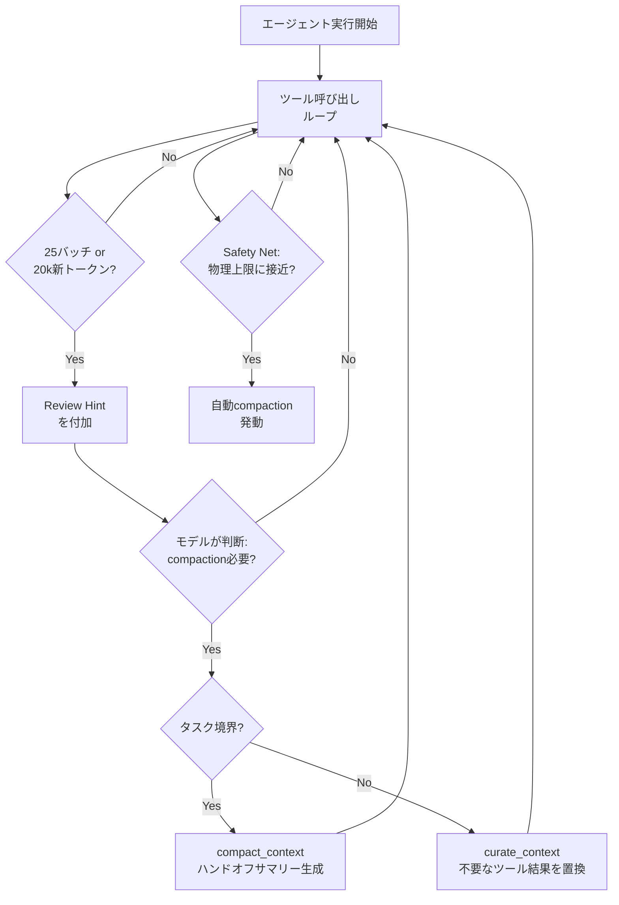

## 論文概要（Abstract）

本記事は [https://arxiv.org/abs/2610.34425](https://arxiv.org/abs/2610.34425) の解説記事です。

CTXAgentは、LLMエージェントのコンテキスト管理をモデル自身に委ねるアプローチを提案した論文である。従来のエージェントハーネスでは、トークン閾値に達したときにシステム側が自動的にコンテキストを圧縮（compaction）するが、CTXAgentでは2つの専用ツール（`compact_context`と`curate_context`）と1段落のガイダンスのみをモデルに与え、いつ・何を・どのように圧縮するかの判断をモデル自身に行わせる。著者らは、Claude Opus 5.5上でClaude Code 2.1.301と同等のタスク成功率を達成しつつ、明示的200kウィンドウ設定と比較して34%、デフォルト設定と比較して49%のAPIコスト削減を報告している。

この記事は [Zenn記事: AIエージェントのコンテキスト3層管理：Compaction×Clearing×Memory](https://zenn.dev/0h_n0/articles/c1d44153ca0dda) の深掘りです。

## 情報源

- **arXiv ID**: 2610.34425
- **URL**: [https://arxiv.org/abs/2610.34425](https://arxiv.org/abs/2610.34425)
- **著者**: Matthias Busch, Marius Tacke, Roland C. Aydin, Christian Feiler, Christian J. Cyron（Hamburg University of Technology, Helmholtz-Zentrum Hereon, DFKI, Saarland University）
- **発表年**: 2026年（投稿日: 2026年10月25日）
- **分野**: cs.AI
- **ライセンス**: CC BY 4.0

## 背景と動機（Background & Motivation）

長時間動作するLLMエージェントにとって、コンテキストウィンドウの管理は根本的な課題である。エージェントがツール呼び出しを繰り返すたびにコンテキストは膨張し、やがてモデルのウィンドウ上限に達する。現在の主要なエージェントハーネス（Claude Code、Codex CLI、OpenCode等）は、トークン数が閾値を超えた時点でシステム側が自動的にcompactionを実行するアプローチを採用している。

しかし、著者らはこの「システム主導のcompaction」には以下の問題があると指摘している。

1. **タイミングの非最適性**: 閾値ベースのトリガーでは、タスクの切れ目とは無関係にcompactionが発生する。タスク途中でcompactionが走ると、まだ必要な中間結果が失われるリスクがある
2. **サマリー品質の制御困難**: 別のLLM呼び出しでサマリーを生成する場合、何を保持し何を捨てるかの判断が作業コンテキストから切り離される
3. **コスト増**: サマライザーの追加呼び出し自体がAPIコストを発生させる

CTXAgentの中心的な仮説は、「作業を行っているモデル自身が、何が重要で何が不要かを最もよく知っている」というものである。モデルにcompactionの判断権限を与えることで、タスク境界での自然なcompactionが実現し、結果としてコスト効率が向上するという主張がなされている。

## 主要な貢献（Key Contributions）

- **貢献1**: 2つのツール（`compact_context`、`curate_context`）と1段落のガイダンスのみで、LLMが自律的にコンテキストを管理する手法の提案
- **貢献2**: 複数モデル（Claude Opus 5.5、Sol 6.1、Astra 6等7モデル）および複数ハーネス（Claude Code、Codex CLI、OpenCode）との比較評価
- **貢献3**: planted dependency（埋め込み依存関係）を用いた、コンテキスト管理品質の定量評価手法の提案
- **貢献4**: エージェント、ベンチマーク、全結果行のオープンソース公開

## 技術的詳細（Technical Details）

### 2つのコンテキスト管理ツール

CTXAgentの核心は、エージェントに提供される2つの専用ツールである。

#### compact_context

```python
def compact_context(
    summary: str,
    keep_from: int,
    keep_ids: list[int] | None = None
) -> str:
    """コンテキストのcompactionを実行する。

    Args:
        summary: モデルが記述するハンドオフサマリー。
                 目標、意思決定、変更ファイル、結果、
                 未解決事項、セグメントIDを含む。
        keep_from: この位置以降のメッセージは保持する。
        keep_ids: 追加で保持するメッセージIDのリスト。

    Returns:
        compaction完了の確認メッセージ。
    """
    ...
```

このツールが呼ばれると、システムプロンプトから`keep_from`位置までの全メッセージがアーカイブされ、モデルが記述した`summary`で置換される。重要な点は、**別のサマライザーLLMの呼び出しが発生しない**ことである。サマリーはcompactionを実行するモデル自身が生成するため、追加のAPIコストは発生しない。

#### curate_context

```python
def curate_context(
    drop: list[dict[str, str]]
) -> str:
    """処理済みのツール結果を簡潔なノートに置換する。

    Args:
        drop: 置換対象のリスト。各要素は
              {"id": "メッセージID", "note": "1行の要約ノート"}

    Returns:
        curation完了の確認メッセージ。
    """
    ...
```

`curate_context`は、既に処理が完了したツール結果（ファイル読み取り結果、コマンド出力等）を1行のノートに置換する。これはZenn記事で解説されているAnthropicのTool Result Clearingに概念的に対応するが、CTXAgentではモデル自身がどの結果をいつ置換するかを判断する点が異なる。

### システムプロンプトガイダンス

著者らは、全モデルで共通の1段落のガイダンスをシステムプロンプトに含めている。このガイダンスには以下の指針が記述されている。

1. **キャッシュ意識**: 書き換え（compaction）はプロンプトキャッシュを無効化するため、タスク境界まで遅延させるべき
2. **ハンドオフサマリーの内容**: 目標、意思決定、変更ファイル、結果、未解決事項、セグメントIDを含める
3. **保護すべき情報**: ユーザーの事実情報と常設の指示（standing instructions）はcompaction後も維持する

### Review Hintメカニズム

エンジンは25ツールバッチごと、または20,000新規トークンごとに、最新のツール結果に1行のreview hintを付加する。このhintはモデルにcompactionの検討を促す合図だが、エンジン自身はhintに基づく行動を一切行わない。自動compactionはsafety net（コンテキストが物理的上限に近づいた場合のみ）としてのみ存在する。

### コンテキスト管理のフロー



著者らが強調しているのは、**compactionのタイミングとサマリー内容の判断がすべてモデル側にある**点である。エンジンはhintの付加とsafety netのみを担当し、コンテキスト管理の実質的な制御権はモデルに委ねられている。

### 形式的なコスト分析

セッション全体のAPIコストは、入力トークンと出力トークンの合計で決まる。

$$
C_{\text{total}} = \sum_{t=1}^{T} \left( c_{\text{in}} \cdot n_{\text{in}}^{(t)} + c_{\text{out}} \cdot n_{\text{out}}^{(t)} \right)
$$

ここで、

- $T$: セッション中のAPI呼び出し総数
- $c_{\text{in}}, c_{\text{out}}$: 入力・出力トークンの単価
- $n_{\text{in}}^{(t)}, n_{\text{out}}^{(t)}$: $t$回目の呼び出しにおける入力・出力トークン数

CTXAgentでは、モデルがcompactionを実行するたびに$n_{\text{in}}^{(t)}$が大幅に削減される。ただし、compaction自体がハンドオフサマリーの出力トークン$n_{\text{out}}^{(\text{compact})}$を消費する。著者らの実験結果（後述）では、この入力削減量が出力増加量を大きく上回ることが示されている。

## 実装のポイント（Implementation）

### 2つのツールの統合

CTXAgentの実装では、既存のエージェントツール（ファイル操作、シェル実行等）に加えて`compact_context`と`curate_context`の2ツールを追加するだけでよい。ツール定義はJSON Schema形式で記述し、エージェントハーネスの既存のツール呼び出し機構に乗せる。

### ハンドオフサマリーの品質

著者らは、ハンドオフサマリーに含めるべき要素として以下を挙げている。

- **目標（Goal）**: 現在取り組んでいるタスクの説明
- **意思決定（Decisions）**: これまでに下した技術的判断とその根拠
- **変更ファイル（Files changed）**: 編集したファイルのパスと変更内容の要約
- **結果（Results）**: テスト結果、コマンド出力等
- **未解決事項（Open issues）**: まだ対応していない問題
- **セグメントID（Segment IDs）**: 保持すべきコンテキストの識別子

### Planted Dependencyによる品質検証

著者らは、コンテキスト管理の品質を検証するために「planted dependency」を提案している。セッション中に事実（stated facts）、一時的な観測値（ephemeral observations）、常設ルール（standing rules）を埋め込み、後のターンで正確に想起できるかを決定論的チェッカーで自動検証する。

## Production Deployment Guide

### AWS実装パターン（コスト最適化重視）

CTXAgentのアーキテクチャ（自己管理型コンテキスト管理）をAWS上で実装する場合の構成例を示す。

**トラフィック量別の推奨構成**:

| 規模 | 月間リクエスト | 推奨構成 | 月額コスト | 主要サービス |
|------|--------------|---------|-----------|------------|
| **Small** | ~3,000 (100/日) | Serverless | $50-150 | Lambda + Bedrock + DynamoDB |
| **Medium** | ~30,000 (1,000/日) | Hybrid | $300-800 | Lambda + ECS Fargate + ElastiCache |
| **Large** | 300,000+ (10,000/日) | Container | $2,000-5,000 | EKS + Karpenter + EC2 Spot |

**Small構成の詳細**（月額$50-150）:
- **Lambda**: 1GB RAM, 60秒タイムアウト（$20/月）— CTXAgentのcompaction判断ロジック実行
- **Bedrock**: Claude 3.5 Haiku, Prompt Caching有効（$80/月）— compaction/curationツール呼び出し含む
- **DynamoDB**: On-Demand（$10/月）— ハンドオフサマリーとセッション状態の永続化
- **CloudWatch**: 基本監視（$5/月）
- **API Gateway**: REST API（$5/月）

**コスト削減テクニック**:
- Spot Instances使用で最大90%削減（EKS + Karpenter）
- Bedrock Batch API使用で50%削減（非リアルタイム処理）
- Prompt Caching有効化で30-90%削減（CTXAgentのキャッシュ意識ガイダンスと連携）
- CTXAgent自身のコンテキスト圧縮で入力トークン34-49%削減

**コスト試算の注意事項**:
- 上記は2026年11月時点のAWS ap-northeast-1（東京）リージョン料金に基づく概算値です
- 実際のコストはトラフィックパターン、リージョン、バースト使用量により変動します
- 最新料金は [AWS料金計算ツール](https://calculator.aws/) で確認してください

### Terraformインフラコード

**Small構成 (Serverless): Lambda + Bedrock + DynamoDB**

```hcl
module "vpc" {
  source  = "terraform-aws-modules/vpc/aws"
  version = "~> 5.0"

  name = "ctxagent-vpc"
  cidr = "10.0.0.0/16"
  azs  = ["ap-northeast-1a", "ap-northeast-1c"]
  private_subnets = ["10.0.1.0/24", "10.0.2.0/24"]

  enable_nat_gateway   = false
  enable_dns_hostnames = true
}

resource "aws_iam_role" "lambda_ctxagent" {
  name = "lambda-ctxagent-role"

  assume_role_policy = jsonencode({
    Version = "2012-10-17"
    Statement = [{
      Action = "sts:AssumeRole"
      Effect = "Allow"
      Principal = { Service = "lambda.amazonaws.com" }
    }]
  })
}

resource "aws_iam_role_policy" "bedrock_invoke" {
  role = aws_iam_role.lambda_ctxagent.id

  policy = jsonencode({
    Version = "2012-10-17"
    Statement = [{
      Effect   = "Allow"
      Action   = ["bedrock:InvokeModel", "bedrock:InvokeModelWithResponseStream"]
      Resource = "arn:aws:bedrock:ap-northeast-1::foundation-model/anthropic.claude-3-5-haiku*"
    }]
  })
}

resource "aws_lambda_function" "ctxagent_handler" {
  filename      = "lambda.zip"
  function_name = "ctxagent-handler"
  role          = aws_iam_role.lambda_ctxagent.arn
  handler       = "index.handler"
  runtime       = "python3.12"
  timeout       = 120
  memory_size   = 1024

  environment {
    variables = {
      BEDROCK_MODEL_ID    = "anthropic.claude-3-5-haiku-20241022-v1:0"
      DYNAMODB_TABLE      = aws_dynamodb_table.session_state.name
      ENABLE_PROMPT_CACHE = "true"
      REVIEW_HINT_INTERVAL = "25"
    }
  }
}

resource "aws_dynamodb_table" "session_state" {
  name         = "ctxagent-session-state"
  billing_mode = "PAY_PER_REQUEST"
  hash_key     = "session_id"

  attribute {
    name = "session_id"
    type = "S"
  }

  ttl {
    attribute_name = "expire_at"
    enabled        = true
  }
}

resource "aws_cloudwatch_metric_alarm" "lambda_cost" {
  alarm_name          = "ctxagent-cost-spike"
  comparison_operator = "GreaterThanThreshold"
  evaluation_periods  = 1
  metric_name         = "Duration"
  namespace           = "AWS/Lambda"
  period              = 3600
  statistic           = "Sum"
  threshold           = 100000
  alarm_description   = "Lambda実行時間異常（コスト急増の可能性）"

  dimensions = {
    FunctionName = aws_lambda_function.ctxagent_handler.function_name
  }
}
```

**Large構成 (Container)** ではEKS + Karpenter + Spot Instancesを使用する。Karpenter NodePoolで`capacity-type: spot`を指定し、`consolidationPolicy: WhenEmptyOrUnderutilized`でアイドル30秒後にスケールダウンする。AWS Budgetsで月額$5,000上限のアラートを設定する。

### 運用・監視設定

**CloudWatch Logs Insights クエリ**:

```sql
-- CTXAgentのcompaction頻度とコスト影響の分析
fields @timestamp, session_id, compaction_type, tokens_before, tokens_after
| stats count() as compaction_count,
        avg(tokens_before - tokens_after) as avg_tokens_saved
  by bin(1h)
| filter compaction_count > 0
```

**CloudWatch アラーム**: `put_metric_alarm`でCTXAgent/Metricsネームスペースの`TokenUsage`を監視し、1時間あたり50万トークン超過でSNS通知を送信する。

**X-Ray トレーシング**: `aws_xray_sdk`の`patch_all()`でboto3を自動計装し、compaction実行時にsession_idをアノテーション、tokens_savedをメタデータとして記録する。

### コスト最適化チェックリスト

**アーキテクチャ選択**:
- [ ] ~100 req/日 → Lambda + Bedrock (Serverless) - $50-150/月
- [ ] ~1000 req/日 → ECS Fargate + Bedrock (Hybrid) - $300-800/月
- [ ] 10000+ req/日 → EKS + Spot Instances (Container) - $2,000-5,000/月

**リソース最適化**:
- [ ] EC2: Spot Instances優先（最大90%削減、Karpenter自動管理）
- [ ] Reserved Instances: 1年コミットで72%削減（予測可能な負荷）
- [ ] Savings Plans: Compute Savings Plans検討（柔軟性高）
- [ ] Lambda: メモリサイズ最適化（CloudWatch Insights分析）
- [ ] ECS/EKS: アイドルタイムのスケールダウン（夜間0台）

**LLMコスト削減**:
- [ ] CTXAgent自身のコンテキスト圧縮で34-49%削減
- [ ] Bedrock Batch API: 50%割引（非リアルタイム処理）
- [ ] Prompt Caching: 30-90%削減（CTXAgentガイダンスでキャッシュ無効化を最小化）
- [ ] モデル選択: 開発=Haiku ($0.25/MTok)、本番簡易=Haiku、本番複雑=Sonnet ($3/MTok)
- [ ] トークン数制限: max_tokens設定で過剰生成防止

**監視・アラート**:
- [ ] AWS Budgets: 月額予算設定（80%で警告、100%でアラート）
- [ ] CloudWatch: compaction頻度・トークン削減量の監視
- [ ] Cost Anomaly Detection: 自動異常検知
- [ ] 日次コストレポート: SNS/Slackへ自動送信

**リソース管理**:
- [ ] 未使用リソース削除（Lambda Insights, Trusted Advisor活用）
- [ ] タグ戦略（環境別・プロジェクト別コスト可視化）
- [ ] DynamoDBセッション自動削除（TTL 30日）

## 実験結果（Results）

### ベンチマーク構成

著者らは以下の4つのベンチマークを用いた評価を行っている。

| ベンチマーク | タスク数 | 内容 |
|-------------|---------|------|
| Aider Polyglot | 118 (Python 34, JS 48, Go 36) | コーディング問題 |
| SciCode | 15問題 / 50ステップ | 科学計算問題 |
| Terminal-Bench 4.0 | 22タスク（うち9タスク使用） | ターミナル操作 |
| SWE-bench Pro | 複数（Python/Go/JS） | ソフトウェアエンジニアリング |

### セッションファミリー

評価は4種類のセッションで実施されている。

- **Mixed sessions**: 101〜115ターン、3シード、188の採点対象質問
- **Clean SciCode chains**: 5チャット、2回繰り返し
- **Marathon**: 212ターン、118エクササイズ、全15 SciCode問題、約1.5Mトークンの生の履歴
- **Hard sessions**: 35〜36ターン、3シード（タスクセットは各シードで重複なし）

### 主要な実験結果

**ハーネス間比較（Claude Opus 5.5, Mixed sessions）**:

著者らの報告によれば（論文Table記載値）:

| ハーネス | タスク成功率 | セッションコスト | コンテキスト最大サイズ |
|---------|------------|----------------|---------------------|
| CTXAgent (self-managed) | ~0.97 | 基準 | ≤80k tokens |
| Claude Code (200k) | ~0.98 | +34% | ~168k tokens |
| Claude Code (default) | ~0.98 | +49% | ~277k tokens |

タスク成功率の差（約0.01）は統計的に有意ではないと著者らは報告している。

**Marathon session（212ターン, ~1.5Mトークン）**:

| ハーネス | スコア |
|---------|-------|
| CTXAgent | 0.986 |
| Claude Code | 0.981 |
| OpenCode | 0.980 |

CTXAgentは212ターンにわたる超長時間セッションにおいても安定した性能を維持しており、コンテキストが80kを超えることがなかったと報告されている。

**Hard sessions**:

著者らの報告によれば、CTXAgent（self-managed）はスコア0.869を$10.72で達成し、control arm（コンテキスト管理ツールなし）はスコア0.826を$12.71で達成している。

### モデル間比較

著者らは7つのモデルでA/B比較（コンテキスト管理あり vs なし）を実施している（論文Table 4の報告値）。

| モデル | コスト比（A/B） | 解釈 |
|--------|---------------|------|
| Opus 5.5 | 0.57 | 43%削減 |
| Astra 6 | 0.52 | 48%削減 |
| Sol 6.1 | 0.69 | 31%削減 |
| Sonnet 5.5 | 0.84 | 16%削減 |
| Haiku 5.5 | 0.99 | ほぼ変化なし |

著者らは「OpusとSolはMixed sessionsで16-58%のコスト削減を達成しつつ、スコアの低下は数パーセントに留まった」と報告している。一方、Haiku 5.5ではコスト削減効果がほぼなく、モデルの能力によって自己管理型コンテキスト管理の効果が大きく異なることが示唆されている。

## 実運用への応用（Practical Applications）

CTXAgentのアプローチは、Zenn記事で解説されているAnthropicの3層コンテキスト管理（Compaction × Clearing × Memory）と相補的な位置づけにある。

**Zenn記事との関連**:
- **Layer 1（Tool Result Clearing）** → `curate_context`ツールが対応。ただしCTXAgentではモデル自身が判断
- **Layer 2（Compaction）** → `compact_context`ツールが対応。タスク境界での実行がガイダンスで推奨される
- **Layer 3（Memory）** → CTXAgentのハンドオフサマリーがMemoryの役割を部分的に担う

**プロダクション導入の判断基準**:
- コンテキストウィンドウが100kトークンを超えるセッションが頻発する場合に効果が高い
- モデルの能力に依存するため、Opus/Sol級のモデルでの利用が前提
- Haiku級の小型モデルでは効果が限定的であり、従来のシステム主導compactionが適切

## 関連研究（Related Work）

- **Beyond Compaction (arXiv 2606.11213)**: Semenov & Dorofeevによる構造化コンテキスト退避手法CWL。CTXAgentがモデルに判断を委ねるのに対し、CWLはtyped episodesと依存グラフによる決定論的な退避を行う。LLM呼び出しなしでのcompactionという共通の目標を持つが、アプローチは対照的である
- **ReCAP (arXiv 2609.40118)**: Yang et al.によるPersistent Context Graphs。推論時のattention信号を軽量グラフに保存し、compaction時にモデル呼び出しなしでブロック選択を行う。CTXAgentとはcompactionの判断主体が異なる（ReCAP: attention統計、CTXAgent: モデル自身）
- **Don't Break the Cache (arXiv 2601.06007)**: Lumer et al.によるプロンプトキャッシュの定量評価。CTXAgentのガイダンスに含まれるキャッシュ意識（compactionはキャッシュを無効化するためタスク境界まで遅延）の理論的裏付けとなる研究

## まとめと今後の展望

CTXAgentは、コンテキスト管理の判断をモデル自身に委ねるという興味深いアプローチを提案している。著者らの実験結果によれば、Claude Opus 5.5上でClaude Codeと同等のタスク成功率を達成しつつ、34-49%のAPIコスト削減を実現している。

ただし、以下の制約に留意する必要がある。

- **モデル依存性**: Haiku級の小型モデルでは効果が限定的
- **実験規模**: コスト制約によりrun数が限られており、run-to-run varianceがハーネス間の差を上回る可能性がある
- **システムプロンプト未最適化**: 著者ら自身が認めるように、ガイダンスのチューニングが不十分
- **クロスベンダー比較の交絡**: ハーネスとモデルが交絡するため、純粋なハーネス効果の分離が困難

今後の研究として、より大規模な評価、小型モデル向けのガイダンス最適化、およびAnthropicのserver-side compactionとの組み合わせ評価が期待される。

## 参考文献

- **arXiv**: [https://arxiv.org/abs/2610.34425](https://arxiv.org/abs/2610.34425)
- **Code**: [https://github.com/MatthiasHBusch/CTXAgent](https://github.com/MatthiasHBusch/CTXAgent)（論文記載、要確認）
- **Related Zenn article**: [https://zenn.dev/0h_n0/articles/c1d44153ca0dda](https://zenn.dev/0h_n0/articles/c1d44153ca0dda)
