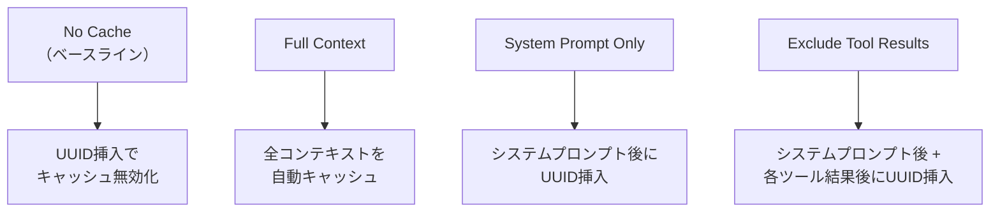

## 論文概要（Abstract）

本記事は [https://arxiv.org/abs/2601.06007](https://arxiv.org/abs/2601.06007) の解説記事です。

「Don't Break the Cache」は、LLMエージェントの長時間マルチターンタスクにおけるプロンプトキャッシュの有効性を、3つのプロバイダ（OpenAI・Anthropic・Google）と4つのモデルで体系的に評価した論文である。著者らは500以上のエージェントセッションを用いて3種類のキャッシュ戦略を比較し、APIコスト41〜80%削減、Time to First Token（TTFT）6〜31%改善を報告している。

この記事は [Zenn記事: AIエージェントのコンテキスト3層管理：Compaction×Clearing×Memory](https://zenn.dev/0h_n0/articles/c1d44153ca0dda) の深掘りです。

## 情報源

- **arXiv ID**: 2601.06007
- **URL**: [https://arxiv.org/abs/2601.06007](https://arxiv.org/abs/2601.06007)
- **著者**: Elias Lumer, Faheem Nizar, Akshaya Jangiti, Kevin Frank, Anmol Gulati, Mandar Phadate, Vamse Kumar Subbiah（PricewaterhouseCoopers, U.S.）
- **発表年**: 2026年（v2: 2026年1月31日）
- **分野**: cs.CL

## 背景と動機（Background & Motivation）

LLMエージェントは単発のプロンプト応答とは異なり、数十〜数百回のツール呼び出しを伴うマルチターン対話で動作する。各ターンでコンテキストウィンドウにツール結果が蓄積されるため、APIコストとレイテンシが急速に増大する。

2025年以降、主要なLLMプロバイダはプロンプトキャッシュ機能を提供している。これはリクエスト間で共通するプレフィックス部分をサーバー側にキャッシュし、再計算を省略することでコストとレイテンシを削減する仕組みである。しかし、エージェントのマルチターン動作では、ツール呼び出しの結果が動的に変化するため、キャッシュの有効活用が困難である。

著者らは、エージェントタスクにおけるプロンプトキャッシュの効果を体系的に評価した研究が存在しないことを指摘し、本論文でその空白を埋めることを目的としている。具体的には、「どのキャッシュ戦略が最もコスト効率が良いか」「フルコンテキストキャッシュは常に有利か」「プロバイダ間で結果は一貫するか」という3つの問いに答えることを目指している。

## 主要な貢献（Key Contributions）

- **貢献1**: エージェントのマルチターンタスクにおけるプロンプトキャッシュの初の体系的評価を実施。3プロバイダ×4モデルで500以上のセッションを分析
- **貢献2**: 3種類のキャッシュ戦略（Full context / System prompt only / Exclude tool results）を比較し、System prompt only戦略がコストとレイテンシの両面で最も安定した効果を発揮することを示した
- **貢献3**: プロンプトサイズ（500〜50,000トークン）とツール呼び出し回数（3〜50回）に対するアブレーション分析を実施し、キャッシュ効果のスケーリング特性を明らかにした

## 技術的詳細（Technical Details）

### プロンプトキャッシュの仕組み

プロンプトキャッシュは、APIリクエストのプレフィックス部分をサーバー側に保持し、後続リクエストで再利用する仕組みである。コスト構造は以下の3つのトークンカテゴリで決まる。

$$
C_{\text{total}} = C_{\text{standard}} \cdot n_{\text{standard}} + C_{\text{cache\_write}} \cdot n_{\text{cache\_write}} + C_{\text{cache\_read}} \cdot n_{\text{cache\_read}}
$$

ここで、
- $C_{\text{standard}}$: 通常の入力トークン単価
- $C_{\text{cache\_write}}$: キャッシュ書き込みトークン単価（通常 $C_{\text{standard}}$ の1.0〜1.25倍）
- $C_{\text{cache\_read}}$: キャッシュ読み取りトークン単価（通常 $C_{\text{standard}}$ の0.1〜0.5倍）
- $n_{\text{standard}}, n_{\text{cache\_write}}, n_{\text{cache\_read}}$: 各カテゴリのトークン数

キャッシュが有効に機能するためには、**リクエスト間でプレフィックスが安定している**ことが条件となる。プレフィックス中の1トークンでも変更があると、その位置以降のキャッシュは無効化される。

### 3つのキャッシュ戦略

著者らは以下の3つのキャッシュ戦略を比較している。



| 戦略 | キャッシュ対象 | 動的コンテンツの扱い |
|------|-------------|-------------------|
| No Cache（ベースライン） | なし | UUID挿入でキャッシュを破壊 |
| Full Context | 全コンテキスト | プロバイダの自動キャッシュに委任 |
| System Prompt Only | システムプロンプトのみ | システムプロンプト後にUUID挿入 |
| Exclude Tool Results | システムプロンプト + 会話履歴 | ツール結果後にUUID挿入 |

**UUIDによるキャッシュ境界制御**: 著者らはキャッシュ境界の制御にUUID（ランダム文字列）を挿入する手法を採用している。UUIDが挿入された位置以降は、プレフィックスが一致しなくなるためキャッシュが無効化される。これにより、どの部分までキャッシュするかを明示的に制御できる。

### 実験設計

**モデル**: GPT-5.2、Claude Sonnet 4.5、Gemini 2.5 Pro、GPT-4o（世代間比較用）

**ベンチマーク**: DeepResearchBenchを使用。LangChainのDeep Agentsライブラリ上に構築されたリサーチエージェントが、Web検索ツールを用いて質問に回答する。各セッションは10,000トークンのシステムプロンプトを含む。

**実験条件**: 各モデル×各戦略で40の独立セッションを実行。条件間に24時間以上の間隔を設け、既存キャッシュをクリアしている。ウォームアップコールも各条件の前に実施。

**統計手法**: 独立サンプルt検定（$\alpha = 0.05$）をベースラインに対して実施。

## 実験結果（Results）

### コスト削減効果

論文Table 1より、各モデル×各戦略のコスト削減率を以下に示す。

| モデル | Full Context | System Prompt Only | Exclude Tool Results | 最良戦略 |
|--------|------------|-------------------|---------------------|---------|
| GPT-5.2 | 79.0% | 80.7% | **79.6%** | Exclude Tool Results |
| Claude Sonnet 4.5 | 78.5% | **78.5%** | 79.3% | System Prompt Only |
| Gemini 2.5 Pro | 28.0% | **41.4%** | 32.6% | System Prompt Only |
| GPT-4o | 45.9% | **45.9%** | 48.0% | System Prompt Only |

著者らは、コスト削減の大部分がシステムプロンプト（10,000トークン）のキャッシュに起因すると分析している。戦略間の差は2〜4ポイント程度であり、**システムプロンプトのキャッシュが最も重要な要素**であることが示されている。

### レイテンシ（TTFT）改善効果

論文Table 2より、Time to First Token（TTFT）の改善率を以下に示す。

| モデル | Full Context | System Prompt Only | Exclude Tool Results |
|--------|------------|-------------------|---------------------|
| GPT-5.2 | 10.2% | 11.6% | **13.0%** |
| Claude Sonnet 4.5 | **22.9%** | 20.9% | 22.1% |
| Gemini 2.5 Pro | 6.0% | **6.1%** | -2.9% |
| GPT-4o | **-8.8%** | 25.0% | **30.9%** |

注目すべきは、**Full Context戦略がGPT-4oでTTFTを悪化させた**（-8.8%）点である。著者らは、動的なツール呼び出し結果に対するキャッシュ書き込みコストがレイテンシのオーバーヘッドとなっていると分析している。Gemini 2.5 ProでもExclude Tool Results戦略でTTFTが悪化（-2.9%）しており、フルコンテキストキャッシュが常に有利とは限らないことが示されている。

一方、Claude Sonnet 4.5はすべての戦略で20%以上のTTFT改善を達成しており、プロバイダの実装による差が大きいことがわかる。

### プロンプトサイズのアブレーション

論文Section 5より、プロンプトサイズを500〜50,000トークンで変化させた結果を以下に示す。

| プロンプトサイズ | GPT-5.2 コスト削減 | Claude コスト削減 | GPT-4o TTFT改善 |
|---------------|-------------------|-----------------|----------------|
| 500トークン | 低い（キャッシュ最小閾値未満） | 低い | -10〜-18%（悪化） |
| 10,000トークン | 79.6% | 78.5% | 30.9% |
| 50,000トークン | 89% | 88% | 60% |

著者らは、プロバイダごとにキャッシュ可能な最小トークン数が異なる（1,024〜4,096トークン）と報告している。500トークンの条件では、この最小閾値を下回るため、キャッシュの書き込みオーバーヘッドだけが発生しTTFTが悪化した。

### ツール呼び出し回数のアブレーション

ツール呼び出し回数を3〜50回で変化させた結果、コスト削減率はほぼ安定していた（GPT-5.2で77〜81%、GPT-4oで42〜53%）。一方、Claude Sonnet 4.5のTTFT改善率は、3回で19%、50回で5%と、ツール数の増加に伴い効果が減衰している。著者らはこれをサーバー負荷の影響と推測している。

## 実装のポイント（Implementation）

著者らが論文中で示した実践的な推奨事項を整理する。

**1. システムプロンプトを安定に保つ**

タイムスタンプ、セッションID、ユーザー固有の情報をシステムプロンプトに含めない。動的な値が必要な場合は、システムプロンプトの末尾に配置する。これにより、プレフィックスの安定性を最大化できる。

**2. ツール定義セットを固定する**

リクエスト間でツール定義を変更すると、キャッシュプレフィックスが無効化される。動的な機能が必要な場合は、汎用的な関数セットを固定し、動的な部分はコード生成で対応することが推奨されている。

**3. 動的コンテンツの配置に注意する**

ツール呼び出し結果やThinkingブロックなど、ターンごとに変化するコンテンツはコンテキストの末尾に配置する。これにより、安定したプレフィックス部分のキャッシュが維持される。

**4. プロバイダの最小キャッシュサイズを意識する**

各プロバイダには最小キャッシュ可能トークン数がある。この閾値を下回るシステムプロンプトではキャッシュが機能せず、書き込みオーバーヘッドのみが発生する。

```python
from dataclasses import dataclass

@dataclass
class CacheConfig:
    """プロバイダ別キャッシュ設定"""
    provider: str
    min_cacheable_tokens: int
    cache_write_multiplier: float
    cache_read_multiplier: float

PROVIDER_CONFIGS = {
    "anthropic": CacheConfig("anthropic", 1024, 1.25, 0.10),
    "openai": CacheConfig("openai", 1024, 1.0, 0.50),
    "google": CacheConfig("google", 4096, 1.0, 0.25),
}

def should_enable_cache(
    system_prompt_tokens: int, provider: str
) -> bool:
    """キャッシュを有効化すべきかを判定する

    Args:
        system_prompt_tokens: システムプロンプトのトークン数
        provider: プロバイダ名

    Returns:
        キャッシュを有効化すべきならTrue
    """
    config = PROVIDER_CONFIGS.get(provider)
    if config is None:
        return False
    return system_prompt_tokens >= config.min_cacheable_tokens
```

**5. タイミングサイドチャネルに注意する**

著者らは、共有キャッシュ環境でのタイミングサイドチャネルリスクについても言及している（Gu et al., 2025; Wu et al., 2025を引用）。キャッシュヒット時とミス時のTTFT差から、他ユーザーのプロンプト内容を推測される可能性がある。

## Production Deployment Guide

### AWS実装パターン（コスト最適化重視）

本論文の知見をAWS上のLLMエージェントに適用する場合の推奨構成を示す。プロンプトキャッシュの効果を最大化するためには、システムプロンプトの安定性とリクエストのルーティング設計が重要である。

**トラフィック量別の推奨構成**:

| 規模 | 月間リクエスト | 推奨構成 | 月額コスト | 主要サービス |
|------|--------------|---------|-----------|------------|
| **Small** | ~3,000 (100/日) | Serverless | $80-200 | Lambda + Bedrock + DynamoDB |
| **Medium** | ~30,000 (1,000/日) | Hybrid | $400-1,000 | Lambda + ECS Fargate + ElastiCache |
| **Large** | 300,000+ (10,000/日) | Container | $2,500-6,000 | EKS + Karpenter + EC2 Spot |

**Small構成の詳細**（月額$80-200）:
- **Lambda**: 1GB RAM, 60秒タイムアウト ($25/月)
- **Bedrock**: Claude 3.5 Haiku, Prompt Caching有効 ($100/月)
- **DynamoDB**: On-Demand、プロンプトハッシュでキャッシュ管理 ($10/月)
- **CloudWatch**: 基本監視 ($5/月)
- **API Gateway**: REST API ($5/月)

**Medium構成の詳細**（月額$400-1,000）:
- **Lambda**: イベント処理 ($50/月)
- **ECS Fargate**: 0.5 vCPU, 1GB RAM × 2タスク ($120/月)
- **Bedrock**: Claude 3.5 Sonnet, システムプロンプトキャッシュ最適化 ($500/月)
- **ElastiCache Redis**: cache.t3.micro、プロンプトハッシュ管理 ($15/月)
- **Application Load Balancer**: ($20/月)

**Large構成の詳細**（月額$2,500-6,000）:
- **EKS**: コントロールプレーン ($72/月)
- **EC2 Spot Instances**: g5.xlarge × 2-4台 (平均$800/月)
- **Karpenter**: 自動スケーリング（追加コストなし）
- **Bedrock Batch**: 50%割引活用 ($2,500/月)
- **S3**: プロンプトテンプレートストレージ ($20/月)
- **CloudWatch + X-Ray**: 詳細監視 ($100/月)

**コスト削減テクニック（本論文の知見に基づく）**:
- **システムプロンプト固定化**: 論文の実験結果より、コスト削減の大部分はシステムプロンプトキャッシュに起因する。動的な値はプロンプト末尾に配置し、プレフィックスの安定性を確保する
- **Bedrock Prompt Caching**: Anthropic Claude on Bedrockではプロンプトキャッシュが利用可能。論文の推奨に従い、ツール定義セットを固定する
- **Spot Instances**: 推論ワークロードはステートレスであるため、Spot Instancesで最大90%削減が可能
- **Batch API**: 非リアルタイム処理にはBedrock Batch APIで50%削減

**コスト試算の注意事項**:
- 上記は2026年11月時点のAWS ap-northeast-1（東京）リージョン料金に基づく概算値です
- 実際のコストはトラフィックパターン、リージョン、バースト使用量により変動します
- 最新料金は [AWS料金計算ツール](https://calculator.aws/) で確認してください

### Terraformインフラコード

**Small構成 (Serverless): Lambda + Bedrock + DynamoDB**

```hcl
module "vpc" {
  source  = "terraform-aws-modules/vpc/aws"
  version = "~> 5.0"

  name = "llm-cache-vpc"
  cidr = "10.0.0.0/16"
  azs  = ["ap-northeast-1a", "ap-northeast-1c"]
  private_subnets = ["10.0.1.0/24", "10.0.2.0/24"]

  enable_nat_gateway   = false
  enable_dns_hostnames = true
}

resource "aws_iam_role" "lambda_bedrock" {
  name = "lambda-bedrock-cache-role"

  assume_role_policy = jsonencode({
    Version = "2012-10-17"
    Statement = [{
      Action = "sts:AssumeRole"
      Effect = "Allow"
      Principal = { Service = "lambda.amazonaws.com" }
    }]
  })
}

resource "aws_iam_role_policy" "bedrock_invoke" {
  role = aws_iam_role.lambda_bedrock.id

  policy = jsonencode({
    Version = "2012-10-17"
    Statement = [{
      Effect   = "Allow"
      Action   = ["bedrock:InvokeModel", "bedrock:InvokeModelWithResponseStream"]
      Resource = "arn:aws:bedrock:ap-northeast-1::foundation-model/anthropic.claude-3-5-haiku*"
    }]
  })
}

resource "aws_lambda_function" "agent_handler" {
  filename      = "lambda.zip"
  function_name = "llm-agent-cached-handler"
  role          = aws_iam_role.lambda_bedrock.arn
  handler       = "index.handler"
  runtime       = "python3.12"
  timeout       = 60
  memory_size   = 1024

  environment {
    variables = {
      BEDROCK_MODEL_ID     = "anthropic.claude-3-5-haiku-20241022-v1:0"
      DYNAMODB_TABLE       = aws_dynamodb_table.prompt_cache.name
      CACHE_STRATEGY       = "system_prompt_only"
      ENABLE_PROMPT_CACHE  = "true"
    }
  }
}

resource "aws_dynamodb_table" "prompt_cache" {
  name         = "llm-prompt-cache-metadata"
  billing_mode = "PAY_PER_REQUEST"
  hash_key     = "prompt_hash"

  attribute {
    name = "prompt_hash"
    type = "S"
  }

  ttl {
    attribute_name = "expire_at"
    enabled        = true
  }
}

resource "aws_cloudwatch_metric_alarm" "cache_miss_rate" {
  alarm_name          = "prompt-cache-miss-spike"
  comparison_operator = "GreaterThanThreshold"
  evaluation_periods  = 2
  metric_name         = "CacheMissCount"
  namespace           = "Custom/LLMAgent"
  period              = 3600
  statistic           = "Sum"
  threshold           = 100
  alarm_description   = "キャッシュミス率異常（プレフィックス変更の可能性）"
}
```

**Large構成 (Container): EKS + Karpenter + Spot Instances**

```hcl
module "eks" {
  source  = "terraform-aws-modules/eks/aws"
  version = "~> 20.0"

  cluster_name    = "llm-agent-cluster"
  cluster_version = "1.31"

  vpc_id     = module.vpc.vpc_id
  subnet_ids = module.vpc.private_subnets

  cluster_endpoint_public_access = true
  enable_cluster_creator_admin_permissions = true
}

resource "kubectl_manifest" "karpenter_provisioner" {
  yaml_body = <<-YAML
    apiVersion: karpenter.sh/v1
    kind: NodePool
    metadata:
      name: spot-inference
    spec:
      template:
        spec:
          requirements:
            - key: karpenter.sh/capacity-type
              operator: In
              values: ["spot"]
            - key: node.kubernetes.io/instance-type
              operator: In
              values: ["g5.xlarge", "g5.2xlarge"]
          limits:
            cpu: "32"
            memory: "128Gi"
      disruption:
        consolidationPolicy: WhenEmptyOrUnderutilized
        consolidateAfter: 30s
  YAML
}

resource "aws_budgets_budget" "llm_monthly" {
  name         = "llm-agent-monthly-budget"
  budget_type  = "COST"
  limit_amount = "6000"
  limit_unit   = "USD"
  time_unit    = "MONTHLY"

  notification {
    comparison_operator        = "GREATER_THAN"
    threshold                  = 80
    threshold_type             = "PERCENTAGE"
    notification_type          = "ACTUAL"
    subscriber_email_addresses = ["ops@example.com"]
  }
}
```

### セキュリティベストプラクティス

**本番環境での推奨設定**:

1. **ネットワークセキュリティ**: EKSは`cluster_endpoint_public_access = false`を設定しVPN経由アクセス。Lambdaはプライベートサブネットに配置
2. **認証・認可**: IAMロールは最小権限原則。MFA必須。IRSA（IAM Roles for Service Accounts）利用
3. **シークレット管理**: AWS Secrets Manager使用。環境変数へのハードコード禁止。90日ごとのローテーション推奨
4. **監査**: CloudTrail全リージョン有効化。Config有効化。GuardDuty有効化
5. **データ保護**: TLS 1.2以上。S3/DynamoDB/EBS全てKMS暗号化

### 運用・監視設定

**CloudWatch Logs Insights クエリ**:
```sql
-- キャッシュヒット率のモニタリング
fields @timestamp, cache_strategy, cache_hit, input_tokens, cache_read_tokens
| stats sum(cache_read_tokens) as total_cache_read,
        sum(input_tokens) as total_input,
        avg(cache_read_tokens / input_tokens) as avg_cache_hit_rate
  by bin(1h)
| filter avg_cache_hit_rate < 0.5

-- TTFT異常検知
fields @timestamp, ttft_ms, model_id
| stats pct(ttft_ms, 95) as p95, pct(ttft_ms, 99) as p99 by bin(5m)
```

**CloudWatch アラーム（キャッシュ効率監視）**:
```python
import boto3

cloudwatch = boto3.client('cloudwatch')

cloudwatch.put_metric_alarm(
    AlarmName='prompt-cache-efficiency-drop',
    ComparisonOperator='LessThanThreshold',
    EvaluationPeriods=3,
    MetricName='CacheHitRate',
    Namespace='Custom/LLMAgent',
    Period=3600,
    Statistic='Average',
    Threshold=0.5,
    ActionsEnabled=True,
    AlarmActions=['arn:aws:sns:ap-northeast-1:123456789:cache-alerts'],
    AlarmDescription='キャッシュヒット率50%未満（プレフィックス不安定の可能性）'
)

cloudwatch.put_metric_alarm(
    AlarmName='bedrock-ttft-spike',
    ComparisonOperator='GreaterThanThreshold',
    EvaluationPeriods=2,
    MetricName='TTFT',
    Namespace='Custom/LLMAgent',
    Period=300,
    Statistic='Average',
    Threshold=5000,
    AlarmDescription='TTFT 5秒超過（キャッシュ無効化の可能性）'
)
```

**X-Ray トレーシング設定**:
```python
from aws_xray_sdk.core import xray_recorder, patch_all

patch_all()

@xray_recorder.capture('bedrock_cached_inference')
def call_bedrock_with_cache(prompt: str, system_prompt: str) -> dict:
    """キャッシュ戦略を適用したBedrock呼び出し"""
    xray_recorder.put_annotation('cache_strategy', 'system_prompt_only')
    xray_recorder.put_metadata('system_prompt_tokens', len(system_prompt.split()))

    response = bedrock.invoke_model(
        modelId='anthropic.claude-3-5-haiku-20241022-v1:0',
        body=json.dumps({'prompt': prompt, 'system': system_prompt})
    )

    usage = response.get('usage', {})
    xray_recorder.put_metadata('cache_read_tokens', usage.get('cache_read_input_tokens', 0))
    xray_recorder.put_metadata('cache_write_tokens', usage.get('cache_creation_input_tokens', 0))
    return response
```

### コスト最適化チェックリスト

**アーキテクチャ選択（トラフィック量で判断）**:
- [ ] ~100 req/日 → Lambda + Bedrock (Serverless) - $80-200/月
- [ ] ~1,000 req/日 → ECS Fargate + Bedrock (Hybrid) - $400-1,000/月
- [ ] 10,000+ req/日 → EKS + Spot Instances (Container) - $2,500-6,000/月

**プロンプトキャッシュ最適化（本論文の推奨）**:
- [ ] システムプロンプトを固定化（タイムスタンプ・セッションID排除）
- [ ] ツール定義セットをリクエスト間で固定
- [ ] 動的コンテンツ（ツール結果）をコンテキスト末尾に配置
- [ ] プロバイダの最小キャッシュサイズ以上のシステムプロンプトを使用
- [ ] キャッシュヒット率を継続的にモニタリング

**リソース最適化**:
- [ ] EC2 Spot Instances優先（最大90%削減、Karpenter自動管理）
- [ ] Reserved Instances: 1年コミットで最大72%削減
- [ ] Bedrock Batch API: 非リアルタイム処理で50%削減
- [ ] Lambda: メモリサイズ最適化（CloudWatch Lambda Insights）
- [ ] ECS/EKS: アイドルタイムのスケールダウン（夜間0台）

**監視・アラート（キャッシュ異常の即時検知）**:
- [ ] AWS Budgets: 月額予算設定（80%で警告、100%でアラート）
- [ ] CloudWatch: キャッシュヒット率・TTFT監視
- [ ] Cost Anomaly Detection: 自動異常検知
- [ ] 日次コストレポート: SNS/Slackへ自動送信

**リソース管理**:
- [ ] タグ戦略: 環境別・プロジェクト別でコスト可視化
- [ ] ライフサイクルポリシー: DynamoDBキャッシュのTTL設定
- [ ] 未使用リソース削除: Trusted Advisor活用
- [ ] 開発環境は夜間停止（Auto Start/Stop）

## 実運用への応用（Practical Applications）

本論文の知見は、Zenn記事で紹介されている3層コンテキスト管理アーキテクチャと密接に関連する。特にLayer 1（Tool Result Clearing）とLayer 2（Compaction）がプロンプトキャッシュに与える影響を理解する上で、以下のポイントが重要である。

**Tool Result Clearingとキャッシュの相互作用**: Zenn記事で述べられている通り、Tool Result Clearingはキャッシュプレフィックスを無効化する。本論文の結果は、この無効化のコストを定量的に裏付けている。Full Context戦略でGPT-4oのTTFTが悪化した結果は、動的なツール結果がキャッシュプレフィックスを頻繁に変更することの弊害を示している。

**System Prompt Only戦略との整合性**: Zenn記事で「システムプロンプトのみをキャッシュする戦略が最も安定」と述べられているが、本論文はこの主張を4モデル×500+セッションの実験で裏付けている。

**コスト最適化の優先順位**: 論文の結果から、プロンプトキャッシュの最適化は以下の優先順位で取り組むべきである。
1. システムプロンプトの安定化（最大効果）
2. ツール定義セットの固定（プレフィックス維持）
3. Tool Result Clearingの `clear_at_least` 設定（Zenn記事で推奨されている通り、小さなクリアリングの頻発を防ぐ）

## 関連研究（Related Work）

- **TokenPilot（arXiv 2606.17016）**: キャッシュ効率を考慮したコンテキスト管理手法を提案。本論文がキャッシュ戦略の評価に焦点を当てているのに対し、TokenPilotはキャッシュ効率を最大化するコンテキスト構造の設計に取り組んでいる
- **Tokalator（arXiv 2604.08290）**: AIコーディングアシスタント向けのContext Engineeringツールキット。プロンプトのトークン消費を可視化し、キャッシュ効率の最適化を支援する
- **CTXAgent（arXiv 2610.34425）**: エージェント自身がコンテキストを管理する手法。キャッシュプレフィックスの無効化を最小限に抑えるため、コンパクション実行をタスク境界で行うことを推奨しており、本論文の知見と整合する
- **Gu et al., 2025; Wu et al., 2025**: 本論文が引用するプロンプトキャッシュのタイミングサイドチャネル攻撃に関する研究。共有キャッシュ環境でのセキュリティリスクを指摘

## 制約と限界

著者ら自身が指摘している本論文の制約を以下に整理する。

- **ベンチマークの限定性**: DeepResearchBench 1つのみで評価しており、コーディングタスクやデータ分析タスクなど、他のエージェントワークロードへの一般化は検証されていない
- **サンプルサイズ**: 各条件40セッションであり、サーバー負荷の変動など外部要因の影響を完全には制御できていない
- **エージェントフレームワーク**: LangChain Deep Agentsのみで検証。他のフレームワーク（Anthropic Agent SDK、AutoGPT等）での結果は不明
- **プロバイダ実装の不透明性**: キャッシュの内部実装はプロバイダごとに異なり、公開されていない。結果の再現性はプロバイダの実装変更に依存する
- **抽象と実践のギャップ**: TTFT改善率は実験条件（10,000トークンシステムプロンプト、Web検索タスク）に依存しており、プロダクション環境では異なる結果になる可能性がある

## まとめと今後の展望

本論文は、LLMエージェントのプロンプトキャッシュ戦略を初めて体系的に評価した研究である。著者らは、System Prompt Only戦略がコストとレイテンシの両面で最も安定した効果を発揮することを、4モデル×500+セッションの実験で示した。

実務への示唆として、エージェント開発者はまずシステムプロンプトの安定化に取り組むべきである。これだけでコストの大部分を削減でき、より高度なキャッシュ戦略（Exclude Tool Resultsなど）はプロバイダ固有の振る舞いに依存するため、自分のワークロードでベンチマークしてから採用すべきである。

今後の研究として、Context Editing（Tool Result ClearingやCompaction）がキャッシュ効率に与える影響の定量評価が期待される。本論文はキャッシュ戦略の静的な比較に留まっているが、エージェントが動的にコンテキストを編集する実運用環境での評価が次のステップとなるだろう。

## 参考文献

- **arXiv**: [https://arxiv.org/abs/2601.06007](https://arxiv.org/abs/2601.06007)
- **Related Zenn article**: [https://zenn.dev/0h_n0/articles/c1d44153ca0dda](https://zenn.dev/0h_n0/articles/c1d44153ca0dda)
- **TokenPilot**: [https://arxiv.org/abs/2606.17016](https://arxiv.org/abs/2606.17016)
- **CTXAgent**: [https://arxiv.org/abs/2610.34425](https://arxiv.org/abs/2610.34425)
- **Tokalator**: [https://arxiv.org/abs/2604.08290](https://arxiv.org/abs/2604.08290)
