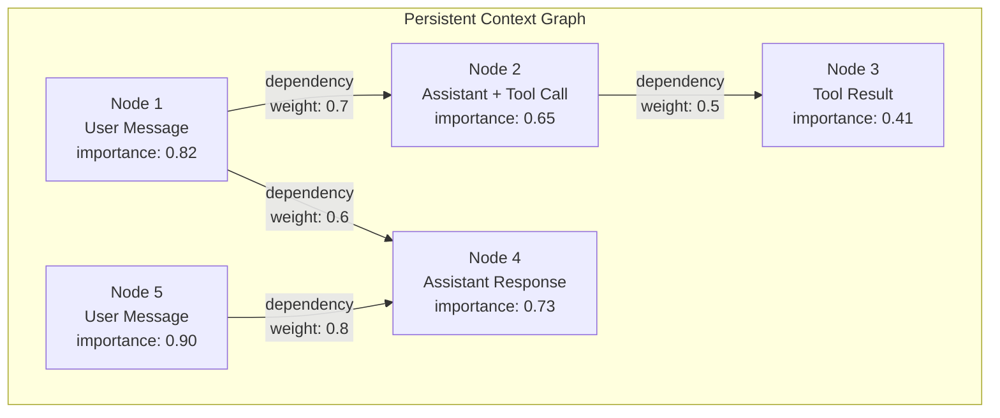

## 論文概要（Abstract）

本記事は [https://arxiv.org/abs/2609.40118](https://arxiv.org/abs/2609.40118) の解説記事です。

LLMエージェントが長時間のセッションで対話履歴を蓄積すると、コンテキストウィンドウの限界に達し、過去の情報を整理（compaction）する必要が生じる。従来のcompaction手法は要約生成のためにLLMを再度呼び出す必要があり、その処理自体がレイテンシとコストの負荷となっていた。本論文は、推論時に既に計算されているattention重みを再利用して**Persistent Context Graph**（持続的コンテキストグラフ）を構築し、**LLM呼び出しなしでコンテキスト選択を行う**ReCAP（Retrieval-based Context with Attention Persistence）手法を提案している。著者らは、Codex方式の要約ベースcompactionと比較して、compactionおよびcold restorationの推定レイテンシを約95%削減したと報告している（論文Table 2より）。

この記事は [Zenn記事: AIエージェントのコンテキスト3層管理：Compaction×Clearing×Memory](https://zenn.dev/0h_n0/articles/c1d44153ca0dda) の深掘りです。

## 情報源

- **arXiv ID**: 2609.40118
- **URL**: [https://arxiv.org/abs/2609.40118](https://arxiv.org/abs/2609.40118)
- **著者**: Jingbo Yang (UCSB), Kwei-Herng Lai (Microsoft), Xiaowen Wang (Microsoft), Zhaoxuan Tan (Notre Dame), Pei Zhou (Microsoft), Mengting Wan, Yaar Harari, Evgeniy Gabrilovich, Shiyu Chang (UCSB)
- **投稿日**: 2026年9月30日
- **分野**: cs.CL
- **コード**: [https://github.com/UCSB-NLP-Chang/ReCAP](https://github.com/UCSB-NLP-Chang/ReCAP)

## 背景と動機（Background & Motivation）

LLMエージェントは、コーディング支援や調査タスクなどで数十〜数百回のツール呼び出しを伴うマルチターン対話を行う。このとき対話履歴はターンごとに増加し、コンテキストウィンドウの上限に到達する問題がある。

従来のcompaction手法は大きく2種類に分かれる。1つは**要約ベースのcompaction**で、古い対話履歴をLLMに要約させてコンテキストを圧縮する方式である。もう1つは**KVキャッシュの圧縮**で、attention scoreに基づいて不要なKVエントリを削除する方式である。

しかし、いずれの手法にも課題がある。要約ベースのcompactionは、要約生成にLLM推論コスト（レイテンシ・API料金）が追加で発生する。例えばCodex方式の要約では、Qwen3-Coderモデルで1回のcompactionに平均7.67秒を要する（論文Table 2より）。KVキャッシュ圧縮は推論サーバへのアクセスが必要であり、クローズドAPIでは利用できない。

著者らは、推論時に「既に計算されている」attention重みに着目した。通常のforward passで得られるattention信号を捨てずに軽量なグラフ構造に保存し、compaction時にはグラフ探索と文字列マッチングだけでコンテキスト選択を行うことで、追加のモデル呼び出しを不要にする。

## 主要な貢献（Key Contributions）

- **貢献1**: 推論時のattention重みを持続的に保存するPersistent Context Graphの設計。ノードは対話履歴の原子単位（ユーザーメッセージ、アシスタント応答等）で、attention由来のimportanceスコアと依存関係エッジを持つ。
- **貢献2**: LLM呼び出しを一切必要としないcompactionアルゴリズム。グラフ探索・文字列マッチング・greedy packingの組み合わせにより、Qwen3-Coderで中央値20.2ms/リクエストのcompaction速度を達成。
- **貢献3**: SWE-TogetherとLost-in-Conversation（LiC）ベンチマークでの評価。LiCでは全履歴保持と比較してQwen3-Coderで19.8ポイント、gpt-oss-20bで41.2ポイントの精度向上を報告。

## 技術的詳細（Technical Details）

### Persistent Context Graphの構造

ReCAPの中核は、対話履歴をグラフ構造で管理するPersistent Context Graphである。



**ノード**は対話履歴の原子的なブロックである。具体的には以下の3種類がある。

- ユーザーメッセージ
- アシスタント応答（ツール呼び出しとその結果を含む場合がある）
- 単純なアシスタントテキスト応答

各ノードは $[0, 1]$ の範囲のimportanceスコア $s_i$ を保持する。

### Attention-Derived Importanceの計算

importanceスコアの更新は、各ターン境界で以下の手順で行われる。

1. **Attentionサンプリング**: 推論のforward passで得られるattention重みを、ヘッド・レイヤーの一部からサンプリングする
2. **ブロック単位の集約**: サンプリングされたattentionを各ノード（ブロック）単位で平均化し、raw importanceスコアを得る
3. **EMAによる更新**: 既存のスコアと新しいスコアを指数移動平均（Exponential Moving Average）で統合する

$$
s_i^{(t)} = \alpha \cdot \hat{s}_i^{(t)} + (1 - \alpha) \cdot s_i^{(t-1)}
$$

ここで、
- $s_i^{(t)}$: ターン $t$ におけるノード $i$ のimportanceスコア
- $\hat{s}_i^{(t)}$: ターン $t$ でattentionから計算されたraw importance
- $\alpha$: EMA係数（新しい情報への適応速度を制御）
- $s_i^{(t-1)}$: 前ターンまでのスコア

この設計の特徴として、**現在のコンテキストウィンドウに含まれないノードもスコアを保持し続ける**点がある。一度evictされたノードでも、過去のスコアが保存されているため、後から必要になった場合に復帰させることが可能である。

### 依存関係エッジの構築

ノード間の依存関係は、attention重みの閾値判定で決定される。

$$
\text{edge}(i \to j) \iff A_{j \to i} > \tau
$$

ここで、
- $A_{j \to i}$: ノード $j$ からノード $i$ への集約attention重み
- $\tau$: 閾値パラメータ

エッジの重みは、過去に観測された最大値を保持する。

### コンテキスト選択アルゴリズム

compaction時のコンテキスト選択は、以下のスコアリング関数に基づくgreedy packingで行う。

$$
\text{score}(i) = \underbrace{\bar{s}_i}_{\text{z-normalized importance}} + \lambda_1 \cdot \underbrace{\text{IDF}(i, q)}_{\text{identifier overlap}} + \lambda_2 \cdot \underbrace{b_i}_{\text{exploration bonus}} - \lambda_3 \cdot \underbrace{d_i}_{\text{stale penalty}}
$$

ここで、
- $\bar{s}_i$: z正規化されたimportanceスコア
- $\text{IDF}(i, q)$: 新しいリクエスト $q$ とノード $i$ 間のIDF重み付き識別子オーバーラップ
- $b_i$: 未観測ブロックへの探索ボーナス
- $d_i$: 長期間参照されていないブロックへのペナルティ

**保護ルール**: ユーザーメッセージと各ファイルの最新editは常に保持される。

**バジェット制約**: 全履歴トークン数の $\beta = 0.1$（10%）に収まるようgreedy packingを行う。

**1-hop expansion**: 選択されたノードの依存関係エッジを辿り、支援コンテキストを追加で取り込む。

```python
from dataclasses import dataclass

@dataclass
class ContextNode:
    """Persistent Context Graphのノード"""
    node_id: int
    content: str
    importance: float  # [0, 1]
    token_count: int
    is_protected: bool  # user message or latest file edit

def select_context(
    graph: dict[int, ContextNode],
    edges: dict[int, list[int]],
    query: str,
    budget_tokens: int,
) -> list[int]:
    """LLM呼び出しなしでコンテキストを選択

    Args:
        graph: ノードID -> ContextNode のマッピング
        edges: ノードID -> 依存先ノードIDリスト
        query: 新しいリクエストのテキスト
        budget_tokens: トークン予算

    Returns:
        選択されたノードIDのリスト
    """
    scores = {}
    for nid, node in graph.items():
        z_importance = z_normalize(node.importance, graph)
        idf_overlap = compute_idf_overlap(node.content, query)
        exploration = exploration_bonus(node)
        stale = stale_penalty(node)
        scores[nid] = z_importance + idf_overlap + exploration - stale

    # 保護ノードを先に確定
    selected = [nid for nid, n in graph.items() if n.is_protected]
    used_tokens = sum(graph[nid].token_count for nid in selected)

    # スコア順にgreedy packing
    ranked = sorted(scores.items(), key=lambda x: x[1], reverse=True)
    for nid, _ in ranked:
        if nid in selected:
            continue
        if used_tokens + graph[nid].token_count > budget_tokens:
            continue
        selected.append(nid)
        used_tokens += graph[nid].token_count

    # 1-hop expansion
    expanded = set(selected)
    for nid in list(selected):
        for dep_id in edges.get(nid, []):
            if dep_id not in expanded:
                if used_tokens + graph[dep_id].token_count <= budget_tokens:
                    expanded.add(dep_id)
                    used_tokens += graph[dep_id].token_count

    return sorted(expanded)
```

### Selection固定によるPrefix Cache再利用

ReCAPの設計上の工夫として、**ターン内のtool stepではselectionを変更しない**点がある。エージェントが1ターン中に複数のツールを呼び出す場合、最初のtool callで決定したコンテキスト選択を最後まで固定する。これにより、同一ターン内のtool stepでprefix cacheを再利用でき、TTFTの短縮につながる。

著者らは、gpt-oss-20bでwarm turnのTTFT中央値が0.10秒、idle turnでは1.58秒であったと報告している（論文Section 5.3より）。

## 実装のポイント（Implementation）

ReCAPを実装する際の主要な注意点は以下の通りである。

**attentionアクセスの必要性**: ReCAPはforward pass時のattention重みを読み取る必要がある。オープンソースモデル（Qwen3-Coder, gpt-oss等）ではSGLingなどのサービングフレームワーク経由で取得可能だが、**クローズドAPI（OpenAI GPT, Anthropic Claude等）ではattention重みが公開されていないため、直接適用できない**。著者らはQwen3-0.6Bを代理（proxy）として使用する実験も行い、統計的に有意な差がなかったと報告している。

**グラフ更新のオーバーヘッド**: Persistent Context Graphの更新処理はCPU上で動作し、グラフ探索と文字列マッチングのみで構成される。Qwen3-CoderのSWE-Togetherベンチマークで中央値20.2ms/リクエスト、それ以外では約1ms以下と報告されている。

**バジェットパラメータ $\beta$ の設定**: 論文では $\beta = 0.1$（全履歴の10%をコンテキストとして保持）が使用されている。バジェットが小さすぎると必要な情報が失われ、大きすぎるとcompactionの効果が薄れる。タスクの特性に応じた調整が必要である。

**EMA係数 $\alpha$ の設定**: 大きな $\alpha$ は最新のattention信号を重視し、小さな $\alpha$ は過去のスコアを重視する。コーディングタスクのように直近の変更が重要な場面では大きめの値が適している。

## Production Deployment Guide

### AWS実装パターン（コスト最適化重視）

ReCAPのようなattention-basedコンテキスト管理をAWS上で運用する場合、オープンソースモデルのセルフホスティングが前提となる（クローズドAPIではattention重みを取得できないため）。

**トラフィック量別の推奨構成**:

| 規模 | 月間リクエスト | 推奨構成 | 月額コスト | 主要サービス |
|------|--------------|---------|-----------|------------|
| **Small** | ~3,000 (100/日) | Serverless GPU | $200-500 | SageMaker Serverless + S3 + DynamoDB |
| **Medium** | ~30,000 (1,000/日) | 常駐GPU | $1,500-3,000 | SageMaker Real-time + ElastiCache |
| **Large** | 300,000+ (10,000/日) | Multi-GPU Cluster | $5,000-15,000 | EKS + Karpenter + g5/p4 Spot |

**Small構成の詳細** (月額$200-500):
- **SageMaker Serverless Inference**: Qwen3-Coder-30B-A3B（MoE、実効パラメータ3B）をSGLingでサーブ ($150/月)
- **S3**: Persistent Context Graphの永続化ストレージ ($5/月)
- **DynamoDB**: セッション管理・ノードメタデータ On-Demand ($10/月)
- **CloudWatch**: 基本監視 ($5/月)

**Medium構成の詳細** (月額$1,500-3,000):
- **SageMaker Real-time Endpoint**: g5.2xlarge (1xA10G 24GB) × 1台 ($800/月)
- **ElastiCache Redis**: グラフキャッシュ cache.r6g.large ($200/月)
- **S3 + DynamoDB**: 永続化 ($30/月)
- **Application Load Balancer**: ($20/月)

**Large構成の詳細** (月額$5,000-15,000):
- **EKS**: コントロールプレーン ($72/月)
- **EC2 Spot g5.xlarge**: 2-4台 (平均$800/月、最大90%削減)
- **Karpenter**: GPU自動スケーリング（追加コストなし）
- **ElastiCache Redis Cluster**: グラフ永続化 ($500/月)
- **CloudWatch + X-Ray**: 詳細監視 ($100/月)

**コスト削減テクニック**:
- Spot Instances使用で最大90%削減（EKS + Karpenter）
- Reserved Instances購入で最大72%削減（1年コミット）
- MoEモデル（Qwen3-Coder-30B-A3B: 実効3Bパラメータ）選択で推論コスト削減
- ReCAP自体がcompactionのLLM呼び出しを削減するため、推論コストが低下
- アイドルタイムのAuto Scaling to Zero（SageMaker Serverless）

**コスト試算の注意事項**:
- 上記は2026年11月時点のAWS ap-northeast-1（東京）リージョン料金に基づく概算値です
- GPU インスタンスの料金はSpot市場の状況により大きく変動します
- 最新料金は [AWS料金計算ツール](https://calculator.aws/) で確認してください

### Terraformインフラコード

**Small構成 (Serverless GPU): SageMaker + S3 + DynamoDB**

```hcl
# --- S3バケット（グラフ永続化） ---
resource "aws_s3_bucket" "context_graphs" {
  bucket = "recap-context-graphs"
}

resource "aws_s3_bucket_server_side_encryption_configuration" "graphs_enc" {
  bucket = aws_s3_bucket.context_graphs.id
  rule {
    apply_server_side_encryption_by_default {
      sse_algorithm = "aws:kms"
    }
  }
}

# --- DynamoDB（セッション管理） ---
resource "aws_dynamodb_table" "sessions" {
  name         = "recap-sessions"
  billing_mode = "PAY_PER_REQUEST"
  hash_key     = "session_id"

  attribute {
    name = "session_id"
    type = "S"
  }

  ttl {
    attribute_name = "expire_at"
    enabled        = true
  }
}

# --- IAMロール（最小権限） ---
resource "aws_iam_role" "sagemaker_execution" {
  name = "recap-sagemaker-role"

  assume_role_policy = jsonencode({
    Version = "2012-10-17"
    Statement = [{
      Action = "sts:AssumeRole"
      Effect = "Allow"
      Principal = { Service = "sagemaker.amazonaws.com" }
    }]
  })
}

resource "aws_iam_role_policy" "sagemaker_s3" {
  role = aws_iam_role.sagemaker_execution.id
  policy = jsonencode({
    Version = "2012-10-17"
    Statement = [{
      Effect   = "Allow"
      Action   = ["s3:GetObject", "s3:PutObject"]
      Resource = "${aws_s3_bucket.context_graphs.arn}/*"
    }]
  })
}

# --- CloudWatchアラーム（レイテンシ監視） ---
resource "aws_cloudwatch_metric_alarm" "inference_latency" {
  alarm_name          = "recap-inference-latency"
  comparison_operator = "GreaterThanThreshold"
  evaluation_periods  = 2
  metric_name         = "ModelLatency"
  namespace           = "AWS/SageMaker"
  period              = 300
  statistic           = "Average"
  threshold           = 10000
  alarm_description   = "SageMaker推論レイテンシ異常（compaction含む）"
}
```

**Large構成 (Container): EKS + Karpenter + Spot GPU**

```hcl
# --- EKSクラスタ ---
module "eks" {
  source  = "terraform-aws-modules/eks/aws"
  version = "~> 20.0"

  cluster_name    = "recap-inference-cluster"
  cluster_version = "1.31"

  vpc_id     = module.vpc.vpc_id
  subnet_ids = module.vpc.private_subnets

  cluster_endpoint_public_access = true
  enable_cluster_creator_admin_permissions = true
}

# --- Karpenter（GPU Spot自動スケーリング） ---
resource "kubectl_manifest" "karpenter_gpu_provisioner" {
  yaml_body = <<-YAML
    apiVersion: karpenter.sh/v1alpha5
    kind: Provisioner
    metadata:
      name: gpu-spot-provisioner
    spec:
      requirements:
        - key: karpenter.sh/capacity-type
          operator: In
          values: ["spot"]
        - key: node.kubernetes.io/instance-type
          operator: In
          values: ["g5.xlarge", "g5.2xlarge"]
      limits:
        resources:
          cpu: "32"
          memory: "128Gi"
          nvidia.com/gpu: "4"
      providerRef:
        name: default
      ttlSecondsAfterEmpty: 60
  YAML
}

# --- Redis（グラフキャッシュ） ---
resource "aws_elasticache_replication_group" "graph_cache" {
  replication_group_id = "recap-graph-cache"
  description          = "ReCAP Persistent Context Graph cache"
  node_type            = "cache.r6g.large"
  num_cache_clusters   = 2
  engine               = "redis"
  engine_version       = "7.1"
  at_rest_encryption_enabled = true
  transit_encryption_enabled = true
}

# --- Cost Explorerアラート ---
resource "aws_budgets_budget" "gpu_monthly" {
  name         = "recap-gpu-budget"
  budget_type  = "COST"
  limit_amount = "15000"
  limit_unit   = "USD"
  time_unit    = "MONTHLY"

  notification {
    comparison_operator        = "GREATER_THAN"
    threshold                  = 80
    threshold_type             = "PERCENTAGE"
    notification_type          = "ACTUAL"
    subscriber_email_addresses = ["ops@example.com"]
  }
}
```

### セキュリティベストプラクティス

**本番環境での推奨設定**:

1. **ネットワーク**: EKS `cluster_endpoint_public_access = false`（VPN経由）、SageMaker VPCエンドポイント使用
2. **IAM**: 最小権限、IRSA（IAM Roles for Service Accounts）使用
3. **シークレット**: Secrets Manager、環境変数ハードコード禁止
4. **暗号化**: S3/DynamoDB/ElastiCache全てKMS暗号化、TLS 1.2以上
5. **監査**: CloudTrail全リージョン有効化

### 運用・監視設定

**CloudWatch Logs Insights クエリ**:
```sql
-- compactionレイテンシの分布
fields @timestamp, compaction_ms, graph_nodes, selected_nodes
| stats pct(compaction_ms, 50) as p50,
        pct(compaction_ms, 95) as p95,
        pct(compaction_ms, 99) as p99
  by bin(1h)

-- attention graph更新コスト
fields @timestamp, graph_update_ms, attention_sample_count
| stats avg(graph_update_ms) as avg_update,
        max(graph_update_ms) as max_update
  by bin(5m)
```

**CloudWatch アラーム（コスト重視）**:
```python
import boto3

cloudwatch = boto3.client('cloudwatch')

cloudwatch.put_metric_alarm(
    AlarmName='recap-compaction-latency',
    ComparisonOperator='GreaterThanThreshold',
    EvaluationPeriods=2,
    MetricName='CompactionLatency',
    Namespace='Custom/ReCAP',
    Period=300,
    Statistic='p95',
    Threshold=100,  # 100ms超過でアラート（通常20ms）
    AlarmDescription='ReCAP compactionレイテンシ異常'
)

cloudwatch.put_metric_alarm(
    AlarmName='recap-gpu-utilization',
    ComparisonOperator='LessThanThreshold',
    EvaluationPeriods=6,
    MetricName='GPUUtilization',
    Namespace='Custom/ReCAP',
    Period=300,
    Statistic='Average',
    Threshold=10,  # 10%未満が30分続いたらスケールダウン
    AlarmDescription='GPU低利用率（コスト最適化のためスケールダウン推奨）'
)
```

**X-Ray トレーシング設定**:
```python
from aws_xray_sdk.core import xray_recorder, patch_all

patch_all()

@xray_recorder.capture('recap_select_context')
def select_context_traced(graph, edges, query, budget):
    """ReCAP コンテキスト選択のトレーシング"""
    xray_recorder.put_annotation('graph_nodes', len(graph))
    xray_recorder.put_annotation('budget_tokens', budget)

    selected = select_context(graph, edges, query, budget)

    xray_recorder.put_metadata('selected_count', len(selected))
    xray_recorder.put_metadata('selected_tokens',
        sum(graph[nid].token_count for nid in selected))
    return selected
```

### コスト最適化チェックリスト

**アーキテクチャ選択（トラフィック量で判断）**:
- [ ] ~100 req/日 → SageMaker Serverless - $200-500/月
- [ ] ~1000 req/日 → SageMaker Real-time Endpoint - $1,500-3,000/月
- [ ] 10000+ req/日 → EKS + Spot GPU Instances - $5,000-15,000/月

**リソース最適化**:
- [ ] GPU Spot Instances優先（g5.xlarge、最大90%削減）
- [ ] MoEモデル選択（Qwen3-Coder-30B-A3B: 実効3Bパラメータ、メモリ効率）
- [ ] Reserved Instances: 1年コミットで72%削減（予測可能な負荷）
- [ ] SageMaker Serverless: アイドル時間のコストゼロ
- [ ] EKS Karpenter: GPU利用率に基づく自動スケーリング

**ReCAP固有の最適化**:
- [ ] compaction時LLM呼び出し削減（ReCAP自体の効果）
- [ ] prefix cache再利用（ターン内selection固定）
- [ ] グラフ永続化（S3）でcold start時のグラフ再構築不要
- [ ] attention proxyモデル（Qwen3-0.6B）使用でattention取得コスト削減

**監視・アラート**:
- [ ] AWS Budgets: 月額予算設定（80%で警告）
- [ ] CloudWatch: compactionレイテンシ・GPU利用率
- [ ] Cost Anomaly Detection: GPU使用量スパイク検知
- [ ] 日次コストレポート: SNS/Slackへ自動送信

**リソース管理**:
- [ ] 未使用SageMakerエンドポイント削除
- [ ] タグ戦略: 環境別（dev/staging/prod）でコスト可視化
- [ ] S3ライフサイクルポリシー: 古いグラフスナップショット自動削除（30日）
- [ ] ElastiCache: 開発環境は夜間停止

## 実験結果（Results）

### SWE-Togetherベンチマーク

SWE-Togetherは106件のリポジトリレベルのタスクで、ツール使用とユーザーフィードバックを含む評価ベンチマークである。GPT-5.4がユーザーをシミュレートしている。

| モデル | 手法 | Reward | Context tokens/call |
|--------|------|--------|-------------------|
| Qwen3-Coder | Full history | 24.4 | 28,504 |
| Qwen3-Coder | Summarize (Codex-style) | 28.7 | 5,239 |
| Qwen3-Coder | **ReCAP** | **28.5** | **15,344** |
| gpt-oss-20b | Full history | 8.2 | 8,508 |
| gpt-oss-20b | Summarize (Codex-style) | 8.1 | 4,543 |
| gpt-oss-20b | **ReCAP** | **9.0** | **4,043** |

（論文Table 1より）

著者らは、ReCAPがSWE-Togetherにおいてfull historyと比較してコンテキスト使用量を約46%削減しながら、rewardスコアはSummarizeと同等（Qwen3-Coderで0.2ポイント差）であったと報告している。gpt-oss-20bではReCAPがSummarizeを0.9ポイント上回った。

### Lost-in-Conversation（LiC）ベンチマーク

LiCは100件のコードインスタンスで、要件がユーザーターンを通じて段階的に明かされるベンチマークである。各インスタンスで5つの会話が実行される。

| モデル | Full history | Summarize | **ReCAP** | 改善幅 (vs Full) |
|--------|------------|-----------|-----------|----------------|
| Qwen3-Coder | 65.6 | 75.4 | **85.4** | +19.8pt |
| gpt-oss-20b | 26.4 | 36.8 | **67.6** | +41.2pt |

（論文Table 1より）

LiCでの大幅な改善は注目に値する。著者らは、full historyが逆に精度を下げる現象について、コンテキストが長くなるほど中間に配置された情報の参照精度が低下する「Lost in the Middle」問題が一因であると指摘している。ReCAPは関連性の高いブロックのみを選択的に提示するため、この問題を緩和していると考えられる。

### Compactionレイテンシ比較

| 手法 | Compaction時間 (Qwen3-Coder) |
|------|---------------------------|
| Codex-style Summarize | 7.67秒 |
| **ReCAP** | **0.02秒** |

（論文Table 2より）

著者らは、ReCAPがcompactionとcold restorationの推定レイテンシを約95%削減したと報告している。ただし、これはオープンソースモデルでの推定値であり、実際のCodex製品との直接比較ではない点に注意が必要である。

### Ablation Study

attention graphを除去した場合（代わりにランダム選択やrecency-based選択を使用）、LiC精度はQwen3-Coderで85.4%から76.6%に低下した（論文Section 5より）。これはattention由来のimportanceスコアがコンテキスト選択の品質に寄与していることを示唆する。

## 実運用への応用（Practical Applications）

ReCAPは以下のようなシナリオで特に有効と考えられる。

**セルフホスティング環境でのエージェント運用**: オープンソースモデルをSGLingなどでサーブしている環境では、attention重みを直接取得できるためReCAPの全機能を活用できる。compaction時のLLM呼び出しが不要になるため、マルチテナント環境でのGPUリソース効率が向上する。

**コーディングエージェント**: SWE-Togetherでの評価結果から、リポジトリレベルのコーディングタスクでfull historyと同等以上のタスク成功率を維持しつつ、コンテキスト使用量を削減できる。

**長時間対話エージェント**: LiCでの大幅な精度向上（特にgpt-oss-20bでの+41.2pt）は、要件が段階的に明かされるような複雑な対話シナリオでの有効性を示唆する。

**制約**: クローズドAPI（OpenAI GPT, Anthropic Claude等）では直接適用できない。ただし、小型proxyモデル（Qwen3-0.6B等）をattention取得用に並行稼働させるアプローチが著者らによって検討されており、統計的に有意な差がなかったと報告されている。

## 関連研究（Related Work）

- **Codex Default Compaction**: OpenAI Codexが採用する要約ベースのcompaction。コンテキストが閾値を超えると要約パスを実行する。ReCAPの直接的な比較対象であり、SWE-Togetherでrewardスコアは同等だが、compactionレイテンシで大きな差が出ている。

- **CWL (Context Window Lifecycle, arXiv 2606.11213)**: Semenov & Dorofeevによるtyped episodesと依存関係グラフに基づく決定論的eviction手法。ReCAPと同様にLLM呼び出しを不要とするが、CWLはエージェント自身がepisode境界を明示的にアノテーションする必要がある点が異なる。CWLは89個の逐次タスクを80Mトークンにわたって処理し、タスク精度の劣化なしと報告されている。

- **CTXAgent (arXiv 2610.34425)**: Busch et al.によるエージェント自律型コンテキスト管理。エージェント自身がcompactタイミングを判断する。Claude Opus 5.5で200k windowと比較して34%のコスト削減を報告している。ReCAPがattention信号による自動選択を行うのに対し、CTXAgentはモデルの判断に委ねるアプローチである。

- **LongLLMLingua / LLMLingua-2**: プロンプト圧縮手法。ReCAPの論文ではベースラインとして比較されており、LiCベンチマークでReCAPが上回っている。

## まとめと今後の展望

ReCAPは、推論時に「既に計算されている」attention重みを持続的なグラフ構造に保存し、compaction時のLLM呼び出しを不要にする手法である。主要な成果として、compactionレイテンシの推定95%削減と、LiCベンチマークでの精度向上（Qwen3-Coderで+19.8pt、gpt-oss-20bで+41.2pt、いずれもfull history比、論文Table 1より）が報告されている。

ただし、以下の制約がある。SWE-Togetherでの改善幅は小さく（Qwen3-Coderで28.5 vs 28.7）、ノイズ範囲内である可能性がある。また、attention重みへのアクセスが必要なため、クローズドAPIでは直接利用できない。ベースラインはCodex方式をオープンモデルで再現したものであり、Codex製品自体との比較ではない。

今後の研究方向としては、クローズドAPIでのproxyモデル方式の実用化、より大規模なベンチマークでの評価、そしてKVキャッシュ圧縮手法との統合が考えられる。

## 参考文献

- **arXiv**: [https://arxiv.org/abs/2609.40118](https://arxiv.org/abs/2609.40118)
- **Code**: [https://github.com/UCSB-NLP-Chang/ReCAP](https://github.com/UCSB-NLP-Chang/ReCAP)
- **Related**: [CWL - Beyond Compaction (arXiv 2606.11213)](https://arxiv.org/abs/2606.11213)
- **Related**: [CTXAgent (arXiv 2610.34425)](https://arxiv.org/abs/2610.34425)
- **Related Zenn article**: [https://zenn.dev/0h_n0/articles/c1d44153ca0dda](https://zenn.dev/0h_n0/articles/c1d44153ca0dda)

---

:::message
この記事はAI（Claude Code）により自動生成されました。内容の正確性については原論文を参照してください。
:::
