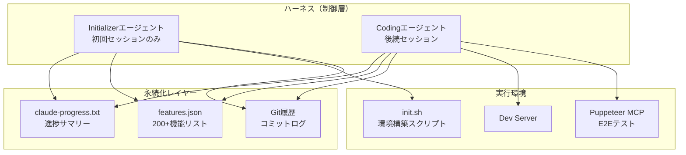

## ブログ概要（Summary）

本記事は [Effective harnesses for long-running agents](https://www.anthropic.com/engineering/effective-harnesses-for-long-running-agents) の解説記事です。

Anthropicエンジニアリングチームは2025年11月に公開したこのブログで、AIエージェントが**複数のコンテキストウィンドウをまたいで安定的に進捗を出すための設計パターン**を提案しています。Claude Agent SDKに組み込まれたコンパクション（会話要約）機能だけでは不十分であり、**ハーネス**（エージェントを包む制御層）を適切に設計することで、長時間タスクの完走率を高められるとAnthropicエンジニアリングチームは主張しています。

具体的には、Initializerエージェントとコーディングエージェントの分離、進捗ファイルによる状態管理、JSON形式のフィーチャーリスト、ブラウザ自動テスト（Puppeteer MCP）という4つの手法を組み合わせたアプローチを紹介しています。検証には200以上の機能を持つclaude.aiクローンの構築タスクが使用されています。

この記事は [Zenn記事: AIエージェントのコンテキスト3層管理：Compaction×Clearing×Memory](https://zenn.dev/0h_n0/articles/c1d44153ca0dda) の深掘りです。

## 情報源

- **種別**: 企業テックブログ
- **URL**: [https://www.anthropic.com/engineering/effective-harnesses-for-long-running-agents](https://www.anthropic.com/engineering/effective-harnesses-for-long-running-agents)
- **組織**: Anthropic Engineering（著者: Justin Young）
- **発表日**: 2025年11月26日

## 技術的背景（Technical Background）

### コンテキストウィンドウの壁

2026年時点で主要LLMは100万〜200万トークンのコンテキストウィンドウを備えていますが、エージェントが実行するタスクは単一セッションに収まらないケースが増えています。ファイル読み取り、Web検索、コード生成と実行を繰り返すと、ツール結果だけで数十万トークンに達します。

Anthropicエンジニアリングチームは、この問題を「引き継ぎなしでシフト交代するエンジニア」に喩えています。各セッションが独立しているため、前セッションで何をしたか・なぜその判断をしたかの情報が失われます。

### コンパクションの限界

Claude Agent SDKにはコンパクション（会話履歴を要約して新しいコンテキストに引き継ぐ）機能が実装されています。しかし、Anthropicエンジニアリングチームは「compaction isn't sufficient」と明言しています。

コンパクションが不十分な理由として、以下の点が挙げられています:

1. **要約の情報損失**: 要約プロセスで技術的な判断根拠や具体的なファイルパスが失われる
2. **指示の不完全さ**: 次のコンテキストウィンドウで動作するエージェントへの引き継ぎ情報が曖昧になりうる
3. **タスク全体像の喪失**: 長いタスクの初期段階で定義された目標や制約が要約から脱落する

Zenn記事で解説しているLayer 2: Compactionの `instructions` パラメータで保持情報を制御できますが、コンパクション単体では長時間タスクの根本的解決にはならないとAnthropicエンジニアリングチームは主張しています。

### 学術研究との関連

このブログが取り上げる課題は、学術的には**Long-Horizon Agent**の文脈管理問題として研究されています。arXiv論文「Beyond Compaction: Structured Context Eviction for Long-Horizon Agents」（2606.11213）では、要約ベースのコンパクションが持つ因果構造の破壊やブロッキングの問題を指摘し、決定論的なEvictionポリシーを提案しています。Anthropicのブログはこれらの問題に対し、**モデル外部の仕組み**（ファイルシステム、Git、テストハーネス）で補完する実践的なアプローチを示しています。

## 実装アーキテクチャ（Architecture）

Anthropicエンジニアリングチームが提案するアーキテクチャは、2種類のエージェントと3つの永続化レイヤーで構成されています。

### システム全体構成



### Initializerエージェント（初回セッション）

初回セッションでは専用のInitializerエージェントが以下の3つの成果物を作成します:

1. **`init.sh`**: アプリケーションの依存関係インストール・Dev Server起動を自動化するスクリプト。後続セッションで毎回手動で環境構築する無駄を排除する
2. **`claude-progress.txt`**: 構造化された進捗ファイル。現在の状態、完了した機能、次にやるべきことを記録する
3. **初期Gitコミット**: プロジェクトの初期状態をコミットし、後続セッションがいつでもクリーンな状態に戻れるようにする

Anthropicエンジニアリングチームによれば、InitializerとCodingエージェントの違いは初期プロンプトの内容のみであり、システムプロンプト・ツール・ハーネスはすべて同一です。

### Codingエージェント（後続セッション）

各セッションの開始時に、Codingエージェントは以下のブートストラップ手順を実行します:

```
1. pwd        → 作業ディレクトリの確認
2. git log    → 直近のコミット履歴を確認
3. read       → claude-progress.txtの読み込み
4. read       → features.jsonの読み込み
5. init.sh    → Dev Serverの起動
6. E2Eチェック → 基本的な動作確認
7. 選択       → 最高優先度の未完了機能を選択
```

この手順により、前セッションの引き継ぎ情報がコンパクション経由ではなく、**ファイルシステム上の明示的な状態**として新しいセッションに渡されます。

### Feature List（JSON形式の機能リスト）

Anthropicエンジニアリングチームは、タスクの完了状態をJSON形式で管理する方式を採用しています。

```json
{
  "features": [
    {
      "id": "auth-login",
      "description": "ユーザーがメールとパスワードでログインできる",
      "passes": false,
      "priority": 1
    },
    {
      "id": "auth-logout",
      "description": "ユーザーがログアウトできる",
      "passes": false,
      "priority": 2
    }
  ]
}
```

AnthropicエンジニアリングチームはフォーマットにJSONを選択した理由として、**モデルがMarkdownよりもJSONを不適切に上書きする可能性が低い**点を挙げています。エージェントが変更できるのは `"passes"` フィールドのみであり、機能定義や優先度は変更できないルールになっています。

### ブラウザ自動テスト（Puppeteer MCP）

ブログで特に注目されているのが、Puppeteer MCPを使ったブラウザ自動テストです。Anthropicエンジニアリングチームは、この導入によりパフォーマンスが「dramatically improved」したと述べています。

**テストの意義**: 従来、エージェントはunit testやcurlでの動作確認に依存しがちでした。しかし、フルスタックWebアプリでは、ブラウザ上でのユーザー操作（クリック、入力、画面遷移）を再現するE2Eテストが必要です。

**制約**: Anthropicエンジニアリングチームは、ブラウザネイティブのalertモーダルがPuppeteer MCPから見えないという制約を報告しています。alertに依存する機能はバグが多くなる傾向がありました。

## パフォーマンス最適化（Performance）

### 検証タスクの規模

Anthropicエンジニアリングチームは、以下の条件で検証を実施しています:

| 項目 | 値 |
|------|-----|
| モデル | Claude Opus 4.5 |
| タスク | claude.aiクローンの構築 |
| 機能数 | 200以上 |
| 形式 | 複数セッションにまたがる長時間タスク |

### 定量的ベンチマークの不在

ブログでは具体的な**数値ベンチマーク（成功率、コスト、所要時間等）は報告されていません**。パフォーマンスに関する主張はすべて定性的（qualitative）であり、「dramatically improved performance」「fell short of building a production-quality clone」等の表現にとどまっています。

この点は重要な制約であり、ハーネス設計の有効性を客観的に評価するためには、後続の研究（例: CTXAgent論文 arXiv:2610.34425 や CWL論文 arXiv:2606.11213 のような定量評価）と合わせて検討する必要があります。

### コンパクションなしの場合の問題

ブログでは、コンパクションを全く使わない場合に加え、コンパクションだけに頼る場合の両方の失敗パターンが記述されています。

**コンパクションなしの問題**:
- Opus 4.5がclaude.aiクローンをone-shotで構築しようとした場合、コンテキスト途中で切れ、半完成の機能が残る
- 後続セッションが未文書化の半完成コードを引き継いでしまう

**コンパクションのみの問題**:
- 要約が「次のエージェントへの完全な指示」として機能しない
- 技術的な詳細（具体的なファイルパス、変数名、テスト結果の数値等）が失われやすい

## 運用での学び（Production Lessons）

### 4つの主要な失敗パターン

Anthropicエンジニアリングチームは、長時間実行エージェントで繰り返し観察される4つの失敗パターンを報告しています。

| 失敗パターン | 症状 | ハーネスによる対策 |
|-------------|------|------------------|
| **One-shot試行** | コンテキスト途中で切れ、未文書化の半完成機能 | Initializerで環境・進捗ファイルを初期化 |
| **早期完了宣言** | 以前の進捗を見て「完了」と誤判断 | features.jsonのpassesフィールドで機械的に判定 |
| **テスト不足** | unit test/curlでOKだがE2E失敗 | Puppeteer MCPでブラウザテスト |
| **環境構築浪費** | アプリの起動方法を毎回試行錯誤 | init.shで自動化 |

### Git活用のベストプラクティス

Anthropicエンジニアリングチームは、各セッションで以下のGit運用を推奨しています:

- **説明的なコミットメッセージ**: 次のセッションがgit logから作業履歴を把握できるようにする
- **マージ可能な状態の維持**: コードは常にmainにマージできる状態を保つ
- **進捗サマリーの記録**: コミットとともにclaude-progress.txtを更新する

これらの手法は、Zenn記事で解説しているLayer 3: Memoryの概念と密接に関連しています。ファイルシステム上の進捗ファイルやGit履歴は、コンテキスト外部に情報を永続化するMemoryの実装パターンの一つと位置付けられます。

## Production Deployment Guide

### AWS実装パターン（コスト最適化重視）

長時間実行エージェントハーネスをAWS上にデプロイする場合のトラフィック量別推奨構成を示します。以下のコスト試算は2026年11月時点のAWS ap-northeast-1（東京）リージョン料金に基づく概算値です。実際のコストはトラフィックパターン、リージョン、バースト使用量により変動します。最新料金は [AWS料金計算ツール](https://calculator.aws/) で確認してください。

**トラフィック量別の推奨構成**:

| 規模 | 月間リクエスト | 推奨構成 | 月額コスト | 主要サービス |
|------|--------------|---------|-----------|------------|
| **Small** | ~3,000 (100/日) | Serverless | $50-150 | Lambda + Bedrock + DynamoDB |
| **Medium** | ~30,000 (1,000/日) | Hybrid | $300-800 | Lambda + ECS Fargate + ElastiCache |
| **Large** | 300,000+ (10,000/日) | Container | $2,000-5,000 | EKS + Karpenter + EC2 Spot |

**コスト削減テクニック**:
- Spot Instances使用で最大90%削減（EKS + Karpenter）
- Bedrock Batch API使用で50%削減（非リアルタイムのエージェント実行）
- Prompt Caching有効化で30-90%削減（システムプロンプト・ツール定義の固定部分）

### Terraformインフラコード

**Small構成 (Serverless): Lambda + Bedrock + DynamoDB**

```hcl
module "vpc" {
  source  = "terraform-aws-modules/vpc/aws"
  version = "~> 5.0"

  name = "agent-harness-vpc"
  cidr = "10.0.0.0/16"
  azs  = ["ap-northeast-1a", "ap-northeast-1c"]
  private_subnets = ["10.0.1.0/24", "10.0.2.0/24"]

  enable_nat_gateway   = false
  enable_dns_hostnames = true
}

resource "aws_iam_role" "agent_lambda" {
  name = "agent-harness-lambda-role"

  assume_role_policy = jsonencode({
    Version = "2012-10-17"
    Statement = [{
      Action = "sts:AssumeRole"
      Effect = "Allow"
      Principal = { Service = "lambda.amazonaws.com" }
    }]
  })
}

resource "aws_iam_role_policy" "bedrock_invoke" {
  role = aws_iam_role.agent_lambda.id

  policy = jsonencode({
    Version = "2012-10-17"
    Statement = [{
      Effect   = "Allow"
      Action   = ["bedrock:InvokeModel", "bedrock:InvokeModelWithResponseStream"]
      Resource = "arn:aws:bedrock:ap-northeast-1::foundation-model/anthropic.claude-3-5-haiku*"
    }]
  })
}

resource "aws_lambda_function" "agent_orchestrator" {
  filename      = "agent_harness.zip"
  function_name = "agent-harness-orchestrator"
  role          = aws_iam_role.agent_lambda.arn
  handler       = "index.handler"
  runtime       = "python3.12"
  timeout       = 900
  memory_size   = 1024

  environment {
    variables = {
      BEDROCK_MODEL_ID    = "anthropic.claude-3-5-haiku-20241022-v1:0"
      DYNAMODB_TABLE      = aws_dynamodb_table.session_state.name
      ENABLE_PROMPT_CACHE = "true"
    }
  }
}

resource "aws_dynamodb_table" "session_state" {
  name         = "agent-harness-sessions"
  billing_mode = "PAY_PER_REQUEST"
  hash_key     = "session_id"

  attribute {
    name = "session_id"
    type = "S"
  }

  ttl {
    attribute_name = "expire_at"
    enabled        = true
  }
}

resource "aws_cloudwatch_metric_alarm" "lambda_duration" {
  alarm_name          = "agent-harness-duration-spike"
  comparison_operator = "GreaterThanThreshold"
  evaluation_periods  = 1
  metric_name         = "Duration"
  namespace           = "AWS/Lambda"
  period              = 3600
  statistic           = "Sum"
  threshold           = 300000
  alarm_description   = "Lambda実行時間異常（コスト急増の可能性）"

  dimensions = {
    FunctionName = aws_lambda_function.agent_orchestrator.function_name
  }
}
```

### セキュリティベストプラクティス

**本番環境での推奨設定**:

1. **ネットワーク**: パブリックアクセス最小化、Lambda VPC内配置
2. **認証・認可**: IAMロール最小権限、MFA必須
3. **シークレット管理**: AWS Secrets Manager使用、環境変数ハードコード禁止
4. **暗号化**: TLS 1.2以上、S3/DynamoDB全てKMS暗号化

### 運用・監視設定

**CloudWatch Logs Insights クエリ**:

```sql
-- エージェントセッション完了率の監視
fields @timestamp, session_id, status, features_completed
| stats count(*) as total,
        sum(case when status = 'completed' then 1 else 0 end) as success
  by bin(1h)
| filter total > 0

-- コンパクション発生頻度と情報損失の追跡
fields @timestamp, session_id, compaction_count, tokens_before, tokens_after
| stats avg(tokens_before - tokens_after) as avg_tokens_saved,
        pct(compaction_count, 95) as p95_compactions
  by bin(6h)
```

**CloudWatch アラーム（Python）**:

```python
import boto3

cloudwatch = boto3.client('cloudwatch')

cloudwatch.put_metric_alarm(
    AlarmName='agent-session-failure-rate',
    ComparisonOperator='GreaterThanThreshold',
    EvaluationPeriods=2,
    MetricName='SessionFailureRate',
    Namespace='AgentHarness',
    Period=3600,
    Statistic='Average',
    Threshold=0.3,
    ActionsEnabled=True,
    AlarmActions=['arn:aws:sns:ap-northeast-1:123456789:agent-alerts'],
    AlarmDescription='エージェントセッション失敗率30%超過'
)

cloudwatch.put_metric_alarm(
    AlarmName='bedrock-token-spike',
    ComparisonOperator='GreaterThanThreshold',
    EvaluationPeriods=1,
    MetricName='TokenUsage',
    Namespace='AWS/Bedrock',
    Period=3600,
    Statistic='Sum',
    Threshold=500000,
    AlarmDescription='Bedrockトークン使用量異常（コスト急増）'
)
```

### コスト最適化チェックリスト

**アーキテクチャ選択（トラフィック量で判断）**:
- [ ] ~100 req/日 → Lambda + Bedrock (Serverless) - $50-150/月
- [ ] ~1,000 req/日 → ECS Fargate + Bedrock (Hybrid) - $300-800/月
- [ ] 10,000+ req/日 → EKS + Spot Instances (Container) - $2,000-5,000/月

**リソース最適化**:
- [ ] EC2: Spot Instances優先（最大90%削減）
- [ ] Lambda: メモリサイズ最適化（CloudWatch Insights分析）
- [ ] ECS/EKS: アイドルタイムのスケールダウン（夜間0台）

**LLMコスト削減**:
- [ ] Bedrock Batch API: 50%割引（非リアルタイム処理）
- [ ] Prompt Caching: 30-90%削減（システムプロンプト+ツール定義固定）
- [ ] モデル選択: 開発=Haiku, 本番複雑=Sonnet
- [ ] トークン数制限: max_tokens設定で過剰生成防止

**監視・アラート**:
- [ ] AWS Budgets: 月額予算設定（80%で警告）
- [ ] CloudWatch アラーム: トークン使用量スパイク検知
- [ ] Cost Anomaly Detection: 自動異常検知
- [ ] 日次コストレポート: SNS/Slackへ自動送信

## 学術研究との関連（Academic Connection）

Anthropicのブログが提示するハーネス設計パターンは、以下の学術研究と関連しています。

### 関連研究

1. **「Beyond Compaction: Structured Context Eviction for Long-Horizon Agents」（arXiv:2606.11213）**: Semenov & Dorofeevが提案するContext Window Lifecycle (CWL) は、コンパクションの代わりに型付きエピソードと依存グラフによる決定論的エビクションを使います。ブログの「コンパクションだけでは不十分」という主張と問題意識を共有していますが、解決手段が異なります。ブログはモデル外部の仕組み（ファイル・Git）で補完するのに対し、CWLはモデル内部のコンテキスト管理を構造化します。

2. **「CTXAgent: Self-Controlled Context Management of LLM Agents」（arXiv:2610.34425）**: Buschらは、エージェント自身がコンテキストの圧縮タイミングと保持内容を判断する自律型ハーネスを提案しています。Claude Opus 5.5で、Claude Codeと同等のタスク成功率を34%低いコストで達成したと報告しています。ブログのInitializer/Coding分離パターンを、モデル自律型の圧縮判断に統合する方向性と位置付けられます。

3. **「Don't Break the Cache: An Evaluation of Prompt Caching for Long-Horizon Agentic Tasks」（arXiv:2601.06007）**: Lumerらは、500以上のエージェントセッションを分析し、プロンプトキャッシュの最適戦略を評価しています。システムプロンプトのみをキャッシュする戦略が最も安定した効果を示したと報告しており、ブログで提案される「安定したシステムプロンプト+変動する進捗情報の分離」と整合します。

## まとめと実践への示唆

Anthropicエンジニアリングチームのブログは、コンパクションの限界を認めた上で、**モデル外部の仕組み**（ファイルシステム、Git、E2Eテスト）でエージェントの長時間タスクを支援する実践的なアプローチを提示しています。

**主要な設計原則**:
- 1セッション=1機能のインクリメンタル進捗
- 状態はファイル（JSON + テキスト）で永続化し、コンパクションに頼らない
- 完了判定は機械的（features.jsonのpassesフィールド）
- E2Eテストでユーザー視点の品質を担保

**制約と留意点**:
- 定量的なベンチマークは報告されておらず、有効性の客観的評価は今後の研究に委ねられている
- 検証はフルスタックWeb開発タスクのみであり、科学研究や金融モデリング等への適用可能性は未検証
- Opus 4.5のみでの検証であり、他モデルでの再現性は不明

Zenn記事の3層コンテキスト管理（Compaction × Clearing × Memory）の中で、このブログの知見はLayer 3: Memoryの実装パターンとして位置付けられます。ファイルシステムとGitをMemoryのバックエンドとして活用し、コンパクションの情報損失を補完する設計は、長時間実行エージェントを構築する際の重要な参考になります。

## 参考文献

- **Blog URL**: [Effective harnesses for long-running agents - Anthropic Engineering](https://www.anthropic.com/engineering/effective-harnesses-for-long-running-agents)
- **Related Blog**: [Effective context engineering for AI agents - Anthropic Research](https://www.anthropic.com/research/effective-context-engineering-for-ai-agents)
- **Related Paper**: [arXiv:2606.11213 - Beyond Compaction: Structured Context Eviction for Long-Horizon Agents](https://arxiv.org/abs/2606.11213)
- **Related Paper**: [arXiv:2610.34425 - CTXAgent: Self-Controlled Context Management of LLM Agents](https://arxiv.org/abs/2610.34425)
- **Related Paper**: [arXiv:2601.06007 - Don't Break the Cache: An Evaluation of Prompt Caching](https://arxiv.org/abs/2601.06007)
- **Related Zenn article**: [AIエージェントのコンテキスト3層管理：Compaction×Clearing×Memory](https://zenn.dev/0h_n0/articles/c1d44153ca0dda)
