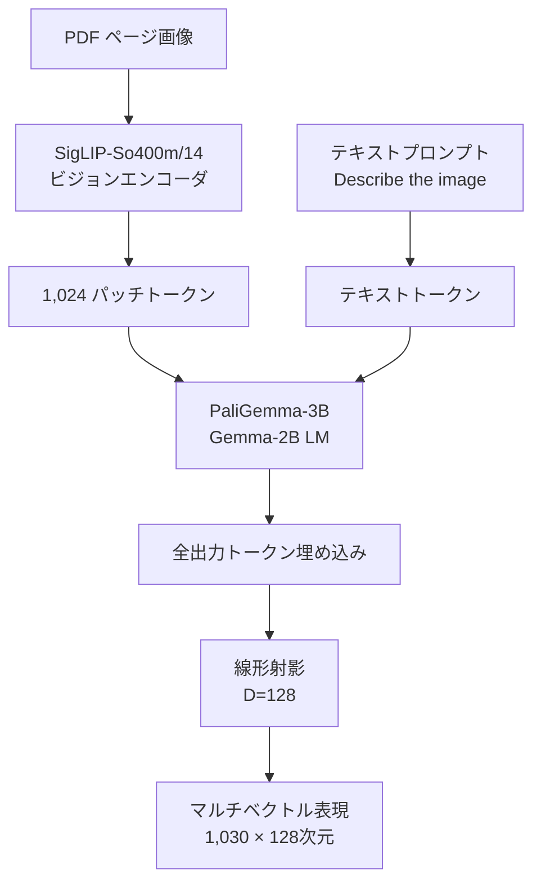

## 論文概要（Abstract）

本記事は [ColPali: Efficient Document Retrieval with Vision Language Models](https://arxiv.org/abs/2407.01449) の解説記事です。

ColPaliは、PDFページの画像をそのまま視覚言語モデル（VLM）に入力し、パッチごとのマルチベクトル埋め込みを生成する文書検索手法である。従来のRAGパイプラインが必要としていたOCR・レイアウト解析・チャンキングを省略し、ページ画像から直接インデックスを構築できる点が特徴である。著者らはColBERTスタイルのLate Interaction（MaxSim）を採用し、ページレベル検索ベンチマーク **ViDoRe** を新たに提案している。論文Table 2によると、ColPaliはViDoReの平均nDCG@5で81.3を達成し、既存パイプラインの最高スコア67.0を14ポイント以上上回ったと報告されている。

この記事は [Zenn記事: ColQwen2.5×Qdrantバイナリ量子化でPDF視覚検索を高速化する](https://zenn.dev/0h_n0/articles/1c18bde052d4a9) の深掘りです。

## 情報源

- **arXiv ID**: 2407.01449
- **URL**: [https://arxiv.org/abs/2407.01449](https://arxiv.org/abs/2407.01449)
- **著者**: Manuel Faysse, Hugues Sibille, Tony Wu, Bilel Omrani, Gautier Viaud, Céline Hudelot, Pierre Colombo
- **所属**: Illuin Technology, CentraleSupélec / Paris-Saclay, ETH Zürich, Equall.ai
- **発表年**: 2024（初投稿）、ICLR 2025で採択
- **分野**: cs.IR, cs.CL, cs.CV

## 背景と動機（Background & Motivation）

企業で扱われるPDF文書には、テキストだけでなく図表・グラフ・インフォグラフィック・複雑なレイアウトが含まれる。従来のRAGパイプラインでは、まずOCRでテキストを抽出し、レイアウト解析でセクションを切り出し、テキスト埋め込みモデルでベクトル化するという多段パイプラインが必要であった。

著者らは、この方式には以下の課題があると指摘している（論文Section 1）：

1. **視覚情報の喪失**: OCRは図表・グラフの意味的内容を取りこぼす。キャプション生成（VLMによる図の説明文生成）を追加しても、すべての視覚的コンテキストを再現できるわけではない
2. **インジェストのボトルネック**: OCR・レイアウト解析・キャプション生成の各段階が処理時間のボトルネックになる。論文の計測では、Unstructuredパイプラインのインデックス構築に1ページあたり約7.22秒（うちOCR約2.67秒、キャプション約3.71秒）を要する
3. **パイプラインの脆弱性**: 各段階のエラーが伝播する。OCRの誤認識は以降のすべての処理に影響する

著者らは、ボトルネックが埋め込みモデルにあるのではなく、**インジェストパイプライン自体にある**と論じている。この認識がColPaliの設計思想の出発点である。

## 主要な貢献（Key Contributions）

- **貢献1（ViDoReベンチマーク）**: 複数のドメイン・言語・視覚要素タイプをカバーするページレベル文書検索ベンチマーク。10のデータセットから構成され、学術的タスク（DocVQA, InfoVQA, TAT-DQA等）と実用的タスク（Energy, Government, Healthcare, AI等）を含む
- **貢献2（ColPaliモデル）**: VLMベースのマルチベクトル埋め込み＋Late Interactionにより、OCRなしでVisual Document Retrievalを実現する手法。ViDoRe上で既存パイプラインを大幅に上回る検索精度を達成
- **貢献3（オープンリリース）**: モデル・データ・コード・ベンチマークをすべてオープンライセンス（CC0 1.0）で公開

## 技術的詳細（Technical Details）

### アーキテクチャ

ColPaliは **PaliGemma-3B** をバックボーンとしている。PaliGemma-3Bは以下の2つのコンポーネントで構成される：

- **SigLIP-So400m/14**: 画像パッチをViTトークンに変換するビジョンエンコーダ。ページ画像を14×14ピクセルのパッチに分割し、**1,024個のパッチトークン**を生成する
- **Gemma-2B**: パッチトークンとテキストトークンを統合処理する言語モデル。Full-block Attentionにより、画像パッチとテキスト指示の間で双方向のAttentionが計算される



各出力トークン（画像パッチ由来・テキスト由来の両方）は、線形射影層を通じて **128次元** に圧縮される。これはColBERT論文の設計に従ったものである。1ページあたり約1,024パッチ＋6テキストトークン＝約1,030ベクトルが生成される。

### Late Interaction（MaxSim）

検索時のスコア計算にはMaxSimが使用される。クエリ $Q$ が $N_q$ 個のベクトル、ドキュメント $D$ が $N_d$ 個のベクトルを持つとき：

$$
\text{LI}(Q, D) = \sum_{i=1}^{N_q} \max_{j=1}^{N_d} \langle E_Q^{(i)}, E_D^{(j)} \rangle
$$

ここで、
- $E_Q^{(i)}$: クエリの $i$ 番目のトークン埋め込み（128次元）
- $E_D^{(j)}$: ドキュメントの $j$ 番目のパッチ埋め込み（128次元）
- $\langle \cdot, \cdot \rangle$: 内積

各クエリトークンについて、ドキュメント側の全パッチとの内積を計算し、最大値を取る。その最大値をクエリ全トークンにわたって合算したものが最終スコアである。ドキュメント埋め込みはオフラインで事前計算されるため、オンラインコストはクエリのエンコード＋MaxSim演算のみとなる。

### クエリ拡張

ColBERTに倣い、各クエリの末尾に **5個の`<unused0>`トークン** が付加される。著者らはこれをソフトなクエリ拡張・重み付け機構と説明している（論文Section 3）。

### 訓練設定

著者らは以下の訓練設定を報告している（論文Section 4）：

- **訓練データ**: 118,695のクエリ-ページペア。約63%は公開VQAデータセット、約37%はClaude-3 Sonnetで生成した合成クエリ
- **損失関数**: In-batch contrastive loss。バッチ内の最も困難な負例（hardest in-batch negative）を使用する。数値的に安定なsoftplus形式で記述：

$$
\mathcal{L} = \frac{1}{b} \sum_{k=1}^{b} \log\left(1 + \exp\left(s_k^{-} - s_k^{+}\right)\right)
$$

ここで $s_k^{+} = \text{LI}(q_k, d_k)$ は正例スコア、$s_k^{-} = \max_{l \neq k} \text{LI}(q_k, d_l)$ はバッチ内最高負例スコアである。

- **最適化**: LoRA（$\alpha=32$, $r=32$）をLM部分に適用。paged AdamW 8-bit、学習率5e-5（線形減衰、2.5%ウォームアップ）、bfloat16精度、バッチサイズ32、GPU 8台でデータ並列、1エポック

## 実装のポイント（Implementation）

ColPaliを実際に利用する際の要点を整理する。

**ストレージコスト**: 1ページあたり約1,030ベクトル × 128次元 × 2バイト（float16）≈ **257.5 KB**。BGE-M3のシングルベクトル（約8.6 KB/ページ）と比較すると約30倍であり、大規模コーパスでは量子化が必須となる。

**インデックス構築速度**: 論文の計測（NVIDIA L4 GPU）によると、ColPaliは1ページあたり約0.39秒でインデックスを構築できる。Unstructuredパイプラインの約7.22秒と比較して約18倍高速である（論文Section 5.3）。

**クエリレイテンシ**: 著者らは、バッチサイズ1でのクエリエンコードが約30ms（L4 GPU）、MaxSim演算は1,000ページあたり約1msと報告している。ただし、この数値はページ数のスケールに依存するため、数百万ページ規模ではHNSWなどの近似最近傍検索が必要となる。

**トークンプーリング**: 論文のアブレーション（論文Section 5.2）では、プールファクター3の階層的平均プーリングにより、ベクトル数を約66.7%削減しつつ、性能の97.8%を維持できたと報告されている。ストレージとレイテンシのトレードオフとして有効な選択肢である。

**ColQwen2への移行**: 論文の後続として公開されたColQwen2.5（`vidore/colqwen2.5-v0.2`）は、768パッチ・128次元でViDoRe v1 nDCG@5 89.5を達成している。任意のアスペクト比をサポートするため、実運用では固定サイズへのリサイズが不要であり、ColPaliからの主要な改善点である。

```python
from colpali_engine.models import ColQwen2_5, ColQwen2_5_Processor
import torch

model = ColQwen2_5.from_pretrained(
    "vidore/colqwen2.5-v0.2",
    torch_dtype=torch.bfloat16,
    device_map="cuda",
)
processor = ColQwen2_5_Processor.from_pretrained("vidore/colqwen2.5-v0.2")
```

## Production Deployment Guide

### AWS実装パターン（コスト最適化重視）

ColPaliベースの視覚文書検索システムをAWSにデプロイする場合の構成を、トラフィック量別に示す。

| 規模 | 月間リクエスト | 推奨構成 | 月額コスト概算 | 主要サービス |
|------|--------------|---------|-------------|------------|
| **Small** | ~3,000 (100/日) | Serverless | $200-400 | Lambda + SageMaker Serverless + S3 |
| **Medium** | ~30,000 (1,000/日) | Hybrid | $800-1,500 | ECS Fargate + Qdrant Cloud + ElastiCache |
| **Large** | 300,000+ (10,000/日) | Container | $3,000-6,000 | EKS + GPU Nodes + Qdrant self-hosted |

**Small構成の詳細**（月額$200-400）:
- **SageMaker Serverless Inference**: ColQwen2.5モデル推論。GPU不要のCPU推論でバッチ処理（$80/月）
- **Lambda**: API Gateway経由のクエリ処理・オーケストレーション（$20/月）
- **Qdrant Cloud Free Tier → Starter**: マルチベクトルコレクション（$50-100/月）
- **S3**: ページ画像ストレージ（$10/月）
- **CloudWatch**: 基本監視（$5/月）

**Medium構成の詳細**（月額$800-1,500）:
- **ECS Fargate（GPU）**: ColQwen2.5のリアルタイム推論。g5.xlarge相当（$500/月）
- **Qdrant Cloud Professional**: バイナリ量子化付きマルチベクトルコレクション（$200-400/月）
- **ElastiCache Redis**: クエリキャッシュ、cache.t3.micro（$15/月）
- **Application Load Balancer**: HTTPS終端（$20/月）
- **ECR**: コンテナイメージ管理（$5/月）

**Large構成の詳細**（月額$3,000-6,000）:
- **EKS**: コントロールプレーン（$72/月）
- **GPU Nodes**: g5.xlarge × 2-4台（Spot利用で平均$800/月）
- **Qdrant self-hosted on EKS**: 高性能NVMe SSD付きノード（$500/月）
- **S3 + CloudFront**: ページ画像CDN配信（$100/月）
- **CloudWatch + X-Ray**: 詳細監視・分散トレーシング（$100/月）

**コスト削減テクニック**:
- バイナリ量子化によりQdrantメモリ使用量を最大32倍削減（Zenn記事参照）
- トークンプーリング（プールファクター3）でベクトル数を約1/3に削減
- Spot Instances使用でGPUノードコストを最大90%削減
- SageMaker Serverless Inferenceでアイドルタイムのコストをゼロに

**コスト試算の注意事項**: 上記は2026年11月時点のAWS ap-northeast-1（東京）リージョン料金に基づく概算値です。実際のコストはトラフィックパターン、リージョン、バースト使用量により変動します。最新料金は [AWS料金計算ツール](https://calculator.aws/) で確認してください。

### Terraformインフラコード

**Small構成（Serverless）: Lambda + SageMaker Serverless**

```hcl
module "vpc" {
  source  = "terraform-aws-modules/vpc/aws"
  version = "~> 5.0"

  name = "colpali-vpc"
  cidr = "10.0.0.0/16"
  azs  = ["ap-northeast-1a", "ap-northeast-1c"]
  private_subnets = ["10.0.1.0/24", "10.0.2.0/24"]

  enable_nat_gateway   = false
  enable_dns_hostnames = true
}

resource "aws_iam_role" "lambda_colpali" {
  name = "lambda-colpali-role"
  assume_role_policy = jsonencode({
    Version = "2012-10-17"
    Statement = [{
      Action    = "sts:AssumeRole"
      Effect    = "Allow"
      Principal = { Service = "lambda.amazonaws.com" }
    }]
  })
}

resource "aws_iam_role_policy" "sagemaker_invoke" {
  role = aws_iam_role.lambda_colpali.id
  policy = jsonencode({
    Version = "2012-10-17"
    Statement = [{
      Effect   = "Allow"
      Action   = ["sagemaker:InvokeEndpoint"]
      Resource = aws_sagemaker_endpoint.colpali.arn
    }]
  })
}

resource "aws_lambda_function" "query_handler" {
  filename      = "lambda.zip"
  function_name = "colpali-query-handler"
  role          = aws_iam_role.lambda_colpali.arn
  handler       = "index.handler"
  runtime       = "python3.12"
  timeout       = 60
  memory_size   = 512

  environment {
    variables = {
      SAGEMAKER_ENDPOINT = aws_sagemaker_endpoint.colpali.name
      QDRANT_URL         = var.qdrant_url
      QDRANT_API_KEY     = var.qdrant_api_key
    }
  }
}

resource "aws_s3_bucket" "page_images" {
  bucket = "colpali-page-images"
}

resource "aws_s3_bucket_server_side_encryption_configuration" "page_images" {
  bucket = aws_s3_bucket.page_images.id
  rule {
    apply_server_side_encryption_by_default {
      sse_algorithm = "aws:kms"
    }
  }
}

resource "aws_cloudwatch_metric_alarm" "lambda_errors" {
  alarm_name          = "colpali-lambda-errors"
  comparison_operator = "GreaterThanThreshold"
  evaluation_periods  = 1
  metric_name         = "Errors"
  namespace           = "AWS/Lambda"
  period              = 300
  statistic           = "Sum"
  threshold           = 5
  alarm_description   = "Lambda関数エラー率異常"
  dimensions = {
    FunctionName = aws_lambda_function.query_handler.function_name
  }
}
```

**Large構成（Container）: EKS + GPU Nodes + Qdrant**

```hcl
module "eks" {
  source  = "terraform-aws-modules/eks/aws"
  version = "~> 20.0"

  cluster_name    = "colpali-cluster"
  cluster_version = "1.31"

  vpc_id     = module.vpc.vpc_id
  subnet_ids = module.vpc.private_subnets

  cluster_endpoint_public_access = true
  enable_cluster_creator_admin_permissions = true
}

resource "kubectl_manifest" "karpenter_gpu" {
  yaml_body = <<-YAML
    apiVersion: karpenter.sh/v1alpha5
    kind: Provisioner
    metadata:
      name: gpu-spot
    spec:
      requirements:
        - key: karpenter.sh/capacity-type
          operator: In
          values: ["spot"]
        - key: node.kubernetes.io/instance-type
          operator: In
          values: ["g5.xlarge", "g5.2xlarge"]
      limits:
        resources:
          cpu: "32"
          memory: "128Gi"
          nvidia.com/gpu: "4"
      providerRef:
        name: default
      ttlSecondsAfterEmpty: 60
  YAML
}

resource "aws_budgets_budget" "colpali_monthly" {
  name         = "colpali-monthly"
  budget_type  = "COST"
  limit_amount = "6000"
  limit_unit   = "USD"
  time_unit    = "MONTHLY"

  notification {
    comparison_operator        = "GREATER_THAN"
    threshold                  = 80
    threshold_type             = "PERCENTAGE"
    notification_type          = "ACTUAL"
    subscriber_email_addresses = ["ops@example.com"]
  }
}
```

### 運用・監視設定

**CloudWatch Logs Insights クエリ**:

```sql
-- 検索レイテンシ分析: P95, P99
fields @timestamp, query_latency_ms, encode_latency_ms, maxsim_latency_ms
| stats pct(query_latency_ms, 95) as p95,
        pct(query_latency_ms, 99) as p99,
        avg(encode_latency_ms) as avg_encode
  by bin(5m)

-- ストレージ使用量のトレンド
fields @timestamp, collection_vectors_count, collection_size_bytes
| stats max(collection_vectors_count) as vectors,
        max(collection_size_bytes) / 1073741824 as size_gb
  by bin(1h)
```

**X-Ray トレーシング設定**:

```python
from aws_xray_sdk.core import xray_recorder, patch_all

patch_all()

@xray_recorder.capture('colpali_search')
def search_documents(query: str, top_k: int = 10) -> list[dict]:
    xray_recorder.put_annotation('top_k', top_k)
    xray_recorder.put_metadata('query_length', len(query))

    query_embedding = encode_query(query)
    xray_recorder.put_metadata('query_vectors', len(query_embedding))

    results = qdrant_client.query_points(
        collection_name="pdf_visual_search",
        query=query_embedding,
        limit=top_k,
    )
    xray_recorder.put_metadata('results_count', len(results.points))
    return results.points
```

### コスト最適化チェックリスト

**アーキテクチャ選択**:
- [ ] ~100 req/日 → SageMaker Serverless + Lambda（$200-400/月）
- [ ] ~1,000 req/日 → ECS Fargate + Qdrant Cloud（$800-1,500/月）
- [ ] 10,000+ req/日 → EKS + GPU Spot + Qdrant self-hosted（$3,000-6,000/月）

**ストレージ最適化**:
- [ ] バイナリ量子化でメモリ使用量32倍削減（Qdrant設定）
- [ ] トークンプーリング（プールファクター3）でベクトル数1/3に
- [ ] オリジナルベクトルはディスクに配置（`on_disk=True`）
- [ ] S3ライフサイクルポリシー: 古いページ画像を自動アーカイブ

**GPU最適化**:
- [ ] Spot Instances: g5.xlarge（最大90%削減）
- [ ] バッチ推論: 複数ページを同時エンコード（batch_size=4推奨）
- [ ] bfloat16精度: メモリ使用量を半減しつつ精度維持
- [ ] SageMaker Serverless: アイドル時コストゼロ

**監視・アラート**:
- [ ] AWS Budgets: 月額予算設定（80%で警告）
- [ ] CloudWatch: クエリレイテンシP95アラーム
- [ ] Cost Anomaly Detection: 自動異常検知
- [ ] 日次コストレポート: SNS/Slack通知

**リソース管理**:
- [ ] 未使用GPU Podの自動スケールダウン（Karpenter TTL設定）
- [ ] タグ戦略: 環境別（dev/prod）コスト可視化
- [ ] ECRイメージライフサイクルポリシー
- [ ] CloudWatch Logsの保持期間設定（30日推奨）

## 実験結果（Results）

### ViDoReベンチマーク結果

論文Table 2より、ViDoReベンチマーク上の主要なnDCG@5スコアを以下に示す。

| 手法 | ArxivQ | DocQ | InfoQ | TabF | TATQ | Shift | AI | Energy | Gov. | Health. | **平均** |
|------|--------|------|-------|------|------|-------|-----|--------|------|---------|---------|
| Unstructured + Caption + BGE-M3 | — | — | — | — | — | — | — | — | — | — | 67.0 |
| SigLIP (vanilla) | — | — | — | — | — | — | — | — | — | — | 51.4 |
| BiSigLIP (fine-tuned) | — | — | — | — | — | — | — | — | — | — | 58.6 |
| BiPali (+LLM) | — | — | — | — | — | — | — | — | — | — | 58.8 |
| **ColPali** | 79.1 | 54.4 | 81.8 | 83.9 | 65.8 | 73.2 | 96.2 | 91.0 | 92.7 | 94.4 | **81.3** |

著者らが報告したデータセット別の分析によると：

- **視覚要素が豊富なタスクで特に優位**: InfographicVQA（81.8）、TabFQuAD（83.9）では、テキストベースのパイプラインとの差が顕著
- **実用ドメインタスクで高精度**: AI（96.2）、Healthcare（94.4）、Government（92.7）はいずれも90を超える
- **DocVQAは相対的に低い**: 54.4にとどまり、テキスト密度が高いページではテキスト抽出ベースの手法との差が縮まる傾向が見られる

### モデルアーキテクチャの段階的改善

著者らは3段階の改善を検証している（論文Section 5.1）：

1. **BiSigLIP**（SigLIPのfine-tuning、シングルベクトル）: 平均58.6
2. **BiPali**（PaliGemmaのプーリング、シングルベクトル）: 平均58.8（+0.2）
3. **ColPali**（マルチベクトル＋Late Interaction）: 平均81.3（+22.5）

シングルベクトルからマルチベクトルへの切り替えで約22ポイントの改善が得られており、Late Interactionの寄与が大きい。

### インデックス構築速度

論文Section 5.3より、NVIDIA L4 GPUでの1ページあたりのインデックス構築時間：

| パイプライン | 時間/ページ | 内訳 |
|------------|-----------|------|
| Unstructured | ~7.22秒 | OCR ~2.67秒 + Caption ~3.71秒 + 埋め込み |
| SigLIP | ~0.12秒 | 画像エンコードのみ |
| ColPali | ~0.39秒 | 画像エンコード＋射影 |

ColPaliはUnstructuredパイプラインの約18倍高速でインデックスを構築できると報告されている。

## 実運用への応用（Practical Applications）

ColPali（およびその後続のColQwen2.5）は、以下のユースケースで有用と考えられる。

**図表検索が重要なRAGシステム**: 技術文書・特許・医療レポートなど、テキストだけでなく図表・グラフからの情報抽出が求められるケース。OCRベースのパイプラインでは失われる視覚的コンテキストを保持できる。

**多言語文書検索**: ColPaliは英語データのみで訓練されているにもかかわらず、フランス語タスク（TabFQuAD: 83.9, Shift Project: 73.2）でも高い性能を示した。著者らはPaliGemmaの多言語能力が寄与していると分析している。

**スケーラビリティへの課題**: 1ページあたり約257.5 KBのストレージは、100万ページ規模で約250 GBとなる。Zenn記事で紹介したQdrantのバイナリ量子化（32倍削減）やトークンプーリング（3倍削減）を組み合わせることで、実用的なメモリフットプリントに抑えられる。

## 関連研究（Related Work）

- **ColBERT / ColBERTv2**: Late Interactionの先駆的研究。ColPaliはColBERTのマルチベクトル＋MaxSimメカニズムを視覚ドメインに拡張したものである
- **VisRAG（ICLR 2025）**: ページ画像をVLMで直接検索するパーシングフリーRAG。ColPaliと同時期に提案され、テキスト抽出なしの文書検索という方向性は共通するが、VisRAGはシングルベクトル方式を採用
- **PULSAR（EMNLP 2026 Industry Track）**: ColPaliスタイルのバックボーンにプーリング＋バイナリ量子化を組み合わせ、エンタープライズ規模（240万ページ）でのデプロイを実現。ColPaliの実運用課題を解決する方向の研究

## まとめと今後の展望

ColPaliは、視覚言語モデルを文書検索に適用し、OCR不要のマルチベクトル検索を実現した手法である。ViDoReベンチマーク上で、既存のテキストベースパイプラインを14ポイント以上上回る検索精度が報告されている。

ストレージコスト（1ページあたり約257.5 KB）が主要な課題であるが、バイナリ量子化・トークンプーリング・階層的パッチ圧縮などの技術により、実運用可能なレベルまで削減できることが後続研究で示されつつある。

今後の展望として、Qdrant v1.20のTurboQuant（回転ベース量子化）との組み合わせや、PULSAR方式のプーリング戦略によるさらなるスケーリングが期待される。

## 参考文献

- **arXiv**: [https://arxiv.org/abs/2407.01449](https://arxiv.org/abs/2407.01449)
- **Code / Models**: [https://huggingface.co/vidore](https://huggingface.co/vidore)
- **ViDoRe Leaderboard**: [https://huggingface.co/spaces/vidore/vidore-leaderboard](https://huggingface.co/spaces/vidore/vidore-leaderboard)
- **ColQwen2.5**: [https://huggingface.co/vidore/colqwen2.5-v0.2](https://huggingface.co/vidore/colqwen2.5-v0.2)
- **Related Zenn article**: [https://zenn.dev/0h_n0/articles/1c18bde052d4a9](https://zenn.dev/0h_n0/articles/1c18bde052d4a9)
