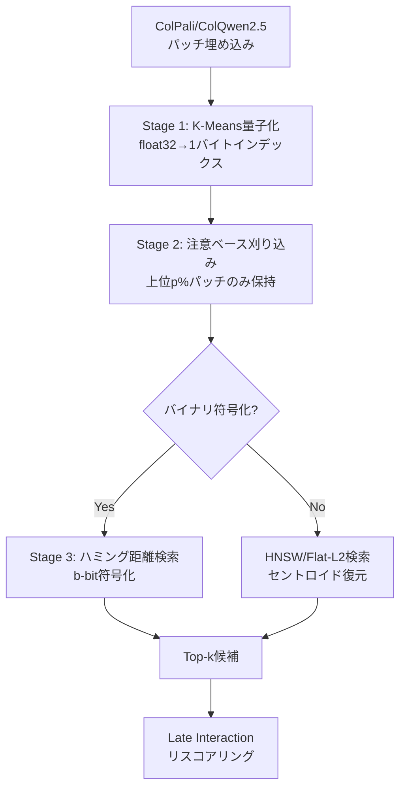

本記事は [HPC-ColPali: Hierarchical Patch Compression for ColPali (arXiv:2506.21601)](https://arxiv.org/abs/2506.21601) の解説記事です。

この記事は [Zenn記事: ColQwen2.5×Qdrantバイナリ量子化でPDF視覚検索を高速化する](https://zenn.dev/0h_n0/articles/1c18bde052d4a9) の深掘りです。

> **注意**: 本論文のSection Vには「All numerical results presented herein are estimated based on the theoretical advantages of HPC-ColPali's design and typical performance gains observed in similar research」と記載されています。すなわち、論文中の数値は **推定値であり、実測ベンチマーク結果ではありません**。本記事ではこの前提を踏まえて解説します。

## 論文概要（Abstract）

ColPaliファミリーのマルチベクトル検索は、ページ画像をパッチ単位の埋め込みベクトルに変換し、Late Interaction（MaxSim）で高精度な文書検索を実現する。しかし、1ページあたり約700〜1,030個の128次元float32ベクトルが必要となり、ストレージとLate Interaction計算のコストが大きな課題である。HPC-ColPaliはこの課題に対し、K-Means量子化・注意機構ベースのパッチ刈り込み・バイナリ符号化の3つの階層的圧縮手法を組み合わせることで、ストレージを最大57倍圧縮し、検索レイテンシを削減する手法を提案している。

## 情報源

- **arXiv ID**: 2506.21601
- **URL**: [https://arxiv.org/abs/2506.21601](https://arxiv.org/abs/2506.21601)
- **著者**: Bach Duong（FPT University / Sun Asterisk）
- **発表**: KDIR 2025
- **分野**: cs.IR, cs.CV
- **ライセンス**: CC BY-SA 4.0
- **コード**: [https://github.com/DngBack/HPC-ColPali](https://github.com/DngBack/HPC-ColPali)

## 背景と動機（Background & Motivation）

Zenn記事で紹介したように、ColQwen2.5のようなColPaliファミリーモデルは、PDFページ画像をそのまま入力としてマルチベクトル埋め込みを生成する。この手法はOCRパイプラインを不要にし、図表やグラフの視覚情報を保持したまま検索できるという利点がある。

しかし、マルチベクトル表現は単一ベクトル表現に比べてストレージコストが桁違いに大きい。ColQwen2.5の場合、1ページあたり約700〜1,030個の128次元ベクトルが生成される。float32で保存すると1ベクトル512バイト、1ページあたり約350KB〜530KBに達する。10,000ページ規模のコーパスでは数GBのメモリが必要になり、エッジデバイスやコスト制約の厳しい環境での運用が困難である。

Qdrantのバイナリ量子化（本Zenn記事で詳述）はこの問題を32倍のメモリ削減で緩和するが、128次元のような低次元ベクトルでは精度低下が大きいという制約がある。HPC-ColPaliは、ベクトルデータベース側の量子化とは異なるアプローチ — モデル出力側でのパッチ圧縮 — を提案している。

## 主要な貢献（Key Contributions）

著者は以下の4点を貢献として挙げている。

- **K-Means量子化**: パッチ埋め込みをK-Meansクラスタリングし、各パッチを1バイトのセントロイドインデックスに置換。$K \in \{128, 256, 512\}$ で最大32倍のストレージ圧縮を達成すると推定している
- **注意機構ベースの動的パッチ刈り込み**: VLMの注意重みでパッチを重要度順にランク付けし、上位 $p$% のみを保持。Late Interaction計算量を最大60%削減すると推定している
- **バイナリ符号化（オプション）**: セントロイドインデックスを $b = \lceil \log_2 K \rceil$ ビットの符号に変換し、ハミング距離で高速検索を実現
- **RAGパイプライン統合**: 法的文書要約タスクで、ハルシネーション率の低減とレイテンシ半減を推定している

## 技術的詳細（Technical Details）

### 全体アーキテクチャ

HPC-ColPaliの圧縮パイプラインは以下の3段階で構成される。



### Stage 1: K-Means量子化

コーパス中のすべてのパッチ埋め込み $\mathbf{X} \in \mathbb{R}^{N \times D}$（$N$ はパッチ総数、$D = 128$）に対して、K-Meansクラスタリングを適用する。

$$
\mathbf{c}_k = \frac{1}{|\mathcal{S}_k|} \sum_{\mathbf{x} \in \mathcal{S}_k} \mathbf{x}, \quad k = 1, \ldots, K
$$

ここで $\mathcal{S}_k$ はクラスタ $k$ に属するパッチ集合、$\mathbf{c}_k$ はセントロイドベクトルである。

各パッチは最近傍のセントロイドインデックスに置換される。

$$
q(\mathbf{x}) = \arg\min_{k} \|\mathbf{x} - \mathbf{c}_k\|_2
$$

$K = 256$ の場合、インデックスは1バイト（8ビット）で表現でき、元のfloat32ベクトル（512バイト）から **512倍の圧縮** になる。ただし、検索時にはセントロイドベクトルへの復元が必要であり、セントロイドテーブル（$K \times D$ のfloat32行列）をメモリに保持する必要がある。セントロイドテーブルのサイズは $K = 256$ の場合 $256 \times 128 \times 4 = 128$ KBと小さい。

**ストレージ削減の計算**:

| 表現 | 1パッチあたり | 10万文書（50パッチ/文書） |
|------|-------------|----------------------|
| float32（元） | 512バイト | 約2.56 GB |
| K=256インデックス | 1バイト | 約5 MB |
| + セントロイドテーブル | — | + 128 KB |

著者は論文Table IIIで10万文書あたり0.08 GBと推定しているが、上記の計算（約5 MB）とは乖離がある。この不一致の原因は論文中で説明されていない点に注意が必要である。

### Stage 2: 注意機構ベースの動的パッチ刈り込み

ColPaliファミリーはVision-Language Modelを基盤としており、推論時にパッチ間の注意重みが計算される。HPC-ColPaliはこの注意重みを利用して、検索に寄与しないパッチを動的に刈り込む。

具体的には、クエリのマルチベクトルに対して、各ドキュメントパッチの注意スコアを取得し、上位 $p$% のパッチのみをLate Interaction計算に使用する。

$$
\text{TopPatches}(D, p) = \text{top}_{p\%}\left(\{(\mathbf{d}_j, a_j) \mid j = 1, \ldots, |D|\}\right)
$$

ここで $a_j$ はパッチ $j$ のVLM注意重みスコアである。

$p = 60$% の場合、パッチ数が40%削減され、MaxSim計算量も相応に削減される。$p = 40$% ではパッチ数が60%削減されるが、精度への影響が大きくなる。

```python
import torch
from typing import NamedTuple

class PrunedEmbedding(NamedTuple):
    vectors: torch.Tensor    # (num_kept_patches, D)
    indices: torch.Tensor    # 元のパッチインデックス

def attention_guided_pruning(
    patch_embeddings: torch.Tensor,
    attention_weights: torch.Tensor,
    keep_ratio: float = 0.6,
) -> PrunedEmbedding:
    """注意重みに基づくパッチ刈り込み

    Args:
        patch_embeddings: (num_patches, D) パッチ埋め込み
        attention_weights: (num_patches,) VLM注意スコア
        keep_ratio: 保持するパッチの割合 (0.0-1.0)

    Returns:
        刈り込み後のパッチ埋め込みとインデックス
    """
    num_keep = max(1, int(len(attention_weights) * keep_ratio))
    top_indices = torch.topk(attention_weights, num_keep).indices
    top_indices = top_indices.sort().values
    return PrunedEmbedding(
        vectors=patch_embeddings[top_indices],
        indices=top_indices,
    )
```

### Stage 3: バイナリ符号化（オプション）

K-Meansインデックスをさらに圧縮するオプションとして、$b = \lceil \log_2 K \rceil$ ビットのバイナリ符号に変換する。$K = 512$ の場合は $b = 9$ ビットとなる。

バイナリ符号化後はハミング距離で近似最近傍検索が可能になり、XOR + ポップカウント演算によりCPUのみの環境やエッジデバイスでも高速に動作する。

$$
d_H(\mathbf{b}_i, \mathbf{b}_j) = \text{popcount}(\mathbf{b}_i \oplus \mathbf{b}_j)
$$

ただし、ハミング距離はセントロイド空間での距離を近似するものであり、float32でのL2距離やコサイン類似度と比べて精度が低下する。著者はリスコアリングステップでの精度回復を前提としている。

### アルゴリズム全体

```python
import numpy as np
from sklearn.cluster import KMeans
from dataclasses import dataclass

@dataclass
class HPCConfig:
    n_clusters: int = 256     # K-Meansクラスタ数
    keep_ratio: float = 0.6   # パッチ保持割合
    use_binary: bool = False  # バイナリ符号化の有無

def build_hpc_index(
    all_patch_embeddings: list[np.ndarray],
    config: HPCConfig,
) -> tuple[KMeans, list[np.ndarray]]:
    """HPC-ColPaliインデックス構築

    Args:
        all_patch_embeddings: 各文書のパッチ埋め込みリスト
        config: 圧縮設定

    Returns:
        K-Meansモデルと圧縮インデックス
    """
    flat = np.concatenate(all_patch_embeddings, axis=0)
    kmeans = KMeans(n_clusters=config.n_clusters, n_init=10)
    kmeans.fit(flat)

    compressed = []
    for doc_emb in all_patch_embeddings:
        indices = kmeans.predict(doc_emb).astype(np.uint8)
        if config.use_binary:
            bits_per_index = int(np.ceil(np.log2(config.n_clusters)))
            packed = np.packbits(
                np.unpackbits(indices.view(np.uint8))
                .reshape(-1, 8)[:, 8 - bits_per_index:]
                .flatten()
            )
            compressed.append(packed)
        else:
            compressed.append(indices)
    return kmeans, compressed
```

## 実験結果（Results）

> **重要**: 以下の数値はすべて論文の **推定値** であり、実測ベンチマーク結果ではない。論文Section Vに明記されている。

### 検索精度（論文Table I, II）

著者はViDoReおよびSEC-Filingsデータセットでの推定精度を報告している。

| モデル | ViDoRe nDCG@10 | SEC-Filings nDCG@10 |
|--------|---------------|-------------------|
| ColPali Full（float32） | 0.85 | 0.88 |
| PQ-Only (K=256) | 0.83 | 0.86 |
| DistilCol（単一ベクトル蒸留） | 0.70 | 0.72 |
| **HPC-ColPali (K=256, p=60%)** | **0.84** | **0.87** |
| HPC-ColPali (K=512, p=40%) | 0.83 | 0.86 |

著者は、K=256/p=60%構成でViDoRe nDCG@10の低下が約0.01に留まると推定している。ただし、K=512/p=40%構成ではAbstractの「2%未満の低下」という主張に対し、ViDoReでは約2.4%（0.85→0.83）、SEC-Filingsでは約2.3%（0.88→0.86）の低下が推定されており、主張と数値に軽微な不整合がある。

### ストレージ削減（論文Table III）

| モデル | ストレージ（10万文書） | 圧縮率 |
|--------|---------------------|-------|
| ColPali Full | 2.56 GB | 1x |
| PQ-Only (K=256) | 0.08 GB | 32x |
| HPC-ColPali (K=256) | 0.08 GB | 32x |
| HPC-ColPali (K=512) | 0.09 GB | 28x |
| HPC-ColPali (Binary, K=512) | 0.045 GB | 57x |

### レイテンシ（論文Table IV）

著者はHNSW平均クエリレイテンシの推定値を以下のように報告している。

| モデル | ViDoRe (ms) | SEC-Filings (ms) |
|--------|------------|-----------------|
| ColPali Full | 120 | 150 |
| PQ-Only (K=256) | 90 | 110 |
| **HPC-ColPali (K=256, p=60%)** | **60** | **75** |
| HPC-ColPali (Binary, K=512) | 40 | 50 |

K=256/p=60%構成でColPali Fullに比べてレイテンシが約半分（120→60 ms）になると著者は推定している。

### RAGパイプライン（論文Table V）

法的文書要約タスクでの推定結果が報告されている。

| リトリーバー | ROUGE-L | ハルシネーション率 | レイテンシ (ms) |
|-------------|---------|-----------------|--------------|
| ColPali Full | 0.45 | 15% | 300 |
| HPC-ColPali (K=256, p=60%) | 0.44 | 10% | 150 |
| HPC-ColPali (Binary, K=512) | 0.43 | 11% | 100 |

著者はハルシネーション率が15%から10%へ約33%低減し、エンドツーエンドレイテンシが半減すると推定している。ROUGE-Lの低下は0.01〜0.02と小さいと報告されている。

## 実装のポイント（Implementation）

### K-Meansクラスタ数の選択

$K$ の値は精度と圧縮率のトレードオフを決定する。

- **$K = 128$**: 1バイトで十分。圧縮率は高いがセントロイド間距離が大きくなり、量子化誤差が増加する
- **$K = 256$**: 1バイトで表現可能な最大値。著者は精度とのバランスが最も良いと推定している
- **$K = 512$**: 2バイト必要。圧縮率はやや低下するが量子化誤差が小さい

### パッチ刈り込み割合の選択

$p$ が小さいほど計算量は削減されるが、情報損失が大きくなる。

- **$p = 80$%**: 保守的。精度低下はほぼなしと推定されるが、計算削減効果も限定的
- **$p = 60$%**: 著者が推奨する設定。精度と効率のバランスポイント
- **$p = 40$%**: 積極的な刈り込み。nDCG@10で約2%の低下が推定される

### Qdrantとの統合

Zenn記事で紹介したQdrantのバイナリ量子化とHPC-ColPaliは相補的に利用できる。HPC-ColPaliでパッチ数を削減した後、Qdrant側でさらにバイナリ量子化を適用することで、二重の圧縮効果が期待できる。

```python
from qdrant_client import QdrantClient, models

def create_hpc_collection(
    client: QdrantClient,
    collection_name: str = "hpc_colpali_search",
) -> None:
    """HPC-ColPali圧縮後のベクトル用コレクション作成"""
    client.create_collection(
        collection_name=collection_name,
        vectors_config={
            "colqwen_hpc": models.VectorParams(
                size=128,
                distance=models.Distance.COSINE,
                multivector_config=models.MultiVectorConfig(
                    comparator=models.MultiVectorComparator.MAX_SIM,
                ),
                quantization_config=models.BinaryQuantization(
                    binary=models.BinaryQuantizationConfig(
                        memory=models.Memory.PINNED,
                    ),
                ),
                on_disk=True,
            ),
        },
    )
```

この構成では、HPC-ColPaliのパッチ刈り込み（60%保持）でパッチ数が約420〜620個に削減され、Qdrantのバイナリ量子化でメモリ上のベクトルサイズがさらに32倍削減される。

## Production Deployment Guide

### AWS実装パターン（コスト最適化重視）

HPC-ColPaliの圧縮パイプラインをAWS上にデプロイする場合の構成を示す。

**トラフィック量別の推奨構成**:

| 規模 | 月間リクエスト | 推奨構成 | 月額コスト | 主要サービス |
|------|--------------|---------|-----------|------------|
| **Small** | ~3,000 (100/日) | Serverless | $80-200 | Lambda + S3 + Qdrant Cloud |
| **Medium** | ~30,000 (1,000/日) | Hybrid | $400-1,000 | ECS Fargate + ElastiCache + Qdrant |
| **Large** | 300,000+ (10,000/日) | Container | $2,500-6,000 | EKS + GPU Nodes + Qdrant Cluster |

**Small構成の詳細** (月額$80-200):
- **Lambda**: 2GB RAM, 60秒タイムアウト。K-Meansインデックス復元とクエリ処理 ($30/月)
- **S3**: セントロイドテーブル（128KB）とインデックスファイル保存 ($5/月)
- **Qdrant Cloud**: Free Tier または 1GB RAM ノード ($0-50/月)
- **ECR**: ColQwen2.5推論用コンテナイメージ ($5/月)
- **SageMaker Serverless Inference**: ColQwen2.5埋め込み生成（バッチ処理） ($40-100/月)

**Medium構成の詳細** (月額$400-1,000):
- **ECS Fargate**: 1 vCPU, 4GB RAM × 2タスク。クエリ処理 ($120/月)
- **SageMaker Real-time Endpoint**: ml.g5.xlarge。ColQwen2.5推論 ($400/月)
- **ElastiCache Redis**: cache.t3.micro。セントロイドテーブルキャッシュ ($15/月)
- **Application Load Balancer**: ($20/月)
- **Qdrant**: 4GB RAMノード ($50-100/月)

**Large構成の詳細** (月額$2,500-6,000):
- **EKS**: コントロールプレーン ($72/月)
- **EC2 GPU Instances**: g5.xlarge × 2-4台（Spot利用で平均$800/月）
- **Qdrant Cluster**: 3ノード、各16GB RAM ($500/月)
- **S3 + CloudFront**: PDFページ画像配信 ($100/月)
- **CloudWatch + X-Ray**: 詳細監視 ($50/月)

**コスト削減テクニック**:
- HPC-ColPaliの圧縮によりQdrantのメモリ要件を60-90%削減（パッチ刈り込み + 量子化）
- K-Meansクラスタリングはオフラインバッチ処理（Lambda/Step Functions）で実行し、リアルタイムコストを削減
- Spot Instancesで推論ノードコストを最大90%削減

**コスト試算の注意事項**:
- 上記は2026年11月時点のAWS ap-northeast-1（東京）リージョン料金に基づく概算値です
- 実際のコストはトラフィックパターン、リージョン、バースト使用量により変動します
- 最新料金は [AWS料金計算ツール](https://calculator.aws/) で確認してください

### Terraformインフラコード

**Small構成 (Serverless): Lambda + S3 + SageMaker**

```hcl
# --- S3バケット（セントロイドテーブル・インデックス保存） ---
resource "aws_s3_bucket" "hpc_index" {
  bucket = "hpc-colpali-index"
}

resource "aws_s3_bucket_server_side_encryption_configuration" "hpc_index" {
  bucket = aws_s3_bucket.hpc_index.id
  rule {
    apply_server_side_encryption_by_default {
      sse_algorithm = "aws:kms"
    }
  }
}

# --- IAMロール（最小権限） ---
resource "aws_iam_role" "lambda_hpc" {
  name = "lambda-hpc-colpali-role"

  assume_role_policy = jsonencode({
    Version = "2012-10-17"
    Statement = [{
      Action = "sts:AssumeRole"
      Effect = "Allow"
      Principal = { Service = "lambda.amazonaws.com" }
    }]
  })
}

resource "aws_iam_role_policy" "s3_read" {
  role = aws_iam_role.lambda_hpc.id
  policy = jsonencode({
    Version = "2012-10-17"
    Statement = [{
      Effect   = "Allow"
      Action   = ["s3:GetObject"]
      Resource = "${aws_s3_bucket.hpc_index.arn}/*"
    }]
  })
}

# --- Lambda関数（クエリ処理） ---
resource "aws_lambda_function" "hpc_query" {
  filename      = "hpc_query.zip"
  function_name = "hpc-colpali-query"
  role          = aws_iam_role.lambda_hpc.arn
  handler       = "handler.query"
  runtime       = "python3.12"
  timeout       = 60
  memory_size   = 2048

  environment {
    variables = {
      INDEX_BUCKET     = aws_s3_bucket.hpc_index.bucket
      CENTROID_KEY     = "centroids/k256.npy"
      QDRANT_URL       = var.qdrant_url
      KEEP_RATIO       = "0.6"
    }
  }
}

# --- CloudWatchアラーム（コスト監視） ---
resource "aws_cloudwatch_metric_alarm" "lambda_cost" {
  alarm_name          = "hpc-lambda-cost-spike"
  comparison_operator = "GreaterThanThreshold"
  evaluation_periods  = 1
  metric_name         = "Duration"
  namespace           = "AWS/Lambda"
  period              = 3600
  statistic           = "Sum"
  threshold           = 60000
  alarm_description   = "Lambda実行時間異常（コスト急増の可能性）"
  dimensions = {
    FunctionName = aws_lambda_function.hpc_query.function_name
  }
}
```

**Large構成 (Container): EKS + GPU + Qdrant**

```hcl
# --- EKSクラスタ ---
module "eks" {
  source          = "terraform-aws-modules/eks/aws"
  version         = "~> 20.0"
  cluster_name    = "hpc-colpali-cluster"
  cluster_version = "1.31"
  vpc_id          = module.vpc.vpc_id
  subnet_ids      = module.vpc.private_subnets

  cluster_endpoint_public_access = true
  enable_cluster_creator_admin_permissions = true
}

# --- Karpenter（Spot GPU自動スケーリング） ---
resource "kubectl_manifest" "karpenter_provisioner" {
  yaml_body = <<-YAML
    apiVersion: karpenter.sh/v1alpha5
    kind: Provisioner
    metadata:
      name: gpu-spot-provisioner
    spec:
      requirements:
        - key: karpenter.sh/capacity-type
          operator: In
          values: ["spot"]
        - key: node.kubernetes.io/instance-type
          operator: In
          values: ["g5.xlarge", "g5.2xlarge"]
      limits:
        resources:
          cpu: "32"
          memory: "128Gi"
          nvidia.com/gpu: "4"
      providerRef:
        name: default
      ttlSecondsAfterEmpty: 60
  YAML
}

# --- Cost Explorer予算アラート ---
resource "aws_budgets_budget" "hpc_monthly" {
  name         = "hpc-colpali-monthly-budget"
  budget_type  = "COST"
  limit_amount = "6000"
  limit_unit   = "USD"
  time_unit    = "MONTHLY"

  notification {
    comparison_operator        = "GREATER_THAN"
    threshold                  = 80
    threshold_type             = "PERCENTAGE"
    notification_type          = "ACTUAL"
    subscriber_email_addresses = ["ops@example.com"]
  }
}
```

### セキュリティベストプラクティス

- **ネットワーク**: EKSの`cluster_endpoint_public_access = false`を本番設定。VPN/Direct Connect経由アクセス
- **IAM**: 最小権限の原則。Lambda/ECSタスクロールはS3読み取りとQdrantアクセスのみ
- **シークレット**: Qdrant APIキー等はAWS Secrets Managerで管理。環境変数へのハードコード禁止
- **暗号化**: S3/EBSはKMS暗号化。転送中はTLS 1.2以上必須
- **監査**: CloudTrail全リージョン有効化

### 運用・監視設定

**CloudWatch Logs Insights クエリ**:

```sql
-- K-Means量子化処理のレイテンシ分析
fields @timestamp, quantization_time_ms, num_patches, k_clusters
| stats avg(quantization_time_ms) as avg_ms,
        pct(quantization_time_ms, 95) as p95_ms,
        pct(quantization_time_ms, 99) as p99_ms
  by bin(5m)

-- パッチ刈り込み後のベクトル数モニタリング
fields @timestamp, original_patches, kept_patches, keep_ratio
| stats avg(kept_patches) as avg_kept,
        min(kept_patches) as min_kept
  by bin(1h)
| filter min_kept < 100
```

**CloudWatch アラーム設定**:

```python
import boto3

cloudwatch = boto3.client('cloudwatch')

cloudwatch.put_metric_alarm(
    AlarmName='hpc-quantization-latency',
    ComparisonOperator='GreaterThanThreshold',
    EvaluationPeriods=2,
    MetricName='QuantizationLatency',
    Namespace='HPC-ColPali',
    Period=300,
    Statistic='Average',
    Threshold=5000,
    AlarmDescription='K-Means量子化レイテンシ異常（5秒超過）'
)
```

### コスト最適化チェックリスト

**アーキテクチャ選択**:
- [ ] ~100 req/日 → Lambda + S3 (Serverless) - $80-200/月
- [ ] ~1,000 req/日 → ECS Fargate + SageMaker (Hybrid) - $400-1,000/月
- [ ] 10,000+ req/日 → EKS + GPU Spot (Container) - $2,500-6,000/月

**HPC-ColPali固有の最適化**:
- [ ] K-Meansクラスタリングはオフラインバッチ処理（Step Functions）
- [ ] セントロイドテーブルはElastiCacheにキャッシュ（128KB、読み取り高速化）
- [ ] パッチ刈り込みで検索対象ベクトル数を40%削減（p=60%設定）
- [ ] バイナリ符号化モードでCPU-only検索を実現（GPU不要でコスト削減）

**リソース最適化**:
- [ ] EC2 Spot Instances優先（最大90%削減）
- [ ] SageMaker Serverless Inference（低トラフィック時のGPUコスト最適化）
- [ ] Lambda: メモリ2048MBでCPU性能確保（量子化処理はCPU集約）
- [ ] アイドルタイムのAuto Scaling to Zero

**監視・アラート**:
- [ ] AWS Budgets: 月額予算設定（80%で警告）
- [ ] CloudWatch: 量子化レイテンシ、パッチ数監視
- [ ] Cost Anomaly Detection: 自動異常検知
- [ ] 日次コストレポート: SNS/Slackへ自動送信

**リソース管理**:
- [ ] 未使用S3オブジェクト削除（古いインデックスファイル、30日ライフサイクル）
- [ ] タグ戦略: 環境別（dev/staging/prod）でコスト可視化
- [ ] ECRイメージクリーンアップ（古いバージョン自動削除）

## 実運用への応用（Practical Applications）

HPC-ColPaliの圧縮手法は、Zenn記事で紹介したColQwen2.5 × Qdrantのパイプラインと組み合わせることで、以下のシナリオで有用と考えられる。

- **エッジデバイス**: K-Meansインデックス + バイナリ符号化により、GPU不要のCPU-only検索が実現可能。ハミング距離はSIMD命令で高速計算できる
- **大規模コーパス**: 100万ページ規模のPDFコーパスでは、float32マルチベクトルのメモリ要件が数百GBに達する。HPC-ColPaliの32-57倍圧縮により、数GBのメモリで運用可能になる
- **RAGパイプライン**: パッチ刈り込みにより検索レイテンシが削減され、リアルタイムの質問応答システムでのユーザー体験が向上する

ただし、前述のとおり論文の数値は推定値であり、実運用前には自身のデータセットでの検証が必要である。

## 関連研究（Related Work）

- **ColBERTv2** (Santhanam et al., NAACL 2022): テキストLate Interactionモデルの残差圧縮手法。6-10倍のストレージ削減を達成。HPC-ColPaliのK-Means量子化はColBERTv2の残差圧縮とは異なるアプローチだが、目的は同じ
- **DynamicViT** (Rao et al., NeurIPS 2021): Vision Transformerのトークン刈り込み手法。HPC-ColPaliの注意ベースパッチ刈り込みはこの系譜に位置づけられる
- **PULSAR** (Constable et al., EMNLP 2026 Industry): 本番環境向けのプーリングベースLate Interaction圧縮。Mean pooling + バイナリ量子化で15.1倍のレイテンシ削減を実測値で報告しており、HPC-ColPaliとは補完的なアプローチ

## まとめと今後の展望

HPC-ColPaliは、ColPaliファミリーのマルチベクトルインデックスをK-Means量子化・注意ベースパッチ刈り込み・バイナリ符号化の3段階で圧縮する手法である。著者は最大57倍のストレージ削減とレイテンシ半減を推定している。

ただし、本論文の数値はすべて推定値であり、実測ベンチマーク結果ではない点は重要な制約である。論文内部にもストレージ計算の不整合やAbstractと表の数値の不一致が存在する。実運用への適用を検討する場合は、自身のデータセットで実測検証を行うことを強く推奨する。

今後の発展として、K-Meansクラスタリングの学習をLate Interaction損失でエンドツーエンドに最適化する手法や、QdrantのTurboQuantとの組み合わせによる多段階圧縮パイプラインが研究対象になると考えられる。

## 参考文献

- **arXiv**: [https://arxiv.org/abs/2506.21601](https://arxiv.org/abs/2506.21601)
- **Code**: [https://github.com/DngBack/HPC-ColPali](https://github.com/DngBack/HPC-ColPali)
- **ColPali原論文**: [https://arxiv.org/abs/2407.01449](https://arxiv.org/abs/2407.01449)
- **Zenn記事**: [ColQwen2.5×Qdrantバイナリ量子化でPDF視覚検索を高速化する](https://zenn.dev/0h_n0/articles/1c18bde052d4a9)
