本記事は [CrossQ: Task-Aligned Cross-Token Conditional Quantization for Late Interaction Retrieval](https://arxiv.org/abs/2608.19204)（Salla et al., arXiv 2026; ICML 2026ポスターページで確認）の解説記事です。

この記事は [Zenn記事: ColQwen2.5×Qdrantバイナリ量子化でPDF視覚検索を高速化する](https://zenn.dev/0h_n0/articles/1c18bde052d4a9) の深掘りです。

## 論文概要（Abstract）

ColBERTに代表されるLate Interaction検索モデルは、クエリとドキュメントそれぞれのトークンベクトル間でMaxSim演算を行うことで高精度な検索を実現する。しかし、ドキュメント側に数百〜数千のトークンベクトルを格納する必要があるため、インデックスサイズが膨大になる。従来の圧縮手法であるProduct Quantization（PQ）はトークンごとに独立して再構成誤差を最小化するが、MaxSimランキングは少数の「勝者トークン（winner tokens）」のスコアに支配されるため、平均的な再構成精度の最適化はランキング品質の保証にならない。

著者らが提案するCrossQは、文書レベルのコンテキストを条件として各トークンのコードブック割り当てを行い、ランキング整合型の学習目的関数で訓練することで、MaxSimスコア分布そのものを保存する量子化手法である。著者らは、4バイト/トークンの圧縮率（約64倍）においてMS MARCOでMRR@10が従来最良のフットプリント一致ベースラインを+0.010上回ると報告している。

## 情報源

- **arXiv ID**: 2608.19204
- **URL**: [https://arxiv.org/abs/2608.19204](https://arxiv.org/abs/2608.19204)
- **著者**: Rohit Kumar Salla（Virginia Tech）, Manoj Saravanan（Virginia Tech）, Ramya Manasa Amancherla（Columbia University）
- **発表年**: 2026（ICML 2026ポスターページが確認されている）
- **分野**: cs.IR（Information Retrieval）
- **ライセンス**: CC BY 4.0

## 背景と動機（Background & Motivation）

Late Interaction検索において、ColBERTはドキュメントの各トークンに対して128次元のベクトルを生成し、MaxSim演算でクエリとのスコアを算出する。この方式は単一ベクトル方式（bi-encoder）と比較して検索精度が高い一方、ドキュメントあたり数百のベクトルを保持するためストレージコストが大きい。

ColBERTv2はresidual compressionによって6〜10倍の圧縮を達成したが（Santhanam et al., NAACL 2022）、ColPali/ColQwen2.5のような視覚文書検索モデルではページあたり700〜1,030のパッチベクトルが生成されるため、さらなる圧縮が求められる。Zenn記事で紹介したQdrantのバイナリ量子化（32倍圧縮）は各次元を独立に1ビットに丸めるため、128次元のような低次元ベクトルでは精度低下が顕著である。

著者らは、既存の圧縮手法が抱える根本的な問題を次のように指摘している。PQやOPQ（Optimized PQ）は各トークンを独立に処理し、再構成誤差 $\|d_j - \hat{d}_j\|^2$ を最小化する。しかしMaxSimスコアは以下の式で計算される。

$$
s(q, D) = \sum_{i=1}^{|q|} \max_{j \in [1, |D|]} q_i^\top d_j
$$

ここで $q_i$ はクエリの $i$ 番目のトークンベクトル、$d_j$ はドキュメントの $j$ 番目のトークンベクトルである。$\max$ 演算子により、各クエリトークンに対して最も類似度の高い単一のドキュメントトークン（「勝者トークン」）のスコアのみがランキングに反映される。したがって、全トークンの平均再構成精度を高めても、勝者トークンのスコアが歪めばランキングは崩壊する。

## 主要な貢献（Key Contributions）

- **貢献1**: 再構成誤差ではなくランキング品質を直接最適化するタスク整合型量子化を提案。教師モデル（フル精度ColBERT）のスコア分布を保存するlistwise KL損失とハードネガティブマージン損失を組み合わせた学習を行う
- **貢献2**: DeepSets方式の文書レベルコンテキストを条件とする加法的マルチコードブック量子化器を設計。インデクシング時にコンテキストを計算してコード割り当てに利用し、コンテキスト自体は破棄するため追加ストレージが不要
- **貢献3**: MS MARCOおよびBEIR（9データセット）の両方でフットプリント一致比較において従来手法を上回る検索品質を達成。4バイト/トークンで約64倍の圧縮を実現

## 技術的詳細（Technical Details）

### 加法的マルチコードブック量子化器

CrossQの量子化器は $M$ 個のコードブックを持ち、各コードブック $m$ は $K$ 個のコードワード $E^{(m)}_k \in \mathbb{R}^D$（$k = 1, \ldots, K$）で構成される。トークン $d_j$ の量子化表現は各コードブックから選択されたコードワードの合計として復元される。

$$
\hat{d}_j = \sum_{m=1}^{M} E^{(m)}_{c_{j,m}}
$$

ここで $c_{j,m}$ はトークン $j$ のコードブック $m$ におけるコードインデックスであり、以下のように決定される。

$$
c_{j,m} = \arg\max_{k} \ell_{j,m,k}
$$

$\ell_{j,m,k}$ はコードワード $k$ に対するロジットである。コードブックは並列かつ加法的であり、ColBERTv2のresidual quantizationのように前段の残差に依存する逐次的な構造とは異なる。

### 文書レベルコンテキストの条件付け

```mermaid
graph TD
    A[ドキュメント D<br/>トークンベクトル群] --> B[DeepSets<br/>集合エンコーダ f_ctx]
    B --> C[コンテキスト h]
    A --> D[各トークン d_j]
    D --> E[結合 g]
    C --> E
    E --> F[z_j = g&#40;d_j, h&#41;]
    F --> G[MLP → ロジット]
    G --> H[コードブック割り当て<br/>c_j,m = argmax ℓ_j,m,k]
    H --> I[コードインデックス<br/>のみ格納]
    C -.->|破棄| J[ストレージには<br/>含まれない]
```



CrossQの核心は、トークンのコード割り当てを文書内の他のトークンの情報で条件付けする点にある。具体的には、DeepSets方式の集合エンコーダ $f_{\text{ctx}}$ でドキュメント全体のコンテキスト $h$ を計算する。

$$
h = f_{\text{ctx}}(D) = \phi\left(\frac{1}{|D|} \sum_{j=1}^{|D|} \psi(d_j)\right)
$$

ここで $\psi$ と $\phi$ はMLPであり、順列不変性が保証される。各トークン $d_j$ はコンテキスト $h$ と結合されて $z_j = g(d_j, h)$ を生成し、そこからMLPを通じてコードブックのロジット $\ell_{j,m,k}$ が計算される。

この設計の重要な特徴は、コンテキスト $h$ がインデクシング時にのみ計算され、格納されないことである。格納されるのはコードインデックス $c_{j,m}$（$M$ 個の整数）のみであり、ストレージフットプリントはバイト/トークン予算に収まる。これにより、文書間のトークン相互作用を利用しつつ追加ストレージコストなしで条件付き量子化が実現される。

### 従来手法との差異

| 手法 | 条件付け | 最適化対象 | 圧縮機構 |
|------|---------|-----------|---------|
| PQ | なし（トークン独立） | 再構成誤差 | 部分空間分割 |
| OPQ | なし（回転後トークン独立） | 再構成誤差 | 回転 + 部分空間分割 |
| QINCo2方式 | トークン自身のみ | 再構成誤差 | 条件付き残差 |
| ColBERTv2 | なし | 再構成誤差 | 残差量子化 |
| **CrossQ** | **文書内全トークン** | **ランキング品質** | **加法的マルチコードブック** |

PQは各トークンを独立にサブベクトルに分割して量子化する。OPQは事前に回転を適用して次元間の相関を除去する。QINCo2方式はトークン自身の情報で条件付けするが、他のトークンの情報は利用しない。CrossQは文書内の全トークンからコンテキストを集約するため、どのトークンが勝者になりやすいかという文書レベルの情報をコード割り当てに反映できる。

### ランキング整合型学習

CrossQの学習目的関数は3つの損失項から構成される。

**1. Listwise KL損失**: 教師モデル（フル精度ColBERT）と生徒モデル（CrossQ）のスコア分布間のKLダイバージェンスを最小化する。

$$
\mathcal{L}_{\text{KL}} = \text{KL}\left(\text{softmax}\left(\frac{s_{\text{teacher}}}{\tau}\right) \Big\| \text{softmax}\left(\frac{s_{\text{student}}}{\tau}\right)\right)
$$

ここで $\tau$ は温度パラメータ、$s$ は候補ドキュメント群に対するMaxSimスコアベクトルである。この損失により、候補間の相対的なスコア順序が保存される。

**2. Pairwise ハードネガティブ損失**: 正例と最も困難な負例の間のマージンを保護するsoftplus損失である。

$$
\mathcal{L}_{\text{pair}} = \log(1 + \exp(\gamma \cdot (s_{\text{neg}} - s_{\text{pos}} + m)))
$$

ここで $\gamma$ はシャープネスパラメータ、$m$ はマージンである。勝者トークンのスコア差が特に重要となるハードネガティブのケースでランキングの崩壊を防ぐ。

**3. 再構成安定化項**: 小さな重み $\lambda$ で再構成誤差を加える。

$$
\mathcal{L}_{\text{total}} = \mathcal{L}_{\text{KL}} + \alpha \mathcal{L}_{\text{pair}} + \lambda \|\mathbf{d} - \hat{\mathbf{d}}\|^2
$$

著者らは、$\lambda$ を小さく保つことで再構成項が主目的関数を支配しないようにしつつ、学習の安定性を確保していると述べている。

**Soft-to-Hard温度アニーリング**: 学習中は連続的なsoftmax割り当てを使用し、温度を徐々に下げてハードな $\arg\max$ 割り当てに近づける。2バイト/トークンの極端な圧縮率ではstraight-through estimatorを併用すると報告されている。

### アルゴリズム

```python
import torch
import torch.nn as nn
import torch.nn.functional as F

class CrossQQuantizer(nn.Module):
    """CrossQ: 文書コンテキスト条件付きマルチコードブック量子化器"""

    def __init__(self, d_model: int, m_codebooks: int, k_codes: int, d_ctx: int = 64):
        super().__init__()
        self.m_codebooks = m_codebooks
        self.k_codes = k_codes
        self.codebooks = nn.ParameterList([
            nn.Parameter(torch.randn(k_codes, d_model) * 0.01)
            for _ in range(m_codebooks)
        ])
        self.psi = nn.Sequential(nn.Linear(d_model, d_ctx), nn.ReLU())
        self.phi = nn.Sequential(nn.Linear(d_ctx, d_ctx), nn.ReLU())
        self.assignment_mlp = nn.Sequential(
            nn.Linear(d_model + d_ctx, d_model),
            nn.ReLU(),
            nn.Linear(d_model, m_codebooks * k_codes),
        )

    def compute_context(self, doc_tokens: torch.Tensor) -> torch.Tensor:
        """DeepSets集合エンコーダでコンテキストを計算する

        Args:
            doc_tokens: (num_tokens, d_model)

        Returns:
            context: (d_ctx,)
        """
        per_token = self.psi(doc_tokens)
        pooled = per_token.mean(dim=0)
        return self.phi(pooled)

    def encode(self, doc_tokens: torch.Tensor) -> torch.Tensor:
        """トークン群をコードインデックスに変換する

        Args:
            doc_tokens: (num_tokens, d_model)

        Returns:
            codes: (num_tokens, m_codebooks) 整数インデックス
        """
        h = self.compute_context(doc_tokens)
        h_expanded = h.unsqueeze(0).expand(doc_tokens.size(0), -1)
        z = torch.cat([doc_tokens, h_expanded], dim=-1)
        logits = self.assignment_mlp(z)
        logits = logits.view(-1, self.m_codebooks, self.k_codes)
        codes = logits.argmax(dim=-1)
        return codes

    def decode(self, codes: torch.Tensor) -> torch.Tensor:
        """コードインデックスからベクトルを復元する

        Args:
            codes: (num_tokens, m_codebooks) 整数インデックス

        Returns:
            reconstructed: (num_tokens, d_model)
        """
        result = torch.zeros(codes.size(0), self.codebooks[0].size(1),
                             device=codes.device)
        for m in range(self.m_codebooks):
            result += self.codebooks[m][codes[:, m]]
        return result
```

## 実装のポイント（Implementation）

CrossQの実装上の注意点を以下にまとめる。

**インデクシング時のコンテキスト計算**: 文書ごとに一度DeepSetsエンコーダを実行してコンテキスト $h$ を計算し、各トークンのコード割り当てに使用する。$h$ は格納しないため、推論時（検索時）はコードインデックスとコードブックのみからベクトルを復元する。これはPQと同じ復元コストであり、追加のランタイムオーバーヘッドはない。

**コードブックサイズの選択**: $K = 256$（8ビット）が標準設定である。$M$ 個のコードブックにそれぞれ1バイトのインデックスを格納するため、$M$ バイト/トークンの圧縮率となる。128次元float16（256バイト/トークン）に対して、$M = 4$ で64倍、$M = 2$ で128倍の圧縮が実現する。

**Straight-through estimator（STE）**: 2バイト/トークンの極端な圧縮では、$\arg\max$ の勾配がゼロになる問題をSTEで回避する。フォワードパスではハードな割り当て、バックワードパスではsoftmax近似の勾配を利用する。

**ColPali/ColQwen2.5への適用可能性**: 論文はColBERTテキスト検索を対象としているが、Late Interaction（MaxSim）の構造は同一である。ColQwen2.5の128次元パッチベクトルに対してCrossQを適用する場合、ページあたり700〜1,030パッチ × $M$ バイトのストレージとなる。$M = 4$（64倍圧縮）では、1ページあたり約2.8〜4.1 KBに圧縮される。これはZenn記事で紹介したバイナリ量子化（1ページあたり約11〜16 KB）よりもさらに小さい。

## Production Deployment Guide

### AWS実装パターン（コスト最適化重視）

CrossQベースのLate Interaction検索システムをAWSにデプロイする場合の構成を示す。コスト試算は2026年11月時点のAWS ap-northeast-1（東京）リージョン料金に基づく概算値であり、実際のコストはトラフィックパターンやバースト使用量により変動する。最新料金は [AWS料金計算ツール](https://calculator.aws/) で確認されたい。

**トラフィック量別の推奨構成**:

| 規模 | 月間リクエスト | 推奨構成 | 月額コスト | 主要サービス |
|------|--------------|---------|-----------|------------|
| **Small** | ~3,000 (100/日) | Serverless | $50-150 | Lambda + S3 + DynamoDB |
| **Medium** | ~30,000 (1,000/日) | Hybrid | $300-800 | Lambda + ECS Fargate + ElastiCache |
| **Large** | 300,000+ (10,000/日) | Container | $2,000-5,000 | EKS + Karpenter + EC2 Spot |

**Small構成の詳細** (月額$50-150):
- **Lambda**: 1GB RAM, 30秒タイムアウト ($20/月) — クエリエンコーディングとMaxSimリスコアリング
- **S3**: 量子化インデックス格納 ($5/月) — CrossQコードインデックスはドキュメントあたり数KBと小さいため低コスト
- **DynamoDB**: メタデータ・On-Demand ($10/月)
- **CloudWatch**: 基本監視 ($5/月)
- **API Gateway**: REST API ($5/月)

**Medium構成の詳細** (月額$300-800):
- **Lambda**: イベント処理・インデクシング ($50/月)
- **ECS Fargate**: 0.5 vCPU, 1GB RAM × 2タスク ($120/月) — 量子化インデックスをメモリにロードして検索
- **ElastiCache Redis**: cache.t3.micro ($15/月) — 頻出クエリのキャッシュ
- **Application Load Balancer**: ($20/月)

**Large構成の詳細** (月額$2,000-5,000):
- **EKS**: コントロールプレーン ($72/月)
- **EC2 Spot Instances**: c6i.xlarge × 2-4台 (平均$200/月、最大90%削減) — 量子化インデックスのCPU検索にはGPU不要
- **Karpenter**: 自動スケーリング（追加コストなし）
- **S3**: インデックスストレージ ($20/月)
- **CloudWatch + X-Ray**: 詳細監視 ($100/月)

**コスト削減テクニック**:
- CrossQの64倍圧縮によりインデックスサイズが大幅に縮小され、メモリコストが削減される
- Spot Instances使用で最大90%削減（EKS + Karpenter）
- Reserved Instances購入で最大72%削減（1年コミット）
- アイドルタイムのAuto Scaling to Zero（Fargate/Lambda）

### Terraformインフラコード

**Small構成 (Serverless): Lambda + S3 + DynamoDB**

```hcl
module "vpc" {
  source  = "terraform-aws-modules/vpc/aws"
  version = "~> 5.0"

  name = "crossq-search-vpc"
  cidr = "10.0.0.0/16"
  azs  = ["ap-northeast-1a", "ap-northeast-1c"]
  private_subnets = ["10.0.1.0/24", "10.0.2.0/24"]

  enable_nat_gateway   = false
  enable_dns_hostnames = true
}

resource "aws_iam_role" "lambda_crossq" {
  name = "lambda-crossq-search-role"

  assume_role_policy = jsonencode({
    Version = "2012-10-17"
    Statement = [{
      Action = "sts:AssumeRole"
      Effect = "Allow"
      Principal = { Service = "lambda.amazonaws.com" }
    }]
  })
}

resource "aws_iam_role_policy" "s3_index_read" {
  role = aws_iam_role.lambda_crossq.id
  policy = jsonencode({
    Version = "2012-10-17"
    Statement = [{
      Effect   = "Allow"
      Action   = ["s3:GetObject"]
      Resource = "${aws_s3_bucket.crossq_index.arn}/*"
    }]
  })
}

resource "aws_s3_bucket" "crossq_index" {
  bucket = "crossq-quantized-index"
}

resource "aws_lambda_function" "crossq_search" {
  filename      = "crossq_search.zip"
  function_name = "crossq-maxsim-search"
  role          = aws_iam_role.lambda_crossq.arn
  handler       = "index.handler"
  runtime       = "python3.12"
  timeout       = 30
  memory_size   = 1024

  environment {
    variables = {
      INDEX_BUCKET   = aws_s3_bucket.crossq_index.id
      DYNAMODB_TABLE = aws_dynamodb_table.metadata.name
      BYTES_PER_TOKEN = "4"
    }
  }
}

resource "aws_dynamodb_table" "metadata" {
  name         = "crossq-document-metadata"
  billing_mode = "PAY_PER_REQUEST"
  hash_key     = "doc_id"

  attribute {
    name = "doc_id"
    type = "S"
  }

  ttl {
    attribute_name = "expire_at"
    enabled        = true
  }
}

resource "aws_cloudwatch_metric_alarm" "search_latency" {
  alarm_name          = "crossq-search-latency-spike"
  comparison_operator = "GreaterThanThreshold"
  evaluation_periods  = 1
  metric_name         = "Duration"
  namespace           = "AWS/Lambda"
  period              = 3600
  statistic           = "Average"
  threshold           = 15000
  alarm_description   = "CrossQ検索レイテンシ異常（15秒超過）"

  dimensions = {
    FunctionName = aws_lambda_function.crossq_search.function_name
  }
}
```

**Large構成 (Container): EKS + Karpenter + Spot Instances**

```hcl
module "eks" {
  source  = "terraform-aws-modules/eks/aws"
  version = "~> 20.0"

  cluster_name    = "crossq-search-cluster"
  cluster_version = "1.31"
  vpc_id          = module.vpc.vpc_id
  subnet_ids      = module.vpc.private_subnets

  cluster_endpoint_public_access = true
  enable_cluster_creator_admin_permissions = true
}

resource "kubectl_manifest" "karpenter_provisioner" {
  yaml_body = <<-YAML
    apiVersion: karpenter.sh/v1alpha5
    kind: Provisioner
    metadata:
      name: crossq-spot
    spec:
      requirements:
        - key: karpenter.sh/capacity-type
          operator: In
          values: ["spot"]
        - key: node.kubernetes.io/instance-type
          operator: In
          values: ["c6i.xlarge", "c6i.2xlarge"]
      limits:
        resources:
          cpu: "32"
          memory: "64Gi"
      providerRef:
        name: default
      ttlSecondsAfterEmpty: 30
  YAML
}

resource "aws_budgets_budget" "crossq_monthly" {
  name         = "crossq-monthly-budget"
  budget_type  = "COST"
  limit_amount = "5000"
  limit_unit   = "USD"
  time_unit    = "MONTHLY"

  notification {
    comparison_operator        = "GREATER_THAN"
    threshold                  = 80
    threshold_type             = "PERCENTAGE"
    notification_type          = "ACTUAL"
    subscriber_email_addresses = ["ops@example.com"]
  }
}
```

### セキュリティベストプラクティス

**本番環境での推奨設定**:

1. **ネットワークセキュリティ**: EKSは`cluster_endpoint_public_access = false`を設定しVPN経由アクセス。Lambdaはプライベートサブネットに配置
2. **認証・認可**: IAMロールは最小権限の原則。MFA必須。IRSA（IAM Roles for Service Accounts）を利用
3. **シークレット管理**: AWS Secrets Managerを使用。環境変数へのハードコード禁止
4. **データ保護**: TLS 1.2以上必須。S3/DynamoDB全てKMS暗号化
5. **監査**: CloudTrail全リージョン有効化。GuardDuty有効化

### 運用・監視設定

**CloudWatch Logs Insights クエリ**:

```sql
-- MaxSimリスコアリングのレイテンシ分析
fields @timestamp, query_id, rescore_ms, num_candidates
| stats pct(rescore_ms, 95) as p95, pct(rescore_ms, 99) as p99 by bin(5m)

-- 圧縮率別の検索品質モニタリング
fields @timestamp, bytes_per_token, mrr_at_10
| stats avg(mrr_at_10) as avg_mrr by bytes_per_token
```

**CloudWatch アラーム**:

```python
import boto3

cloudwatch = boto3.client('cloudwatch')

cloudwatch.put_metric_alarm(
    AlarmName='crossq-rescore-latency',
    ComparisonOperator='GreaterThanThreshold',
    EvaluationPeriods=2,
    MetricName='RescoreLatency',
    Namespace='CrossQ/Search',
    Period=300,
    Statistic='Average',
    Threshold=500,
    AlarmDescription='MaxSimリスコアリングレイテンシ500ms超過',
    AlarmActions=['arn:aws:sns:ap-northeast-1:123456789:search-alerts'],
)
```

**X-Ray トレーシング設定**:

```python
from aws_xray_sdk.core import xray_recorder, patch_all

patch_all()

@xray_recorder.capture('crossq_search')
def search(query_tokens: list[list[float]], top_k: int = 10):
    xray_recorder.put_annotation('bytes_per_token', 4)
    xray_recorder.put_metadata('num_query_tokens', len(query_tokens))

    candidates = prefetch_candidates(query_tokens, limit=top_k * 3)
    results = maxsim_rescore(query_tokens, candidates, top_k=top_k)

    xray_recorder.put_metadata('num_results', len(results))
    return results
```

### コスト最適化チェックリスト

**アーキテクチャ選択**:
- [ ] ~100 req/日 → Lambda + S3（Serverless） - $50-150/月
- [ ] ~1,000 req/日 → ECS Fargate（Hybrid） - $300-800/月
- [ ] 10,000+ req/日 → EKS + Spot（Container） - $2,000-5,000/月

**リソース最適化**:
- [ ] CrossQの64倍圧縮によりインデックスがメモリに収まるインスタンスサイズを選択
- [ ] EC2: Spot Instances優先（CPU集約タスクに適合）
- [ ] Reserved Instances: 1年コミットで72%削減
- [ ] Lambda: メモリサイズ最適化（CloudWatch Insights分析）
- [ ] ECS/EKS: アイドルタイムのスケールダウン

**検索コスト削減**:
- [ ] 圧縮率の選択: 8B/token（98%品質維持）vs 4B/token（64倍圧縮）vs 2B/token（最大圧縮）
- [ ] プリフェッチ+リスコア構成でMaxSim計算対象を削減
- [ ] 頻出クエリのElastiCacheキャッシュ
- [ ] バッチ検索でスループット向上

**監視・アラート**:
- [ ] AWS Budgets: 月額予算設定
- [ ] CloudWatch アラーム: リスコアリングレイテンシ監視
- [ ] Cost Anomaly Detection: 自動異常検知
- [ ] 日次コストレポート: SNS/Slackへ自動送信

**リソース管理**:
- [ ] 未使用リソース削除: Trusted Advisor活用
- [ ] タグ戦略: 環境別コスト可視化
- [ ] S3ライフサイクルポリシー: 古いインデックスバージョン自動削除
- [ ] 開発環境は夜間停止

## 実験結果（Results）

### MS MARCO（開発セット）

著者らはMS MARCOの開発セットにおいて、3シードの平均MRR@10を報告している（論文Table記載値）。

| 手法 | 2 B/token | 4 B/token | 8 B/token |
|------|-----------|-----------|-----------|
| PQ | 0.341 | 0.360 | 0.375 |
| OPQ | 0.345 | 0.366 | 0.379 |
| トークン単位条件付き | 0.359 | 0.371 | 0.387 |
| PLAID（候補一致参照） | 0.357 | 0.381 | 0.389 |
| **CrossQ** | **0.369** | **0.386** | **0.395** |
| **CrossQ + light FT** | **0.374** | **0.392** | **0.399** |

フル精度ColBERT教師モデルのMRR@10は0.408と報告されている。CrossQ + light FTの8B/tokenは0.399であり、フル精度の約98%を維持している。

著者らはRecall@10についても報告しており、CrossQは2B/tokenで0.826、4B/tokenで0.842、8B/tokenで0.850を達成したとしている。

### BEIR（9データセット）

著者らはBEIRの9データセットサブセットにおいて、4B/tokenの平均nDCG@10が従来最良ベースラインの0.387に対してCrossQが0.396（+0.009）、CrossQ + light FTが0.403に達したと報告している。

### 圧縮率

4B/tokenの設定では、float16の128次元ベクトル（256バイト/トークン）に対して以下の圧縮率となる。

| 測定方法 | 圧縮率 |
|---------|-------|
| 生のトークンストレージ | 64倍 |
| メタデータ込み | 約61倍 |
| パディング・アライメント込み | 約58倍 |

### 分析

CrossQの優位性は特に低ビットレート（2B/token）で顕著である。PQとの差は+0.028 MRR@10であり、これはPQが勝者トークンのスコアを歪めやすいことを示唆している。8B/tokenでは各手法の差が縮小するが、CrossQは依然として最良の品質を維持している。

著者らのアブレーション結果によると、文書コンテキスト条件付けが最大の単一寄与因子であり、ランキング整合型損失が再構成項を補完する形で品質を向上させると報告されている。

## 実運用への応用（Practical Applications）

### ColPali/ColQwen2.5マルチベクトル検索への適用

Zenn記事で紹介したColQwen2.5×Qdrant構成では、128次元のマルチベクトルにバイナリ量子化（32倍圧縮）を適用している。CrossQの4B/token設定は同等以上の64倍圧縮を提供しつつ、ランキング品質の劣化を抑えることが期待される。

ただし、CrossQは現時点でテキスト検索（ColBERT）を対象に設計・評価されており、視覚パッチベクトルへの直接適用は検証されていない。ColQwen2.5のパッチベクトルはテキストトークンとは分布が異なる可能性があり、コンテキストエンコーダの再訓練が必要となる可能性がある。

### ストレージ規模の比較

10,000ページ（ページあたり平均800パッチ）のコーパスを想定した場合の比較は以下の通りである。

| 量子化手法 | パッチあたりサイズ | 総インデックスサイズ |
|-----------|-----------------|-------------------|
| float32（非圧縮） | 512 B | 約3.8 GB |
| バイナリ量子化（1-bit） | 16 B | 約122 MB |
| CrossQ（4 B/token） | 4 B | 約30.5 MB |
| CrossQ（2 B/token） | 2 B | 約15.3 MB |

CrossQの4B/token設定はバイナリ量子化のさらに4分の1のサイズであり、エッジデバイスや大規模コーパスでのメモリ制約下で有効な選択肢となりうる。

### スケーリング戦略

CrossQはインデクシング時にのみDeepSetsコンテキスト計算が必要であり、検索時はPQと同じコードブックルックアップで復元する。このため、検索レイテンシは従来のPQベースシステムと同等であり、スケーリング特性も類似する。大規模データではHNSWプリフェッチ + CrossQリスコアリングの2段階構成が有効と考えられる。

## 関連研究（Related Work）

- **ColBERTv2**（Santhanam et al., NAACL 2022）: 残差量子化による6〜10倍圧縮を達成した先駆的研究。CrossQはColBERTv2の再構成ベース圧縮をランキングベースに置き換えたものと位置づけられる
- **PLAID**（Santhanam et al., 2022）: ColBERTのためのエンジンで、centroid-based indexingにより検索を高速化する。CrossQの論文では候補一致参照として比較されている
- **QINCo**（Huijben et al., 2024）: 条件付き残差量子化でトークン自身の情報を利用する。CrossQはこれを文書レベルに拡張し、ランキング損失を追加している

## まとめと今後の展望

CrossQは、Late Interaction検索のベクトル圧縮において「再構成精度よりもランキング品質」という観点の転換を提案した。文書コンテキストによる条件付けと、ランキング整合型学習の組み合わせにより、4B/tokenで約64倍の圧縮を達成しつつ従来手法を上回るMRR@10を実現している。

今後の展望として、以下が考えられる。

- ColPali/ColQwen2.5の視覚パッチベクトルへのCrossQ適用と評価
- Qdrantのカスタム量子化プラグインとしての統合（現時点ではQdrantはCrossQをネイティブサポートしていない）
- バイナリ量子化との併用（CrossQのコードブックインデックスをさらにバイナリエンコードするカスケード圧縮）

## 参考文献

- **arXiv**: [https://arxiv.org/abs/2608.19204](https://arxiv.org/abs/2608.19204)
- **ColBERTv2**: [https://arxiv.org/abs/2112.01488](https://arxiv.org/abs/2112.01488)
- **PLAID**: [https://arxiv.org/abs/2205.09707](https://arxiv.org/abs/2205.09707)
- **Related Zenn article**: [https://zenn.dev/0h_n0/articles/1c18bde052d4a9](https://zenn.dev/0h_n0/articles/1c18bde052d4a9)
