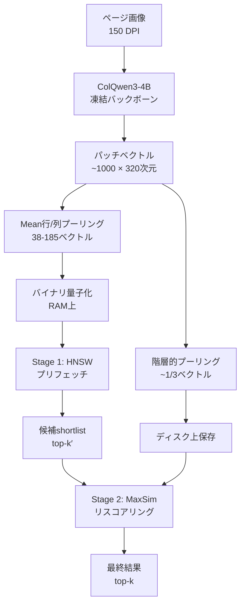

## 論文概要（Abstract）

本記事は [PULSAR: Pooled Unified Late-Interaction Search and Retrieval for Enterprise Visual Document RAG](https://arxiv.org/abs/2608.28572) の解説記事です。

PULSARは、投資会社Mubadala Investment Companyにおいて本番運用されている視覚優先（vision-first）の文書検索システムである。著者らは、ColPaliスタイルのマルチベクトル検索をプーリングとバイナリ量子化で高速化する2段階インデックス構造を提案している。ViDoRe V3ベンチマークにおいて、プーリングなしの構成と比較してベクトル検索のメディアンレイテンシを15.1倍削減しつつ、NDCG@10およびRecall@10の低下を0.01未満に抑えたと報告されている。本番環境では78,000件の文書（約240万ページ）を対象に、メディアンベクトル検索レイテンシ156msで稼働している。

この記事は [Zenn記事: ColQwen2.5×Qdrantバイナリ量子化でPDF視覚検索を高速化する](https://zenn.dev/0h_n0/articles/1c18bde052d4a9) の深掘りです。

## 情報源

- **arXiv ID**: 2608.28572
- **URL**: [https://arxiv.org/abs/2608.28572](https://arxiv.org/abs/2608.28572)
- **著者**: Benjamin Constable (Microsoft), Anup Roy, Vishal Sharma, Rishabh Gyanendra Upadhyay, Robin Mills (Inception42), Aidan Philip Millar (Mubadala Investment Company)
- **発表年**: 2026
- **会議**: EMNLP 2026 Industry Track（pp. 655–666）
- **分野**: cs.IR（Information Retrieval）
- **ライセンス**: CC BY 4.0

## 背景と動機（Background & Motivation）

機関投資家の業務では、ピッチデッキ・取締役会資料・デューデリジェンス文書など、視覚的に複雑な文書を日常的に検索する必要がある。これらの文書はグラフ・チャート・表を多用しており、ディールクロージング前には時間単位で更新が発生する。

従来のアプローチはOCR → レイアウト検出 → 図表の言語化（verbalisation） → テキスト埋め込みという多段パイプラインを採用していた。著者らはこの方式に3つの問題を指摘している。第一に、図表の言語化は「情報削減的（information-reducing）」であり、チャートの値は取得できても視覚的なグルーピングや順序情報が失われる。第二に、ページあたりのコストが高い。OCR/レイアウト処理に加え、各図表ごとにVLM呼び出しが必要となる。第三に、更新頻度の高い文書に対してパイプライン全体を再実行するコストが高い。

ColPali（Faysse et al., ICLR 2025）はページ画像を直接埋め込むvision-firstアプローチを示したが、1ページあたり約700〜1,030のパッチベクトルを生成するため、マルチベクトルインデックスのメモリ使用量とレイテンシがエンタープライズ規模での課題となる。PULSARはこの課題に対し、プーリングとバイナリ量子化を組み合わせた2段階検索構造で対処している。

## 主要な貢献（Key Contributions）

著者らは論文の冒頭で、PULSARの貢献は「新しい検索プリミティブではなく、vision-first検索を本番規模にスケールさせるエンジニアリングと実証」であると述べている。具体的な貢献は以下の4点である。

- **貢献1（解像度の分離）**: 検索用の埋め込みには150 DPIで十分であり、回答生成時のみ500 DPIを使用する。500 DPIでは投資向けデッキにおけるページ読み取りエラーがゼロになったと報告されている。
- **貢献2（2段階プーリングインデックス）**: Mean行/列プーリングによるHNSWプリフェッチと、階層的プーリングベクトルによるMaxSimリスコアリングを組み合わせた構造。バイナリ量子化との併用により、メディアンベクトル検索レイテンシを15.1倍短縮しつつ精度低下を0.01未満に抑えている（論文Table 1より）。
- **貢献3（インジェスチョンパイプライン）**: ローリングラスタライゼーション、優先度付きワークキュー、ページハッシュによるスキップ再開。ページ数に対してリニアにスケールし、OCR+言語化ベースラインと比較して1ページあたり約20倍のコスト削減と推定されている。
- **貢献4（Mubadalaでの本番デプロイ）**: 78,000件の文書、約240万ページ、3,000件以上のディールで2026年3月から稼働。自社評価では、OCR+言語化ベースラインに対してすべてのtop-kでcontext-fact recall、answer-fact recall、completenessで上回ったと報告されている。

## 技術的詳細（Technical Details）

### バックボーンモデル

PULSARのバックボーンはTomoro ColQwen3-4Bである。これはQwen3-VLベースのColPaliスタイル・マルチベクトル検索モデルで、出力次元は320である。著者らは、Apache-2.0ライセンスのモデルの中でサービング予算内で最高性能のものとして選択したと述べている。8Bパラメータの上位モデルはViDoRe V3でより高いスコアを示したが、予算を超過したため採用されなかった。ファインチューニングは行わず、凍結（frozen）バックボーンとして使用されている。

### 2段階プーリングインデックス

PULSARの検索構造は、プリフェッチとリスコアリングの2段階で構成される。



**Stage 1（プリフェッチ）**: 各ページのパッチベクトルを2D格子として扱い、行方向と列方向にそれぞれmeanプーリングを適用する。これにより1ページあたり38〜185のベクトルに圧縮される。これらのプーリングベクトルはバイナリ量子化されてRAM上に配置される。クエリはプーリングなしのまま（非対称スコアリング）、行プーリングインデックスと列プーリングインデックスに対してそれぞれHNSW検索を実行し、結合してtop-k′の候補shortlistを生成する。

**Stage 2（リスコアリング）**: shortlist内の各候補ページに対して、階層的プーリングによるより詳細なベクトル表現を用いてMaxSimスコアリングを再計算する。MaxSimの計算式は以下の通りである。

$$
s(q, d) = \sum_{i=1}^{|q|} \max_{j \in [1, |d|]} q_i^T d_j
$$

ここで $q_i$ はクエリの $i$ 番目のトークンベクトル、$d_j$ はドキュメントの $j$ 番目のパッチベクトルである。クエリの各トークンに対して、ドキュメント側で最大の内積を取り、それらを合計する。

### プーリング手法の詳細

著者らは2つのプーリング手法を使い分けている。

**Mean行/列プーリング**: パッチ列を2D格子に配置し、各行および各列の平均ベクトルを計算する。この表現はプリフェッチ用であり、ベクトル数が大幅に削減される。

**階層的プーリング**: 類似するパッチベクトルをクラスタリングし、各クラスタの平均ベクトルで代替する。プールファクター3の場合、約1/3のベクトル数に圧縮される。リスコアリング段階で使用され、プリフェッチより高い解像度を提供する。

### バイナリ量子化の適用

プリフェッチ用のプーリングベクトルにはバイナリ量子化が適用される。各次元を1ビットに圧縮することで、RAM上のフットプリントを大幅に削減する。著者らの推定では、プーリング＋量子化により、RAM上のベクトルペイロードを99.8%削減し、保存ベクトルペイロードを60.2%削減したと報告されている（論文Table 6より、106,074ページの測定値：プーリング構成0.535 GB vs 非プーリング構成227.72 GB）。

### インジェスチョンパイプライン

インジェスチョンは以下の手順で実行される。

1. Blob Storageイベントが3段階の優先度キュー（高: リアルタイムアナリストアップロード、中: 時間ごとのディール同期、低: 非ディール素材）に入る
2. ドキュメントレベルハッシュで未変更文書をスキップ。変更があれば各ページを150 DPI（検索用）と500 DPI（回答生成用）でラスタライズし、ページレベルハッシュで変更ページを特定
3. ColQwen3-4Bで変更ページの150 DPIレンダーを埋め込み
4. Meanプーリングベクトル（HNSW用）と階層的プーリングベクトル（リスコア用）を導出し、Qdrantにupsert
5. 500 DPIレンダーをページ画像ストアに保存
6. 全ページの処理完了後にドキュメントハッシュをスタンプ。検索クエリはスタンプのない文書をフィルタリング

著者らは、インジェスチョンのレイテンシが $2.9 + 1.41 \cdot p$ 秒（$p$はページ数）で概算されると報告している。変更から検索可能になるまでのラグはメディアン2.0秒、p95で43秒である。

## 実装のポイント（Implementation）

### 本番環境での重要な設計判断

- **prefetch_limit = 200**: 著者らの実験では、この値を超えても品質向上が見られなかったと報告されている。フラットなカーブであり、200が膝の位置に相当する。
- **hnsw_ef_search = 64**: 品質への影響は計測不可能であった（Friedman検定 p = 0.14）。
- **バイナリ量子化はプリフェッチのみ**: リスコアリング段階ではフル精度（またはプーリング後の元ベクトル）を使用する。これはZenn記事で紹介したプリフェッチ→リスコアリングの2段階パイプラインと同一の設計パターンである。
- **優先度スケジューリング**: vLLMはshortest-remaining-time-firstとエージングを使用し、検索クエリが最優先。ライブアナリストのアップロードは継続的に処理される。

### 解像度設定の知見

著者らはViDoRe V3において150〜600 DPIの範囲で検索品質に有意差がないことを確認している。ただし72 DPIと100 DPIでは品質が低下した。インジェスチョンのGPU時間が支配的コストであるため、150 DPIが選択された。回答生成時のみ500 DPIを使用し、投資向けデッキにおけるページ読み取りエラーをゼロにしている（論文Table 8より）。

## Production Deployment Guide

### AWS実装パターン（コスト最適化重視）

PULSARのアーキテクチャ（ColPaliバックボーン＋Qdrantベクトル検索＋プーリング2段階インデックス）をAWS上で実装する際の構成パターンを示す。

**トラフィック量別の推奨構成**:

| 規模 | 月間リクエスト | 推奨構成 | 月額コスト | 主要サービス |
|------|--------------|---------|-----------|------------|
| **Small** | ~3,000 (100/日) | Serverless | $200-400 | Lambda + Bedrock + Qdrant Cloud |
| **Medium** | ~30,000 (1,000/日) | Hybrid | $800-2,000 | ECS Fargate + Qdrant + S3 |
| **Large** | 300,000+ (10,000/日) | Container | $5,000-15,000 | EKS + GPU Nodes + Qdrant Cluster |

**Small構成の詳細** (月額$200-400):
- **Lambda**: 画像ラスタライズとクエリルーティング ($30/月)
- **Qdrant Cloud**: マネージドインスタンス、バイナリ量子化有効 ($100/月)
- **S3**: PDFおよびラスタライズ画像ストレージ ($20/月)
- **SageMaker Serverless**: ColQwen埋め込み推論 ($150/月)
- **CloudWatch**: 基本監視 ($10/月)

**Medium構成の詳細** (月額$800-2,000):
- **ECS Fargate**: 推論ワーカー 1 vCPU, 4GB RAM × 2タスク ($200/月)
- **ECS Fargate**: Qdrantコンテナ 2 vCPU, 8GB RAM ($150/月)
- **SageMaker**: ColQwen推論エンドポイント ml.g5.xlarge ($600/月)
- **S3 + EFS**: 画像・ベクトルストレージ ($50/月)
- **Application Load Balancer**: ($20/月)

**Large構成の詳細** (月額$5,000-15,000):
- **EKS**: コントロールプレーン ($72/月)
- **GPU Nodes**: g5.xlarge × 4台（vLLM推論用、Spot活用で平均$1,600/月）
- **Qdrant Cluster**: 3ノード分散構成、バイナリ量子化＋ディスクオフロード ($2,000/月)
- **S3**: 500 DPIページ画像ストレージ ($200/月)
- **CloudWatch + X-Ray**: 詳細監視 ($100/月)

**コスト試算の注意事項**:
- 上記は2026年11月時点のAWS ap-northeast-1（東京）リージョン料金に基づく概算値です
- 実際のコストはドキュメント数、ページ数、クエリパターンにより変動します
- 最新料金は [AWS料金計算ツール](https://calculator.aws/) で確認してください

### Terraformインフラコード

**Small構成 (Serverless): Lambda + Qdrant Cloud + S3**

```hcl
# --- S3バケット（PDF・ラスタライズ画像ストレージ） ---
resource "aws_s3_bucket" "document_store" {
  bucket = "pulsar-document-store"
}

resource "aws_s3_bucket_server_side_encryption_configuration" "document_store" {
  bucket = aws_s3_bucket.document_store.id

  rule {
    apply_server_side_encryption_by_default {
      sse_algorithm = "aws:kms"
    }
  }
}

# --- IAMロール（最小権限） ---
resource "aws_iam_role" "pulsar_lambda" {
  name = "pulsar-lambda-role"

  assume_role_policy = jsonencode({
    Version = "2012-10-17"
    Statement = [{
      Action = "sts:AssumeRole"
      Effect = "Allow"
      Principal = { Service = "lambda.amazonaws.com" }
    }]
  })
}

resource "aws_iam_role_policy" "pulsar_s3_access" {
  role = aws_iam_role.pulsar_lambda.id

  policy = jsonencode({
    Version = "2012-10-17"
    Statement = [{
      Effect   = "Allow"
      Action   = ["s3:GetObject", "s3:PutObject"]
      Resource = "${aws_s3_bucket.document_store.arn}/*"
    }]
  })
}

# --- Lambda関数（クエリルーティング） ---
resource "aws_lambda_function" "query_router" {
  filename      = "query_router.zip"
  function_name = "pulsar-query-router"
  role          = aws_iam_role.pulsar_lambda.arn
  handler       = "index.handler"
  runtime       = "python3.12"
  timeout       = 60
  memory_size   = 1024

  environment {
    variables = {
      QDRANT_URL          = var.qdrant_cloud_url
      QDRANT_API_KEY      = var.qdrant_api_key
      COLLECTION_NAME     = "pulsar-visual-search"
      PREFETCH_LIMIT      = "200"
      HNSW_EF_SEARCH      = "64"
    }
  }
}

# --- CloudWatch アラーム（レイテンシ監視） ---
resource "aws_cloudwatch_metric_alarm" "query_latency" {
  alarm_name          = "pulsar-query-latency-high"
  comparison_operator = "GreaterThanThreshold"
  evaluation_periods  = 3
  metric_name         = "Duration"
  namespace           = "AWS/Lambda"
  period              = 300
  statistic           = "p95"
  threshold           = 5000
  alarm_description   = "クエリレイテンシp95が5秒超過"

  dimensions = {
    FunctionName = aws_lambda_function.query_router.function_name
  }
}
```

**Large構成 (Container): EKS + GPU + Qdrant Cluster**

```hcl
# --- EKSクラスタ ---
module "eks" {
  source  = "terraform-aws-modules/eks/aws"
  version = "~> 20.0"

  cluster_name    = "pulsar-retrieval-cluster"
  cluster_version = "1.31"

  vpc_id     = module.vpc.vpc_id
  subnet_ids = module.vpc.private_subnets

  cluster_endpoint_public_access = true
  enable_cluster_creator_admin_permissions = true
}

# --- Karpenter（GPU Spot自動スケーリング） ---
resource "kubectl_manifest" "gpu_provisioner" {
  yaml_body = <<-YAML
    apiVersion: karpenter.sh/v1
    kind: NodePool
    metadata:
      name: gpu-spot-pool
    spec:
      template:
        spec:
          requirements:
            - key: karpenter.sh/capacity-type
              operator: In
              values: ["spot"]
            - key: node.kubernetes.io/instance-type
              operator: In
              values: ["g5.xlarge", "g5.2xlarge"]
          limits:
            cpu: "64"
            memory: "256Gi"
            nvidia.com/gpu: "8"
      disruption:
        consolidationPolicy: WhenEmptyOrUnderutilized
        consolidateAfter: 30s
  YAML
}

# --- Qdrant StatefulSet ---
resource "kubectl_manifest" "qdrant_statefulset" {
  yaml_body = <<-YAML
    apiVersion: apps/v1
    kind: StatefulSet
    metadata:
      name: qdrant
    spec:
      replicas: 3
      selector:
        matchLabels:
          app: qdrant
      template:
        metadata:
          labels:
            app: qdrant
        spec:
          containers:
            - name: qdrant
              image: qdrant/qdrant:v1.17.0
              ports:
                - containerPort: 6333
                - containerPort: 6334
              volumeMounts:
                - name: qdrant-storage
                  mountPath: /qdrant/storage
      volumeClaimTemplates:
        - metadata:
            name: qdrant-storage
          spec:
            accessModes: ["ReadWriteOnce"]
            storageClassName: gp3
            resources:
              requests:
                storage: 500Gi
  YAML
}

# --- AWS Budgets ---
resource "aws_budgets_budget" "pulsar_monthly" {
  name         = "pulsar-monthly-budget"
  budget_type  = "COST"
  limit_amount = "15000"
  limit_unit   = "USD"
  time_unit    = "MONTHLY"

  notification {
    comparison_operator        = "GREATER_THAN"
    threshold                  = 80
    threshold_type             = "PERCENTAGE"
    notification_type          = "ACTUAL"
    subscriber_email_addresses = ["ops@example.com"]
  }
}
```

### セキュリティベストプラクティス

1. **ネットワーク**: EKSクラスタはプライベートサブネットに配置。Qdrantへのアクセスはクラスタ内部のみ
2. **認証**: Qdrant API KeyはAWS Secrets Managerで管理。IAM Roles for Service Accounts (IRSA)でPod単位の権限制御
3. **暗号化**: S3のKMS暗号化、EBSのKMS暗号化、転送中はTLS 1.2以上
4. **監査**: CloudTrail全リージョン有効化、Qdrantアクセスログの集約

### 運用・監視設定

**CloudWatch Logs Insights クエリ**:
```sql
-- ベクトル検索レイテンシ分析（PULSARの2段階検索）
fields @timestamp, prefetch_latency_ms, rescore_latency_ms, total_latency_ms
| stats pct(total_latency_ms, 50) as p50,
        pct(total_latency_ms, 95) as p95,
        pct(total_latency_ms, 99) as p99
  by bin(5m)

-- インジェスチョンスループット監視
fields @timestamp, pages_indexed, ingestion_duration_ms
| stats sum(pages_indexed) as total_pages,
        avg(ingestion_duration_ms / pages_indexed) as avg_ms_per_page
  by bin(1h)
```

**CloudWatch アラーム（コスト・レイテンシ重視）**:
```python
import boto3

cloudwatch = boto3.client('cloudwatch')

cloudwatch.put_metric_alarm(
    AlarmName='pulsar-search-latency-p95',
    ComparisonOperator='GreaterThanThreshold',
    EvaluationPeriods=3,
    MetricName='SearchLatencyP95',
    Namespace='PULSAR/Retrieval',
    Period=300,
    Statistic='Average',
    Threshold=1000,
    AlarmActions=['arn:aws:sns:ap-northeast-1:123456789:pulsar-alerts'],
    AlarmDescription='検索レイテンシp95が1秒超過（論文の本番実績156ms p50を大幅に超過）'
)

cloudwatch.put_metric_alarm(
    AlarmName='pulsar-ingestion-lag',
    ComparisonOperator='GreaterThanThreshold',
    EvaluationPeriods=1,
    MetricName='IngestionLagSeconds',
    Namespace='PULSAR/Ingestion',
    Period=60,
    Statistic='p95',
    Threshold=120,
    AlarmDescription='インジェスチョンラグp95が2分超過（論文実績: p95 43秒）'
)
```

**X-Ray トレーシング設定**:
```python
from aws_xray_sdk.core import xray_recorder, patch_all

patch_all()

@xray_recorder.capture('pulsar_two_stage_search')
def search_documents(query_embedding: list[list[float]], limit: int = 5):
    xray_recorder.put_annotation('search_type', 'two_stage_pooled')
    xray_recorder.put_metadata('query_vectors', len(query_embedding))

    prefetch_results = qdrant_prefetch(query_embedding, prefetch_limit=200)
    xray_recorder.put_metadata('prefetch_candidates', len(prefetch_results))

    final_results = maxsim_rescore(query_embedding, prefetch_results, limit=limit)
    xray_recorder.put_metadata('final_results', len(final_results))

    return final_results
```

### コスト最適化チェックリスト

**アーキテクチャ選択**:
- [ ] ~100 req/日 → Serverless (Lambda + Qdrant Cloud) - $200-400/月
- [ ] ~1,000 req/日 → Hybrid (ECS + SageMaker) - $800-2,000/月
- [ ] 10,000+ req/日 → Container (EKS + GPU Spot) - $5,000-15,000/月

**リソース最適化**:
- [ ] GPU Nodes: Spot Instances優先（g5.xlarge、最大90%削減）
- [ ] 150 DPI埋め込み（論文で検索品質に影響なしと確認済み）
- [ ] ページハッシュによる差分インジェスチョン（未変更ページのスキップ）
- [ ] 優先度キューによるリソース配分最適化

**ベクトルDB最適化**:
- [ ] バイナリ量子化（プリフェッチ用ベクトルをRAM上に配置）
- [ ] オリジナルベクトルはディスクオフロード
- [ ] prefetch_limit = 200（論文の推奨値）
- [ ] hnsw_ef_search = 64（論文で品質影響なしと確認）

**監視・アラート**:
- [ ] AWS Budgets: 月額予算設定（80%で警告）
- [ ] 検索レイテンシp50/p95/p99の継続監視
- [ ] インジェスチョンラグの監視
- [ ] GPU利用率の監視（Spot中断対応）

**リソース管理**:
- [ ] 500 DPIページ画像のS3ライフサイクルポリシー
- [ ] 古いドキュメントバージョンの自動削除
- [ ] 開発環境のGPUノード夜間停止
- [ ] タグ戦略（deal-id単位でコスト可視化）

## 実験結果（Results）

### プーリング・量子化スイープ（論文Table 1）

著者らはViDoRe V3の14,514クエリを使用して10構成をテストしている。ベースライン（O: 非プーリング構成）と本番選択（M+Hqp: Meanプーリング＋階層的プーリング＋量子化＋プリフェッチ量子化）の比較を示す。

| 構成 | メディアンベクトル検索 (ms) | 高速化倍率 | ΔNDCG@10 | ΔRecall@10 |
|------|--------------------------|-----------|----------|------------|
| O（ベースライン） | 752.7 | 1.0x | — | — |
| H（階層的プーリングのみ） | 135.4 | 5.6x | — | — |
| Hq（階層的＋量子化） | 73.9 | 10.2x | — | — |
| **M+Hqp（本番構成）** | **49.9** | **15.1x** | **−0.0088** | **−0.0074** |

著者らは、9つの非ベースライン構成すべてが品質ゲート（|Cohen's d| < 0.1）を通過したと報告している。プリフェッチは量子化と組み合わせた場合にのみ効果があり、非量子化のM+H構成は4.1倍にとどまり、H単体（5.6倍）より遅かった。

### レイテンシ（論文Table 7）

単一クエリのエンドツーエンドレイテンシ（並行度1）:

| パーセンタイル | プーリング構成 (ms) | 非プーリング構成 (ms) | 高速化 |
|-------------|-------------------|---------------------|--------|
| p50 | 175 | 1,907 | 10.9x |
| p90 | 387 | 4,628 | 12.0x |
| p95 | 546 | 6,966 | 12.8x |
| p99 | 686 | 13,639 | 19.9x |

ベクトル検索時間（15.1倍）とエンドツーエンドレイテンシ（10.9倍）は異なる測定値である点に注意が必要である。

### スループット

開発スタック（本番の約半分のQdrant CPUおよびIOPS、8ポッド構成）での負荷テスト結果として、プーリング構成は約47 QPSを達成し、非プーリング構成の約0.54 QPSと比較して約88倍のスループット向上が報告されている。非プーリング構成は64並行時にレイテンシが53秒に達し、完了率が46%まで低下した。

### インデックスフットプリント（論文Table 6、106,074ページ）

| | プーリング構成 | 非プーリング構成 | 比率 |
|---|---|---|---|
| RAM上ベクトルペイロード (GB) | 0.535 | 227.72 | 425倍削減 |
| 保存ベクトルペイロード (GB) | 90.67 | 227.72 | 2.5倍削減 |

### OCR+言語化ベースラインとの品質比較（論文Table 2）

75問（7ディール）、5回実行の平均値:

| メトリクス | k | ベースライン | PULSAR |
|----------|---|-----------|--------|
| Answer-Fact Recall | 5 | 0.271 | 0.733 |
| Context-Fact Recall | 5 | 0.388 | 0.874 |
| Completeness (1-5) | 5 | 2.55 | 4.15 |

著者らは、PULSARが7ディールすべて、12のメトリクス×kセルすべてでベースラインを上回ったと報告しており、exact Wilcoxon検定でp = 0.016であった。LLMジャッジとSME（Subject Matter Expert）の一致率はanswer-fact recallでr = 0.94–0.98、completenessでr = 0.83–0.86であった。

## 実運用への応用（Practical Applications）

### Mubadala Investment Companyでのデプロイ

PULSARは2026年3月からMubadala Investment Companyで本番稼働している。具体的なデプロイ構成は以下の通りである。

**インフラ構成（論文Tables 3-4より）**:
- **ベクトルDB**: Qdrant 1.17
- **推論エンジン**: vLLM 0.19.1
- **モデル**: ColQwen3-4B（半A10 GPU予算、NV18ads_A10_v5ノード上）
- **レプリカ数**: vLLM推論 × 4、ColPali推論 × 4、ドキュメントインデクサー × 4、ベクトルDB × 4
- **ストレージ**: 1 TiB P30 PVC（5,000 IOPS）

**本番実績**:
- 78,000件の文書、約240万ページ、3,000件以上のディール
- 7日間ローリングウィンドウ（n = 109,370コール）でのメディアンベクトル検索レイテンシ: 156ms
- テールレイテンシ: p95 0.6秒、p99 1.5秒
- ピーク負荷: 62 QPS
- 変更から検索可能になるまでのラグ: メディアン2.0秒、p95 43秒（最繁時間帯p95: 63秒、最悪328秒）

### ユースケースの特徴

PULSARが対象とする投資分析業務には以下の特徴がある。

- **文書の視覚的複雑性**: ピッチデッキにはチャート・グラフ・表が密集しており、OCRによるテキスト抽出だけでは情報が損失する
- **更新頻度の高さ**: ディールクロージング前は文書が時間単位で更新される
- **高鮮度要求**: 最新の資料が検索できることが業務上必須
- **回答の正確性**: 財務データの誤りは意思決定に直結するため、answer-fact recallが重要

### Zenn記事との関連

Zenn記事「ColQwen2.5×Qdrantバイナリ量子化でPDF視覚検索を高速化する」で紹介されている技術スタック（ColQwen2.5 + Qdrant + バイナリ量子化 + 2段階検索パイプライン）と、PULSARのアーキテクチャには共通する設計思想が多い。特に以下の点が関連する。

- **バイナリ量子化＋リスコアリング**: Zenn記事の「プリフェッチ→フル精度MaxSimリスコア」パイプラインは、PULSARのStage 1/Stage 2構造と同一のパターン
- **メモリ階層の設計**: 量子化ベクトルをRAMに、オリジナルベクトルをディスクに配置する設計はPULSARでも採用
- **128次元 vs 320次元**: Zenn記事のColQwen2.5は128次元、PULSARのColQwen3-4Bは320次元。高次元のほうがバイナリ量子化の精度が高い傾向があるため、次元数の違いが量子化戦略に影響する

## 関連研究（Related Work）

- **ColPali（Faysse et al., ICLR 2025）**: PULSARのバックボーンの基盤となったvision-first検索モデル。PaliGemma-3Bベースで、ViDoReベンチマークを導入した。PULSARはColPaliの設計を踏襲しつつ、プーリングによるスケーラビリティ向上を実現している。
- **ColBERTv2（Santhanam et al., NAACL 2022）**: Late Interactionの圧縮手法として残差圧縮を提案し、フットプリントを6-10倍削減した。PULSARのプーリングアプローチとは異なるが、マルチベクトルインデックスの圧縮という同一の課題に取り組んでいる。
- **HPC-ColPali（Duong, KDIR 2025）**: ColPaliのパッチ圧縮フレームワーク。K-Means量子化とアテンションベースのプルーニングを組み合わせる。PULSARのプーリング手法とは相補的なアプローチである。

## まとめと今後の展望

PULSARは、ColPaliスタイルの視覚文書検索をエンタープライズ規模に拡張した実用的なシステムである。プーリングとバイナリ量子化の組み合わせにより、ベクトル検索レイテンシを15.1倍削減し、RAM上のフットプリントを425倍削減しつつ、検索品質の低下を0.01未満に抑えている。Mubadalaでの本番運用実績は、vision-first検索が投資分析という高精度要求のドメインで実用可能であることを示している。

Zenn記事で紹介されたColQwen2.5 + Qdrantの構成をより大規模に展開する場合、PULSARのプーリング戦略（特にMean行/列プーリングによるプリフェッチ候補の圧縮）は実践的な指針となる。今後の検討事項として、Qdrant v1.20のTurboQuant（回転ベース量子化）とバイナリ量子化の併用可能性、および128次元ベクトルに対するプーリングの品質への影響が挙げられる。

## 参考文献

- **arXiv**: [https://arxiv.org/abs/2608.28572](https://arxiv.org/abs/2608.28572)
- **ColPali (ICLR 2025)**: [https://arxiv.org/abs/2407.01449](https://arxiv.org/abs/2407.01449)
- **ColBERTv2 (NAACL 2022)**: [https://arxiv.org/abs/2112.01488](https://arxiv.org/abs/2112.01488)
- **Qdrant ColPali Blog**: [https://qdrant.tech/blog/qdrant-colpali/](https://qdrant.tech/blog/qdrant-colpali/)
- **Related Zenn article**: [https://zenn.dev/0h_n0/articles/1c18bde052d4a9](https://zenn.dev/0h_n0/articles/1c18bde052d4a9)

---

:::message
この記事はAI（Claude Code）により自動生成されました。内容の正確性については原論文の情報に基づいていますが、実際の利用時は[原論文](https://arxiv.org/abs/2608.28572)もご確認ください。
:::
