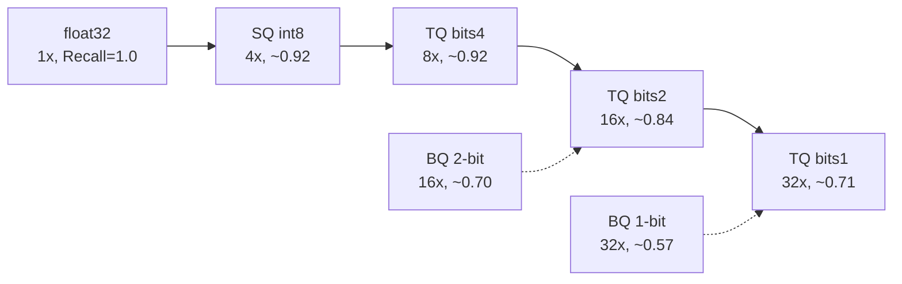

本記事は [Qdrant公式技術記事「TurboQuant in Qdrant」](https://qdrant.tech/articles/turboquant-quantization/)（Ivan Pleshkov・Jonas Schulz著、2026年5月13日公開）の解説記事です。ベンチマーク結果を含む数値はすべてQdrant自身による計測値であり、独立した第三者検証は行われていない点に留意してください。

この記事は [Zenn記事: ColQwen2.5×Qdrantバイナリ量子化でPDF視覚検索を高速化する](https://zenn.dev/0h_n0/articles/1c18bde052d4a9) の深掘りです。

## ブログ概要（Summary）

ColPaliやColQwen2.5のようなマルチベクトル検索モデルが普及するにつれ、ベクトルストレージのメモリ消費が大きな運用課題となっている。Qdrantは従来、スカラー量子化（SQ、4倍圧縮）とバイナリ量子化（BQ、最大32倍圧縮）を提供してきたが、BQは低次元ベクトルでリコールが著しく低下するという問題があった。

TurboQuantは、Google Researchの Zandieh et al.（2025, arXiv:2504.19874）が提案した回転ベース量子化をQdrantが独自に拡張して実装した手法である。ランダム直交回転によりベクトルの各座標の分散を均一化した後、固定のLloyd-Max符号帳で量子化する。Qdrantの公式ベンチマークによると、同一圧縮率ではBQよりも高いリコールを実現し、4ビット設定（8倍圧縮）ではSQと同等のリコールを半分のメモリで達成したとのことである。

## 情報源

- **種別**: 企業テックブログ
- **URL**: [https://qdrant.tech/articles/turboquant-quantization/](https://qdrant.tech/articles/turboquant-quantization/)
- **組織**: Qdrant（ベクトル検索エンジン開発企業）
- **著者**: Ivan Pleshkov、Jonas Schulz
- **発表日**: 2026年5月13日

## 技術的背景（Technical Background）

### なぜ新しい量子化手法が必要だったのか

[Zenn記事](https://zenn.dev/0h_n0/articles/1c18bde052d4a9)で解説したように、ColQwen2.5のマルチベクトル埋め込みは1ページあたり700〜1,030本の128次元ベクトルを生成する。10,000ページ規模のコーパスでは約700万ベクトルとなり、float32で保持すると約3.4 GBのメモリを消費する。

バイナリ量子化（BQ）は各次元を1ビットに圧縮し32倍のメモリ削減を実現するが、**128次元のような低次元ベクトルではリコールが大幅に低下する**という制約がある。Qdrant公式の分析では、512次元のtext-embedding-3-smallでもリスコアリングなしの精度が53〜55%まで低下したと[報告されている](https://qdrant.tech/articles/binary-quantization/)。

スカラー量子化（SQ）はリコール低下が小さいが、圧縮率は4倍に留まる。**BQの圧縮率とSQのリコールを両立する手法**が求められていた。

### 学術的な背景

TurboQuantの基盤は、Zandieh et al.が提案したProduct Quantization（PQ）ファミリーに属する回転ベース量子化である。さらに、Gao & Long（SIGMOD 2024）が提案したRaBitQのアイデア（長さ再正規化）も取り入れている。従来のPQがデータセットごとに符号帳を学習する必要があるのに対し、TurboQuantは**標準正規分布に対するLloyd-Max符号帳を固定的に使用**するため、キャリブレーションデータの用意やオフライン学習が不要である。

## 実装アーキテクチャ（Architecture）

### TurboQuantのコアアルゴリズム

TurboQuantは以下の3ステップで動作する。

```mermaid
graph TD
    A[入力ベクトル v<br/>D次元 float32] --> B[ランダム直交回転<br/>v' = Rv]
    B --> C[各座標を独立に量子化<br/>Lloyd-Max N(0,1) 符号帳]
    C --> D[量子化コード<br/>b×D ビット]
    D --> E[スコアリング<br/>回転空間で直接計算]
```

#### ステップ1: ランダム直交回転

すべてのベクトル $\mathbf{v}$ に対して、ランダム直交行列 $\mathbf{R}$ を乗じる。

$$
\mathbf{v}' = \mathbf{R}\mathbf{v}
$$

ここで $\mathbf{R}$ は $D \times D$ の直交行列（$\mathbf{R}^T\mathbf{R} = \mathbf{I}$）である。直交変換は内積とL2距離を保存するため、回転後の空間で計算したスコアは回転前と同一になる。

この回転の目的は、**各座標の分散を均一化する**ことにある。等方的なデータ（各座標の分散がほぼ等しいデータ）では、回転後の各座標が近似的に $N(0, \sigma^2)$ に従う。これにより、次のステップの固定符号帳が有効に機能する。

#### ステップ2: Lloyd-Max符号帳による独立量子化

回転後の各座標を、$N(0,1)$ に対する最適なLloyd-Max符号帳で独立に量子化する。$b$ ビットの量子化では $2^b$ 個のセントロイド（代表値）を使用する。

| ビット数 | セントロイド数 | 圧縮率（float32比） |
|---------|-------------|-------------------|
| 4 (`bits4`) | 16 | 8倍 |
| 2 (`bits2`) | 4 | 16倍 |
| 1.5 (`bits1_5`) | — | 約21倍 |
| 1 (`bits1`) | 2 | 32倍 |

PQとの決定的な違いは、**符号帳が固定でありデータセット依存の学習が不要**な点である。$N(0,1)$ に対するLloyd-Max最適符号帳は解析的に決まるため、どのデータセットでも同じ符号帳を使用できる。

#### ステップ3: 回転空間でのスコアリング

検索時、クエリベクトルも同じ回転行列 $\mathbf{R}$ で変換し、量子化されたデータベースベクトルとの内積を計算する。直交変換が内積を保存するため、逆回転は不要である。

### Qdrant独自の拡張

Qdrantは原論文のアルゴリズムに対して、以下の拡張を加えている。

#### 長さ再正規化（RaBitQより）

バニラMSE量子化では、量子化後のベクトルの長さが系統的に短くなる。Qdrantは元のベクトル長と量子化復元後のベクトル長の比率をスカラーとして保存し、スコアリング時に乗算する。この比率はL2ノルム用に予約されている4バイト領域に格納されるため、追加のストレージコストは発生しない。

#### 座標ごとのキャリブレーション（異方性補正）

現実の埋め込みモデルは等方的でないことが多い。各座標の分布が $N(0,1)$ から外れると量子化精度が低下する。Qdrantは各セグメントの事前パスで座標ごとに `(shift, scale)` ペアを推定し、以下の正規化を適用する。

$$
x_{\text{normalized}} = (x + \text{shift}) \cdot \text{scale}
$$

記事によると、この補正はクエリ時の追加コストが実質ゼロである。 $1/\text{scale}$ をクエリ側に折り込み、$\langle \mathbf{q}, \text{shift} \rangle$ を1回のスカラー減算で処理するためである。推定には P-Square アルゴリズム（分位数推定）とVitterのAlgorithm R（リザーバーサンプリング）を使用し、プロダクション規模でもセグメントあたり数秒で完了するとのことである。

#### 距離メトリクスの対応

TurboQuantは単位ベクトルを前提とするが、Qdrantは元のL2ノルムを保存して正規化したベクトルを量子化する。L2距離は以下の恒等式で復元する。

$$
\|\mathbf{q} - \mathbf{v}\|^2 = \|\mathbf{q}\|^2 + \|\mathbf{v}\|^2 - 2\|\mathbf{v}\|\|\mathbf{q}\|\langle\hat{\mathbf{q}}, \hat{\mathbf{v}}\rangle
$$

これにより、**Cosine、Dot Product、L2の3つの距離メトリクスに対応**している。ただし、L1距離は回転不変でないため非対応であり、L1が必要な場合はSQの使用が推奨されている。

#### SIMD最適化

4ビットおよび2ビット量子化では、Lloyd-Max符号帳（16セントロイドまたは4セントロイド）を8ビットルックアップテーブルとして1つのSIMDレジスタに収め、`pshufb`命令でルックアップする。VNNI対応CPU（Intel Ice Lake以降、AMD Zen 4以降）では`VPDPBUSD`命令、ARMv8.2-Aでは`SDOT`命令による高速化が行われている。

1ビット量子化ではRaBitQのビットプレーンスコアリングに従い、AND演算とポップカウントで内積を計算する。

## Production Deployment Guide

### AWS実装パターン（コスト最適化重視）

TurboQuantを活用したベクトル検索システムのAWS構成パターンを示す。

**トラフィック量別の推奨構成**:

| 規模 | 月間リクエスト | 推奨構成 | 月額コスト概算 | 主要サービス |
|------|-------------|---------|-------------|------------|
| **Small** | ~3,000 (100/日) | Serverless | $80-200 | Lambda + Qdrant Cloud Free + S3 |
| **Medium** | ~30,000 (1,000/日) | Hybrid | $400-900 | ECS Fargate + Qdrant on EC2 + ElastiCache |
| **Large** | 300,000+ (10,000/日) | Container | $2,500-6,000 | EKS + Qdrant Cluster + NVMe SSD |

**コスト削減テクニック**:
- TurboQuant bits4（8倍圧縮）により、SQ（4倍圧縮）と比較してQdrantノードのインスタンスサイズを半分に削減可能
- Reserved Instances購入で最大72%削減（1年コミット）
- Qdrant `on_disk=True` 設定でオリジナルベクトルをNVMeに退避し、RAM使用量を削減

**コスト試算の注意事項**: 上記は2026年11月時点のAWS ap-northeast-1（東京）リージョン料金に基づく概算値です。Qdrant Cloudの料金はプランにより異なり、セルフホスト版は別途EC2/EKSコストが発生します。最新料金は [AWS料金計算ツール](https://calculator.aws/) で確認してください。

### Terraformインフラコード

**Small構成 (Serverless): Lambda + Qdrant**

```hcl
module "vpc" {
  source  = "terraform-aws-modules/vpc/aws"
  version = "~> 5.0"
  name = "qdrant-vpc"
  cidr = "10.0.0.0/16"
  azs  = ["ap-northeast-1a", "ap-northeast-1c"]
  private_subnets = ["10.0.1.0/24", "10.0.2.0/24"]
  enable_nat_gateway = false
  enable_dns_hostnames = true
}

resource "aws_lambda_function" "vector_search" {
  filename      = "lambda.zip"
  function_name = "qdrant-vector-search"
  role          = aws_iam_role.lambda_qdrant.arn
  handler       = "index.handler"
  runtime       = "python3.12"
  timeout       = 30
  memory_size   = 1024
  environment {
    variables = {
      QDRANT_URL        = var.qdrant_cloud_url
      COLLECTION_NAME   = "pdf_visual_search"
      QUANTIZATION_TYPE = "turbo_bits4"
    }
  }
}
```

**Large構成 (Container): EKS + Qdrant Cluster**

```hcl
module "eks" {
  source  = "terraform-aws-modules/eks/aws"
  version = "~> 20.0"
  cluster_name    = "qdrant-cluster"
  cluster_version = "1.31"
  vpc_id          = module.vpc.vpc_id
  subnet_ids      = module.vpc.private_subnets
  cluster_endpoint_public_access = true
  enable_cluster_creator_admin_permissions = true
}

resource "helm_release" "qdrant" {
  name       = "qdrant"
  repository = "https://qdrant.github.io/qdrant-helm"
  chart      = "qdrant"
  namespace  = "qdrant"
  set { name = "replicaCount"; value = "3" }
  set { name = "resources.requests.memory"; value = "24Gi" }
  set { name = "resources.requests.cpu"; value = "4" }
  set { name = "persistence.storageClass"; value = "nvme-ssd" }
  set { name = "persistence.size"; value = "200Gi" }
}

resource "aws_budgets_budget" "qdrant_monthly" {
  name         = "qdrant-monthly-budget"
  budget_type  = "COST"
  limit_amount = "6000"
  limit_unit   = "USD"
  time_unit    = "MONTHLY"
  notification {
    comparison_operator        = "GREATER_THAN"
    threshold                  = 80
    threshold_type             = "PERCENTAGE"
    notification_type          = "ACTUAL"
    subscriber_email_addresses = ["ops@example.com"]
  }
}
```

### セキュリティベストプラクティス

**本番環境での推奨設定**:

1. **ネットワークセキュリティ**: Qdrantノードはプライベートサブネットに配置し、パブリックアクセスを禁止する。クライアントからのアクセスはALB/NLB経由とし、TLS 1.2以上を必須とする
2. **認証・認可**: Qdrant APIキーはAWS Secrets Managerで管理し、環境変数へのハードコード禁止。IAMロールは最小権限の原則に従う
3. **暗号化**: EBSボリュームはKMS暗号化を有効化する。S3バックアップも同様にKMS暗号化する
4. **監査**: CloudTrailで全APIコールを記録し、S3に長期保存する

### 運用・監視設定

**CloudWatch Logs Insights クエリ**:

```sql
-- Qdrant検索レイテンシ分析
fields @timestamp, search_latency_ms, quantization_type
| stats pct(search_latency_ms, 95) as p95, pct(search_latency_ms, 99) as p99 by bin(5m)
```

**CloudWatch アラーム設定**:

```python
import boto3
cloudwatch = boto3.client('cloudwatch')
cloudwatch.put_metric_alarm(
    AlarmName='qdrant-search-latency-spike',
    ComparisonOperator='GreaterThanThreshold',
    EvaluationPeriods=2,
    MetricName='SearchLatency',
    Namespace='Qdrant/VectorSearch',
    Period=300,
    Statistic='p95',
    Threshold=500,
    AlarmDescription='Qdrant検索レイテンシP95異常'
)
```

### コスト最適化チェックリスト

**TurboQuant設定でのリソース最適化**:
- [ ] bits4（8倍圧縮）をデフォルトとし、SQと同等のリコールを半分のメモリで実現
- [ ] メモリ制約が厳しい場合は bits2（16倍圧縮）に切り替え、リスコアリング有効化
- [ ] `memory: "pinned"` で量子化ベクトルをRAMに固定（Qdrant 1.19以降）
- [ ] `on_disk: true` でオリジナルベクトルをディスクに退避

**インフラ・監視**:
- [ ] EC2: メモリ最適化インスタンス（r6i/r7i）をQdrantノードに使用
- [ ] Reserved Instances: 1年コミットで最大72%削減
- [ ] AWS Budgets: 月額予算設定（80%で警告、100%でアラート）
- [ ] CloudWatch: 検索レイテンシP95/P99監視、メモリ使用率監視
- [ ] Cost Anomaly Detection: 自動異常検知
- [ ] Qdrantスナップショット: S3に定期バックアップ（ライフサイクル90日）

## パフォーマンス最適化（Performance）

### ベンチマーク結果

Qdrant公式記事では、HNSW（m=16, ef_construct=128）を使用した10のパブリックデータセットで各量子化方式のリコールを計測している。以下はQdrant自身による計測結果である。

**主要なデータセットでの比較（Recall@10）**:

| データセット | float32 (1x) | SQ (4x) | TQ 4-bit (8x) | TQ 2-bit (16x) | BQ 2-bit (16x) | TQ 1-bit (32x) | BQ 1-bit (32x) |
|------------|-------------|---------|--------------|---------------|---------------|---------------|---------------|
| arxiv-384 | 0.986 | 0.967 | 0.944 | 0.848 | 0.695 | 0.713 | 0.603 |
| dbp-gem | 0.917 | 0.913 | 0.902 | 0.817 | 0.669 | 0.699 | 0.495 |
| dbp-oai | 0.963 | 0.884 | 0.930 | 0.848 | 0.733 | 0.736 | 0.610 |
| cohere | 0.945 | 0.901 | 0.927 | 0.830 | 0.688 | 0.630 | 0.541 |
| laion | 0.990 | 0.928 | 0.944 | 0.835 | 0.595 | 0.681 | 0.476 |
| ads-1M | 0.930 | 0.919 | 0.917 | 0.871 | 0.781 | 0.772 | 0.676 |

**Qdrant記事より報告されている主要な比較結果**:

- **TQ 4-bit vs SQ**: 10データセット中7つで2.3ポイント以内のリコール差。dbp-oai（+4.6pp）、cohere（+2.6pp）、laion（+1.6pp）の3データセットではTQ 4-bitがSQを上回った
- **TQ 2-bit vs BQ 2-bit**: 全10データセットでTQ 2-bitが9〜24ポイント上回った（最大差: laion +24.0pp、最小差: ads-1M +9.0pp）
- **TQ 1-bit vs BQ 1-bit**: 全10データセットでTQ 1-bitが9〜21ポイント上回った

### 圧縮率とリコールのトレードオフ

記事から読み取れる量子化方式の位置づけを整理する。



TQ 4-bit（8倍圧縮）は、SQ（4倍圧縮）の約半分のメモリで同等のリコールを達成していることがQdrantの計測で示されている。同一圧縮率（16倍または32倍）ではBQと比較して大幅なリコール改善が報告されている。

ただし、これらの数値はQdrant自身のベンチマークによるものであり、すべてのデータセットおよび埋め込みモデルでこの傾向が成立するとは限らない。自社データでの評価が推奨される。

### ColQwen2.5 × TurboQuantの適用考察

Zenn記事で扱ったColQwen2.5の128次元マルチベクトルにTurboQuantを適用する場合を考える。

Zenn記事ではBQ（1-bit）を使用し、`oversampling=3.0`以上でリスコアリング必須という構成を紹介した。TurboQuantの `bits2`（16倍圧縮）を使用した場合、Qdrantのベンチマーク結果に基づけば、BQの2-bit設定と比較して9〜24ポイントのリコール改善が期待できる。

ただし、以下の制約に注意が必要である。

- Qdrantのベンチマーク結果は主に高次元（384〜1536次元）の埋め込みで計測されており、128次元でのTurboQuantの挙動は記事中に明示されていない
- マルチベクトル（Late Interaction）コレクションでの量子化はシングルベクトルと挙動が異なる可能性がある
- 実運用では自社データでTQ bits4とTQ bits2のリコールを比較し、`oversampling`パラメータとの組み合わせを最適化する必要がある

### Qdrant設定例

TurboQuantをColQwen2.5マルチベクトルコレクションに適用する設定例を示す。

```python
from qdrant_client import QdrantClient, models

client = QdrantClient("localhost", port=6333)

client.create_collection(
    collection_name="pdf_visual_search_turbo",
    vectors_config={
        "colqwen": models.VectorParams(
            size=128,
            distance=models.Distance.COSINE,
            multivector_config=models.MultiVectorConfig(
                comparator=models.MultiVectorComparator.MAX_SIM,
            ),
            quantization_config=models.TurboQuantization(
                turbo=models.TurboQuantQuantizationConfig(
                    memory=models.Memory.PINNED,
                    bits=models.TurboQuantBitSize.BITS4,
                ),
            ),
            on_disk=True,
        ),
    },
)
```

BQからの移行はコレクション設定の変更とインデックス再構築で完了する。

```python
client.update_collection(
    collection_name="pdf_visual_search",
    quantization_config=models.TurboQuantization(
        turbo=models.TurboQuantQuantizationConfig(
            memory=models.Memory.PINNED,
            bits=models.TurboQuantBitSize.BITS4,
        ),
    ),
)
```

## 運用での学び（Production Lessons）

### 量子化方式の選択指針

Qdrantの記事からは、以下の移行パスが推奨されている。

- **SQユーザー**: TQ bits4 への移行でストレージを半減しつつリコールを維持
- **BQユーザー**: 同じビット深度のTurboQuantへの移行でリコールを大幅改善
- **L1距離を使用するユーザー**: SQを継続（TurboQuantの直交回転はL1不変でないため）

### スループットに関する注意

記事はリコールとストレージの比較を詳細に提供しているが、**スループット（QPS）やレイテンシの定量的な比較は含まれていない**。SIMDカーネルの設計は解説されているが、BQやSQと比較した実測のスループット差は報告されていない。記事は「ワークロードでスループット低下が目立つ場合はBQに留まることを検討」と述べており、TurboQuantがBQよりスループットで劣る可能性を示唆している。

### バージョン要件

- **Qdrant 1.18以上**: TurboQuant機能そのものが利用可能
- **Qdrant 1.19以上**: `memory` パラメータ（`"pinned"` 等）が利用可能

既存コレクションへのTurboQuant適用は設定変更とインデックス再構築で可能だが、再構築中はコレクションの検索性能が一時的に低下する点に注意が必要である。

## 学術研究との関連（Academic Connection）

TurboQuantは以下の3つの学術研究を基盤としている。

- **TurboQuant原論文** (Zandieh et al., 2025, arXiv:2504.19874): Google Researchにより提案されたPQファミリーの回転ベース量子化手法。MSE変種とPROD変種がある。Qdrantが実装したのはMSE変種で、HNSW検索における対称スコアリングに適している
- **RaBitQ** (Gao & Long, SIGMOD 2024, arXiv:2405.12497): ランダムバイナリ量子化手法で、長さ再正規化のアイデアをQdrantが取り入れた。ビットプレーンスコアリングのアルゴリズムも1-bit TurboQuantの実装に使用されている
- **Lloyd-Max量子化**: 情報理論における古典的な最適スカラー量子化手法。$N(0,1)$ に対するLloyd-Max符号帳は解析的に決まるため、データセット依存の学習が不要であるという特性をTurboQuantが活用している

Zenn記事で扱ったバイナリ量子化が「しきい値0で正負を判定する」単純なアプローチであるのに対し、TurboQuantは「回転で分散を均一化してからLloyd-Max最適符号帳で量子化する」という、情報理論的に合理的なアプローチを取っている。この違いが、同一ビット深度でのリコール差として現れている。

## まとめと実践への示唆

**まとめ**:

- TurboQuantはランダム直交回転とLloyd-Max符号帳を組み合わせた回転ベース量子化で、データセット依存の学習が不要である
- Qdrantの計測では、TQ 4-bit（8倍圧縮）はSQ（4倍圧縮）と同等のリコールを半分のメモリで達成した
- 同一ビット深度ではBQと比較して全データセットでリコールが向上した（2-bitで+9〜24pp、1-bitで+9〜21pp）
- Qdrant独自の拡張（長さ再正規化、座標ごとのキャリブレーション）が異方的な実データでの精度を補っている
- スループットの定量比較は記事に含まれておらず、ワークロード依存である可能性がある

**実践への示唆**:

- Zenn記事のBQ構成からTurboQuantへの移行は設定変更のみで可能。まずbits4で評価し、メモリ制約に応じてbits2を検討する
- 128次元マルチベクトルでのTurboQuantの挙動はQdrantのベンチマークに含まれていないため、自社データでの事前評価が必須である
- L1距離を使用する場合はSQに留まる
- Qdrant 1.19以降を使用し、`memory: "pinned"`で量子化ベクトルをRAMに固定することを推奨する

## 参考文献

- **Blog URL**: [TurboQuant in Qdrant](https://qdrant.tech/articles/turboquant-quantization/)
- **TurboQuant原論文**: Zandieh et al. (2025), [arXiv:2504.19874](https://arxiv.org/abs/2504.19874)
- **RaBitQ**: Gao & Long (SIGMOD 2024), [arXiv:2405.12497](https://arxiv.org/abs/2405.12497)
- **Qdrant 1.20リリースノート**: [Qdrant 1.20 Performance](https://qdrant.tech/blog/qdrant-1.20-performance/)
- **Qdrant Binary Quantization解説**: [Binary Quantization](https://qdrant.tech/articles/binary-quantization/)
- **Related Zenn article**: [ColQwen2.5×Qdrantバイナリ量子化でPDF視覚検索を高速化する](https://zenn.dev/0h_n0/articles/1c18bde052d4a9)
