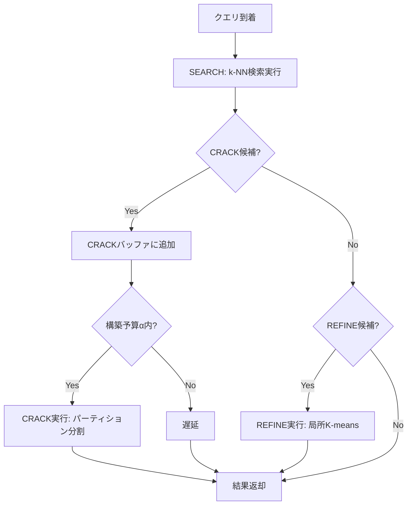

本記事は VLDB 2025論文 [Cracking Vector Search Indexes](https://www.vldb.org/pvldb/vol18/p3951-mageirakos.pdf) の解説記事です。

## 論文概要（Abstract）

大規模言語モデル（LLM）の知識を外部データで補完するRetrieval-Augmented Generation（RAG）では、ベクトルデータベースの近似最近傍探索（ANN）インデックスが検索品質を左右する。しかし現実の環境では、すべてのデータセットに事前にインデックスを構築することは現実的ではない。著者らは、クエリ実行の副産物としてインデックスを漸進的に構築する適応型パーティションベースインデックス**CrackIVF**を提案している。CrackIVFは小さなインデックスから開始し、クエリワークロードに応じて自律的に成長する。著者らは、従来手法がインデックス構築を完了する前に100万件以上のクエリに応答でき、初期化時間を10〜1000倍短縮できると報告している。

この記事は [Zenn記事: ベクトルDB書き込み性能徹底比較2026](https://zenn.dev/0h_n0/articles/c07ae2ade39a4e) の深掘りです。

## 情報源

- **会議名**: VLDB 2025（Proceedings of the VLDB Endowment, Vol. 18, No. 11）
- **年**: 2025
- **URL**: [https://www.vldb.org/pvldb/vol18/p3951-mageirakos.pdf](https://www.vldb.org/pvldb/vol18/p3951-mageirakos.pdf)
- **著者**: Vasilis Mageirakos, Bowen Wu, Gustavo Alonso（Systems Group, ETH Zurich）
- **DOI**: 10.14778/3749646.3749666
- **ソースコード**: [https://github.com/mageirakos/crack-ivf-vldb](https://github.com/mageirakos/crack-ivf-vldb)
- **ライセンス**: CC BY-NC-ND 4.0

## カンファレンス情報

**VLDBについて**: VLDB（Very Large Data Bases）は、データベースおよび大規模データ管理分野の最高峰国際会議の一つである。SIGMOD/PODSと並んでデータベース分野のトップ会議として広く認知されている。PVLDB（Proceedings of the VLDB Endowment）は継続的投稿を受け付けるジャーナル形式の採択プロセスを採用しており、本論文はPVLDB Vol. 18, No. 11（2025）に採録されている。Artifacts Available V1.1の認定を受けており、実験の再現性が確認されている。

## 背景と動機（Background & Motivation）

### なぜインデックス選定が問題になるのか

RAGシステムでは、非構造化データ（テキスト、画像、音声など）をベクトル埋め込みに変換し、ベクトルデータベースに格納する。著者らは、実世界のデータの80〜90%が非構造化データであり、その多くが「ダークデータ」として未活用のままであると指摘している（論文Section 1）。

こうしたデータを効率的に検索するためにはANNインデックスが必要だが、現実には以下の問題がある。

1. **インデックス構築の前払いコスト**: IVFFlat(16000)のような大規模インデックスの構築には、100万クエリに応答するよりも長い時間がかかる場合がある（論文Figure 1より）
2. **最適なパーティション数が事前に不明**: パーティション数を増やすとQPSは向上するが構築コストも増加する。将来のクエリ負荷が不明な時点で決定しなければならない
3. **クエリ分布の偏り**: オープンソースデータセットでも、80%のクエリが60%のパーティションにしかアクセスしない（論文Figure 2bより）。残りの85%のパーティションは事前構築のコストに見合わない

### 従来手法の限界

従来のパーティションベースIVFインデックスは、データセット全体にわたってK-meansクラスタリングを実行し、均一にパーティション代表ベクトルを配置する。これには2つの非効率性がある。

- **時間的非効率**: インデックス構築はクエリ処理と独立した前処理として行われる
- **空間的非効率**: アクセスされない領域にも均等に構築コストが配分される

## 主要な貢献（Key Contributions）

著者らは以下の3つの貢献を挙げている。

- **貢献1**: クエリ実行の副産物としてインデックスを漸進的に構築する**CrackIVF**の提案。事前のインデックス構築を不要にし、即座にクエリ応答を開始できる
- **貢献2**: インデックス構築の「いつ・どこで」を制御する**コストモデルとヒューリスティックルール**の設計。クエリ分布に追従してアクセス頻度の高い領域を優先的に構築する
- **貢献3**: 6つの標準データセットで、従来のIVFインデックスに対する**10〜1000倍の初期化時間短縮**と、パレートフロンティア上の収束を実験的に確認

## 技術的詳細（Technical Details）

### 3つの基本操作

CrackIVFのインデックス構築は、3つの操作の組み合わせとして実現される。



#### SEARCH（検索）

通常のIVF検索と同じく、$n_{\text{probe}}$個の最近傍パーティションを特定し、そのパーティション内のベクトルを走査してk近傍を返す。CrackIVFでは、この検索中に計算される距離情報をCRACKとREFINEの候補判定に再利用する。

#### CRACK（パーティション分割）

クエリベクトルを新しいパーティション代表として、周辺パーティションからベクトルを「盗む」操作である。具体的には、あるベクトルが現在のパーティション代表よりもクエリベクトルに近い場合、そのベクトルの所属をクエリベクトル側のパーティションに再割り当てする。

$$
\text{steal}(p) = \begin{cases} \text{true} & \text{if } d(p, q) < d(p, A_P^{\text{dyn}}(p)) \\
\text{false} & \text{otherwise}
\end{cases}
$$

ここで、
- $p$: データポイント
- $q$: クエリベクトル（新パーティション代表候補）
- $A_P^{\text{dyn}}(p)$: $p$の現在のパーティション代表
- $d(\cdot, \cdot)$: 距離関数（L2またはIP）

CRACK操作は**遅延実行**（lazy）である。まずバッファに蓄積され、構築予算に余裕がある場合にのみコミットされる。

#### REFINE（パーティション精錬）

アクセスされたローカル領域に対して、局所的なK-meansクラスタリングを実行する操作である。CRACKが新パーティション追加を担うのに対し、REFINEは既存パーティションの代表ベクトルの位置を改善する。

```python
def refine(C_local: list[int], state_dyn: State) -> State:
    """ローカル領域のパーティションを精錬する

    Args:
        C_local: ローカル領域のパーティションID群
        state_dyn: 現在のインデックス状態（動的）
    Returns:
        更新されたインデックス状態
    """
    P_local = get_points_in_partitions(C_local)

    # ローカルK-means: 代表ベクトルの再計算
    C_local_refined = local_kmeans(
        P_local,
        centroids=state_dyn.centroids[C_local],
        n_iter=state_dyn.n_iter,
        max_points=state_dyn.max_points,
    )

    # ポイントの再割り当て
    for p in P_local:
        new_assignment = nearest_centroid(p, C_local_refined)
        state_dyn.assignments[p] = new_assignment

    # 転置リスト・代表ベクトルの更新
    state_dyn.update_centroids(C_local, C_local_refined)
    return state_dyn
```

### コスト制御メカニズム

CrackIVFの鍵は、**インデックス構築にかける時間を制御するコストモデル**にある。

**パラメータ$\alpha$（構築予算比率）**: 全実行時間に対する構築操作（CRACK + REFINE）の許容比率を定義する。デフォルト値は$\alpha = 0.5$（50%）である。

$$
T_{\text{build}} + \hat{T}_{\text{CRACK}} \leq \alpha \cdot (T_{\text{build}} + T_{\text{search}} + \hat{T}_{\text{CRACK}})
$$

ここで、
- $T_{\text{build}}$: これまでの累計構築時間
- $T_{\text{search}}$: これまでの累計検索時間
- $\hat{T}_{\text{CRACK}}$: 次のCRACK操作の推定コスト

$\alpha$が小さいほどクエリ応答時間が短くなるが、インデックスの収束が遅くなる。論文Figure 8aでは$\alpha = 0.25$の場合、$\alpha = 0.75$と比較してインデックス構築が遅延するが最終的なQPS-Recall性能は同等であると報告されている。

**「どこで」の制御**: 4つのヒューリスティックパラメータ（`min_pts`, `pts_crack_thr`, `cv_max`, `size_prctl`）が、CRACKとREFINEの適用箇所を決定する。著者らは48通りのパラメータ×データセットの組み合わせのうち、最終インデックスに影響したのは15通りのみであり、デフォルト値で頑健な性能が得られると報告している。

### インデックス状態の管理

CrackIVFは2つの状態を同時に保持する。

$$
\text{State}_* = (A_P^*, D_P^*, H_C^*) \quad \text{where } * \in \{\text{dyn}, \text{true}\}
$$

- **dynamic state**（$\text{State}_{\text{dyn}}$）: バッファされた未コミットのCRACKを含む状態。クエリはこの状態に対して実行される
- **true state**（$\text{State}_{\text{true}}$）: コミット済みの確定状態。CRACKコミット時にdynamic stateと同期される

この2状態管理により、CRACKの遅延実行が可能になる。REFINEはtrue stateのみを更新するため、dynamic stateとの一貫性は自動的に保たれる。

## 実装のポイント（Implementation）

### FAISS上の実装

CrackIVFはMeta社が開発するFAISSライブラリのIVF拡張として実装されている。著者らは、FAISSの`.add()`操作を拡張し、SEARCH時に計算される距離情報と割り当て情報を中間結果として返すようにしている。

```python
import faiss
import numpy as np

def initialize_crackivf(
    data: np.ndarray,
    n_init_partitions: int = 100,
    alpha: float = 0.5,
) -> "CrackIVFIndex":
    """CrackIVFインデックスの初期化

    Args:
        data: ベクトルデータ (N x d)
        n_init_partitions: 初期パーティション数
        alpha: 構築予算比率 (0.0-1.0)
    Returns:
        初期化されたCrackIVFインデックス
    """
    d = data.shape[1]

    # 初期パーティション: ランダムに代表ベクトルを選択
    rng = np.random.default_rng(42)
    init_centroids = data[rng.choice(len(data), n_init_partitions, replace=False)]

    # FAISSのIVFFlat上に構築
    quantizer = faiss.IndexFlatL2(d)
    quantizer.add(init_centroids)
    index = faiss.IndexIVFFlat(quantizer, d, n_init_partitions)
    index.train(data[:min(len(data), 10000)])
    index.add(data)

    return CrackIVFIndex(
        index=index,
        alpha=alpha,
        state_dyn=State(assignments=index.invlists, ...),
        state_true=State(assignments=index.invlists, ...),
    )
```

### 実装上の注意点

- **初期パーティション数**: 著者らはすべての実験で100パーティションから開始しており、FAISSの16スレッド並列化を使うと、100パーティションでも1パーティションでも起動時間はほぼ同じ（差は約120ms）と報告している
- **nprobe設定**: CrackIVFとIVFFlatの両方で、Recall@10が常に90〜95%になるようにnprobeを設定している
- **シングルスレッド評価**: 本論文の実験はすべてシングルスレッドで実行されており、並列化による性能向上は別途検討が必要である

## Production Deployment Guide

### AWS実装パターン（コスト最適化重視）

CrackIVFの特性（事前構築不要、クエリ駆動構築、中断耐性）を活かしたAWS構成を示す。

| 規模 | 月間リクエスト | 推奨構成 | 月額コスト | 主要サービス |
|------|------------|---------|-----------|------------|
| **Small** | ~3,000 | Serverless | $50-150 | Lambda (2GB) + S3 + DynamoDB |
| **Medium** | ~30,000 | Hybrid | $300-800 | ECS Fargate (8GB×2) + ElastiCache + S3 |
| **Large** | 300,000+ | Container | $2,000-5,000 | EKS + r6i Spot + S3 |

**CrackIVF固有のコスト削減**:
- 事前インデックス構築用GPUインスタンスが不要（最大のメリット）
- Spot Instancesと高相性（中断時もクエリからインデックス再構築可能）
- $\alpha$パラメータの動的調整（ピーク時0.25 / オフピーク時0.75）

上記は2026年11月時点のAWS東京リージョン概算値。最新料金は[AWS料金計算ツール](https://calculator.aws/)で確認のこと。

### Terraformインフラコード（Small構成）

```hcl
resource "aws_s3_bucket" "vectors" {
  bucket = "crackivf-vector-store"
}

resource "aws_s3_bucket_server_side_encryption_configuration" "vectors" {
  bucket = aws_s3_bucket.vectors.id
  rule {
    apply_server_side_encryption_by_default { sse_algorithm = "aws:kms" }
  }
}

resource "aws_iam_role" "lambda_crackivf" {
  name = "lambda-crackivf-role"
  assume_role_policy = jsonencode({
    Version = "2012-10-17"
    Statement = [{ Action = "sts:AssumeRole", Effect = "Allow",
      Principal = { Service = "lambda.amazonaws.com" } }]
  })
}

resource "aws_lambda_function" "crackivf_search" {
  filename      = "crackivf_lambda.zip"
  function_name = "crackivf-ann-search"
  role          = aws_iam_role.lambda_crackivf.arn
  handler       = "index.handler"
  runtime       = "python3.12"
  timeout       = 60
  memory_size   = 2048
  environment {
    variables = {
      S3_BUCKET      = aws_s3_bucket.vectors.id
      CRACKIVF_ALPHA = "0.5"
      NPROBE         = "10"
    }
  }
}

resource "aws_dynamodb_table" "index_state" {
  name         = "crackivf-index-state"
  billing_mode = "PAY_PER_REQUEST"
  hash_key     = "dataset_id"
  attribute { name = "dataset_id"; type = "S" }
  ttl { attribute_name = "expire_at"; enabled = true }
}
```

### セキュリティ・運用

- **ネットワーク**: EKSはVPN経由、LambdaはVPC内配置
- **認証**: IAM最小権限、IRSA使用
- **暗号化**: S3/DynamoDB全てKMS、TLS 1.2以上
- **監視**: CloudWatch Logs InsightsでRecall@10推移とパーティション数の監視を推奨

### コスト最適化チェックリスト

- [ ] 事前インデックス構築用GPUインスタンスを排除
- [ ] Spot Instances積極活用（中断耐性あり）
- [ ] $\alpha$動的調整（ピーク0.25/オフピーク0.75）
- [ ] メモリ最適化インスタンス（r6i系）選択
- [ ] AWS Budgets設定（80%警告）
- [ ] Recall@10低下アラーム設定
- [ ] 未使用インデックスのS3ライフサイクル（30日削除）

## 実験結果（Results）

### 初期化時間の比較

著者らはSIFT10M（1000万ベクトル、128次元）での初期化時間を比較している。

| インデックス | 初期化時間 | CrackIVF比 |
|---|---|---|
| CrackIVF（100パーティション） | 約120ms | 1x |
| IVFFlat(1000) | ≈120ms × 100 | ~100x |
| IVFFlat(5000) | ≈120ms × 100 | ~100x |
| IVFFlat(16000) | ≈120ms × 1000 | ~1000x |
| BruteForce | 0ms（構築不要） | — |

論文Figure 4bより、SIFT10Mにおいて、IVFFlat(5000)の累積時間（構築+クエリ）は約10万クエリ時点でCrackIVFと交差し、IVFFlat(16000)は約100万クエリ時点で交差する。すなわち、CrackIVFは従来手法がインデックス構築を完了する前に10万〜100万件のクエリに応答できる。

### QPS vs Recall性能

論文Figure 3より、各データセットにおけるCrackIVFの最終性能（CrackIVF-END）を報告する。

| データセット | CrackIVF最終パーティション数 | Recall@10=0.9でのQPS比較 |
|---|---|---|
| Last.fm | 1264 | IVFFlat全構成比で約50%高いQPS |
| SIFT10M | 可変 | パレートフロンティア上に収束 |
| Glove50 | 可変 | パレートフロンティア上に収束 |
| Deep10M | 可変 | パレートフロンティア上に収束 |

著者らは、CrackIVF-ENDがすべてのデータセットでパレートフロンティア上またはその近傍に位置すると報告している。Last.fmではクエリ分布の偏りが大きく（高スキュー）、CrackIVFのアクセスパターン追従型構築が最も効果を発揮している。

### 構築コストの内訳

論文の実験結果によると、CrackIVFの構築操作は検索処理に対して非常に軽量である。

- CRACK操作: クエリトレース全体の**0.03%未満**
- REFINE操作: クエリトレース全体の**0.6%未満**
- CRACKはデータ移動（inverted list間のポイント再割り当て）が支配的
- REFINEは計算（局所K-means）が支配的

### AV-Treeとの比較

SIFT 1Mにおいて、既存の適応型インデックスAV-Tree（Lampropoulos et al., 2023）との比較結果が報告されている（論文Table 3）。

| インデックス | 累積時間（$10^0$クエリ） | 累積時間（$10^3$クエリ） | 累積時間（$10^6$クエリ） |
|---|---|---|---|
| IVF-1K | 12.57s | 14.48s | 1938.60s |
| IVF-5K | 178.17s | 179.93s | 1943.02s |
| AV-Tree | 0.08s | 75.43s | 5721.29s |
| CrackIVF | 1.10s | 55.33s | **1531.40s** |

AV-Treeは最初の10クエリではCrackIVFより高速だが、CrackIVFは100万クエリ時点でAV-Treeの3.7倍高速である。CrackIVFはIVF-1Kよりも最終的に高速であり、IVF-5Kの約1.3倍高速である。

## 実運用への応用（Practical Applications）

### Embedding Data Lakeでの活用

著者らがCrackIVFの主要な応用先として挙げているのが**Embedding Data Lake**（EDL）である。EDLとは、非構造化データをベクトル埋め込みとともにデータレイク上に格納し、ベクトルデータベースのプールでクエリを処理するアーキテクチャである。

EDLでは数百万のデータセットに対してインデックスを構築する必要があり、以下の理由からCrackIVFが適している。

1. **コールドデータへのアクセス**: ほとんどのデータセットはアクセス頻度が低い。事前にインデックスを構築するコストが回収できないケースが多い
2. **未知のデータセットへの初回アクセス**: CrackIVFはBruteForceから開始して自動的にインデックスを構築するため、新しいデータセットへの即座のアクセスが可能
3. **クエリ分布の偏り**: 実ワークロードではクエリが特定のデータ領域に集中するため、CrackIVFのアクセスパターン追従型構築が効率的

### RAGシステムへの適用

RAGシステムにおいて、ドキュメントの追加・更新が頻繁に発生する環境では、以下のパターンでCrackIVFが有用である。

- **新規ドキュメント追加時**: CrackIVFはデータの追加と同時にインデックスが適応するため、追加後即座に検索可能
- **インデックス再構築の回避**: 埋め込みモデルの切り替え時に全件再構築が不要。クエリ駆動でインデックスが再構築される
- **マルチテナント環境**: テナントごとに異なるクエリパターンがある場合、各テナントのアクセスパターンに最適化されたインデックスが自動構築される

## 関連研究（Related Work）

- **AV-Tree**（Lampropoulos et al., VLDB 2023）: ENN（Exact Nearest Neighbor）向けのツリーベース適応型インデックス。短命データ向けで最大1000クエリのワークロードを対象とし、CrackIVFとは規模とインデックスタイプが異なる
- **DeDrift**（Baranchuk et al., 2024）: データ分布シフトに対応してパーティション数を固定したまま分割・マージを行う。CrackIVFはパーティション数自体を増加させる
- **Quake**（SIGMOD 2025）: 動的ワークロード向けの適応型インデックスだが、挿入・削除によるメンテナンスをトリガーとする。CrackIVFはクエリのみをトリガーとする点が異なる

## まとめと今後の展望

**論文の主要な成果**:
- CrackIVFは、ベクトルインデックス構築をクエリ実行の「副産物」に変換するという発想の転換を実現した
- 6つの標準データセットで10〜1000倍の初期化時間短縮を達成し、パレート最適性能に漸近的に収束する
- 構築操作のオーバーヘッドはクエリトレース全体の1%未満であり、クエリ応答時間への影響は限定的である

**実務への示唆**:
- Embedding Data Lakeのように大量のデータセットを管理する環境では、CrackIVFのような遅延構築型インデックスが事前構築型よりも総コストで優れる可能性がある
- ベクトルDB選定において、書き込み性能だけでなく「インデックス構築戦略」も重要な判断軸として考慮すべきである

**今後の研究方向**:
- 著者らは、CrackIVFのアイデアをグラフベースインデックス（HNSW等）に拡張する可能性を示唆している
- データの挿入・削除を伴う動的ワークロードへの対応は今後の課題である

## 参考文献

- **Conference URL**: [https://www.vldb.org/pvldb/vol18/p3951-mageirakos.pdf](https://www.vldb.org/pvldb/vol18/p3951-mageirakos.pdf)
- **Code**: [https://github.com/mageirakos/crack-ivf-vldb](https://github.com/mageirakos/crack-ivf-vldb)
- **Related Zenn article**: [https://zenn.dev/0h_n0/articles/c07ae2ade39a4e](https://zenn.dev/0h_n0/articles/c07ae2ade39a4e)

---

:::message
この記事はAI（Claude Code）により自動生成されました。内容の正確性については論文原文で検証していますが、実際の利用時は[原論文](https://www.vldb.org/pvldb/vol18/p3951-mageirakos.pdf)もご確認ください。
:::
