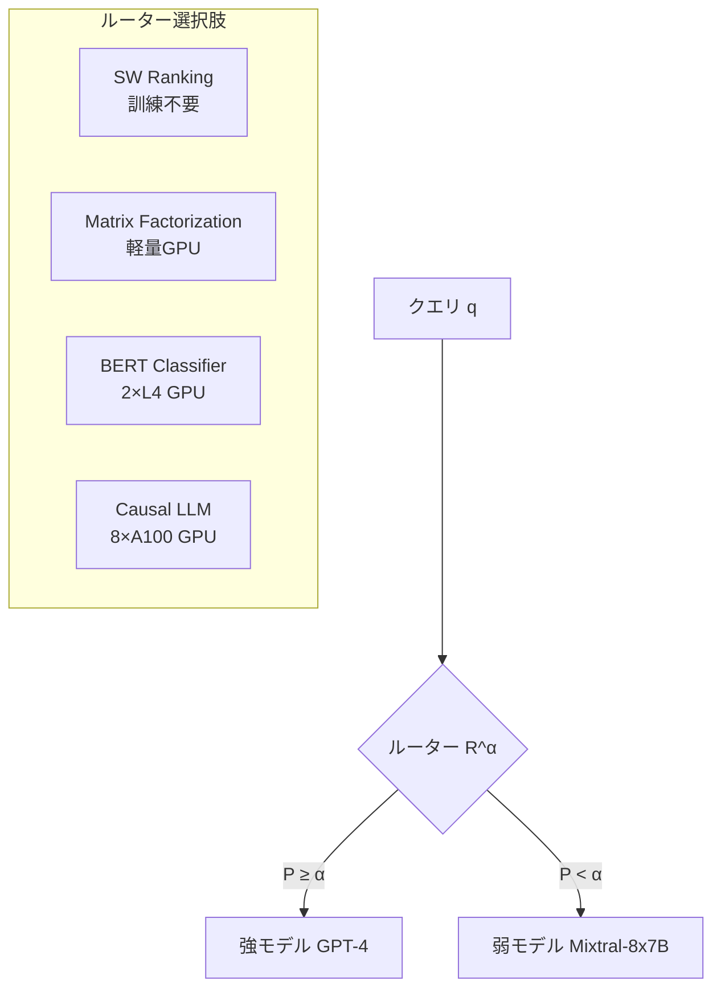

本記事は [RouteLLM: Learning to Route LLMs with Preference Data](https://arxiv.org/abs/2406.18665) の解説記事です。

この記事は [Zenn記事: Fargate 32vCPU×LiteLLMで社内LLMゲートウェイをサーバーレス構築する](https://zenn.dev/0h_n0/articles/13b5175e562a56) の深掘りです。

## 論文概要（Abstract）

RouteLLMは、LLMの推論コストと応答品質のトレードオフを最適化するルーティングフレームワークである。著者らは、各クエリに対して「強モデル」と「弱モデル」のどちらに振り分けるかを判断するルーターを、人間の嗜好データ（Chatbot Arenaの対戦ログ）から学習する手法を提案している。論文のTable 1によれば、MT-Benchにおいて強モデル（GPT-4）の呼び出し割合を最大75%削減しつつ、GPT-4の95%の品質（スコア8.8 / 9.3）を維持できると報告されている。コードはオープンソース（github.com/lm-sys/RouteLLM）として公開されており、LiteLLMなどのLLMゲートウェイに統合することで、社内LLM基盤のコスト最適化に直接活用できる。

## 情報源

- **会議名**: ICLR 2025（International Conference on Learning Representations）
- **年**: 2025
- **URL**: [https://arxiv.org/abs/2406.18665](https://arxiv.org/abs/2406.18665)
- **著者**: Isaac Ong\*, Amjad Almahairi\*（\*equal contribution）, Vincent Wu, Wei-Lin Chiang, Tianhao Wu, Joseph E. Gonzalez, M Waleed Kadous, Ion Stoica（UC Berkeley, Anyscale, Canva）
- **arXiv ID**: 2406.18665（v4, 2025年2月23日改訂）

## カンファレンス情報

**ICLR（International Conference on Learning Representations）について**: ICLRは機械学習分野の主要国際会議の1つであり、特に表現学習・深層学習の理論と応用をカバーしている。ICLRは査読がオープンレビュー形式で公開される点が特徴で、採択率は例年25〜30%程度である。RouteLLMはICLR 2025に採択されており、LLM推論の効率化に関する実用的な貢献が評価された。

## 背景と動機（Background & Motivation）

LLMの推論コストはモデルサイズに比例して増大する。論文中では、Claude 3 HaikuとClaude 3 Opusの間に100万出力トークンあたり$1.25対$75という50倍以上の価格差があることが示されている。すべてのクエリを最強モデルに送ると品質は最大化されるがコストが膨大になり、逆にすべてを安価なモデルに送るとコストは下がるが難しいクエリで品質が劣化する。

著者らは、この問題に対して既存のアプローチ（アンサンブルやカスケード方式）では複数モデルを呼び出すためコスト効率が悪いと指摘している。RouteLLMでは、各クエリに対して**1回のモデル呼び出し**のみを行い、ルーター自体の推論コストを最小化することを設計目標としている。

## 主要な貢献（Key Contributions）

- **貢献1**: Chatbot Arenaの人間嗜好データからルーターを学習するフレームワークの提案。ラベルスパース性（モデルペアごとの対戦データが0.1%未満）をモデルティアリングとデータ拡張で克服している
- **貢献2**: 4種類のルーターアーキテクチャ（類似度重み付きランキング、行列分解、BERTクラシファイア、因果LLMクラシファイア）の設計と比較評価
- **貢献3**: 学習済みルーターがモデルペアを変更しても再学習なしで汎化すること（Claude 3 Opus/Sonnet、Llama 3.1 70B/8B等）の実証

## 技術的詳細（Technical Details）

### 問題定式化

著者らは、LLMルーティングを以下のように定式化している。クエリ $q$ に対して、ルーター $R^\alpha(q)$ は強モデル勝利確率 $P(\text{win}_s \mid q)$ を推定し、閾値 $\alpha$ と比較して振り分けを決定する：

$$
R^\alpha(q) = \begin{cases} M_s & \text{if } P(\text{win}_s \mid q) \geq \alpha \\ M_w & \text{otherwise} \end{cases}
$$

ここで、
- $M_s$: 強モデル（例: GPT-4）
- $M_w$: 弱モデル（例: Mixtral-8x7B）
- $\alpha \in [0, 1]$: コスト閾値（高いほど弱モデルに多く振り分け、コスト削減が大きい）
- $P(\text{win}_s \mid q)$: クエリ $q$ において強モデルが弱モデルより良い応答を生成する確率

### 評価指標

著者らは以下の指標を定義している：

- **$c$（コスト）**: 強モデルへの呼び出し割合
- **PGR（Performance Gap Recovery）**: ルーターの品質回復率

$$
\text{PGR} = \frac{r(\text{router}) - r(\text{weak})}{r(\text{strong}) - r(\text{weak})}
$$

ここで $r(\cdot)$ は各方式のスコア（例: MT-Benchスコア）を表す。PGR = 1.0は強モデルと同等、PGR = 0.0は弱モデルと同等を意味する。

- **APGR（Area under PGR curve）**: コスト割合を10バケットに分割したPGR曲線の下側面積。ランダムルーターのAPGRは0.500である
- **CPT($x$%)**: PGRが$x$%に到達するために必要な最小の強モデル呼び出し割合

### 訓練データ

著者らは3種類のデータソースを組み合わせている：

1. **$D_{\text{arena}}$（Chatbot Arena）**: 約80,000件の対戦ログ。ラベルのスパース性（モデルペアごと0.1%未満）に対処するため、リーダーボードスコアの分散を最小化する動的計画法で64モデルを10ティアにクラスタリングし、上位2ティアを強クラス、3番目を弱クラスとしている
2. **$D_{\text{gold}}$（ゴールドラベル拡張）**: MMLU検証セットの約1,500問（訓練データの2%未満）。各モデルの回答を正解と照合してラベル付与
3. **$D_{\text{judge}}$（LLM判定拡張）**: Nectarデータセットから約120,000サンプル。GPT-4の応答とMixtral-8x7Bの応答をGPT-4ジャッジがデバイアシング付きで評価。コストは約$700

### ルーターアーキテクチャ



**1. 類似度重み付きランキング（SW Ranking）**

訓練不要のアプローチ。推論時に各訓練クエリ $q'$ との類似度で重み付けしたBradley-Terryモデルを解く：

$$
\omega' = \gamma^{1 + S(q, q')}
$$

$$
P(\text{win}_s) = \frac{1}{1 + e^{\xi_s - \xi_w}}
$$

ここで $S(q, q')$ はテキスト埋め込みの正規化コサイン類似度、$\gamma = 10$は減衰パラメータ、$\xi_s, \xi_w$はクエリごとに重み付き二値交差エントロピーで求めるBradley-Terry係数である。

**2. 行列分解（Matrix Factorization）**

双線形スコアリング関数を用いる：

$$
\delta(M, q) = \mathbf{w}_2^T(\mathbf{v}_m \odot (\mathbf{W}_1^T \mathbf{v}_q + \mathbf{b}))
$$

$$
P(\text{win}_s) = \sigma(\delta(M_s, q) - \delta(M_w, q))
$$

ここで $\mathbf{v}_m$ はモデル埋め込み、$\mathbf{v}_q$ はクエリ埋め込み（OpenAI text-embedding-3-small）、$\odot$ はアダマール積である。8GB GPUで約10エポック、バッチ64、学習率3e-4で学習される。

**3. BERTクラシファイア**

BERT-baseの[CLS]トークン表現にロジスティックヘッドを付与：

$$
P = \sigma(\mathbf{W} \cdot \mathbf{h}_{\text{CLS}} + b)
$$

2×L4 24GB GPUで約2,000ステップ、バッチ16、最大長512、学習率1e-5でファインチューニングする。

**4. 因果LLMクラシファイア**

Llama 3 8Bにプロンプトを与え、ラベルトークンを語彙に追加してsoftmaxで分類する。8×A100 80GBで約2,000ステップ、バッチ8、最大長2048、学習率1e-6で学習される。

## 実験結果（Results）

### MT-Bench

論文Table 1より、$D_{\text{arena}} + D_{\text{judge}}$で学習した行列分解ルーターが最良の結果を示している：

| ルーター | CPT(50%) | CPT(80%) | APGR |
|----------|----------|----------|------|
| ランダム | 49.03% | 78.08% | 0.500 |
| 行列分解 ($D_{\text{arena}} + D_{\text{judge}}$) | **13.40%** | **31.31%** | **0.802** |
| SW Ranking ($D_{\text{arena}} + D_{\text{judge}}$) | 23.21% | 36.04% | 0.759 |
| BERT ($D_{\text{arena}} + D_{\text{judge}}$) | 19.58% | 34.02% | 0.751 |

著者らは、MT-BenchスコアがCPT(50%)時点で8.8であり、GPT-4の9.3の**95%**に相当すると報告している。ランダムルーターと比較して、行列分解は強モデル呼び出しを**最大75%削減**（CPT(50%): 49.03% → 13.40%）できる。

### MMLU（5-shot）

論文Table 2より、$D_{\text{arena}} + D_{\text{gold}}$で学習した場合の結果：

| ルーター | CPT(50%) | CPT(80%) | APGR |
|----------|----------|----------|------|
| ランダム | 50.07% | 79.93% | 0.500 |
| SW Ranking ($D_{\text{arena}} + D_{\text{gold}}$) | **35.40%** | 71.55% | **0.603** |
| Causal LLM ($D_{\text{arena}} + D_{\text{gold}}$) | 35.49% | **70.31%** | 0.600 |

著者らは、MMLUスコアがCPT(50%)時点で75であり、GPT-4の81の**92%**に相当すると報告している。Arena単独データではルーターがランダム並みにしか動作しない（$D_{\text{arena}}$のみのAPGRは0.47〜0.52）が、わずか1,500問のゴールドラベル拡張でドメイン外汎化が改善される。

### GSM8K（8-shot）

論文Table 3より、$D_{\text{arena}} + D_{\text{judge}}$で学習した因果LLMルーターが最良：

| ルーター | CPT(50%) | CPT(80%) | APGR |
|----------|----------|----------|------|
| ランダム | 50.00% | 80.08% | 0.497 |
| Causal LLM ($D_{\text{arena}} + D_{\text{judge}}$) | **33.64%** | **63.26%** | **0.622** |

著者らは、GSM8Kスコアがランダム対比でGPT-4呼び出しを17%削減しつつ87%の品質を維持すると報告している。

### モデルペア転移

論文Section 5.2より、GPT-4 / Mixtral-8x7Bで学習したルーターを再学習なしで他のモデルペアに適用した結果が報告されている：

| モデルペア | ランダムCPT(80%) | SW Ranking CPT(80%) | 改善 |
|------------|-----------------|---------------------|------|
| Claude 3 Opus / Sonnet | 49.89% | 23.27% | +56.6% |
| Llama 3.1 70B / 8B | 47.52% | 21.18% | +49.8% |

著者らによれば、最良のルーターはランダムの約半分の強モデル呼び出しで同等の品質を達成している。

## 実装のポイント（Implementation）

### ルーター選択の指針

著者らの実験結果に基づくと、ユースケースに応じて異なるルーターが適している：

- **行列分解**: MT-Benchで最良のAPGR（0.802）。リソース要件が低く（8GB GPU）、推論も高速。**汎用的な第一選択**として適している
- **SW Ranking**: 訓練不要でCPUのみで動作。SW RankingのルーティングオーバーヘッドはGPT-4生成コストの0.4%以下と報告されている。ただし推論時に全訓練データとの類似度計算が必要
- **因果LLMクラシファイア**: GSM8Kで最良のAPGR（0.622）。数学的推論の難易度判定に強いが、8×A100の訓練コストと推論時のGPU要求が高い
- **BERTクラシファイア**: Arenaデータ単独では性能が低い（MT-BenchでAPGR 0.391）が、拡張データを加えると大幅に改善される（0.751）。BERTの推論は軽量だが、ファインチューニングが必須

### LiteLLMとの統合

RouteLLMのオープンソース実装は、OpenAI互換APIを提供するLiteLLMと組み合わせて使用できる。LiteLLMの`model_list`にstrong/weakモデルを定義し、RouteLLMのルーターをリクエストの前段に配置する構成が考えられる。

```python
from routellm.controller import Controller

client = Controller(
    routers=["mf"],  # 行列分解ルーター
    strong_model="gpt-4-1106-preview",
    weak_model="mixtral-8x7b",
)

response = client.chat.completions.create(
    model="router-mf-0.11593",  # 閾値αを含むモデル名
    messages=[{"role": "user", "content": query}],
)
```

閾値 $\alpha$ はモデル名に埋め込まれ、`router-{router_name}-{threshold}` の形式で指定する。閾値を高くするとコスト削減が大きくなるが、品質が低下するリスクがある。著者らは、閾値のキャリブレーションにはターゲットとするベンチマークの一部を使用することを推奨している。

## Production Deployment Guide

### AWS実装パターン（コスト最適化重視）

RouteLLMルーターをLiteLLMゲートウェイの前段に配置し、リクエスト単位でモデル選択を最適化する構成を示す。

**トラフィック量別の推奨構成**:

| 規模 | 月間リクエスト | 推奨構成 | 月額コスト目安 | 主要サービス |
|------|--------------|---------|-------------|------------|
| **Small** | ~3,000 (100/日) | Serverless | $50-200 | Lambda + Bedrock + DynamoDB |
| **Medium** | ~30,000 (1,000/日) | Hybrid | $400-1,200 | ECS Fargate (ルーター) + Bedrock |
| **Large** | 300,000+ (10,000/日) | Container | $2,000-6,000 | EKS + Karpenter + Bedrock Batch |

**Small構成の詳細**（月額$50-200）:
- **Lambda**: RouteLLMの行列分解ルーターは軽量（8GB GPU不要、CPU推論可能）。Lambda 1GB RAM、30秒タイムアウトで動作（$20/月）
- **Bedrock**: 強モデル（Claude Sonnet）と弱モデル（Claude Haiku）をルーター判定で切り替え。RouteLLMの論文結果に基づけば、強モデル呼び出しを50-75%削減でき、API課金を大幅に圧縮可能（$80-150/月）
- **DynamoDB**: ルーティング結果のログと埋め込みキャッシュ（$10/月）

**Medium構成の詳細**（月額$400-1,200）:
- **ECS Fargate**: RouteLLMルーター + LiteLLMプロキシを同一タスクに配置。Zenn記事で紹介されている2vCPU/4GB構成にルーターのオーバーヘッド分を加えて4vCPU/8GBを推奨（$80/月）
- **Bedrock**: ルーティングによる強モデル削減で$200-800/月（削減率はクエリ難易度分布に依存）
- **ElastiCache Redis**: 埋め込みキャッシュで同一クエリのルーター再計算を回避（$15/月）

**Large構成の詳細**（月額$2,000-6,000）:
- **EKS**: ルーターをGPU対応Pod（因果LLMルーター使用時）またはCPU Pod（行列分解ルーター使用時）にデプロイ
- **Karpenter**: ルーターPodとLiteLLMプロキシPodを別ノードプールで自動スケーリング
- **Bedrock Batch**: 非リアルタイム処理に50%割引のBatch APIを適用

**コスト削減テクニック**:
- RouteLLMルーターによる強モデル呼び出し50-75%削減（論文報告値）
- 埋め込みキャッシュで同一・類似クエリのルーター計算をスキップ
- Bedrock Prompt Cachingで30-90%のトークンコスト削減
- Spot Instances（EKS）/ Fargate Spotで計算コスト最大70%削減

**コスト試算の注意事項**:
- 上記は2026年11月時点のAWS ap-northeast-1（東京）リージョン料金に基づく概算値
- RouteLLMの削減率は論文のGPT-4 / Mixtral-8x7Bペアでの報告値であり、Bedrockモデルペアでは異なる可能性がある
- 最新料金は [AWS料金計算ツール](https://calculator.aws/) で確認を推奨

### Terraformインフラコード

**Small構成（Serverless）: Lambda + Bedrock + RouteLLMルーター**

```hcl
resource "aws_iam_role" "router_lambda" {
  name = "routellm-router-role"

  assume_role_policy = jsonencode({
    Version = "2012-10-17"
    Statement = [{
      Action = "sts:AssumeRole"
      Effect = "Allow"
      Principal = { Service = "lambda.amazonaws.com" }
    }]
  })
}

resource "aws_iam_role_policy" "bedrock_routing" {
  role = aws_iam_role.router_lambda.id

  policy = jsonencode({
    Version = "2012-10-17"
    Statement = [{
      Effect = "Allow"
      Action = [
        "bedrock:InvokeModel",
        "bedrock:InvokeModelWithResponseStream"
      ]
      Resource = [
        "arn:aws:bedrock:ap-northeast-1::foundation-model/anthropic.claude-sonnet-*",
        "arn:aws:bedrock:ap-northeast-1::foundation-model/anthropic.claude-haiku-*"
      ]
    }]
  })
}

resource "aws_lambda_function" "routellm_router" {
  filename      = "routellm_lambda.zip"
  function_name = "routellm-mf-router"
  role          = aws_iam_role.router_lambda.arn
  handler       = "handler.route_request"
  runtime       = "python3.12"
  timeout       = 60
  memory_size   = 1024

  environment {
    variables = {
      ROUTER_TYPE       = "mf"
      ROUTER_THRESHOLD  = "0.11593"
      STRONG_MODEL      = "anthropic.claude-sonnet-4-6"
      WEAK_MODEL        = "anthropic.claude-haiku-3-5"
      DYNAMODB_TABLE    = aws_dynamodb_table.routing_log.name
    }
  }
}

resource "aws_dynamodb_table" "routing_log" {
  name         = "routellm-routing-log"
  billing_mode = "PAY_PER_REQUEST"
  hash_key     = "request_id"

  attribute {
    name = "request_id"
    type = "S"
  }

  ttl {
    attribute_name = "expire_at"
    enabled        = true
  }
}

resource "aws_cloudwatch_metric_alarm" "routing_ratio" {
  alarm_name          = "routellm-strong-model-ratio-high"
  comparison_operator = "GreaterThanThreshold"
  evaluation_periods  = 3
  metric_name         = "StrongModelCalls"
  namespace           = "RouteLLM"
  period              = 3600
  statistic           = "Average"
  threshold           = 0.6
  alarm_description   = "強モデル呼び出し割合が60%超（閾値調整を検討）"
}
```

**Large構成（Container）: EKS + RouteLLMルーター + LiteLLMプロキシ**

```hcl
module "eks" {
  source  = "terraform-aws-modules/eks/aws"
  version = "~> 20.0"

  cluster_name    = "llm-routing-cluster"
  cluster_version = "1.31"

  vpc_id     = module.vpc.vpc_id
  subnet_ids = module.vpc.private_subnets

  cluster_endpoint_public_access = true
  enable_cluster_creator_admin_permissions = true
}

resource "kubectl_manifest" "routellm_deployment" {
  yaml_body = <<-YAML
    apiVersion: apps/v1
    kind: Deployment
    metadata:
      name: routellm-proxy
    spec:
      replicas: 2
      selector:
        matchLabels:
          app: routellm-proxy
      template:
        metadata:
          labels:
            app: routellm-proxy
        spec:
          containers:
          - name: routellm
            image: ghcr.io/lm-sys/routellm:latest
            ports:
            - containerPort: 6060
            env:
            - name: ROUTER_TYPE
              value: "mf"
            - name: STRONG_MODEL
              value: "bedrock/anthropic.claude-sonnet-4-6"
            - name: WEAK_MODEL
              value: "bedrock/anthropic.claude-haiku-3-5"
            resources:
              requests:
                cpu: "500m"
                memory: "1Gi"
              limits:
                cpu: "1000m"
                memory: "2Gi"
  YAML
}

resource "aws_budgets_budget" "llm_routing_monthly" {
  name         = "llm-routing-monthly"
  budget_type  = "COST"
  limit_amount = "6000"
  limit_unit   = "USD"
  time_unit    = "MONTHLY"

  notification {
    comparison_operator        = "GREATER_THAN"
    threshold                  = 80
    threshold_type             = "PERCENTAGE"
    notification_type          = "ACTUAL"
    subscriber_email_addresses = ["ops@example.com"]
  }
}
```

### セキュリティベストプラクティス

**本番環境での推奨設定**:

1. **ネットワークセキュリティ**: EKSの`cluster_endpoint_public_access = false`を設定し、VPN/Direct Connect経由に限定。RouteLLMルーターはPrivate Subnetに配置
2. **認証・認可**: BedrockアクセスはIAMロール経由（APIキー不要）。Zenn記事で紹介されているLiteLLMのタスクロール設計と同一パターン
3. **シークレット管理**: RouteLLMの閾値やモデル設定はSecrets Managerに格納。環境変数へのハードコード禁止
4. **監査**: ルーティング結果（どのクエリがどのモデルに振り分けられたか）をDynamoDBまたはS3に記録し、Athenaで分析可能にする

### 運用・監視設定

**CloudWatch Logs Insights クエリ**:

```sql
-- ルーティング比率の時系列分析
fields @timestamp, model_selected, routing_score
| stats count(*) as total,
        count_distinct(case when model_selected = 'strong' then request_id end) as strong_calls
        by bin(1h)
| filter total > 0
| sort @timestamp desc

-- コスト異常検知: 強モデル呼び出し率の急上昇
fields @timestamp, model_selected
| stats avg(case when model_selected = 'strong' then 1 else 0 end) as strong_ratio by bin(1h)
| filter strong_ratio > 0.6
```

**CloudWatch アラーム（Python）**:

```python
import boto3

cloudwatch = boto3.client('cloudwatch')

cloudwatch.put_metric_alarm(
    AlarmName='routellm-strong-ratio-spike',
    ComparisonOperator='GreaterThanThreshold',
    EvaluationPeriods=3,
    MetricName='StrongModelCallRatio',
    Namespace='RouteLLM',
    Period=3600,
    Statistic='Average',
    Threshold=0.5,
    ActionsEnabled=True,
    AlarmActions=['arn:aws:sns:ap-northeast-1:123456789:cost-alerts'],
    AlarmDescription='RouteLLM強モデル呼び出し率50%超過（閾値調整を検討）'
)

cloudwatch.put_metric_alarm(
    AlarmName='routellm-latency-spike',
    ComparisonOperator='GreaterThanThreshold',
    EvaluationPeriods=2,
    MetricName='RouterLatencyMs',
    Namespace='RouteLLM',
    Period=300,
    Statistic='p99',
    Threshold=100,
    AlarmDescription='RouteLLMルーターレイテンシP99が100ms超過'
)
```

**X-Ray トレーシング設定**:

```python
from aws_xray_sdk.core import xray_recorder, patch_all

patch_all()

@xray_recorder.capture('routellm_routing')
def route_and_invoke(query: str, router: Controller, threshold: float):
    xray_recorder.put_annotation('router_type', 'mf')
    xray_recorder.put_annotation('threshold', str(threshold))

    response = router.chat.completions.create(
        model=f"router-mf-{threshold}",
        messages=[{"role": "user", "content": query}],
    )

    model_used = response.model
    xray_recorder.put_annotation('model_selected', model_used)
    xray_recorder.put_metadata('token_count', response.usage.total_tokens)
    return response
```

**Cost Explorer自動レポート**:

```python
import boto3
from datetime import datetime, timedelta

ce = boto3.client('ce')

response = ce.get_cost_and_usage(
    TimePeriod={
        'Start': (datetime.now() - timedelta(days=1)).strftime('%Y-%m-%d'),
        'End': datetime.now().strftime('%Y-%m-%d')
    },
    Granularity='DAILY',
    Metrics=['UnblendedCost'],
    GroupBy=[
        {'Type': 'SERVICE', 'Key': 'SERVICE'},
    ]
)

for result in response['ResultsByTime']:
    for group in result['Groups']:
        service = group['Keys'][0]
        cost = float(group['Metrics']['UnblendedCost']['Amount'])
        if 'Bedrock' in service and cost > 500:
            print(f"⚠️ Bedrockコスト異常: ${cost:.2f}/日")
```

### コスト最適化チェックリスト

**アーキテクチャ選択**:
- [ ] ~100 req/日 → Lambda + Bedrock（Serverless）- $50-200/月
- [ ] ~1,000 req/日 → ECS Fargate + Bedrock（Hybrid）- $400-1,200/月
- [ ] 10,000+ req/日 → EKS + Spot + Bedrock Batch（Container）- $2,000-6,000/月

**RouteLLMルーター最適化**:
- [ ] 行列分解ルーター選択（最良のAPGR/コストバランス）
- [ ] 閾値 $\alpha$ のキャリブレーション（ターゲットベンチマークで検証）
- [ ] 埋め込みキャッシュ（Redis/DynamoDB）で同一クエリの再計算回避
- [ ] ルーティングログ分析による閾値の定期的チューニング

**LLMコスト削減**:
- [ ] RouteLLMによる強モデル呼び出し50-75%削減
- [ ] Bedrock Prompt Caching有効化で30-90%削減
- [ ] Bedrock Batch API使用（非リアルタイム処理）で50%削減
- [ ] モデルペア選択の最適化（コスト差が大きいペアほど効果大）

**リソース最適化**:
- [ ] ECS Fargate Spot活用で計算コスト最大70%削減
- [ ] Graviton（ARM64）でvCPU単価約20%削減
- [ ] Lambda: メモリサイズ最適化（CloudWatch Insights分析）
- [ ] ECS/EKS: アイドル時スケールダウン

**監視・アラート**:
- [ ] AWS Budgets: 月額予算設定（80%で警告）
- [ ] CloudWatch: 強モデル呼び出し率の監視（閾値超過でアラート）
- [ ] Cost Anomaly Detection: Bedrockコストの自動異常検知
- [ ] 日次コストレポート: SNS/Slackへ自動送信

**リソース管理**:
- [ ] DynamoDBルーティングログのTTL設定（30日）
- [ ] タグ戦略: 環境別（dev/staging/prod）でコスト可視化
- [ ] S3ログのライフサイクルポリシー（Glacier移行）
- [ ] 開発環境は夜間停止

## 実運用への応用（Practical Applications）

### LiteLLMゲートウェイとの統合

Zenn記事で紹介されているFargate上のLiteLLMゲートウェイにRouteLLMを統合することで、リクエスト単位のコスト最適化が可能になる。LiteLLMの`model_list`に複数のBedrockモデル（Claude Sonnet, Claude Haiku等）を定義し、RouteLLMルーターがクエリの難易度に応じてモデルを自動選択する構成が考えられる。

論文の結果に基づけば、MT-Benchで95%の品質を維持しながら強モデル呼び出しを75%削減できる可能性がある。ただし、これはGPT-4 / Mixtral-8x7Bペアでの報告値であり、Bedrockモデルペアでは事前の検証が必要である。

### 社内利用での閾値設計

社内LLMゲートウェイでは、部署やユースケースごとに異なる閾値 $\alpha$ を設定することが実用的である。例えば、顧客対応チャットボットには低い閾値（品質重視）、社内ドキュメント検索には高い閾値（コスト重視）を設定する。RouteLLMのコスト閾値はリクエストごとに変更可能であるため、LiteLLMのユーザー別設定と組み合わせた柔軟な運用が可能である。

### 制約と限界

- ルーターの学習にはChatbot Arenaデータが前提であり、ドメイン固有のクエリ（医療、法律等）では追加のファインチューニングが必要になる可能性がある
- 論文の実験はテキスト生成タスクが中心であり、コード生成やマルチモーダルタスクへの汎化は検証されていない
- ルーターの推論自体にレイテンシが加わる（SW Rankingで0.4%以下と報告されているが、因果LLMクラシファイアではGPU推論が必要）

## 関連研究（Related Work）

- **FrugalGPT**（Chen et al., 2023）: LLMのカスケード方式（安価なモデルから順に試行）を提案。RouteLLMは1回のモデル呼び出しで済む点で効率的だが、FrugalGPTはルーター学習が不要という利点がある
- **Hybrid LLM**（Ding et al., 2024）: BERTベースのルーターでクエリ難易度を判定する手法。RouteLLMは複数のルーターアーキテクチャを比較し、行列分解が最良であることを示した
- **Unify AI / Martian**: 商用のLLMルーティングサービス。論文の付録EではRouteLLMの行列分解ルーターがこれらのサービスと同等以上の性能を達成しつつ、強モデル呼び出しを最大40%削減できると報告されている

## まとめと今後の展望

RouteLLMは、LLMの推論コストと品質のトレードオフを最適化するための実用的なフレームワークである。著者らの実験によれば、行列分解ルーターが最も安定した性能を示し、MT-Benchで強モデル品質の95%を維持しながら呼び出し割合を75%削減できることが報告されている。

Zenn記事のFargate + LiteLLMゲートウェイにRouteLLMを統合することで、リクエスト単位のモデル選択を自動化し、コスト効率を高められる可能性がある。特に、LiteLLMの`model_list`に複数のBedrockモデルを登録し、RouteLLMの閾値をユーザー・ユースケースごとに設定する運用パターンは、社内LLM基盤のコスト最適化において有望なアプローチである。

今後の展望として、マルチモーダルモデルやコード生成タスクへの適用、ドメイン固有データでの閾値最適化、そしてLiteLLM公式プラグインとしての統合が期待される。

## 参考文献

- **Conference URL / arXiv**: [https://arxiv.org/abs/2406.18665](https://arxiv.org/abs/2406.18665)
- **OSDI/ICLR Proceedings**: [USENIX OSDI '24](https://www.usenix.org/conference/osdi24/presentation/fu)（初期版）/ ICLR 2025（採択版）
- **Code**: [https://github.com/lm-sys/RouteLLM](https://github.com/lm-sys/RouteLLM)
- **Related Zenn article**: [https://zenn.dev/0h_n0/articles/13b5175e562a56](https://zenn.dev/0h_n0/articles/13b5175e562a56)

---

:::message
この記事はAI（Claude Code）により自動生成されました。内容の正確性については論文原文で検証していますが、実際の利用時は[原論文](https://arxiv.org/abs/2406.18665)もご確認ください。
:::
