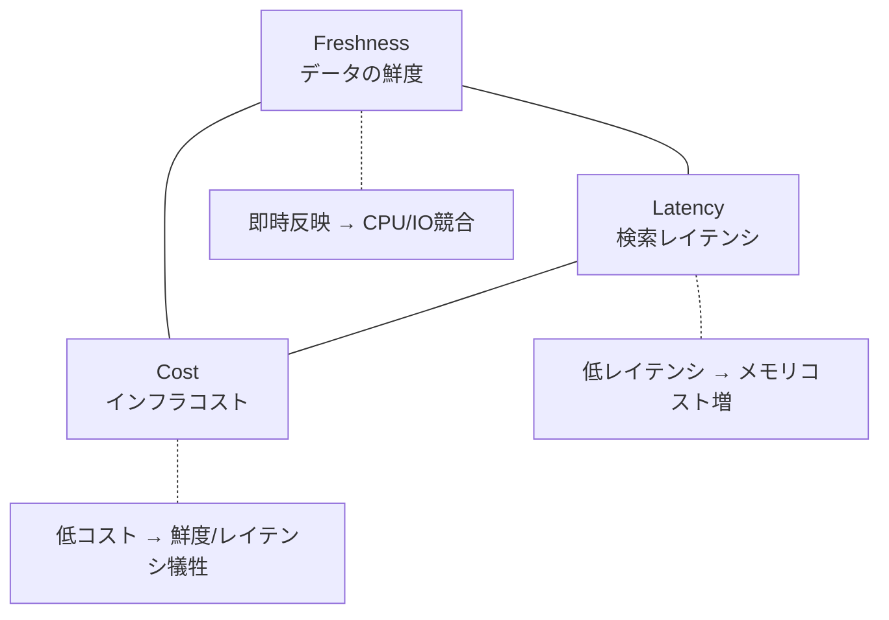
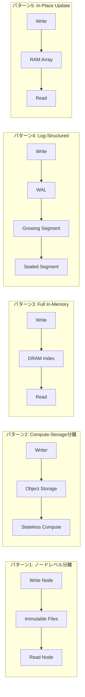
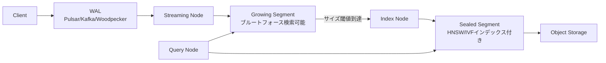

本記事は [https://arxiv.org/abs/2605.01260](https://arxiv.org/abs/2605.01260) の解説記事です。

## 論文概要（Abstract）

大規模検索エンジンでは、インデックスの鮮度を保つために頻繁な書き込み更新が必要だが、書き込み処理と検索処理がCPU・ディスクI/O・OSページキャッシュを奪い合うことで検索レイテンシが悪化する。著者らはこの「書き込み-読み取り競合（write-read contention）」問題に対する5つのデカップリングパターンを体系化し、Elasticsearch、LinkedIn Galene、Uber Sia、Quickwit、Alibaba Havenask、Algolia、Milvus、Vespaの実装を横断的に分析している。さらに、これらのパターンを統合した「ScaleSearch」アーキテクチャの設計を提示し、フィールド単位のルーティングによるスカラー更新の即時反映を提案している。

この記事は [Zenn記事: ベクトルDB書き込み性能徹底比較2026：リアルタイム更新×同時検索で変わる5製品の本番適性](https://zenn.dev/0h_n0/articles/c07ae2ade39a4e) の深掘りです。

## 情報源

- **arXiv ID**: 2605.01260
- **URL**: [https://arxiv.org/abs/2605.01260](https://arxiv.org/abs/2605.01260)
- **著者**: Xin Liang（corresponding）, Qing Yang, Wenru Qiu, Wenjie Mao, Tianyu Ma, Minghui Zhu, Nan Wang
- **発表年**: 2026
- **分野**: cs.DB
- **ページ数**: 8ページ（サーベイ論文）

## 背景と動機（Background & Motivation）

### なぜ書き込み-読み取り分離が必要なのか

Luceneベースの検索エンジン（Elasticsearch等）では、ドキュメントの書き込みが以下のパスで処理される。

1. **RAMバッファ**への書き込み
2. **Refresh**（デフォルト1秒間隔）でページキャッシュ上のセグメントを生成
3. **Flush**で`fsync`を実行し、トランザクションログをクリア
4. **バックグラウンドマージ**（TieredMergePolicy）でセグメントを統合

著者らは、この過程で3つの干渉経路が存在すると指摘している。

| 干渉経路 | 内容 | 影響 |
|---|---|---|
| CPU競合 | セグメントマージがCPUを占有 | 検索クエリの処理遅延 |
| I/O競合・ページキャッシュ退避 | マージ中のディスクI/Oがキャッシュを汚染 | 検索のキャッシュヒット率低下 |
| セグメント爆発 | 1秒ごとのRefreshでセグメントが累積 | 検索ファンアウトの増大 |

著者らによると、Elasticsearchの継続的な書き込みでは**書き込み増幅（Write Amplification）が10〜30倍**に達し（Qader et al., 2018の報告を引用）、セグメント数の増加により**検索スループットが2〜5倍劣化**するケースがあるとされている。

### Freshness-Latency-Cost Triangle

著者らは、すべてのアーキテクチャが直面するトレードオフを「**鮮度-レイテンシ-コストの三角形（Freshness-Latency-Cost Triangle）**」として定式化している。



各パターンはこの三角形の異なる辺を緩和することで、特定のワークロードに適した解を提供するという構図になっている。

## 主要な貢献（Key Contributions）

- **貢献1**: 大規模検索エンジンにおける書き込み-読み取り競合の体系的な分析と、5つのデカップリングパターンの分類
- **貢献2**: 8つの実システム（Elasticsearch、Galene、Sia、Quickwit、Havenask、Algolia、Milvus、Vespa）の実装に基づくパターンの検証
- **貢献3**: フィールド単位の更新ルーティングを核とする「ScaleSearch」アーキテクチャの提案

## 技術的詳細（Technical Details）：5つのデカップリングパターン

### パターン全体像



### パターン1: ノードレベル読み書き分離

書き込み専用ノード（Indexer）と読み取り専用ノード（Searcher）を物理的に分離し、インデックスをイミュータブルなファイルとして転送するパターンである。

**実装例:**

| システム | インジェスション | インデックス転送 | 伝播レイテンシ |
|---|---|---|---|
| LinkedIn Galene | Kafka経由で専用Indexerに投入 | Force-mergedスナップショットをSearcherに配布 | 分単位 |
| Uber Sia | Flinkジョブでセグメント構築 | HDFS/GCSに公開 | 分単位 |

著者らは、このパターンの最大の利点は「検索ノードにおいて書き込み処理が一切発生しないため、検索レイテンシが安定する」点にあると述べている。一方で、伝播レイテンシが分単位になるため、リアルタイム性が要求されるワークロードには不向きであるとしている。

**ベクトルDBへの示唆**: Qdrant、Milvus等のベクトルDBでも、読み取り専用レプリカを配置し、書き込みノードからインデックスを非同期に同期するアーキテクチャが実装されている。Zenn記事で触れたOptimizerによるCPU競合は、このパターンで根本的に解消できる。

### パターン2: Compute-Storage分離

インデックスの正本をオブジェクトストレージ（S3/GCS/Azure Blob）に置き、検索ノードをステートレスにするパターンである。

**実装例:**

| システム | ストレージ戦略 | 報告された効果 |
|---|---|---|
| Quickwit | 1〜15GBのイミュータブルスプリット、hotcacheフッター | フェッチ約60ms、8〜16MiBリクエスト |
| Elastic Stateless / Search AI Lake | バッチコミットフォーマット | クラウドI/O 100x削減（Psaroudakis et al.による報告） |
| Alibaba OpenStore / AliES | 共有OSSプール | ストレージ約50%削減、書き込みスループット70%向上（Alibaba報告） |

著者らは、このパターンの核心は「書き込み-読み取り干渉がゼロになり、水平スケーリングが容易になる」点だと述べている。ただし、コールドスタート時のレイテンシと、セグメント封印までの鮮度制約がトレードオフとして存在するとしている。

**ベクトルDBへの示唆**: Milvus 3.0のWoodpecker WALはまさにこのパターンを採用しており、オブジェクトストレージにログを永続化することでKafka/Pulsarへの依存を排除している。Pinecone Serverlessのアーキテクチャも、ログファーストでSlabをオブジェクトストレージに保持するCompute-Storage分離型である。

### パターン3: フルインメモリインデクシング

インデックス全体をDRAM上に保持し、検索パスからディスクI/Oを完全に排除するパターンである。

**実装例:**

| システム | 実装方式 | 更新方式 |
|---|---|---|
| Algolia | メモリマップされたC++構造、SIMD交差演算 | 世代構造 + アトミックスワップ |
| Typesense | Adaptive Radix Trie | 同期的Insert + Raft永続化 |

著者らは、Ximalaya（中国の音声プラットフォーム）の事例として、広告リコールシステムでRoaring Bitmapとタームレベルロックを導入し、レイテンシを「約50msから5ms未満に改善した」（2022年InfoQ記事からの引用）と報告している。

**トレードオフ**: 生データの3〜10倍のDRAMが必要であり、ノード再起動時の復旧に時間がかかる。

**ベクトルDBへの示唆**: pgvectorはPostgreSQLの共有バッファ（shared_buffers）にHNSWインデックスをキャッシュし、実質的にインメモリインデクシングに近い動作をするケースがある。ただし、EnterpriseDBの報告によると32クライアント・10億ベクトル規模ではI/Oバウンドになるため、このパターンだけではスケールしない。

### パターン4: ログ構造化書き込みパス

Write-Ahead Log（WAL）にまず書き込みを永続化し、インデックス構築を非同期に行うパターンである。ベクトルDBにおいて最も重要なパターンであり、著者らはMilvusの実装を詳細に分析している。



**Milvusの実装詳細:**

著者らは、Milvusの書き込みパスを以下のように分析している。

1. **WAL（Pulsar/Kafka、またはWoodpecker）** が唯一の信頼源（source of truth）であり、各ログエントリにTSOタイムスタンプが付与される
2. **Growing Segment**はメモリ上に存在し、WALからの書き込みが到達した時点で**ブルートフォース検索が可能**になる（サブ秒の可視化）
3. Growing Segmentがサイズ閾値に達すると、**Index Node**がHNSWまたはIVFインデックスを構築し、**Sealed Segment**としてオブジェクトストレージにフラッシュする
4. 4種類のワーカー（Streaming Node、Index Node、Query Node、Data Node）が独立にスケールする

**Havenaskの実装:**

Alibaba Havenask（HA3）は3つの構築モードを提供している。

| モード | 更新間隔 | 用途 |
|---|---|---|
| Full Build | 日次 | 全量再構築 |
| Incremental Build | 30〜60分 | 差分更新 |
| Real-time In-Process | リアルタイム | ストリーミング更新 |

著者らによると、Havenaskは単一マシンベンチマークでElasticsearch比4倍のQPSと4分の1のレイテンシを報告しているが、セットアップの詳細は記載されていない。

**ベクトルDBへの示唆**: Zenn記事で詳述したQdrantのWAL→Segment→Optimizerパイプラインもこのパターンに属する。Milvusとの違いは、QdrantではOptimizer（バックグラウンドマージ）と検索が同一ノードのCPU/IO/メモリを共有する点にある。

### パターン5: インプレース部分更新

スカラー属性（価格、在庫数、タグ等）をRAM上の前方配列に保持し、セグメント再構築なしで $O(1)$ で更新するパターンである。

**Vespa Protonの実装:**

著者らは、Vespaのアーキテクチャを以下のように分析している。

| コンポーネント | 役割 | 更新方式 |
|---|---|---|
| Attribute fields | スカラー属性をRAM配列に保持 | Copy-on-Writeによるインプレース更新 |
| Enum Store | 文字列/列挙値のデータストア | B-tree索引 |
| Incremental HNSW | テンソル属性のベクトルインデックス | グラフ全体の再構築なしに増分更新 |
| Transaction Log Service | 永続化ログ | シーケンシャル追記 |

著者らは、VespaのインクリメンタルHNSWがテンソル属性に対して「グラフ全体の再構築なしにベクトルインデックスを増分更新できる」点を評価している。

**ベクトルDBへの示唆**: Weaviateも同様に、HNSWグラフに対してインクリメンタルな更新を行うアーキテクチャを採用している。Zenn記事で述べたWeaviateの「非同期インデクシング」は、まさにこのパターンの延長線上にある。

## 実装のポイント（Implementation Guide）

### パターン選択の判断基準

著者らはTable 1で定性的な比較を提示しており、以下のようにワークロード特性に基づくパターン選択を推奨している。

| ワークロード | 推奨パターン | 理由 |
|---|---|---|
| ログ分析（書き込み大、読み取り少） | Compute-Storage分離 | アイドル時コストゼロ、バッチ書き込み最適 |
| Eコマース検索（リアルタイム価格更新） | インプレース部分更新 | スカラー属性の即時反映 |
| リアルタイムベクトル検索 | ログ構造化書き込みパス | Growing Segmentでサブ秒可視化 |
| 高可用性全文検索 | ノードレベル分離 | 検索レイテンシの安定性 |
| 低レイテンシ要件（P99 < 10ms） | フルインメモリ | ディスクI/O排除 |

### Growing Segment vs. Sealed Segmentモデル

ベクトルDBにおいて最も実用的なのはパターン4のGrowing/Sealedモデルであり、著者らはその設計トレードオフを以下のように整理している。

| 属性 | Growing Segment | Sealed Segment |
|---|---|---|
| 格納場所 | メモリ | オブジェクトストレージ |
| 検索方式 | ブルートフォース | ANN（HNSW / IVF） |
| 可視化速度 | サブ秒（WAL ack後即座） | インデックス構築完了後 |
| 検索効率 | 低い（線形スキャン） | 高い（近似最近傍） |
| イミュータビリティ | 可変 | 不変 |

著者らはこのモデルについて、論文のSection 5.2で「リアルタイムベクトル検索にはこのパターンが推奨される」と明記している。

## Production Deployment Guide

本論文はサーベイ論文であり実装コードは含まれないが、5つのデカップリングパターンをAWS上で実現する際の構成を整理する。

### AWS実装パターン（コスト最適化重視）

**書き込み-読み取り分離パターンの実装対応表**:

| パターン | AWS構成 | 月額目安 | 主要サービス |
|---|---|---|---|
| **ノードレベル分離** | Dedicated Writer + Reader EC2 | $500-2,000 | EC2 + MSK (Kafka) + EFS |
| **Compute-Storage分離** | Serverless + S3 | $100-500 | Lambda + S3 + CloudFront |
| **フルインメモリ** | High-Memory EC2 | $1,000-5,000 | r7g.4xlarge + ElastiCache |
| **ログ構造化（Milvus型）** | EKS + S3 | $300-1,500 | EKS + S3 + Woodpecker |
| **インプレース更新** | Amazon OpenSearch | $200-800 | OpenSearch Service |

**ベクトルDB書き込み負荷が高い環境での推奨構成**:

- **Small（~100 req/日）**: Amazon OpenSearch Serverless（$50-150/月）。書き込み-読み取り分離はサービス内部で自動管理される
- **Medium（~1,000 req/日）**: Milvus on EKS + S3（$300-800/月）。Growing SegmentとIndex Nodeを独立スケーリング
- **Large（10,000+ req/日）**: 専用Writer/Reader EC2クラスタ + MSK（$2,000-5,000/月）。ノードレベル分離でレイテンシ安定化

**コスト試算の注意事項**: 上記は2026年11月時点のAWS ap-northeast-1（東京）リージョン料金に基づく概算値です。実際のコストはトラフィックパターン、リージョン、バースト使用量により変動します。最新料金は [AWS料金計算ツール](https://calculator.aws/) で確認してください。

### Terraformインフラコード

**Milvus型ログ構造化パターン（EKS + S3）**:

```hcl
module "vpc" {
  source  = "terraform-aws-modules/vpc/aws"
  version = "~> 5.0"

  name = "milvus-vpc"
  cidr = "10.0.0.0/16"
  azs  = ["ap-northeast-1a", "ap-northeast-1c"]

  private_subnets = ["10.0.1.0/24", "10.0.2.0/24"]
  public_subnets  = ["10.0.101.0/24", "10.0.102.0/24"]

  enable_nat_gateway   = true
  single_nat_gateway   = true
  enable_dns_hostnames = true
}

module "eks" {
  source  = "terraform-aws-modules/eks/aws"
  version = "~> 20.0"

  cluster_name    = "milvus-cluster"
  cluster_version = "1.31"

  vpc_id     = module.vpc.vpc_id
  subnet_ids = module.vpc.private_subnets

  cluster_endpoint_public_access = true
  enable_cluster_creator_admin_permissions = true
}

resource "aws_s3_bucket" "milvus_storage" {
  bucket = "milvus-sealed-segments"
}

resource "aws_s3_bucket_server_side_encryption_configuration" "milvus_storage" {
  bucket = aws_s3_bucket.milvus_storage.id

  rule {
    apply_server_side_encryption_by_default {
      sse_algorithm = "aws:kms"
    }
  }
}

resource "aws_iam_role" "milvus_s3_access" {
  name = "milvus-s3-access"

  assume_role_policy = jsonencode({
    Version = "2012-10-17"
    Statement = [{
      Effect = "Allow"
      Principal = {
        Federated = module.eks.oidc_provider_arn
      }
      Action = "sts:AssumeRoleWithWebIdentity"
    }]
  })
}

resource "aws_iam_role_policy" "milvus_s3_policy" {
  role = aws_iam_role.milvus_s3_access.id

  policy = jsonencode({
    Version = "2012-10-17"
    Statement = [{
      Effect = "Allow"
      Action = [
        "s3:GetObject",
        "s3:PutObject",
        "s3:DeleteObject",
        "s3:ListBucket"
      ]
      Resource = [
        aws_s3_bucket.milvus_storage.arn,
        "${aws_s3_bucket.milvus_storage.arn}/*"
      ]
    }]
  })
}

resource "aws_budgets_budget" "milvus_monthly" {
  name         = "milvus-monthly-budget"
  budget_type  = "COST"
  limit_amount = "1500"
  limit_unit   = "USD"
  time_unit    = "MONTHLY"

  notification {
    comparison_operator        = "GREATER_THAN"
    threshold                  = 80
    threshold_type             = "PERCENTAGE"
    notification_type          = "ACTUAL"
    subscriber_email_addresses = ["ops@example.com"]
  }
}
```

### セキュリティベストプラクティス

**本番環境での推奨設定**:

1. **ネットワーク**: EKSの`cluster_endpoint_public_access = false`設定、VPN/Direct Connect経由アクセス
2. **認証**: IRSA（IAM Roles for Service Accounts）によるPod単位の最小権限
3. **シークレット**: Secrets Managerによる接続情報管理、ローテーション有効化
4. **暗号化**: S3/EBSにKMS暗号化、転送中はTLS 1.2以上必須
5. **監査**: CloudTrail全リージョン有効化、Config変更追跡

### 運用・監視設定

**CloudWatch Logs Insights クエリ（書き込みパス監視）**:

```sql
-- セグメントマージ頻度の監視
fields @timestamp, segment_id, merge_duration_ms
| stats count(*) as merge_count, avg(merge_duration_ms) as avg_merge_ms by bin(1h)
| filter merge_count > 10

-- Growing Segmentサイズ監視
fields @timestamp, segment_type, size_bytes
| filter segment_type = "growing"
| stats max(size_bytes) as max_growing_size by bin(5m)
```

**CloudWatch アラーム（書き込み-読み取り競合検知）**:

```python
import boto3

cloudwatch = boto3.client('cloudwatch')

cloudwatch.put_metric_alarm(
    AlarmName='write-read-contention-p99',
    ComparisonOperator='GreaterThanThreshold',
    EvaluationPeriods=2,
    MetricName='SearchLatencyP99',
    Namespace='Custom/VectorDB',
    Period=300,
    Statistic='Maximum',
    Threshold=200,
    AlarmDescription='検索P99レイテンシが200msを超過（書き込み競合の可能性）',
    AlarmActions=['arn:aws:sns:ap-northeast-1:123456789:ops-alerts']
)
```

### コスト最適化チェックリスト

**アーキテクチャ選択**:
- [ ] ワークロード分析に基づくデカップリングパターン選択
- [ ] 書き込み/読み取り比率の計測と最適パターンの照合
- [ ] スカラー更新とベクトル更新の分離検討

**リソース最適化**:
- [ ] EKS: Karpenter + Spot Instancesで最大90%削減
- [ ] S3: Intelligent-Tieringで自動コスト最適化
- [ ] Growing Segment: メモリサイズ閾値の適正化
- [ ] Sealed Segment: S3 Glacier移行ポリシー設定

**監視・アラート**:
- [ ] AWS Budgets: 月額予算設定（80%警告）
- [ ] CloudWatch: セグメントマージ頻度・P99レイテンシ監視
- [ ] Cost Anomaly Detection: 自動異常検知
- [ ] 日次レポート: SNS/Slack自動送信

## 実運用への応用（Practical Applications）

### ベクトルDBの書き込みパスへの示唆

著者らは、ベクトルインデックスの更新が「構造的に転置インデックスの更新よりも高コストである」と指摘しており、以下の理由を挙げている。

1. **グラフ構造の更新**: HNSWではノード追加時に近傍グラフの再接続が必要であり、転置インデックスのPostingリスト追記と比較して計算量が大きい
2. **次元数の影響**: ベクトルの次元数（768〜2560次元）が大きいほど、距離計算のコストが増大する
3. **量子化の再計算**: PQ（Product Quantization）やSQ（Scalar Quantization）を使用している場合、コードブックの更新が必要になるケースがある

### Zenn記事との関連

Zenn記事で分析した5製品の書き込みパスを、本サーベイの5パターンにマッピングすると以下のようになる。

| 製品 | 主要パターン | 補助パターン |
|---|---|---|
| Qdrant | パターン4（WAL→Segment→Optimizer） | ― |
| Milvus 3.0 | パターン4（Woodpecker WAL + Growing/Sealed） | パターン2（S3にSealed Segment保存） |
| pgvector | パターン3（shared_buffersでインメモリ検索） | ― |
| Weaviate | パターン5（HNSW増分更新） | パターン4（LSMストレージ） |
| Pinecone Serverless | パターン2（ログファースト + Slab on S3） | ― |

著者らの分析に基づくと、Milvusが複数パターンを組み合わせている点が特徴的であり、これが同時読み書きワークロードでのP99安定性に寄与している可能性がある。

### フィルタ付きベクトル検索の課題

著者らは、フィルタ付き近似最近傍検索（Filtered ANN）について「普遍的に満足できる解は存在しない」と指摘している（Section 7.1）。Lucene 9.3ではHNSWプレフィルタリング（LUCENE-10606）が追加され、VespaはフィルタHNSWを以前からサポートしている。Zenn記事で触れたWeaviateのACORNやPathSeerも、この課題に対するアプローチの一つである。

## 関連研究（Related Work）

- **Elasticsearch Tiered Node Roles**: Elasticの公式機能として、ノードを`data_hot`/`data_warm`/`data_cold`に分類し、書き込み負荷を`data_hot`に集約する。本サーベイのパターン1の簡易版。
- **Vexless（SIGMOD 2024）**: ステートレスなクラウドファンクションワーカーでベクトル検索を実行し、アイドル時コストをゼロにする。パターン2のサーバーレス拡張。
- **CXLメモリプーリング**: CXL（Compute Express Link）を使用して、単一ノードのDRAM制約を超えるインデックスサイズを実現する。Section 7.3で投機的に言及。

## まとめと今後の展望

著者らは以下の原則を結論として提示している。

> 「書き込みパスと読み取りパスは、システムスタックのすべてのレイヤーで分離されるべきである」

この原則は、Zenn記事で分析した5製品の書き込み性能差の根本原因を理解する上で有用である。同一ノードでOptimizer/マージと検索が競合するQdrantやpgvectorでは、パターン1（ノード分離）やパターン2（Compute-Storage分離）の導入を検討する価値がある。

**本サーベイの限界**:
- 独自のベンチマーク結果は含まれておらず、すべての数値は引用元に依存している
- ScaleSearchの性能主張（P99 50ms未満、サブ分鮮度）は設計目標であり、実測値ではない
- ベクトルDBの分析はMilvusに限定されており、Qdrant・pgvector・Weaviate・Pineconeの書き込みパスは対象外である

## 参考文献

- **arXiv**: [https://arxiv.org/abs/2605.01260](https://arxiv.org/abs/2605.01260)
- **Related Zenn article**: [https://zenn.dev/0h_n0/articles/c07ae2ade39a4e](https://zenn.dev/0h_n0/articles/c07ae2ade39a4e)
- **Elasticsearch Segment Merging**: [Lucene TieredMergePolicy](https://lucene.apache.org/core/)
- **Milvus WAL**: [https://milvus.io/blog/how-woodpecker-keeps-wal-writes-fast-and-retention-cheap-in-milvus-3-0.md](https://milvus.io/blog/how-woodpecker-keeps-wal-writes-fast-and-retention-cheap-in-milvus-3-0.md)
- **Vespa Proton**: [https://docs.vespa.ai/en/proton.html](https://docs.vespa.ai/en/proton.html)

---

> この記事はAI（Claude Code）により自動生成されました。内容の正確性については複数の情報源で検証していますが、実際の利用時は公式ドキュメントもご確認ください。
