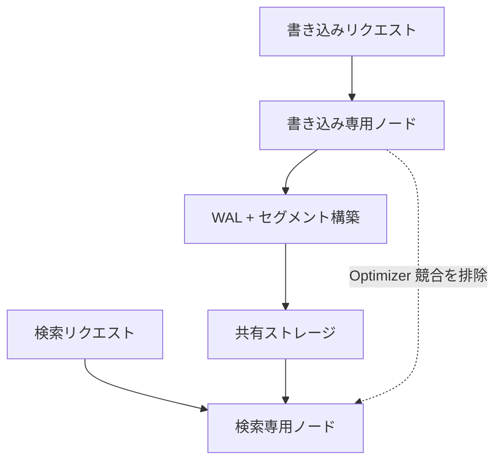

本記事は [https://arxiv.org/abs/2606.08950](https://arxiv.org/abs/2606.08950) の解説記事です。

## 論文概要（Abstract）

ベクトルデータベース（VDB）はクラウド環境向けに設計されているが、科学AI ワークロード（分子検索、気象軌跡検出、文献駆動仮説生成など）はHPC環境での実行を必要とする。著者らは Qdrant 1.16.2、Milvus 2.6.6、Weaviate 1.36.0 を2つの本番スーパーコンピュータ上で評価し、64ノード・256ワーカーまでスケーリングした。その結果、**コアを追加するとクエリスループットが最大30.67%低下する**という「スケーリングパラドックス」を発見し、ワーカー数を16倍（16→256）にしても性能向上は5.46倍にとどまると報告している。

この記事は [Zenn記事: ベクトルDB書き込み性能徹底比較2026](https://zenn.dev/0h_n0/articles/c07ae2ade39a4e) の深掘りです。

## 情報源

- **arXiv ID**: 2606.08950
- **URL**: [https://arxiv.org/abs/2606.08950](https://arxiv.org/abs/2606.08950)
- **著者**: Seth Ockerman (UW-Madison), Song Young Oh (UChicago), Amal Gueroudji, Philip Carns, Ian Foster, Robert Ross et al.（計15名、Argonne National Laboratory / UChicago / UW-Madison）
- **発表年**: 2026
- **分野**: cs.DC, cs.DB
- **ライセンス**: CC BY 4.0

## 背景と動機（Background & Motivation）

既存のベクトルDBベンチマーク（ANN-Benchmarks、VDBBenchなど）はクラウド環境を前提としており、データを一括ロード→インデックス構築→読み取り専用クエリという静的パターンで計測する。しかし科学計算ワークロードでは、以下の特性がクラウド前提とは大きく異なる。

- **データ規模**: 数十億〜数千億ベクトル（例: Pes2o-VEデータセットは8,845万ベクトル、2,560次元、843GB）
- **ハードウェア**: 高コア数CPU（Aurora: 104コア/ノード、1TB DDR5）、高速インターコネクト（8×25GB/s NIC）、共有ファイルシステム（Lustre/DAOS）
- **ワークロード**: 連続的なストリーミング挿入と同時検索が発生

著者らは、クラウド向けに最適化されたVDBをHPC環境に持ち込むと、設計上の前提が崩れ、**リソースを増やしても性能が低下する**という逆説的な現象が起きることを実証した。

## 主要な貢献（Key Contributions）

- **貢献1**: 3つの主要VDB（Qdrant・Milvus・Weaviate）をHPCスーパーコンピュータ上で体系的に評価した初の研究
- **貢献2**: 挿入スループット・インデックス構築時間・同時読み書き性能・マルチノードスケーリングを包括的に計測
- **貢献3**: 「スケーリングパラドックス」（コア追加による性能低下）のメカニズムを、メモリストール・セグメント管理・ロック競合の3要因に分解して分析
- **貢献4**: 新規データセット Pes2o-VE（Qwen3-Embedding-4Bで生成した科学論文埋め込み）をリリース
- **貢献5**: HPC向けベクトルDB設計のガイドラインを提示

## 技術的詳細（Technical Details）

### 挿入スループットの比較

著者らは、単一ワーカーおよびマルチワーカー構成での挿入スループットを計測している（論文Section V-Aより）。

**単一ワーカーでの挿入スループット（Pes2o-VEデータセット、Aurora）:**

| 製品 | クライアント数 | 挿入スループット (vec/s) | 備考 |
|---|---|---|---|
| Qdrant | 4 | 37,218 | 4クライアント以降はWAL競合で伸びず |
| Milvus | 32 | 47,236 | — |
| Weaviate | 32 | 31,859 | — |

著者らは、Qdrantで WALシャードを32に増やすと、32クライアント時に223,843 vec/sまで向上すると報告している。同条件でMilvusは138,860 vec/sを記録した。

**マルチワーカーでの挿入スループット:**

| 製品 | ピーク性能 (vec/s) | ピーク時のワーカー数 | 備考 |
|---|---|---|---|
| Qdrant | 489,213 | 32ワーカー | サブリニアにスケール |
| Weaviate | 160,551 | 32ワーカー | サブリニアにスケール |
| Milvus | 61,344 | 16（proxy + streaming node） | **16を超えると性能低下** |

著者らは、Milvusのバルクインサート（WALをバイパスし、メモリバックのMinIOを使用）では83,042 vec/sに達したと報告している。これはWALがボトルネックになっていることを示唆する。

著者らは、最良の挿入スループットでもインターコネクトの理論容量（25GB/sリンクあたり約260万 Pes2o-VEベクトル/秒）を大幅に下回っており、**ストレージレイテンシ（WALとLustre）がネットワークではなく挿入性能を支配している**と結論づけている。

### 同時読み書きワークロードの性能劣化

論文Table VIIでは、5百万ベクトル挿入後にクエリと挿入を同時実行した場合の性能劣化を計測している。

**Pes2o-VEデータセットでの同時読み書き性能（論文Table VIIより）:**

| 製品 | パターン | QPS | 平均レイテンシ (ms) | P99 (ms) |
|---|---|---|---|---|
| Milvus | ベースライン | 442.49 ± 4.34 | 72.23 ± 0.71 | 99.50 ± 2.46 |
| Milvus | 同時読み書き | 395.54 ± 8.69 | 81.05 ± 1.81 | 145.16 ± 17.51 |
| Weaviate | ベースライン | 7,853.42 ± 151.47 | 4.07 ± 0.08 | 5.57 ± 0.11 |
| Weaviate | 同時読み書き | 4,430.65 ± 248.48 | 7.41 ± 0.42 | 36.41 ± 1.56 |
| Qdrant | ベースライン | 751.42 ± 25.13 | 42.56 ± 1.40 | 59.15 ± 1.50 |
| Qdrant | 同時読み書き | 355.13 ± 13.33 | 90.12 ± 3.45 | 201.91 ± 20.18 |

著者らの分析によると、平均的なスループット低下率はMilvus 23.44%、Weaviate 38.37%、Qdrant 50.57%であった。P99レイテンシの平均増加率はPes2o-VEで280%、Yandex-T2Iで345%に達する。

劣化の3つのメカニズムとして、以下が報告されている：

1. **未インデックスセグメントの全探索**: MilvusとQdrantは新規挿入データをインデックス構築前にブルートフォーススキャンで検索する
2. **HNSWグラフの同時更新**: Weaviateはクエリ処理中にHNSWグラフを更新するため、CPUとメモリ帯域が競合する
3. **ロック競合**: インデックス状態の変更時にクエリがブロックされる

### スケーリングパラドックス

著者らは、コア数を増やした場合のクエリ性能を計測し、以下の「パラドックス」を報告している（論文Section V-C2より）。

**Milvusのコアスケーリング特性:**

$$
\text{IPC} = \frac{\text{Retiring cycles}}{\text{Total cycles}} \quad \xrightarrow{32 \to 208 \text{ cores}} \quad 0.54 \to 0.14
$$

- メモリストールサイクルが65.3%から85.23%に増加
- リタイアリングサイクルが9.1%から3.6%に低下
- 6構成中4構成で32コア時にQPSがピーク

ここで、
- $\text{IPC}$: Instructions Per Cycle（1サイクルあたりの命令実行数）
- $\text{Retiring cycles}$: 実際に命令を完了しているサイクルの割合

著者らは、ベクトル検索の性能がメモリ帯域にバウンドされているため、コアを増やしてもメモリアクセスの競合が増加し、むしろ性能が低下すると説明している。

**Weaviateのマルチノードスケーリング**: 4ノードでQPSがピークに達し、それ以降は低下する。マージワーカーが28〜50%のCPUを消費する一方、他のワーカーは10〜15%にとどまり、負荷の偏りが顕著である。

### インデックス構築時間

論文Table IVでは、10百万ポイントのインデックス構築時間が報告されている。

| 製品 | Pes2o-VE 10M (Aurora CPU) | Yandex-T2I 10M (Aurora CPU) |
|---|---|---|
| Milvus | 691秒 | 110秒 |
| Qdrant | 845秒 | 131秒 |
| Weaviate | 19,457秒 | 5,951秒 |

GPU インデクシング（Polaris、A100×4）では、Pes2o-VEで10.04倍、Yandex-T2Iで3.86倍の高速化が報告されている。高次元（2,560次元）のPes2o-VEでGPUの効果がより大きいのは、距離計算のベクトル演算がGPUのSIMD並列性を効果的に活用できるためである。

### 書き込み増幅

著者らは、Milvusで95GBのPes2o-VEサブセットをLustreに書き込んだ場合、ストレージ使用量が266GBに膨張する（約2.8倍の書き込み増幅）と報告している。この書き込み増幅は、WALの二重書き込み、セグメントのマージ、インデックス構造の重複保持などが原因である。

## 実装のポイント（Implementation）

### WALボトルネックの回避

著者らの結果から、WALがHPC環境での挿入ボトルネックになることが明らかになった。QdrantでWALシャードを32に増やすと、挿入スループットが37,218 vec/sから223,843 vec/sに向上した（約6倍）。本番環境では以下が推奨される：

```python
from qdrant_client import QdrantClient
from qdrant_client.models import OptimizersConfigDiff

client = QdrantClient(url="http://localhost:6333")

client.update_collection(
    collection_name="documents",
    optimizers_config=OptimizersConfigDiff(
        max_optimization_threads=2,
        indexing_threshold=50000,
    ),
)
```

### コアカウントの最適化

著者らは「より多くのコア = より良い性能」という仮定は誤りであり、コア数をスイープして最適値を見つけることを推奨している。Milvusでは32コア前後が最適であり、それ以上ではメモリストールが支配的になる。

### セグメント数のトレードオフ

Qdrantでセグメント数を1から8に増やすと、recall@10が0.962から0.9854に改善するが、検索時間は4.19秒から22.65秒に増加する。セグメント数は精度と速度のトレードオフを制御する隠れたチューニングパラメータである。

## Production Deployment Guide

### AWS実装パターン（コスト最適化重視）

本論文の知見を踏まえ、ベクトルDB書き込みワークロードのAWS構成を以下に示す。

| 規模 | 月間リクエスト | 推奨構成 | 月額コスト | 主要サービス |
|---|---|---|---|---|
| **Small** | ~3,000 (100/日) | Serverless | $50-150 | Lambda + OpenSearch Serverless |
| **Medium** | ~30,000 (1,000/日) | Hybrid | $400-900 | ECS Fargate + OpenSearch + ElastiCache |
| **Large** | 300,000+ (10,000/日) | Container | $2,500-6,000 | EKS + Karpenter + EC2 Spot + 専用VDB |

**Small構成の詳細** (月額$50-150):
- **Lambda**: 1GB RAM, 60秒タイムアウト ($20/月)
- **OpenSearch Serverless**: ベクトル検索コレクション ($60/月、2 OCU最小)
- **DynamoDB**: メタデータストア On-Demand ($10/月)
- **CloudWatch**: 基本監視 ($5/月)

**Medium構成の詳細** (月額$400-900):
- **ECS Fargate**: 1 vCPU, 2GB RAM × 2タスク ($80/月)
- **OpenSearch**: r6g.large.search × 2ノード ($340/月)
- **ElastiCache Redis**: cache.t3.micro ($15/月)
- **ALB**: ($20/月)

**Large構成の詳細** (月額$2,500-6,000):
- **EKS**: コントロールプレーン ($72/月)
- **EC2 Spot**: r6i.2xlarge × 2-4台 (平均$400/月)
- **Karpenter**: 自動スケーリング（追加コストなし）
- **Qdrant/Milvus**: セルフホスト（EC2コストに含む）
- **S3**: セグメントストレージ ($30/月)
- **CloudWatch + X-Ray**: 詳細監視 ($100/月)

**論文の知見に基づくコスト削減テクニック**:
- 本論文の結果より、コア数を32前後に制限することでメモリストールを回避し、コスト対効果が最適化される
- Spot Instances使用で最大90%削減（EKS + Karpenter）
- WALシャード数の最適化でスループットを最大6倍改善（追加コストなし）

**コスト試算の注意事項**: 上記は2026年11月時点のAWS ap-northeast-1（東京）リージョン料金に基づく概算値です。最新料金は [AWS料金計算ツール](https://calculator.aws/) で確認してください。

### Terraformインフラコード

**Small構成 (Serverless): Lambda + OpenSearch Serverless**

```hcl
module "vpc" {
  source  = "terraform-aws-modules/vpc/aws"
  version = "~> 5.0"

  name = "vectordb-vpc"
  cidr = "10.0.0.0/16"
  azs  = ["ap-northeast-1a", "ap-northeast-1c"]
  private_subnets = ["10.0.1.0/24", "10.0.2.0/24"]

  enable_nat_gateway   = false
  enable_dns_hostnames = true
}

resource "aws_iam_role" "lambda_vectordb" {
  name = "lambda-vectordb-role"

  assume_role_policy = jsonencode({
    Version = "2012-10-17"
    Statement = [{
      Action    = "sts:AssumeRole"
      Effect    = "Allow"
      Principal = { Service = "lambda.amazonaws.com" }
    }]
  })
}

resource "aws_iam_role_policy" "aoss_access" {
  role = aws_iam_role.lambda_vectordb.id

  policy = jsonencode({
    Version = "2012-10-17"
    Statement = [{
      Effect   = "Allow"
      Action   = ["aoss:APIAccessAll"]
      Resource = "arn:aws:aoss:ap-northeast-1:*:collection/*"
    }]
  })
}

resource "aws_lambda_function" "vectordb_handler" {
  filename      = "lambda.zip"
  function_name = "vectordb-write-handler"
  role          = aws_iam_role.lambda_vectordb.arn
  handler       = "index.handler"
  runtime       = "python3.12"
  timeout       = 60
  memory_size   = 1024

  environment {
    variables = {
      AOSS_ENDPOINT    = aws_opensearchserverless_collection.vectors.collection_endpoint
      WAL_SHARD_COUNT  = "32"
      MAX_BATCH_SIZE   = "100"
    }
  }
}

resource "aws_dynamodb_table" "metadata" {
  name         = "vectordb-metadata"
  billing_mode = "PAY_PER_REQUEST"
  hash_key     = "vector_id"

  attribute {
    name = "vector_id"
    type = "S"
  }

  ttl {
    attribute_name = "expire_at"
    enabled        = true
  }
}

resource "aws_cloudwatch_metric_alarm" "lambda_duration" {
  alarm_name          = "vectordb-lambda-duration-spike"
  comparison_operator = "GreaterThanThreshold"
  evaluation_periods  = 1
  metric_name         = "Duration"
  namespace           = "AWS/Lambda"
  period              = 3600
  statistic           = "Sum"
  threshold           = 100000
  alarm_description   = "Lambda実行時間異常（コスト急増の可能性）"

  dimensions = {
    FunctionName = aws_lambda_function.vectordb_handler.function_name
  }
}
```

**Large構成 (Container): EKS + Karpenter + Spot Instances**

```hcl
module "eks" {
  source  = "terraform-aws-modules/eks/aws"
  version = "~> 20.0"

  cluster_name    = "vectordb-cluster"
  cluster_version = "1.31"

  vpc_id     = module.vpc.vpc_id
  subnet_ids = module.vpc.private_subnets

  cluster_endpoint_public_access = true
  enable_cluster_creator_admin_permissions = true
}

resource "kubectl_manifest" "karpenter_provisioner" {
  yaml_body = <<-YAML
    apiVersion: karpenter.sh/v1
    kind: NodePool
    metadata:
      name: vectordb-spot
    spec:
      template:
        spec:
          requirements:
            - key: karpenter.sh/capacity-type
              operator: In
              values: ["spot"]
            - key: node.kubernetes.io/instance-type
              operator: In
              values: ["r6i.2xlarge", "r6i.4xlarge"]
          limits:
            cpu: "64"
            memory: "256Gi"
      disruption:
        consolidationPolicy: WhenEmpty
        consolidateAfter: 30s
  YAML
}

resource "aws_budgets_budget" "vectordb_monthly" {
  name         = "vectordb-monthly-budget"
  budget_type  = "COST"
  limit_amount = "6000"
  limit_unit   = "USD"
  time_unit    = "MONTHLY"

  notification {
    comparison_operator        = "GREATER_THAN"
    threshold                  = 80
    threshold_type             = "PERCENTAGE"
    notification_type          = "ACTUAL"
    subscriber_email_addresses = ["ops@example.com"]
  }
}
```

### 運用・監視設定

**CloudWatch Logs Insights クエリ**:

```sql
-- 挿入スループット監視: 1時間あたりの挿入ベクトル数
fields @timestamp, vectors_inserted, insert_latency_ms
| stats sum(vectors_inserted) as total_inserted,
        avg(insert_latency_ms) as avg_latency
  by bin(1h)
| filter total_inserted > 0

-- P99レイテンシ監視: 同時読み書き時の劣化検知
fields @timestamp, query_latency_ms, concurrent_writes
| stats pct(query_latency_ms, 99) as p99 by bin(5m)
| filter concurrent_writes > 0
```

**CloudWatch アラーム（P99劣化検知）**:

```python
import boto3

cloudwatch = boto3.client('cloudwatch')

cloudwatch.put_metric_alarm(
    AlarmName='vectordb-p99-degradation',
    ComparisonOperator='GreaterThanThreshold',
    EvaluationPeriods=2,
    MetricName='QueryP99Latency',
    Namespace='VectorDB/Performance',
    Period=300,
    Statistic='Average',
    Threshold=200,
    ActionsEnabled=True,
    AlarmActions=['arn:aws:sns:ap-northeast-1:123456789:vectordb-alerts'],
    AlarmDescription='P99レイテンシ200ms超過（同時書き込みによる劣化の可能性）'
)
```

**X-Ray トレーシング設定**:

```python
from aws_xray_sdk.core import xray_recorder, patch_all

patch_all()

@xray_recorder.capture('vector_insert')
def insert_vectors(vectors: list[dict], collection: str) -> dict:
    xray_recorder.put_annotation('collection', collection)
    xray_recorder.put_annotation('batch_size', len(vectors))
    xray_recorder.put_metadata('vector_dim', len(vectors[0]['embedding']))

    result = client.upsert(collection_name=collection, points=vectors, wait=True)

    xray_recorder.put_metadata('insert_latency_ms', result.elapsed_ms)
    return result
```

### コスト最適化チェックリスト

**アーキテクチャ選択（本論文の知見を反映）**:
- [ ] ~100 req/日 → Lambda + OpenSearch Serverless - $50-150/月
- [ ] ~1,000 req/日 → ECS Fargate + OpenSearch - $400-900/月
- [ ] 10,000+ req/日 → EKS + Spot + セルフホストVDB - $2,500-6,000/月

**リソース最適化（論文結果に基づく推奨）**:
- [ ] CPUコア数を32前後に制限（メモリストール回避、論文Section V-C2）
- [ ] Spot Instances優先（最大90%削減、Karpenter自動管理）
- [ ] WALシャード数を最適化（Qdrant: 32シャードで6倍向上）
- [ ] Lambda: メモリサイズ1GB以上（ベクトル演算のため）
- [ ] ECS/EKS: アイドルタイムのスケールダウン

**書き込み性能最適化（論文知見の適用）**:
- [ ] バルクインサートAPIの活用（WALバイパスで1.4倍向上、Milvus）
- [ ] セグメントサイズ閾値の調整（精度vs速度トレードオフ）
- [ ] Optimizer スレッド数の制限（検索レイテンシ安定化）
- [ ] 書き込み増幅の監視（2.8倍以上で警告）

**監視・アラート**:
- [ ] AWS Budgets: 月額予算設定（80%で警告、100%でアラート）
- [ ] CloudWatch: P99レイテンシの同時読み書き劣化検知
- [ ] Cost Anomaly Detection: 自動異常検知
- [ ] 日次コストレポート: SNS/Slackへ自動送信

**リソース管理**:
- [ ] 未使用リソース削除: Trusted Advisor活用
- [ ] タグ戦略: 環境別（dev/staging/prod）でコスト可視化
- [ ] ライフサイクルポリシー: S3古いセグメント自動削除（30日）
- [ ] 開発環境: 夜間停止（Auto Start/Stop）

## 実験結果（Results）

### 実験環境

| 項目 | Polaris | Aurora |
|---|---|---|
| CPU | 32コア | 104コア（208仮想コア） |
| メモリ | 512GB DDR4 | 1TB DDR5 |
| GPU | 4× NVIDIA A100 40GB | 6× Intel Max 128GB |
| ネットワーク | 2× 25GB/s NIC | 8× 25GB/s NIC |
| 共有ストレージ | Lustre | Lustre, DAOS |

**データセット**:

| データセット | ベクトル数 | 次元数 | サイズ | 埋め込みモデル |
|---|---|---|---|---|
| Pes2o-VE | 88,453,763 | 2,560 | 843.56GB | Qwen3-Embedding-4B |
| Yandex-T2I | 1,000,000,000 | 200 | 745.05GB | Se-ResNext-101 |
| GIST | 1,000,000 | 960 | 3.58GB | — |
| dbpedia-openai | 1,000,000 | 1,536 | 5.72GB | text-embedding-ada-002 |

### クラウド環境との比較

著者らは、Qdrantの公開クラウドベンチマークをAuroraで再実行し、QPSが1.33〜5.22倍に向上、レイテンシが1.01〜13.53倍に改善、インデックス構築が平均6.83倍高速化したと報告している。ただし、元々サブミリ秒のクエリでは改善の余地が小さいことも指摘している。

### Recall@10

論文Table Vより、全ノード使用時の10Mサブセットでの Recall@10 は以下の通りである。

| 製品 | Yandex-T2I-10M | Pes2o-VE-10M |
|---|---|---|
| Weaviate | 0.738 | 0.918 |
| Qdrant | 0.837 | 0.970 |
| Milvus | 0.876 | 0.982 |

## 実運用への応用（Practical Applications）

### RAGシステムへの示唆

本論文の結果は、RAGシステムの書き込みパス設計に以下の示唆を与える。

1. **CPUコア数の最適化**: 32コア前後でメモリバウンドとなるため、r6i.xlargeクラスのインスタンスが費用対効果が高い。高コアインスタンス（r6i.16xlargeなど）は逆効果の可能性がある
2. **WAL設計の重要性**: 挿入スループットはWAL実装に強く依存する。Qdrantで32 WALシャードにすることで6倍の改善が得られた知見は、本番環境のチューニングに直接適用できる
3. **P99劣化の予算化**: 同時読み書きでP99が最大3.4倍に膨張することを前提にSLAを設計すべきである
4. **書き込み増幅の見積もり**: ストレージコストの見積もりには2.8倍の書き込み増幅を考慮する必要がある

### 推奨されるワークロード分離パターン



## 関連研究（Related Work）

- **VDBBench 2.0** (Zilliz): ストリーミング挿入テストを含むベンチマークフレームワーク。本論文はVDBBenchの静的テスト前提を批判し、同時読み書きの重要性を実証した
- **HAKES** (arXiv 2505.12524): 書き込み比率を増やすとHNSWとLVQ両方のスループットが低下することを報告しており、本論文の結果と一致する
- **Percona Vector Search Benchmark** (2026年10月): 6エンジンの比較ベンチマーク。pgvectorの並行スケーリング特性を報告しているが、HPC環境でのテストは含まれていない

## まとめと今後の展望

本論文は、ベクトルDBの書き込み性能がHPC環境でクラウドとは質的に異なる挙動を示すことを実証した。特に重要な知見として、以下が挙げられる。

- コア追加による性能低下（メモリストールサイクルが65.3%→85.23%に増加）はメモリバウンドなワークロードに共通する問題であり、クラウド環境でも高コアインスタンスでは同様の傾向が予想される
- 同時読み書きでのP99レイテンシ膨張（最大3.4倍）は、SLA設計において無視できないファクターである
- WALシャード数の最適化やバルクインサートAPIの活用など、低コストで大きな効果が得られるチューニングポイントが存在する

今後の研究方向として、著者らは複数のデータパスを持つ挿入APIの設計（バルクロード時にはWALをバイパスし、ストリーミング時にはWALを使用する適応的な切り替え）と、HPC環境に最適化されたスレッディング・分散モデルの開発を挙げている。

## 参考文献

- **arXiv**: [https://arxiv.org/abs/2606.08950](https://arxiv.org/abs/2606.08950)
- **VECHINI Framework**: 著者らが公開したHPC向けVDBベンチマークフレームワーク
- **Related Zenn article**: [https://zenn.dev/0h_n0/articles/c07ae2ade39a4e](https://zenn.dev/0h_n0/articles/c07ae2ade39a4e)
