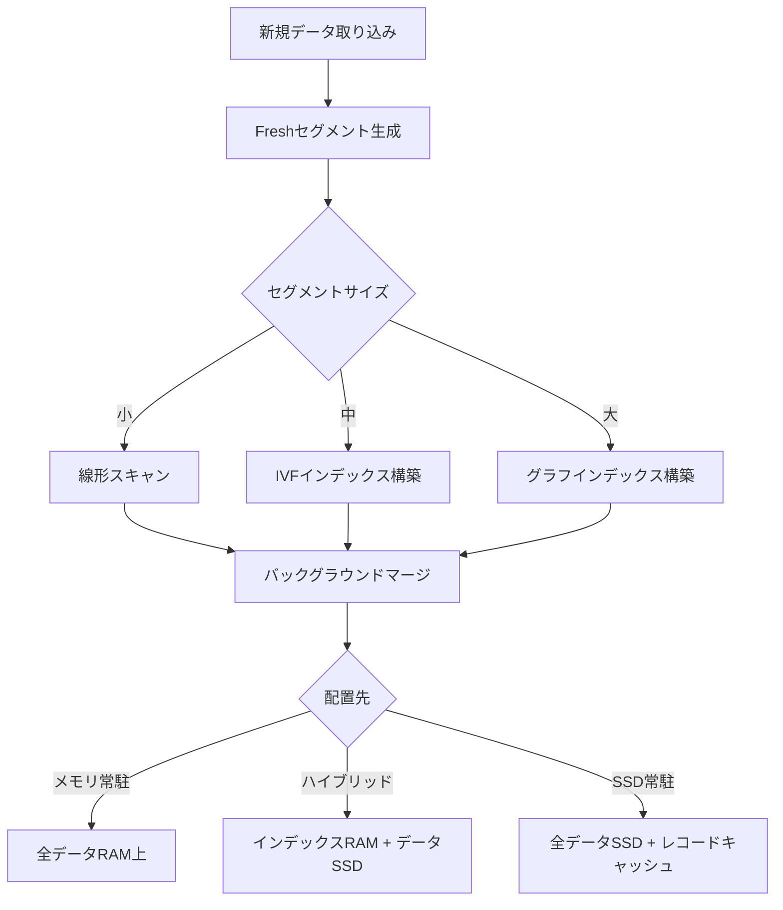

本記事は [https://arxiv.org/abs/2608.30607](https://arxiv.org/abs/2608.30607) の解説記事です。

## 論文概要（Abstract）

UBASEはByteDanceが2016年から運用している検索基盤であり、7,000以上のクラスタと300PB超のインデックスデータを管理している。著者らは、連続的なデータ取り込み下でのグラフインデックス構築時のメモリ消費と、ベクトルインデックスをメモリに保持するコストという2つのボトルネックに対して、対称量子化手法SymRaBitQとハイブリッドストレージエンジンを提案している。大規模ベンチマークにおいて、スループット最大3倍、インデックス構築メモリ80%削減、サービングコスト（$/QPS）最大99.4%削減を報告している。

この記事は [Zenn記事: ベクトルDB書き込み性能徹底比較2026：リアルタイム更新×同時検索で変わる5製品の本番適性](https://zenn.dev/0h_n0/articles/c07ae2ade39a4e) の深掘りです。

## 情報源

- **arXiv ID**: 2608.30607
- **URL**: [https://arxiv.org/abs/2608.30607](https://arxiv.org/abs/2608.30607)
- **著者**: Yao Tian, Yuncheng Lu（共同筆頭）, Liyao Xiong, Yuming Xu, Hao Zhang（責任著者）, et al.（計12名、全員ByteDance所属）
- **発表**: ACM SIGOPS ATC 2026（2026年11月、香港）
- **分野**: cs.DB

## 背景と動機

ベクトルデータベースはRAG（Retrieval-Augmented Generation）の普及により急速に需要が拡大しているが、**兆規模**のベクトルを連続取り込みしながら低レイテンシで検索するという本番要件を満たすシステムは限られている。

ByteDanceの検索基盤では、1日あたり100億ベクトル以上の取り込みが発生し、ピーク時には毎秒70万ベクトルを超える。最大の本番デプロイメントでは約1兆ベクトルをインデックスしている。この規模で直面する課題は以下の2つである。

**課題1: インデックス構築時のメモリ爆発**。グラフベースインデックス（HNSW、DiskANN等）の構築には、全ベクトルの全精度コピーをメモリに保持する必要がある。著者らによると、顧客Eのデプロイメント（1.07兆ベクトル、3.79PB）では、ナイーブな構築で27TBのピークメモリが必要となり、13.8TBのDRAM予算を大幅に超過する。

**課題2: サービングコスト**。全ベクトルをメモリに保持するコストは、データ規模に比例して増大する。SSDベースの検索に切り替えるとコストは下がるが、ページ粒度のキャッシュではグラフ走査に不要なバイトもキャッシュされ、メモリ効率が悪化する。

## 主要な貢献

著者らは以下の3つの貢献を主張している。

- **SymRaBitQ**: 対称量子化手法。インデックス構築・マージを量子化空間で実行し、全精度ベクトルを不要にする。構築メモリを80%削減
- **ハイブリッドストレージエンジン**: メモリ常駐・ハイブリッド・SSD常駐の3モードを切り替え可能。レコードレベルキャッシュとコルーチンベースの非同期ANN実行
- **本番規模での検証**: 1兆ベクトル規模のデプロイメントと30時間ストリーミングテストによる安定性実証

## 技術的詳細

### SymRaBitQ: 対称量子化による構築メモリ削減

従来のRaBitQは**非対称**量子化である。格納ベクトルは量子化されるが、クエリベクトルは全精度のまま距離計算に使用する。これにより高精度な距離推定が可能だが、インデックス構築時にはベクトル間の距離計算が必要であり、少なくとも一方は全精度でメモリに保持しなければならない。

SymRaBitQは**対称**量子化を実現する。格納ベクトルもクエリベクトルも量子化し、Bビットコードとベクトルごとのスカラー値（$\rho$, $\gamma$）のみで距離を推定する。

距離推定は以下のように行われる。ベクトル $\mathbf{x}$ と $\mathbf{y}$ をそれぞれBビットに量子化し、量子化コード $\hat{\mathbf{x}}_B$, $\hat{\mathbf{y}}_B$ とスカラー $\rho_x, \gamma_x, \rho_y, \gamma_y$ を得る。対称距離推定関数 $\text{SymDist}_B$ は、これらのコードとスカラーのみから元の距離を推定する。

$$
\text{SymDist}_B(\mathbf{x}, \mathbf{y}) = f(\hat{\mathbf{x}}_B, \hat{\mathbf{y}}_B, \rho_x, \gamma_x, \rho_y, \gamma_y)
$$

ここで、
- $\hat{\mathbf{x}}_B, \hat{\mathbf{y}}_B$: Bビット量子化コード
- $\rho_x, \rho_y$: 各ベクトルのノルム関連スカラー
- $\gamma_x, \gamma_y$: 各ベクトルの方向関連スカラー

著者らは$B=5$で98%以上の距離推定精度と0.01未満のRecall低下を報告している。

**検索時の粗密2段階推定**:

1. **1ビットコードによるスクリーニング**: popcount演算で候補をフィルタリング
2. **Bビットコードによるリスコアリング**: 生き残った候補に対してフルBビットコードで精密推定

```python
def symrabitq_search(query: np.ndarray, index: SymRaBitQIndex, k: int) -> list[int]:
    """SymRaBitQによる2段階ANN検索

    Args:
        query: クエリベクトル（全精度）
        index: SymRaBitQインデックス
        k: 返却する近傍数

    Returns:
        k個の近傍ベクトルID
    """
    q_code_1bit = quantize_1bit(query)
    q_code_bbit = quantize_bbit(query, B=5)
    q_rho, q_gamma = compute_scalars(query)

    # Stage 1: 1-bit popcount screening
    candidates = []
    for node_id in index.graph_neighbors(query):
        dist_approx = popcount_distance(q_code_1bit, index.codes_1bit[node_id])
        candidates.append((node_id, dist_approx))

    candidates.sort(key=lambda x: x[1])
    top_candidates = candidates[:k * 10]

    # Stage 2: B-bit precise rescoring
    results = []
    for node_id, _ in top_candidates:
        dist = sym_dist_b(
            q_code_bbit, index.codes_bbit[node_id],
            q_rho, q_gamma,
            index.rho[node_id], index.gamma[node_id]
        )
        results.append((node_id, dist))

    results.sort(key=lambda x: x[1])
    return [r[0] for r in results[:k]]
```

### 書き込みパス: セグメントライフサイクル管理

UBASEの書き込みパスは、セグメントサイズに応じてインデックス方式を段階的にアップグレードする設計になっている。



著者らの論文によると、このパスの特徴は以下の通りである。

1. **Fresh セグメント**: 新規データはまず軽量なFreshセグメントとして検索可能になる
2. **バックグラウンドマージ**: マージによりクエリファンアウト（検索時に走査するセグメント数）を制限する
3. **インデックスタイプの段階的昇格**: セグメントサイズに応じてスキャン→IVF→グラフと自動昇格する
4. **量子化空間での構築・マージ**: SymRaBitQにより全精度ベクトルを読まずにグラフ構築・マージが可能
5. **配置先の透過的変更**: マージ後のセグメントはメモリ・ハイブリッド・SSD間を再インデックスなしで移動可能

### レコードレベルキャッシュ

SSDベースのグラフ走査では、DiskANNのようなページ粒度のmmap方式では不要なバイトもキャッシュされる。UBASEはレコード粒度のキャッシュを採用している。

```python
from dataclasses import dataclass
import numpy as np

@dataclass
class CachePointer:
    """64ビット論理ポインタの構造

    Attributes:
        residency: 1ビット - データがキャッシュに存在するか
        state: 2ビット - ロード中/有効/無効
        offset: 61ビット - キャッシュまたはディスク上のオフセット
    """
    residency: bool
    state: int  # 0: loading, 1: valid, 2: invalid
    offset: int

class RecordLevelCache:
    """レコードレベルキャッシュ

    ページ粒度ではなくグラフノード単位でキャッシュ。
    同一レコードへの並行ロード要求は最初のロードを待機し、
    重複SSD読み取りを回避する。
    """
    def __init__(self, capacity: int, record_size: int):
        self.pointers = np.zeros(capacity, dtype=np.uint64)
        self.cache_data = np.zeros((capacity, record_size), dtype=np.float32)
        self.clock_hand = 0

    def lookup(self, vertex_id: int) -> tuple[bool, np.ndarray | None]:
        ptr = self._decode_pointer(self.pointers[vertex_id])
        if ptr.residency and ptr.state == 1:
            return True, self.cache_data[ptr.offset]
        return False, None
```

著者らは、GISTデータセットでキャッシュヒット率97.7%、クエリあたりのSSDアクセス数が51.90（DiskANNの80.9に対して36%削減）を報告している。

### 非同期ANN実行

各検索クエリはコルーチンとして実行される。グラフ走査中にSSD読み取りが必要な候補が見つかると、非ブロッキングSSD読み取りを発行してyieldし、ワーカーは別のクエリを処理する。これにより、SSDレイテンシを他のクエリの計算とオーバーラップさせる。

## 実装のポイント

**DiskANN/Vamanaグラフの量子化空間構築**: UBASEはDiskANNのグラフ構築アルゴリズム（候補探索、RobustPrune、逆辺修復）をそのまま使用し、距離オラクルのみをSymDistBに置き換えている。これにより、既存の実績あるグラフ構築ロジックを活かしつつ、メモリ消費を大幅に削減している。

**OpenSearch互換性**: UBASEはOpenSearchの初期ブランチから発展しており、REST API、SDK、ダッシュボードがそのまま利用可能である。これにより既存ユーザーの移行コストを最小化している。

**スケーリング戦略**: シャードの追加により水平スケールする。各シャードは有界なユニットであり、インデックスとクエリのコストがコレクション全体のサイズに依存しない設計になっている。

## Production Deployment Guide

### AWS実装パターン（コスト最適化重視）

UBASEのアーキテクチャ（量子化インデックス＋ハイブリッドストレージ）をAWS上で実現する場合の構成を示す。以下のコスト試算は2026年11月時点のAWS ap-northeast-1（東京）リージョン料金に基づく概算値であり、実際のコストはトラフィックパターンやバースト使用量により変動する。最新料金は [AWS料金計算ツール](https://calculator.aws/) で確認されたい。

| 規模 | 月間リクエスト | 推奨構成 | 月額コスト | 主要サービス |
|------|------------|---------|-----------|------------|
| **Small** | ~3,000 (100/日) | Serverless | $50-150 | Lambda + OpenSearch Serverless |
| **Medium** | ~30,000 (1,000/日) | Hybrid | $300-800 | ECS Fargate + OpenSearch Service |
| **Large** | 300,000+ (10,000/日) | Container | $2,000-5,000 | EKS + OpenSearch + S3 |

**Small構成の詳細** (月額$50-150):
- **Lambda**: 1GB RAM, 30秒タイムアウト ($20/月)
- **OpenSearch Serverless**: 2 OCU ($350/月 — 最小構成が高いため、Small規模ではDynamoDB + カスタム実装の方がコスト効率が良い場合がある)
- **S3**: ベクトルデータ保存 ($5/月)
- **CloudWatch**: 基本監視 ($5/月)

**Medium構成の詳細** (月額$300-800):
- **ECS Fargate**: 1 vCPU, 4GB RAM × 2タスク ($150/月)
- **OpenSearch Service**: r6g.large.search × 2ノード ($400/月)
- **S3**: ベクトルデータ + インデックスバックアップ ($20/月)
- **ElastiCache Redis**: cache.t3.micro ($15/月)

**Large構成の詳細** (月額$2,000-5,000):
- **EKS**: コントロールプレーン ($72/月)
- **EC2 Spot Instances**: i3.xlarge × 4台（NVMe SSD付き、平均$600/月、最大90%削減）
- **OpenSearch Service**: r6g.2xlarge × 3ノード ($2,400/月)
- **S3**: 大規模ベクトルストレージ ($100/月)
- **CloudWatch + X-Ray**: 詳細監視 ($100/月)

**コスト削減テクニック**:
- Spot Instances使用で最大90%削減（EKS + Karpenter）
- UltraWarm/Cold Storage活用で古いインデックスのストレージコストを最大90%削減
- OpenSearch Serverless OCU自動スケーリングでアイドルコスト削減
- S3 Intelligent-Tieringで不要なベクトルデータの保管コスト削減

### Terraformインフラコード

**Small構成 (Serverless): Lambda + DynamoDB**

```hcl
module "vpc" {
  source  = "terraform-aws-modules/vpc/aws"
  version = "~> 5.0"

  name = "vector-search-vpc"
  cidr = "10.0.0.0/16"
  azs  = ["ap-northeast-1a", "ap-northeast-1c"]
  private_subnets = ["10.0.1.0/24", "10.0.2.0/24"]

  enable_nat_gateway   = false
  enable_dns_hostnames = true
}

resource "aws_iam_role" "lambda_search" {
  name = "lambda-vector-search-role"

  assume_role_policy = jsonencode({
    Version = "2012-10-17"
    Statement = [{
      Action = "sts:AssumeRole"
      Effect = "Allow"
      Principal = { Service = "lambda.amazonaws.com" }
    }]
  })
}

resource "aws_iam_role_policy" "opensearch_access" {
  role = aws_iam_role.lambda_search.id

  policy = jsonencode({
    Version = "2012-10-17"
    Statement = [{
      Effect   = "Allow"
      Action   = ["es:ESHttp*"]
      Resource = "arn:aws:es:ap-northeast-1:*:domain/vector-search/*"
    }]
  })
}

resource "aws_lambda_function" "vector_search" {
  filename      = "search.zip"
  function_name = "vector-search-handler"
  role          = aws_iam_role.lambda_search.arn
  handler       = "index.handler"
  runtime       = "python3.12"
  timeout       = 30
  memory_size   = 1024

  environment {
    variables = {
      OPENSEARCH_ENDPOINT = "https://search-domain.ap-northeast-1.es.amazonaws.com"
      INDEX_NAME          = "vectors"
      CACHE_TABLE         = aws_dynamodb_table.cache.name
    }
  }
}

resource "aws_dynamodb_table" "cache" {
  name         = "vector-search-cache"
  billing_mode = "PAY_PER_REQUEST"
  hash_key     = "query_hash"

  attribute {
    name = "query_hash"
    type = "S"
  }

  ttl {
    attribute_name = "expire_at"
    enabled        = true
  }
}

resource "aws_cloudwatch_metric_alarm" "search_latency" {
  alarm_name          = "vector-search-latency-spike"
  comparison_operator = "GreaterThanThreshold"
  evaluation_periods  = 2
  metric_name         = "Duration"
  namespace           = "AWS/Lambda"
  period              = 300
  statistic           = "p99"
  threshold           = 10000
  alarm_description   = "検索レイテンシP99が10秒超過"

  dimensions = {
    FunctionName = aws_lambda_function.vector_search.function_name
  }
}
```

**Large構成 (Container): EKS + OpenSearch + NVMe SSD**

```hcl
module "eks" {
  source  = "terraform-aws-modules/eks/aws"
  version = "~> 20.0"

  cluster_name    = "vector-search-cluster"
  cluster_version = "1.31"

  vpc_id     = module.vpc.vpc_id
  subnet_ids = module.vpc.private_subnets

  cluster_endpoint_public_access = true
  enable_cluster_creator_admin_permissions = true
}

resource "kubectl_manifest" "karpenter_provisioner" {
  yaml_body = <<-YAML
    apiVersion: karpenter.sh/v1alpha5
    kind: Provisioner
    metadata:
      name: nvme-spot-provisioner
    spec:
      requirements:
        - key: karpenter.sh/capacity-type
          operator: In
          values: ["spot"]
        - key: node.kubernetes.io/instance-type
          operator: In
          values: ["i3.xlarge", "i3.2xlarge"]
      limits:
        resources:
          cpu: "64"
          memory: "256Gi"
      providerRef:
        name: default
      ttlSecondsAfterEmpty: 60
  YAML
}

resource "aws_opensearch_domain" "vectors" {
  domain_name    = "vector-search"
  engine_version = "OpenSearch_2.17"

  cluster_config {
    instance_type          = "r6g.2xlarge.search"
    instance_count         = 3
    zone_awareness_enabled = true

    zone_awareness_config {
      availability_zone_count = 3
    }
  }

  ebs_options {
    ebs_enabled = true
    volume_size = 500
    volume_type = "gp3"
    throughput  = 250
    iops        = 3000
  }

  encrypt_at_rest { enabled = true }
  node_to_node_encryption { enabled = true }

  domain_endpoint_options {
    enforce_https       = true
    tls_security_policy = "Policy-Min-TLS-1-2-PFS-2023-10"
  }
}

resource "aws_budgets_budget" "vector_search_monthly" {
  name         = "vector-search-monthly"
  budget_type  = "COST"
  limit_amount = "5000"
  limit_unit   = "USD"
  time_unit    = "MONTHLY"

  notification {
    comparison_operator        = "GREATER_THAN"
    threshold                  = 80
    threshold_type             = "PERCENTAGE"
    notification_type          = "ACTUAL"
    subscriber_email_addresses = ["ops@example.com"]
  }
}
```

### セキュリティベストプラクティス

1. **ネットワーク**: OpenSearchドメインはVPC内に配置し、パブリックアクセスを無効化。セキュリティグループで443ポートのみ許可
2. **認証・認可**: IAMロール最小権限、IRSA（IAM Roles for Service Accounts）使用
3. **暗号化**: 転送中TLS 1.2以上、保管時KMS暗号化（OpenSearch、S3、EBS）
4. **監査**: CloudTrail全リージョン有効化、OpenSearch Audit Logs有効化

### 運用・監視設定

```python
import boto3

cloudwatch = boto3.client('cloudwatch')

cloudwatch.put_metric_alarm(
    AlarmName='opensearch-search-latency',
    ComparisonOperator='GreaterThanThreshold',
    EvaluationPeriods=2,
    MetricName='SearchLatency',
    Namespace='AWS/ES',
    Period=300,
    Statistic='p99',
    Threshold=500,
    ActionsEnabled=True,
    AlarmActions=['arn:aws:sns:ap-northeast-1:123456789:search-alerts'],
    AlarmDescription='OpenSearch検索P99レイテンシ500ms超過',
    Dimensions=[{'Name': 'DomainName', 'Value': 'vector-search'}]
)

cloudwatch.put_metric_alarm(
    AlarmName='opensearch-indexing-rate',
    ComparisonOperator='LessThanThreshold',
    EvaluationPeriods=3,
    MetricName='IndexingRate',
    Namespace='AWS/ES',
    Period=300,
    Statistic='Average',
    Threshold=100,
    AlarmDescription='インデックス取り込みレート低下（書き込みバックプレッシャーの可能性）'
)
```

```sql
-- CloudWatch Logs Insights: 検索レイテンシ分析
fields @timestamp, latency_ms, recall, index_name
| stats pct(latency_ms, 95) as p95, pct(latency_ms, 99) as p99 by bin(5m)
| filter latency_ms > 0

-- インデックス構築進捗監視
fields @timestamp, segment_type, build_time_s, memory_mb
| filter segment_type = "graph"
| stats avg(build_time_s) as avg_build, max(memory_mb) as peak_mem by bin(1h)
```

### コスト最適化チェックリスト

**アーキテクチャ選択**:
- [ ] ~100 req/日 → Lambda + DynamoDB — $50-150/月
- [ ] ~1,000 req/日 → ECS Fargate + OpenSearch — $300-800/月
- [ ] 10,000+ req/日 → EKS + OpenSearch + NVMe — $2,000-5,000/月

**リソース最適化**:
- [ ] EC2 Spot Instances優先（NVMe付きi3インスタンス、最大90%削減）
- [ ] Reserved Instances: OpenSearch 1年コミットで最大36%削減
- [ ] UltraWarm/Cold Storage: アクセス頻度の低いインデックスを移行
- [ ] Lambda: メモリサイズ最適化（Power Tuning）
- [ ] EKS: Karpenterによるアイドルタイムスケールダウン

**ベクトル検索コスト削減**:
- [ ] 量子化（SQ/PQ）でメモリ使用量を50-80%削減
- [ ] ハイブリッドストレージ（インデックスRAM、データSSD）
- [ ] バッチクエリ対応でスループット最大化
- [ ] レコードレベルキャッシュでSSD読み取り回数削減

**監視・アラート**:
- [ ] AWS Budgets: 月額予算設定（80%で警告）
- [ ] CloudWatch: 検索レイテンシ・インデクシングレート監視
- [ ] Cost Anomaly Detection: 自動異常検知
- [ ] 日次コストレポート: SNS/Slack自動送信

**リソース管理**:
- [ ] 未使用インデックス削除（Index Lifecycle Management）
- [ ] タグ戦略: 環境別コスト可視化
- [ ] S3ライフサイクルポリシー: 古いスナップショット自動削除
- [ ] 開発環境: 夜間のOpenSearchインスタンス停止

## 実験結果

### QPS比較（in-house 100M、2,048次元）

著者らは独自の100Mベクトルデータセット（2,048次元）とCohereデータセットで、メモリ常駐モードにおけるQPS比較を行っている。

| システム | QPS（~90% recall@10） | UBASE比 | 月額コスト | $/1K QPS |
|---------|----------------------|---------|----------|---------|
| UBASE | 21,445 | 1.0x | $2,790 | $130 |
| Elasticsearch 8.18 | 9,342 | 0.44x | $2,790 | $299 |
| PostgreSQL (VectorChord 1.0) | 3,929 | 0.18x | $2,790 | $710 |
| Milvus 2.5 | 2,262 | 0.11x | $2,790 | $1,233 |

*論文Table 4より。同一ハードウェア（Xeon Platinum 8457C、24コア、192GB）での比較。月額コストはクラウドインスタンス概算。*

Cohereデータセットでは、UBASE 23,013 QPS（~92% recall@10）で、Milvusの11.7倍、Elasticsearchの5.4倍、PostgreSQLの3.5倍を記録したと著者らは報告している。

### インデックス構築時間とメモリ消費

| 手法 | Cohere 1M 構築時間 | ピークメモリ | Cohere 100M 構築時間 | ピークメモリ |
|------|-------------------|-----------|-------------------|-----------|
| HNSW | 359.8秒 | 4.8 GB | 41,946.2秒（約11.6時間） | 476.19 GB |
| DiskANN | — | — | 23,826秒（約6.6時間） | 453 GB |
| UBASE (SymRaBitQ) | 194+43秒（60%削減） | 0.75 GB（80%削減） | 11,033+1,463秒（48%削減、約3.5時間） | 90 GB（80%削減） |

*論文Table 2より。UBASEの構築時間は「グラフ構築+量子化」の2段階。*

100Mベクトルでは、HNSWが476 GBのメモリを要するのに対し、UBASEは90 GBで済む。著者らは、この80%のメモリ削減が、解放されたメモリをサービングキャッシュに転用できる点で重要だと主張している。

### 30時間ストリーミングテスト

Cohereデータセットに対して空のインデックスから毎秒1,000ベクトルを30時間連続挿入しながら、並行して検索クエリを発行するテストが実施されている。著者らは、クエリQPSが安定し、P99の読み取り・書き込みレイテンシも安定していると報告している。読み取りパスでの頻繁なレイテンシスパイクや書き込み側のバックプレッシャーは発生しなかったとしている。ただし、具体的なQPS値やP99レイテンシ値はFigure 18-19に記載されており、論文本文中には数値が明記されていない。

### SSDモードでの検索効率

著者らは、GISTデータセットにおけるSSDモードの性能を報告している。

- **キャッシュヒット率**: 97.7%
- **クエリあたりSSDアクセス数**: UBASE 51.90 vs DiskANN 80.9（36%削減）
- **32スレッド時QPS**: 非同期UBASE約15,000 QPS（DiskANNの約2倍）
- **バッファ比率10%時**: 5,381 QPS（0%時の4,163 QPSから30%向上）

## 実運用への応用

### ByteDanceでの本番規模

著者らは以下の本番デプロイメントを報告している（論文Table 1）。

- **顧客D**: 1.17兆ベクトル
- **顧客E**: 1.07兆ベクトル、3.79PB、180インデックス、72シャード、72ノード（各24コア、192GB）

ベクトルDB書き込み性能の観点では、UBASEの以下の設計が本番運用に直結する。

1. **セグメントサイズ連動型インデックス**: 小さいFreshセグメントは線形スキャンで即座に検索可能になり、成長に応じてIVF→グラフへ自動昇格する。これによりバルクロードとストリーミング挿入の両方に対応できる
2. **量子化空間でのマージ**: マージ時に全精度ベクトルを読み出す必要がないため、I/O帯域の消費を抑えながらバックグラウンドマージを実行できる
3. **配置先の透過的変更**: ホットデータはメモリ、ウォームデータはハイブリッド、コールドデータはSSDと、ワークロードに応じたデータ配置が再インデックスなしで可能

### Zenn記事との関連

Zenn記事「ベクトルDB書き込み性能徹底比較2026」ではQdrant、Milvus、pgvector、Weaviate、Pineconeの書き込みパスを比較しているが、UBASEはこれらとは異なるアプローチを取っている。特にSymRaBitQによる構築メモリ80%削減は、Milvus 3.0のWoodpecker WALとは相補的な最適化であり、書き込みパスのWAL部分ではなくインデックス構築部分のボトルネックを解消するものである。

## 関連研究

- **RaBitQ** (Gao et al., 2024): UBASEのSymRaBitQの基礎となる非対称ランダムバイナリ量子化。格納側のみ量子化し、クエリは全精度のまま距離推定する。SymRaBitQはこれを対称に拡張
- **DiskANN** (Jayaram Subramanya et al., 2019): SSD上のグラフベースANN検索。UBASEはDiskANNのVamanaグラフ構築アルゴリズムを採用しつつ、距離オラクルをSymRaBitQに置換
- **VectorChord** (EnterpriseDB, 2026): PostgreSQL上の高性能ベクトル検索拡張。UBASEの比較対象の一つで、メモリ常駐モードで3,929 QPS（UBASEの18%）

## まとめと今後の展望

UBASEは、対称量子化SymRaBitQとレコードレベルキャッシュにより、兆規模のベクトル管理で従来手法に対して構築メモリ80%削減・QPS最大11.7倍を実現した本番システムである。書き込みパスにおいては、セグメントサイズ連動型のインデックス昇格と量子化空間でのマージにより、連続取り込み下でも検索性能の安定性を維持している。

ただし、比較対象がElasticsearch 8.18、Milvus 2.5、PostgreSQL/VectorChord 1.0であり、QdrantやWeaviateとの比較は含まれていない。また30時間ストリーミングテストの具体的な数値が論文本文中に明示されていないため、定量的な書き込み耐性の評価には図表の確認が必要である。

## 参考文献

- **arXiv**: [https://arxiv.org/abs/2608.30607](https://arxiv.org/abs/2608.30607)
- **Related Zenn article**: [https://zenn.dev/0h_n0/articles/c07ae2ade39a4e](https://zenn.dev/0h_n0/articles/c07ae2ade39a4e)

---

:::message
この記事はAI（Claude Code）により自動生成されました。内容の正確性については論文の記述に基づいて記載していますが、実際の利用時は原論文もご確認ください。
:::
