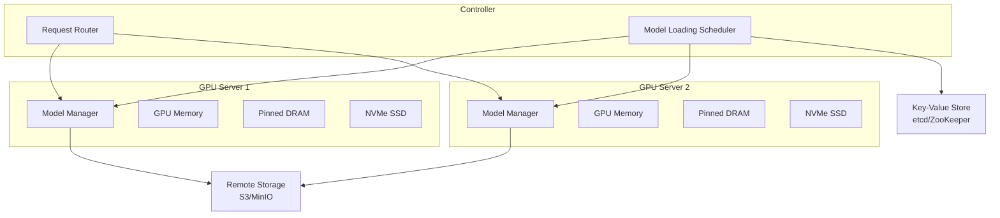

## 論文概要（Abstract）

本記事は [ServerlessLLM: Low-Latency Serverless Inference for Large Language Models](https://arxiv.org/abs/2401.14351) の解説記事です。

ServerlessLLMは、大規模言語モデル（LLM）のサーバーレス推論において、コールドスタート時のモデル読み込みレイテンシを大幅に削減する分散システムである。GPU推論サーバーが備えるホストメモリやNVMe SSDなどのローカルストレージ階層を活用し、リモートストレージからの繰り返しダウンロードを回避する設計を採用している。著者らは、既存手法と比較してチェックポイント読み込みが3.6〜8.2倍高速化し、エンドツーエンドのレイテンシが10〜200倍改善されたと報告している（論文Abstract・Section 7より）。本論文はOSDI '24（トップティアのシステム系国際会議）に採択されている。

この記事は [Zenn記事: Fargate 32vCPU×LiteLLMで社内LLMゲートウェイをサーバーレス構築する](https://zenn.dev/0h_n0/articles/13b5175e562a56) の深掘りです。Zenn記事ではAWS Fargate上でLiteLLMゲートウェイを構築する手法を解説しているが、ServerlessLLMはその前段にある根本的な課題——「サーバーレス環境でLLMをいかに高速に起動するか」——に対する学術的アプローチを提示している。

## 情報源

- **arXiv ID**: 2401.14351
- **URL**: [https://arxiv.org/abs/2401.14351](https://arxiv.org/abs/2401.14351)
- **著者**: Yao Fu, Leyang Xue, Yeqi Huang, Andrei-Octavian Brabete, Dmitrii Ustiugov, Yuvraj Patel, Luo Mai（University of Edinburgh, NTU Singapore）
- **発表年**: 2024（OSDI '24採択）
- **分野**: cs.LG, cs.DC
- **コード**: [github.com/ServerlessLLM/ServerlessLLM](https://github.com/ServerlessLLM/ServerlessLLM)

## 背景と動機（Background & Motivation）

サーバーレスLLM推論では、リクエスト到着時にモデルチェックポイントをGPUメモリに読み込む必要がある。しかし、LLMのチェックポイントサイズは従来のDNNモデルと比較して桁違いに大きい。論文によれば、Grok-1は600GB超、DBRXは250GB、Mixtral-8x22Bは約280GB（FP16）に達する（論文Section 2.1より）。

この巨大なチェックポイントの読み込みがコールドスタート問題を深刻化させている。著者らは、Azure Serverless Traceを引用し、40%以上の関数がコールドスタート率25%超、約25%の関数が60%超のコールドスタート率を示すと指摘している（5分間のkeep-alive設定下、論文Section 2.3より）。

具体的な問題点は以下の通りである：

1. **リモートダウンロードの遅さ**: LLaMA-2-70Bの130GBチェックポイントをS3から5GB/sでダウンロードすると最低26秒かかる（論文Section 2.1の計算例より）
2. **既存ローダーの非効率性**: PyTorchでOPT-30Bを4 GPUに読み込むと34秒、LLaMA-2-70Bを8 GPUに読み込むと84秒かかる（論文Section 2.1より）
3. **GPUウォームプール維持のコスト**: LLMではモデルサイズが大きいため、常時GPUを確保する方式は高コストである

著者らは、既存の対策——ウォームプール維持、ホストメモリキャッシュ、専用ストレージサーバー——がいずれもLLMの規模では不十分であると論じている。

## 主要な貢献（Key Contributions）

著者らは以下の3つの貢献を主張している（論文Abstractより）：

- **貢献1: 高速マルチティアチェックポイント読み込み** — 読み込みに最適化されたチェックポイントフォーマットと、GPU推論サーバーのストレージ階層（DRAM→NVMe SSD→SATA SSD→リモートストレージ）の帯域幅を最大限活用するマルチティアローダーを設計
- **貢献2: LLM推論のライブマイグレーション** — 実行中の推論を別サーバーに移行し、新規リクエストがローカルチェックポイントを利用できるようにする手法を提案。ユーザーへの影響を最小化する設計
- **貢献3: 起動時間最適化モデルスケジューリング** — 各サーバーでのモデル読み込み時間をストレージティアごとに推定し、最短起動時間のサーバーを選択するスケジューラを設計

## 技術的詳細（Technical Details）

### システムアーキテクチャ

ServerlessLLMは、コントローラ（クラスタレベル）とGPU推論サーバー群で構成される。



コントローラは**リクエストルーター**（リクエストを適切なサーバーに振り分け）と**モデル読み込みスケジューラ**（最適なサーバー・GPUスロットを選択）で構成される。各GPUサーバーには**モデルマネージャ**が配置され、GPUメモリ割り当てとチェックポイントの多階層読み込みを担当する（論文Section 2.2, Figure 1より）。

サーバーの状態（GPU、DRAM、SSD利用状況）はetcdやZooKeeperなどのKey-Valueストアに記録され、スケジューラ障害時の復旧に使用される。

### 読み込み最適化チェックポイントフォーマット

従来のチェックポイントは訓練時の書き込み効率を重視した設計だが、サーバーレス推論では「一度アップロード、何度も読み込み」というアクセスパターンになる。著者らはこの観察に基づき、読み込みに特化したフォーマットを設計している（論文Section 4.1より）。

**主要な最適化**:

1. **シーケンシャルチャンクベース読み取り**: 各GPUに割り当てられるテンソルを**パーティション**にグループ化し、パーティションファイルには生パラメータバイトのみを格納する。メタデータを含まないため、大きなチャンク単位での連続読み取りが可能になる。
2. **ダイレクトテンソルアドレッシング**: テンソル名から(GPU ID, offset, size)へのマッピングを**テンソルインデックスファイル**として別途保持する。テンソルはメモリワードサイズにアラインされており、以下の式でアドレスを直接計算できる：

$$
\text{addr}(t) = \text{base}_{\text{GPU}} + \text{offset}(t)
$$

ここで$\text{base}_{\text{GPU}}$はCUDA IPCハンドルから取得するGPUベースアドレス、$\text{offset}(t)$はテンソルインデックスファイルから読み取るオフセット値である。

この設計により、モデルマネージャがテンソルバイトを読み込む処理と、推論プロセスがモデルオブジェクトを初期化する処理を**並行実行**できる。

### マルチティア読み込みパイプライン

ServerlessLLMのマルチティアローダーは3つの要素で構成される（論文Section 4.2より）：

**A. チャンクベースデータ管理**: 固定サイズチャンクによるフラグメンテーション回避と、複数GPUへの並列PCIeリンク転送を実現する。メモリプールはアロケーション/デアロケーションAPIを公開し、アプリケーション制御のキャッシュ管理を可能にしている。

**B. 予測可能なデータパス**: Linux上のDirect I/O（`O_DIRECT`）を使用し、ページキャッシュをバイパスしてユーザー空間に直接読み取る。著者らは、SafeTensorsが使用するmmapがシステムキャッシュに依存し性能が不安定であると指摘している。さらに、ピン留めメモリ（Pinned Memory）により、GPUがDRAMから直接DMAコピーを実行でき、CPU負荷を最小化する。

**C. マルチティア読み込みパイプライン**: ストレージインターフェース関数（ローカルNVMe/SATA、リモートS3、インメモリピン留めプール）とI/Oスレッドプールにより、各ティアの内部並列性を活用する。タスクキューベースのパイプライン構造で、I/Oスレッドがチャンクを読み取り、次のティアのスレッドにキューイングする。

### ライブマイグレーション

サーバーレス環境では、モデルのローカリティ（チェックポイントが既にメモリやSSDにあるサーバー）を活用したいが、そのサーバーのGPUが別の推論で占有されている場合がある。著者らは4つのポリシーを比較検討している（論文Section 5.1より）：

| ポリシー | 動作 | 問題点 |
|---------|------|--------|
| 可用性ベース | 空きGPUで即座に開始 | SSDからの完全な読み込みが必要 |
| ローカリティベース | ローカルにチェックポイントがあるサーバーを待つ | 他サーバーが遊休になる |
| プリエンプションベース | 実行中の推論を中断し、新モデルを読み込む | 中断された推論の再読み込み・再計算コスト |
| **ライブマイグレーション** | 実行中の推論を別サーバーに移行 | 移行コストが発生するが最小限 |

**核心的なアイデア: KVキャッシュではなくトークンを移行する**

著者らの重要な洞察は、KVキャッシュ（通常1〜10GB）ではなく、入力・出力トークン（通常10〜100KB）のみを移行先に送信し、移行先でKVキャッシュを再計算する方式を採用している点である。論文によれば、1,000トークンのKVキャッシュ再計算は約100トークンの生成にかかる時間と同程度であり、ネットワーク転送よりも高速である（論文Section 5.2より）。

マイグレーションは以下のマルチラウンドプロセスで実行される（論文Section 5.3, Figure 4より）：

1. スケジューラが移行先にモデル読み込みを指示
2. 読み込み完了後、ソースにマイグレーションリクエスト送信
3. ソースが入力トークンと生成済み出力トークンを移行先に送信
4. 移行先がトークンからKVキャッシュを再計算
5. 再計算完了後、ソースが推論を停止しルーターに通知
6. ルーターが移行先に切り替え

### 起動時間最適化スケジューリング

スケジューラは各サーバーについて読み込み時間を以下の式で推定する（論文Section 6.1より）：

$$
T_{\text{load}} = q + \frac{n}{b}
$$

ここで、
- $q$: キューイング時間（そのサーバーの読み込みキューの待ち時間）
- $n$: モデルサイズ（バイト）またはパーティションサイズ
- $b$: 使用ストレージティアの帯域幅（マルチティアの場合はボトルネックとなる最遅ティアの帯域幅）

マイグレーション時間は以下のように推定される（論文Section 6.2より）：

$$
T_{\text{migrate}} = a \times (t_{\text{in}} + t_{\text{out}}) + b
$$

ここで、
- $t_{\text{in}}$: 入力トークン数
- $t_{\text{out}}$: 生成済み出力トークン数（$t_{\text{out}} = d / t$、$d$は推論経過時間、$t$は1トークンあたりの平均生成時間）
- $a, b$: モデル固有のパラメータ

スケジューラは全サーバーの推定起動時間を比較し、最短のサーバーとGPUスロットを選択する。各サーバーの読み込みは**逐次実行**され、帯域幅の競合を回避する設計としている。

## 実装のポイント（Implementation）

### 性能分解（論文Figure 7より）

著者らは、OPTモデルでRAID0-NVMeを使用した場合の各最適化の寄与を報告している：

| 最適化手法 | スループット向上 |
|-----------|---------------|
| バルク読み取り（テンソル結合） | 1.2倍 |
| Direct I/O | 2.1倍 |
| マルチスレッディング | 2.3倍 |
| ピン留めメモリ | 1.4倍 |
| パイプライニング | 1.5倍 |

バルク読み取りの効果について、著者らはモデル内テンソルの約3分の1が1MB未満であることを指摘しており、これらを結合して16MBチャンクとして読み取ることで効率が向上するとしている。ローダーは最大帯域幅に達するのに4 CPUコアのみ必要と報告されている。

### 実装上の注意点

1. **推論プロセスとの分離**: モデルマネージャがチェックポイントをGPUメモリに読み込み、推論プロセス（HuggingFace AccelerateやvLLMベース）はモデルオブジェクトを初期化してテンソルポインタを設定するのみ。CUDA IPCハンドルを使ったプロセス間通信で同期する。
2. **SafeTensorsのページフォルト問題**: 著者らはSafeTensorsがLLaMA-2-7Bのコールドスタートで112,000回のページフォルトを起こすと報告しており、mmapベースのアプローチの限界を示している（論文Section 7.2より）。
3. **帯域幅推定の更新**: スケジューラはサーバーから報告される読み込みレイテンシに基づいて帯域幅推定を動的に更新する。

## Production Deployment Guide

ServerlessLLMの知見は、サーバーレスLLM推論基盤の構築に直接応用できる。以下では、AWS上でServerlessLLMの設計原則を活用した本番環境構成を提示する。

### AWS実装パターン（コスト最適化重視）

ServerlessLLMの核心——ローカルストレージ階層の活用とコールドスタート最小化——をAWSサービスで実現する構成を示す。

| 規模 | 月間リクエスト | 推奨構成 | 月額コスト目安 | 主要サービス |
|------|--------------|---------|-------------|------------|
| **Small** | ~3,000 (100/日) | Serverless | $50-150 | Lambda + Bedrock + DynamoDB |
| **Medium** | ~30,000 (1,000/日) | Hybrid | $500-1,200 | ECS Fargate + S3 + ElastiCache |
| **Large** | 300,000+ (10,000/日) | Container | $3,000-8,000 | EKS + EC2 (GPU) + EFS/FSx |

**Small構成の詳細**（月額$50-150）:
- **Lambda**: API Gateway経由でリクエスト受付、Bedrockへのプロキシ（$20/月）
- **Bedrock**: Claude 3.5 Haiku、Prompt Caching有効化（$80/月）
- **DynamoDB**: リクエストログ・キャッシュ（On-Demand、$10/月）
- **CloudWatch**: 基本監視（$5/月）

**Medium構成の詳細**（月額$500-1,200）:
- **ECS Fargate**: LiteLLMゲートウェイ（2vCPU/4GB × 2タスク、$80/月）
- **S3**: モデルチェックポイント保存（ServerlessLLMの知見: ティア構造活用）
- **ElastiCache Redis**: KVキャッシュ・セッション管理（cache.t3.micro、$15/月）
- **Bedrock**: 複数モデルへの統一アクセス（$400-800/月）
- **ALB**: 内部ロードバランサー（$20/月）

**Large構成の詳細**（月額$3,000-8,000）:
- **EKS**: コントロールプレーン（$72/月）
- **EC2 GPU Instances**: g5.xlarge × 2-4台（Spot活用で平均$1,000/月）
- **EFS/FSx for Lustre**: モデルチェックポイントの高速配信（ServerlessLLMのマルチティア思想を反映）
- **S3**: 永続ストレージ（$20/月）
- **CloudWatch + X-Ray**: 詳細監視（$100/月）

**コスト試算の注意事項**: 上記は2026年11月時点のAWS ap-northeast-1（東京）リージョン料金に基づく概算値です。実際のコストはトラフィックパターン、リージョン、バースト使用量により変動します。最新料金は [AWS料金計算ツール](https://calculator.aws/) で確認してください。

### Terraformインフラコード

**Small構成（Serverless）: Lambda + Bedrock + DynamoDB**

```hcl
module "vpc" {
  source  = "terraform-aws-modules/vpc/aws"
  version = "~> 5.0"

  name = "serverlessllm-vpc"
  cidr = "10.0.0.0/16"
  azs  = ["ap-northeast-1a", "ap-northeast-1c"]
  private_subnets = ["10.0.1.0/24", "10.0.2.0/24"]

  enable_nat_gateway = false
  enable_dns_hostnames = true
}

resource "aws_iam_role" "lambda_bedrock" {
  name = "serverlessllm-lambda-role"

  assume_role_policy = jsonencode({
    Version = "2012-10-17"
    Statement = [{
      Action = "sts:AssumeRole"
      Effect = "Allow"
      Principal = { Service = "lambda.amazonaws.com" }
    }]
  })
}

resource "aws_iam_role_policy" "bedrock_invoke" {
  role = aws_iam_role.lambda_bedrock.id
  policy = jsonencode({
    Version = "2012-10-17"
    Statement = [{
      Effect   = "Allow"
      Action   = ["bedrock:InvokeModel", "bedrock:InvokeModelWithResponseStream"]
      Resource = "arn:aws:bedrock:ap-northeast-1::foundation-model/anthropic.claude-3-5-haiku*"
    }]
  })
}

resource "aws_lambda_function" "inference_proxy" {
  filename      = "lambda.zip"
  function_name = "serverlessllm-proxy"
  role          = aws_iam_role.lambda_bedrock.arn
  handler       = "index.handler"
  runtime       = "python3.12"
  timeout       = 60
  memory_size   = 1024

  environment {
    variables = {
      BEDROCK_MODEL_ID    = "anthropic.claude-3-5-haiku-20241022-v1:0"
      DYNAMODB_TABLE      = aws_dynamodb_table.cache.name
      ENABLE_PROMPT_CACHE = "true"
    }
  }
}

resource "aws_dynamodb_table" "cache" {
  name         = "serverlessllm-cache"
  billing_mode = "PAY_PER_REQUEST"
  hash_key     = "prompt_hash"

  attribute {
    name = "prompt_hash"
    type = "S"
  }

  ttl {
    attribute_name = "expire_at"
    enabled        = true
  }
}

resource "aws_cloudwatch_metric_alarm" "lambda_cost" {
  alarm_name          = "serverlessllm-lambda-cost-spike"
  comparison_operator = "GreaterThanThreshold"
  evaluation_periods  = 1
  metric_name         = "Duration"
  namespace           = "AWS/Lambda"
  period              = 3600
  statistic           = "Sum"
  threshold           = 100000
  alarm_description   = "Lambda実行時間異常（コスト急増の可能性）"

  dimensions = {
    FunctionName = aws_lambda_function.inference_proxy.function_name
  }
}
```

**Large構成（Container）: EKS + Spot GPU Instances**

```hcl
module "eks" {
  source  = "terraform-aws-modules/eks/aws"
  version = "~> 20.0"

  cluster_name    = "serverlessllm-cluster"
  cluster_version = "1.31"

  vpc_id     = module.vpc.vpc_id
  subnet_ids = module.vpc.private_subnets

  cluster_endpoint_public_access = true
  enable_cluster_creator_admin_permissions = true
}

resource "kubectl_manifest" "karpenter_provisioner" {
  yaml_body = <<-YAML
    apiVersion: karpenter.sh/v1
    kind: NodePool
    metadata:
      name: gpu-spot-pool
    spec:
      template:
        spec:
          requirements:
            - key: karpenter.sh/capacity-type
              operator: In
              values: ["spot"]
            - key: node.kubernetes.io/instance-type
              operator: In
              values: ["g5.xlarge", "g5.2xlarge"]
          limits:
            cpu: "32"
            memory: "128Gi"
      disruption:
        consolidationPolicy: WhenEmptyOrUnderutilized
        consolidateAfter: 30s
  YAML
}

resource "aws_budgets_budget" "monthly" {
  name         = "serverlessllm-monthly"
  budget_type  = "COST"
  limit_amount = "8000"
  limit_unit   = "USD"
  time_unit    = "MONTHLY"

  notification {
    comparison_operator        = "GREATER_THAN"
    threshold                  = 80
    threshold_type             = "PERCENTAGE"
    notification_type          = "ACTUAL"
    subscriber_email_addresses = ["ops@example.com"]
  }
}
```

### 運用・監視設定

**CloudWatch Logs Insights クエリ**:

```sql
-- コールドスタートレイテンシの分析（ServerlessLLMの知見を活用）
fields @timestamp, model_id, loading_source, loading_duration_ms
| stats avg(loading_duration_ms) as avg_load,
        pct(loading_duration_ms, 95) as p95_load,
        pct(loading_duration_ms, 99) as p99_load
  by model_id, loading_source
| sort p99_load desc

-- ストレージティア別のヒット率
fields @timestamp, storage_tier, cache_hit
| stats count(*) as total,
        sum(case when cache_hit = 1 then 1 else 0 end) as hits
  by storage_tier
| filter total > 0
```

**CloudWatch アラーム設定**:

```python
import boto3

cloudwatch = boto3.client('cloudwatch')

cloudwatch.put_metric_alarm(
    AlarmName='cold-start-latency-spike',
    ComparisonOperator='GreaterThanThreshold',
    EvaluationPeriods=2,
    MetricName='ColdStartLatency',
    Namespace='ServerlessLLM',
    Period=300,
    Statistic='Average',
    Threshold=5000,
    ActionsEnabled=True,
    AlarmActions=['arn:aws:sns:ap-northeast-1:123456789:alerts'],
    AlarmDescription='コールドスタートレイテンシが5秒を超過'
)
```

**X-Ray トレーシング設定**:

```python
from aws_xray_sdk.core import xray_recorder, patch_all

patch_all()

@xray_recorder.capture('model_loading')
def load_model(model_id: str, storage_tier: str):
    xray_recorder.put_annotation('model_id', model_id)
    xray_recorder.put_annotation('storage_tier', storage_tier)
    # モデル読み込み処理
    xray_recorder.put_metadata('checkpoint_size_mb', size_mb)
    xray_recorder.put_metadata('loading_duration_ms', duration_ms)
```

### コスト最適化チェックリスト

**アーキテクチャ選択**:
- [ ] ~100 req/日 → Lambda + Bedrock（Serverless）— $50-150/月
- [ ] ~1,000 req/日 → ECS Fargate + Bedrock（Hybrid）— $500-1,200/月
- [ ] 10,000+ req/日 → EKS + GPU Instances（Container）— $3,000-8,000/月

**リソース最適化**:
- [ ] EC2 GPU: Spot Instances優先（最大90%削減、Karpenter自動管理）
- [ ] Reserved Instances: 1年コミットで最大72%削減（予測可能な負荷）
- [ ] Savings Plans: Compute Savings Plans検討
- [ ] Lambda: メモリサイズ最適化（CloudWatch Insights分析）
- [ ] ECS/EKS: アイドルタイムのスケールダウン

**LLMコスト削減**:
- [ ] Bedrock Batch API: 50%割引（非リアルタイム処理）
- [ ] Prompt Caching: 30-90%削減
- [ ] モデル選択ロジック: Haiku（$0.25/MTok）vs Sonnet（$3/MTok）
- [ ] トークン数制限: max_tokens設定で過剰生成防止

**監視・アラート**:
- [ ] AWS Budgets: 月額予算設定（80%で警告）
- [ ] CloudWatch: コールドスタートレイテンシ監視
- [ ] Cost Anomaly Detection: 自動異常検知
- [ ] 日次コストレポート: SNS/Slack自動送信

**リソース管理**:
- [ ] 未使用リソース削除: Trusted Advisor活用
- [ ] タグ戦略: 環境別・プロジェクト別コスト可視化
- [ ] ライフサイクルポリシー: S3古いキャッシュ30日自動削除
- [ ] 開発環境: 夜間停止（Auto Start/Stop）

## 実験結果（Results）

### 実験環境

著者らは2つのテストベッドを使用している（論文Section 7.1より）：

- **テストベッド(i)**: 8× NVIDIA A5000 GPU、1TB DDR4、2× AMD EPYC 7453、4TB PCIe 4.0 NVMe SSD × 2（RAID 0）、4TB SATA 3.0 SSD × 2（RAID 0）
- **テストベッド(ii)**: 4サーバー（各4× A40 GPU、512GB DDR4、2TB PCIe 4.0 NVMe SSD）、10Gbpsイーサネット接続

### チェックポイント読み込み性能

著者らが報告した読み込みレイテンシの比較結果（論文Section 7.2, RAID0-NVMe使用、20回測定の平均値）：

| モデル | vs. PyTorch | vs. SafeTensors |
|--------|------------|----------------|
| OPT-2.7B | 6倍高速 | 3.6倍高速 |
| LLaMA-2-70B | 8.2倍高速 | 4.7倍高速 |

LoRAアダプタ（PEFT形式、ランク32、1GB、LLaMA-70B用）の読み込みでは、ServerlessLLMが83.5msに対しSafeTensorsが370msであり、4.4倍の高速化が報告されている（論文Section 7.2より）。

### エンドツーエンド性能

既存サーバーレスシステム（Ray Serve 2.7.0、KServe 0.10.2）との比較（論文Section 7.4, テストベッド(ii)、GSM8Kデータセット使用）：

| モデル | ServerlessLLM | Ray Serve | Ray Serve + Cache |
|--------|--------------|-----------|-------------------|
| OPT-6.7B | 0.8秒 | 12.1秒 | 8.2秒 |
| OPT-30B | 7.5秒 | 213秒 | 199.2秒 |

OPT-30Bでは、ServerlessLLMは300秒以内に89%のリクエストを完了しているのに対し、Ray Serve + Cacheでは26%にとどまっている。ShareGPTデータセットではRPS 0.2〜1.1の範囲で最大212倍の改善が報告されている（論文Section 7.4より）。

### スケジューラ性能

ServerlessLLMのスケジューラをShepherd*（プリエンプションベース）およびサーバーレススケジューラ（ランダム割り当て）と比較した結果（論文Section 7.3より）：

- **OPT-6.7B, GSM8K, RPS 1.4**: ServerlessLLMのP99レイテンシはShepherd*比1.27倍、サーバーレススケジューラ比1.95倍優位
- **OPT-6.7B, ShareGPT, RPS 0.8**: Shepherd*のP99がServerlessLLMの約2倍。ServerlessLLMは513リクエスト中114回のマイグレーションを実行

## 実運用への応用（Practical Applications）

ServerlessLLMの知見は、Zenn記事で解説されているFargate + LiteLLMアーキテクチャと以下の点で関連する：

1. **コールドスタート問題の共通性**: Fargateもタスク起動時にコンテナイメージのプルとモデル読み込みが必要であり、ServerlessLLMが取り組むコールドスタート問題と本質的に同じ課題を抱えている。EFS上のモデルファイルをマウントする方式は、ServerlessLLMのマルチティアストレージの思想に通じる。
2. **ストレージ階層の活用**: ServerlessLLMがDRAM→NVMe→SATA→リモートストレージの階層を活用するように、Fargate環境ではEFSのElasticスループットモード選択やECRイメージキャッシュ（SOCI）が同様の役割を果たす。
3. **スケジューリング最適化**: ServerlessLLMの起動時間推定に基づくスケジューリングは、ECS Service Auto Scalingの設計指針として参考になる。コールドスタート時間を考慮した`min_capacity`の設定が重要である。
4. **ライブマイグレーションの制約**: Fargateではタスク間のライブマイグレーションは直接サポートされないが、Blue/Greenデプロイメントやタスク置換戦略で類似の効果を得られる。

## 関連研究（Related Work）

- **Ray Serve / KServe**: 論文内でベースラインとして比較。ServerlessLLMはこれらに対して10〜200倍のレイテンシ改善を報告している。
- **vLLM**: PagedAttentionによるKVキャッシュ管理で推論効率を改善するシステム。ServerlessLLMは推論エンジンとしてvLLMを活用可能。
- **Shepherd / ClockWork**: ローカリティを考慮したスケジューリング。Shepherdはプリエンプションベースだが、ServerlessLLMはライブマイグレーションにより中断を最小化する。
- **Singularity**: スナップショットベースのマイグレーション。著者らは、スナップショットの作成・転送に秒〜分オーダーかかるため不適切と判断している。

## まとめと今後の展望

ServerlessLLMは、LLMのサーバーレス推論における最大のボトルネック——チェックポイント読み込みレイテンシ——に対し、ストレージ階層の体系的な活用、ライブマイグレーション、起動時間最適化スケジューリングという3つのアプローチで取り組んだシステムである。

著者らは、既存手法と比較してチェックポイント読み込みが最大8.2倍高速化し、エンドツーエンドで最大212倍のレイテンシ改善を達成したと報告している。これらの知見は、Fargate上でのLLMゲートウェイ構築において、コールドスタート対策やストレージ設計の指針として有用である。

今後の研究方向として、著者らは分散スケジューラのスケーリング、フェアネス保証付き並行読み込み、チェックポイント配置の最適化を挙げている。

## 参考文献

- **arXiv**: [https://arxiv.org/abs/2401.14351](https://arxiv.org/abs/2401.14351)
- **OSDI '24**: [https://www.usenix.org/conference/osdi24/presentation/fu](https://www.usenix.org/conference/osdi24/presentation/fu)
- **Code**: [https://github.com/ServerlessLLM/ServerlessLLM](https://github.com/ServerlessLLM/ServerlessLLM)
- **Related Zenn article**: [https://zenn.dev/0h_n0/articles/13b5175e562a56](https://zenn.dev/0h_n0/articles/13b5175e562a56)
