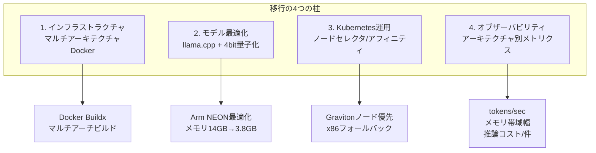

## ブログ概要（Summary）

本記事は [How We Cut LLM Inference Costs by 35% Migrating to ARM-based AWS Graviton](https://community.arm.com/arm-community-blogs/b/servers-and-cloud-computing-blog/posts/how-we-cut-llm-inference-costs-by-35-migrating-to-arm-based-aws-graviton) の解説記事です。

Vociply AIのAIエンジニアであるCornelius Maroa氏は、顧客サポートチャットボットに使用しているLlama 2 7Bの推論基盤をx86アーキテクチャからAWS Graviton（Arm Neoverse）に移行した実践事例を報告している。同社は1日あたり約50,000件の会話を処理するワークロードを運用しており、推論インフラがAWS月額コストの約40%（$2,800超）を占めていたと述べている。移行の結果、月額インフラコストを$2,000から$1,300に削減（35%減）し、推論速度も24.3 tok/sから28.1 tok/sへ向上（15.6%増）したとしている。

この記事は [Zenn記事: Fargate 32vCPU×LiteLLMで社内LLMゲートウェイをサーバーレス構築する](https://zenn.dev/0h_n0/articles/13b5175e562a56) の深掘りです。Zenn記事で紹介されているGraviton（ARM64）活用によるvCPU単価約20%削減の戦略が、実際のプロダクション環境でどのように機能するかを示す具体的な事例となっています。

## 情報源

- **種別**: 企業テックブログ（Arm Community Blog）
- **URL**: [https://community.arm.com/...](https://community.arm.com/arm-community-blogs/b/servers-and-cloud-computing-blog/posts/how-we-cut-llm-inference-costs-by-35-migrating-to-arm-based-aws-graviton)
- **著者**: Cornelius Maroa（Arm Ambassador、Vociply AI AIエンジニア）
- **発表日**: 2025年9月24日
- **組織**: Vociply AI（12名規模、うちエンジニア5名のカスタマーサポートチャットボットスタートアップ）

## 技術的背景（Technical Background）

### LLM推論におけるCPUコスト問題

LLMの推論処理はGPUで行うのが一般的だが、小規模モデル（1〜8Bパラメータ）をCPUで推論するアプローチは、GPUインスタンスのコストを回避できる利点がある。特にチャットボットのような対話型ワークロードでは、レイテンシ要件が比較的緩く（数秒以内で許容）、同時接続数に応じたスケーリングが求められる。

Vociply AIの場合、Llama 2 7Bをx86インスタンス上で推論しており、月額コストの約40%が推論インフラに集中していた。著者はこの状況を「持続不可能」と判断し、Graviton移行を検討したと述べている。

### Graviton（Arm Neoverse）の特性

AWS GravitonプロセッサはArm Neoverseアーキテクチャに基づくカスタムCPUである。著者はGraviton3の特性として以下を挙げている：

- **vCPU単価**: x86と比較して約20%安価（時間あたり$0.34 → $0.272の事例）
- **エネルギー効率**: 23%低い消費電力（Arm公式の一般的な主張値）
- **NEON命令セット**: 128ビットSIMD命令による行列演算の高速化
- **価格性能比**: 多くのワークロードで最大40%の改善（AWS公式の一般的な主張値）

ただし、上記の「40%」や「23%」はArmおよびAWSの一般的なマーケティング値であり、Vociply AI固有のベンチマーク結果ではない点に注意が必要である。

### 量子化によるモデル圧縮

著者らはLlama 2 7Bに4ビット量子化を適用し、メモリフットプリントを14GBから3.8GBへ削減（約73%減）したと報告している。量子化はモデルの重みを低ビット精度に変換する手法で、メモリ使用量とメモリ帯域幅の消費を大幅に減らせる。

量子化後のモデルサイズは以下の式で概算できる：

$$
M_{quantized} \approx N_{params} \times \frac{b}{8} + M_{overhead}
$$

ここで、
- $N_{params}$: パラメータ数（7B = 7 × 10^9）
- $b$: 量子化ビット数（4ビット）
- $M_{overhead}$: 量子化メタデータのオーバーヘッド

Llama 2 7Bの場合、$7 \times 10^9 \times \frac{4}{8} \approx 3.5\text{GB}$に加え、スケーリング係数やゼロポイントなどのメタデータが加わり約3.8GBとなる。この値は著者の報告値と一致する。

## 実装アーキテクチャ（Architecture）

### 移行の4つの柱

著者らは移行を以下の4つのコンポーネントに分けて実施したと報告している。



#### 1. インフラストラクチャ: マルチアーキテクチャDocker

著者らはDocker Buildxを使用してマルチアーキテクチャのコンテナイメージを構築するCI/CDパイプラインを導入したと述べている。これにより、同一のDockerfileからARM64とAMD64の両方のイメージをビルドできる。

初期段階ではビルド時間が約2倍に増加する問題が発生したが、アーキテクチャごとの並列ビルドと個別のテストスイートを導入して解決したとしている。

#### 2. モデル最適化: llama.cppへの切り替え

推論エンジンをHugging Face TransformersからArm NEON命令セットに最適化されたllama.cppに切り替えたと報告している。llama.cppはC/C++実装でGGUF形式の量子化モデルを効率的に処理でき、Pythonランタイムのオーバーヘッドを排除できる。

Arm NEONは128ビットのSIMD（Single Instruction, Multiple Data）命令セットで、4つの32ビット浮動小数点数または16個の8ビット整数を1命令で処理できる。量子化モデルの推論ではこの並列演算能力が効果的に活用される。

#### 3. Kubernetes運用: ワークロード配置制御

Kubernetesのノードセレクタとアフィニティルールを使用して、Arm最適化ワークロードをGravitonノードに配置する戦略を採用したと述べている。高需要時にはx86ノードをフォールバックとして利用する構成である。

```yaml
# 著者らが採用したとされるワークロード配置戦略の概念例
apiVersion: apps/v1
kind: Deployment
metadata:
  name: llm-inference
spec:
  template:
    spec:
      nodeSelector:
        kubernetes.io/arch: arm64
      affinity:
        nodeAffinity:
          preferredDuringSchedulingIgnoredDuringExecution:
            - weight: 100
              preference:
                matchExpressions:
                  - key: node.kubernetes.io/instance-type
                    operator: In
                    values:
                      - c7g.4xlarge
                      - c7g.8xlarge
      tolerations:
        - key: "arch"
          operator: "Equal"
          value: "arm64"
          effect: "NoSchedule"
```

#### 4. オブザーバビリティ: アーキテクチャ別メトリクス

ダッシュボードとカスタムメトリクスを導入し、tokens/sec、メモリ帯域幅、推論あたりのコストをアーキテクチャ別に分離して監視する体制を構築したと報告している。これにより、GravitonとX86のパフォーマンス比較をリアルタイムで確認できる。

### 移行時に遭遇した課題

著者らは以下の課題に直面したと述べている：

1. **初期性能低下**: 最初のArmデプロイメントではx86比で約25%遅い結果となった。Arm最適化エンジン（llama.cpp）の採用、より積極的な量子化、バッチサイズチューニング、Graviton3のコアレイアウトに合わせたスレッド最適化で解決した
2. **MLライブラリの互換性**: 多くのMLライブラリにARM64のプリビルドwheelが存在せず、ソースからのビルドと互換性マトリクスの維持が必要だった
3. **CI/CDの複雑化**: アーキテクチャ固有のテスト失敗のデバッグが困難で、エミュレーション環境での迅速なイテレーションを導入して対処した
4. **チームの学習コスト**: Armアーキテクチャの知識不足を、内部勉強会とAWS/Arm公式リソースの活用で補った

## パフォーマンス最適化（Performance）

### 公開されたベンチマーク結果

著者らは移行8ヶ月後の結果として以下の数値を報告している。

| メトリクス | 移行前（x86） | 移行後（Graviton） | 変化率 |
|-----------|-------------|-------------------|-------|
| 時間あたりインスタンスコスト | $0.34 | $0.272 | -20% |
| 月額インフラコスト | $2,000 | $1,300 | -35% |
| 1,000リクエストあたりコスト | $1.33 | $0.87 | -34.5% |
| 年間削減額 | — | $8,400 | — |
| 推論速度 | 24.3 tok/s | 28.1 tok/s | +15.6% |
| 平均レイテンシ | 1.2秒 | 1.1秒 | -8.3% |
| P95レイテンシ | 2.1秒 | 1.9秒 | -9.5% |

**データの注意点**: ブログ記事中では使用したインスタンスタイプ、リクエストの構成、x86ベースラインのモデル精度、ベンチマーク環境の詳細が明記されていない。そのため、これらの数値を他の環境で再現することは困難である。また、メモリ使用量の行で11.2GBから12.8GBへの増加を「-12.5%」と表記するなど、一部の変化率表記に不整合が見られる。

### チューニング手法

著者らは以下のチューニングを実施したと述べている：

1. **バッチサイズの最適化**: Armのメモリサブシステム特性に合わせたバッチサイズの調整。Graviton3のL3キャッシュサイズ（コアあたり2MB）やメモリ帯域幅に応じて最適なバッチサイズが異なる
2. **スレッド数の調整**: Graviton3のコアレイアウト（物理コア = vCPU、SMTなし）に合わせたスレッド配分。x86のハイパースレッディングとは異なり、各vCPUが独立した物理コアであるためスレッド戦略が変わる
3. **NEON命令の活用**: llama.cppのArm NEONバックエンドを使用し、SIMD演算を最大限に活用

llama.cppでのスレッド設定の考え方は以下のようになる：

```bash
# Graviton3: vCPU = 物理コア（SMTなし）
# 推奨: --threads をvCPU数と同値に設定
./llama-server \
    --model /models/llama-2-7b-q4_k_m.gguf \
    --host 0.0.0.0 \
    --port 8080 \
    --threads $(nproc) \
    --ctx-size 4096 \
    --parallel 4
```

### コスト削減の内訳

35%のコスト削減は、単なるインスタンス単価の差（20%）だけでなく、以下の複合効果と考えられる：

$$
C_{saved} = C_{instance} \times (1 - r_{price}) + C_{overhead} \times (1 - r_{efficiency})
$$

ここで、
- $C_{instance}$: インスタンス課金コスト
- $r_{price}$: Gravitonの単価割引率（約20%）
- $C_{overhead}$: スケーリングやオーバープロビジョニングに起因するコスト
- $r_{efficiency}$: 推論効率向上による追加の削減率

著者の報告では、推論速度が15.6%向上しており、同一リクエスト量を処理するのに必要なインスタンス数が減少する効果も加わって、合計35%の削減に至ったと推察される。

## Production Deployment Guide

### AWS実装パターン（コスト最適化重視）

著者の事例をAWS Fargateで再現する場合のアーキテクチャ構成を、トラフィック量別に示す。Zenn記事で解説されているFargate + Graviton構成と整合する設計である。

**トラフィック量別の推奨構成**:

| 規模 | 月間リクエスト | 推奨構成 | 月額コスト目安 | 主要サービス |
|------|-------------|---------|-------------|------------|
| **Small** | ~3,000 (100/日) | Serverless | $50-120 | Lambda + Bedrock |
| **Medium** | ~30,000 (1,000/日) | Fargate Graviton | $200-500 | ECS Fargate (ARM64) + llama.cpp |
| **Large** | 1,500,000+ (50,000/日、著者の規模) | EKS Graviton | $1,000-2,000 | EKS + Graviton3 Spot + llama.cpp |

**Small構成の詳細**（月額$50-120）:
- **Lambda**: ARM64ランタイム、1GB RAM ($15/月)
- **Bedrock**: Claude Haiku、Prompt Caching有効 ($30-80/月)
- **DynamoDB**: On-Demand ($5/月)
- **CloudWatch**: 基本監視 ($5/月)

**Medium構成の詳細**（月額$200-500、Zenn記事のパターン2に相当）:
- **ECS Fargate**: ARM64、8vCPU/16GB × 2タスク ($180/月、Graviton単価適用)
- **EFS**: elasticスループット、モデルファイル配信 ($20/月)
- **ALB**: Internal ALB ($18/月)
- **CloudWatch**: Container Insights Enhanced ($15/月)
- **VPC Endpoint**: bedrock-runtime不要（ローカル推論のため）

**Large構成の詳細**（月額$1,000-2,000、著者の規模に相当）:
- **EKS**: コントロールプレーン ($72/月)
- **Graviton3 Spot**: c7g.4xlarge × 2-4台 ($400-800/月、Spot最大70%割引)
- **On-Demand fallback**: c7g.2xlarge × 1台 ($150/月、高需要時のフォールバック)
- **EFS**: モデルストレージ ($20/月)
- **ALB + WAF**: セキュリティ込み ($40/月)
- **CloudWatch + Prometheus**: アーキテクチャ別メトリクス ($50/月)

**コスト削減テクニック**（著者の事例から得られる知見）:
- Graviton（ARM64）採用で**vCPU単価約20%削減**
- Spot Instances活用で**さらに最大70%削減**（EKS + Karpenter環境）
- 4ビット量子化でメモリ要件を**約73%削減** → 小さいインスタンスタイプで対応可能
- llama.cppへの移行でPythonランタイムのオーバーヘッドを排除

**コスト試算の注意事項**:
- 上記は2026年11月時点のAWS ap-northeast-1（東京）リージョン料金に基づく概算値です
- Graviton3のSpot割引率はキャパシティの空き状況により変動します
- 最新料金は [AWS料金計算ツール](https://calculator.aws/) で確認してください
- 著者の事例（$2,000→$1,300）はus-east-1の参考値であり、東京リージョンでは異なる可能性があります

### Terraformインフラコード

**Medium構成（Fargate Graviton + llama.cpp）**:

```hcl
# --- ECS クラスター（Graviton対応） ---
resource "aws_ecs_cluster" "llm_inference" {
  name = "llm-graviton-cluster"

  setting {
    name  = "containerInsights"
    value = "enhanced"
  }
}

resource "aws_ecs_cluster_capacity_providers" "llm_inference" {
  cluster_name       = aws_ecs_cluster.llm_inference.name
  capacity_providers = ["FARGATE"]

  default_capacity_provider_strategy {
    capacity_provider = "FARGATE"
    weight            = 1
  }
}

# --- タスク定義（ARM64指定） ---
resource "aws_ecs_task_definition" "llama_cpp" {
  family                   = "llama-cpp-graviton"
  network_mode             = "awsvpc"
  requires_compatibilities = ["FARGATE"]
  cpu                      = "8192"   # 8 vCPU
  memory                   = "16384"  # 16 GB

  runtime_platform {
    cpu_architecture        = "ARM64"  # Graviton指定
    operating_system_family = "LINUX"
  }

  execution_role_arn = aws_iam_role.ecs_execution.arn
  task_role_arn      = aws_iam_role.ecs_task.arn

  volume {
    name = "model-storage"
    efs_volume_configuration {
      file_system_id     = aws_efs_file_system.models.id
      root_directory     = "/models"
      transit_encryption = "ENABLED"
      authorization_config {
        access_point_id = aws_efs_access_point.models.id
        iam             = "ENABLED"
      }
    }
  }

  container_definitions = jsonencode([{
    name  = "llama-cpp-server"
    image = "public.ecr.aws/deep-learning-containers/llama-cpp-arm64:server-cpu-v1"
    portMappings = [{
      containerPort = 8080
      protocol      = "tcp"
    }]
    command = [
      "--model", "/models/llama-2-7b-q4_k_m.gguf",
      "--host", "0.0.0.0",
      "--port", "8080",
      "--ctx-size", "4096",
      "--threads", "8",
      "--parallel", "4"
    ]
    mountPoints = [{
      sourceVolume  = "model-storage"
      containerPath = "/models"
      readOnly      = true
    }]
    healthCheck = {
      command     = ["CMD-SHELL", "curl -f http://localhost:8080/health || exit 1"]
      interval    = 30
      timeout     = 10
      retries     = 5
      startPeriod = 600
    }
    logConfiguration = {
      logDriver = "awslogs"
      options = {
        "awslogs-group"         = "/ecs/llama-cpp-graviton"
        "awslogs-region"        = "ap-northeast-1"
        "awslogs-stream-prefix" = "inference"
      }
    }
  }])
}

# --- EFS（モデルファイル配信） ---
resource "aws_efs_file_system" "models" {
  creation_token  = "llm-models-graviton"
  encrypted       = true
  throughput_mode  = "elastic"

  lifecycle_policy {
    transition_to_ia = "AFTER_30_DAYS"
  }
}

# --- Auto Scaling ---
resource "aws_appautoscaling_target" "ecs" {
  max_capacity       = 4
  min_capacity       = 2
  resource_id        = "service/${aws_ecs_cluster.llm_inference.name}/${aws_ecs_service.llama_cpp.name}"
  scalable_dimension = "ecs:service:DesiredCount"
  service_namespace  = "ecs"
}

resource "aws_appautoscaling_policy" "cpu_tracking" {
  name               = "cpu-target-tracking"
  policy_type        = "TargetTrackingScaling"
  resource_id        = aws_appautoscaling_target.ecs.resource_id
  scalable_dimension = aws_appautoscaling_target.ecs.scalable_dimension
  service_namespace  = aws_appautoscaling_target.ecs.service_namespace

  target_tracking_scaling_policy_configuration {
    target_value = 70.0
    predefined_metric_specification {
      predefined_metric_type = "ECSServiceAverageCPUUtilization"
    }
    scale_in_cooldown  = 300
    scale_out_cooldown = 60
  }
}
```

**Large構成（EKS + Graviton Spot + x86フォールバック）**:

```hcl
# --- EKSクラスタ ---
module "eks" {
  source  = "terraform-aws-modules/eks/aws"
  version = "~> 20.0"

  cluster_name    = "llm-graviton-cluster"
  cluster_version = "1.31"

  vpc_id     = module.vpc.vpc_id
  subnet_ids = module.vpc.private_subnets

  cluster_endpoint_public_access = true
  enable_cluster_creator_admin_permissions = true
}

# --- Karpenter: Graviton Spot優先 ---
resource "kubectl_manifest" "graviton_provisioner" {
  yaml_body = <<-YAML
    apiVersion: karpenter.sh/v1
    kind: NodePool
    metadata:
      name: graviton-spot
    spec:
      template:
        spec:
          requirements:
            - key: karpenter.sh/capacity-type
              operator: In
              values: ["spot"]
            - key: kubernetes.io/arch
              operator: In
              values: ["arm64"]
            - key: node.kubernetes.io/instance-type
              operator: In
              values: ["c7g.4xlarge", "c7g.8xlarge"]
          nodeClassRef:
            group: karpenter.k8s.aws
            kind: EC2NodeClass
            name: default
      limits:
        cpu: "64"
        memory: "256Gi"
      disruption:
        consolidationPolicy: WhenEmptyOrUnderutilized
        consolidateAfter: 30s
  YAML
}

# --- x86 On-Demandフォールバック ---
resource "kubectl_manifest" "x86_fallback" {
  yaml_body = <<-YAML
    apiVersion: karpenter.sh/v1
    kind: NodePool
    metadata:
      name: x86-fallback
    spec:
      weight: 10
      template:
        spec:
          requirements:
            - key: karpenter.sh/capacity-type
              operator: In
              values: ["on-demand"]
            - key: kubernetes.io/arch
              operator: In
              values: ["amd64"]
            - key: node.kubernetes.io/instance-type
              operator: In
              values: ["c6i.4xlarge"]
          nodeClassRef:
            group: karpenter.k8s.aws
            kind: EC2NodeClass
            name: default
      limits:
        cpu: "16"
        memory: "64Gi"
  YAML
}

# --- AWS Budgets ---
resource "aws_budgets_budget" "llm_monthly" {
  name         = "llm-graviton-monthly"
  budget_type  = "COST"
  limit_amount = "2000"
  limit_unit   = "USD"
  time_unit    = "MONTHLY"

  notification {
    comparison_operator        = "GREATER_THAN"
    threshold                  = 80
    threshold_type             = "PERCENTAGE"
    notification_type          = "ACTUAL"
    subscriber_email_addresses = ["ops@example.com"]
  }
}
```

### セキュリティベストプラクティス

**本番環境での推奨設定**:

1. **ネットワークセキュリティ**: EKSではcluster_endpoint_public_access = falseを設定しVPN/Direct Connect経由でアクセス。Fargateではパブリックサブネットに配置せず、Internal ALBを使用
2. **IAMロール**: 最小権限の原則。EFSアクセスはIAM認証を有効化し、アクセスポイントでディレクトリレベルの制御を実施
3. **シークレット管理**: モデルのダウンロード認証情報はSecrets Managerで管理。環境変数へのハードコード禁止
4. **コンテナイメージ**: ECRプライベートリポジトリを使用し、イメージスキャンを有効化。マルチアーキテクチャイメージのタグ管理を明確化
5. **監査**: CloudTrailで全APIコールを記録。EKSの場合、Kubernetes Audit Logも有効化

### 運用・監視設定

**CloudWatch Logs Insightsクエリ**（アーキテクチャ別メトリクス分析）:

```sql
-- Graviton vs x86のパフォーマンス比較（著者の監視戦略を再現）
fields @timestamp, architecture, tokens_per_sec, latency_ms, cost_per_request
| stats avg(tokens_per_sec) as avg_tps,
        pct(latency_ms, 95) as p95_latency,
        avg(cost_per_request) as avg_cost
  by architecture, bin(1h)
| sort @timestamp desc
```

**CloudWatchアラーム（コスト異常検知）**:

```python
import boto3

cloudwatch = boto3.client('cloudwatch')

# 推論コストスパイク検知
cloudwatch.put_metric_alarm(
    AlarmName='graviton-inference-cost-spike',
    ComparisonOperator='GreaterThanThreshold',
    EvaluationPeriods=1,
    MetricName='CostPerRequest',
    Namespace='LLMInference',
    Period=3600,
    Statistic='Average',
    Threshold=0.002,  # $0.002/リクエスト超過でアラート
    ActionsEnabled=True,
    AlarmActions=['arn:aws:sns:ap-northeast-1:123456789:cost-alerts'],
    Dimensions=[
        {'Name': 'Architecture', 'Value': 'arm64'},
    ],
    AlarmDescription='Graviton推論コストが閾値を超過'
)

# OOM Killer検知（Fargate環境で重要）
cloudwatch.put_metric_alarm(
    AlarmName='ecs-oom-killer',
    ComparisonOperator='GreaterThanThreshold',
    EvaluationPeriods=1,
    MetricName='MemoryUtilization',
    Namespace='AWS/ECS',
    Period=60,
    Statistic='Maximum',
    Threshold=90,  # 90%超過で警告
    AlarmDescription='メモリ使用率90%超過 - OOM Killerリスク'
)
```

**Cost Explorer自動レポート**:

```python
import boto3
from datetime import datetime, timedelta

ce = boto3.client('ce')

response = ce.get_cost_and_usage(
    TimePeriod={
        'Start': (datetime.now() - timedelta(days=7)).strftime('%Y-%m-%d'),
        'End': datetime.now().strftime('%Y-%m-%d')
    },
    Granularity='DAILY',
    Metrics=['UnblendedCost'],
    GroupBy=[
        {'Type': 'DIMENSION', 'Key': 'INSTANCE_TYPE'}
    ],
    Filter={
        'Dimensions': {
            'Key': 'INSTANCE_TYPE_FAMILY',
            'Values': ['c7g', 'c6i', 'c6g']
        }
    }
)

for result in response['ResultsByTime']:
    date = result['TimePeriod']['Start']
    for group in result['Groups']:
        instance_type = group['Keys'][0]
        cost = float(group['Metrics']['UnblendedCost']['Amount'])
        arch = 'ARM64' if 'g' in instance_type.split('.')[0][-1:] else 'x86'
        print(f"{date} | {instance_type} ({arch}) | ${cost:.2f}")
```

### コスト最適化チェックリスト

**アーキテクチャ選択**:
- [ ] ~100 req/日 → Lambda ARM64 + Bedrock（Serverless） - $50-120/月
- [ ] ~1,000 req/日 → Fargate Graviton + llama.cpp（Container） - $200-500/月
- [ ] 50,000+ req/日 → EKS Graviton Spot + x86フォールバック - $1,000-2,000/月

**Graviton移行チェック**:
- [ ] llama.cppまたはvLLMのARM64ビルドが利用可能か確認
- [ ] 依存ライブラリのARM64 wheel提供状況を確認（なければソースビルド）
- [ ] Docker BuildxでマルチアーキテクチャCI/CDパイプラインを構築
- [ ] x86フォールバック用のノードプール/キャパシティプロバイダを確保

**リソース最適化**:
- [ ] Graviton Spot Instances使用で最大70%+20%=76%コスト削減
- [ ] 4ビット量子化でメモリ要件を73%削減 → インスタンスサイズダウン
- [ ] スレッド数 = vCPU数（Gravitonは物理コア=vCPU、SMTなし）
- [ ] バッチサイズをGravitonのL3キャッシュサイズに合わせて調整
- [ ] EFS elasticモードでモデルロード時のスループットを確保

**LLMコスト削減**:
- [ ] llama.cppのNEON最適化を有効化（`-mcpu=native`フラグ）
- [ ] GGUF Q4_K_M量子化形式を使用（品質とサイズのバランス）
- [ ] `--parallel`オプションで同時リクエスト処理を最適化
- [ ] KVキャッシュサイズを考慮したメモリ設計（OOM防止）

**監視・アラート**:
- [ ] アーキテクチャ別（ARM64/x86）のパフォーマンスダッシュボード
- [ ] tokens/sec、メモリ帯域幅、推論コスト/件のカスタムメトリクス
- [ ] AWS Budgets: 月額予算設定（80%で警告）
- [ ] OOM Killerアラーム（メモリ使用率90%超過）
- [ ] Cost Anomaly Detection有効化

**リソース管理**:
- [ ] 未使用のx86インスタンスを夜間に停止（EKSの場合Karpenterで自動）
- [ ] タグ戦略: architecture=arm64/x86でコスト可視化
- [ ] EFSライフサイクルポリシー: 古いモデルバージョンを30日後にIA移行
- [ ] Graviton RI/Savings Plans: 安定した負荷には1年コミットで最大72%削減

## 運用での学び（Production Lessons）

### 段階的移行の重要性

著者らは全面的な一括移行ではなく、段階的なアプローチを採用したと報告している。まずGravitonノードを追加し、一部のワークロードを移行して検証した後、徐々に比率を増やしていく方法である。x86ノードをフォールバックとして維持することで、問題発生時のリスクを低減している。

この戦略はZenn記事で紹介されている`capacity_provider_strategy`の`base`パラメータ（On-Demandタスクを最低1つ確保）と同じ考え方である。可用性を犠牲にせずコスト最適化を進められる。

### 初期性能低下への対処

著者らはGraviton移行直後に約25%の性能低下を経験したと述べている。これはx86向けに最適化されたPython（Hugging Face Transformers）からARM向けに最適化されたC++（llama.cpp）への切り替えが必要だったことを示している。単純なアーキテクチャ変更では不十分であり、推論エンジンの選択が性能を大きく左右する。

### オブザーバビリティの設計

アーキテクチャ別にメトリクスを分離する監視設計は、移行の効果測定において不可欠である。著者らはtokens/sec、メモリ帯域幅使用率、推論あたりのコストの3つを主要KPIとして設定している。これらはZenn記事で紹介されているCloudWatch Container Insightsの活用方針と一致する。

## 学術研究との関連（Academic Connection）

### CPU推論最適化の研究動向

Arm CPUでのLLM推論最適化は活発な研究分野である。ArmのKleidiAIライブラリはllama.cppに統合されており、NEON/SVE命令セットを活用した行列演算カーネルを提供している。vLLM公式ブログ（2026年7月）では、Arm CPU上でのINT8 W8A8およびINT4 W4A8推論パスの最適化が報告されている。

また、arXiv論文「SAIL: SRAM-Accelerated LLM Inference System with Lookup-Table-based GEMV」（arXiv:2509.25853）は、CPU上での低ビット精度量子化推論を加速するシステムを提案しており、既存のCPUアーキテクチャが任意の低ビット精度に対応することの困難さを指摘している。

著者らが採用した4ビット量子化 + llama.cpp + Arm NEONの組み合わせは、これらの研究で示されたCPU推論の最適化方向性と合致している。

### Graviton移行の他の事例

AWS公式ブログでは、Warner Bros. DiscoveryがGraviton移行で60%のコスト削減と推論速度の向上を達成した事例が報告されている。また、Arm公式ブログではGenAIパイプラインをGravitonに移行し、インフラコストを40%削減したケーススタディも公開されている。これらの事例は、著者らの35%削減が妥当な範囲内であることを裏付けている。

## まとめと実践への示唆

Vociply AIの事例は、小規模チーム（12名、エンジニア5名）であってもGraviton移行によるLLM推論コスト削減が実現可能であることを示している。主要な成果として、月額インフラコスト35%削減、推論速度15.6%向上、年間$8,400の節約が報告されている。

ただし、以下の制約に注意が必要である：
- 使用したインスタンスタイプが未公開であり、コスト比較の再現性に限界がある
- 一部のメトリクス表記に不整合があり、数値の精度には留意が必要
- Llama 2 7Bという比較的小規模なモデルでの事例であり、より大規模なモデルへの適用可能性は未検証

Zenn記事で紹介されているFargate + Graviton構成では、ゲートウェイ型（LiteLLMプロキシ）であればリソース要件が小さく、CPU推論型であっても量子化済み1〜8Bモデルであれば32vCPU/244GBのFargate構成で対応可能である。本事例のような段階的移行戦略とアーキテクチャ別監視の設計は、Fargate環境でも直接応用できる知見である。

## 参考文献

- **Blog URL**: [How We Cut LLM Inference Costs by 35% Migrating to ARM-based AWS Graviton](https://community.arm.com/arm-community-blogs/b/servers-and-cloud-computing-blog/posts/how-we-cut-llm-inference-costs-by-35-migrating-to-arm-based-aws-graviton)
- **Related**: [Optimizing vLLM on Arm CPUs](https://vllm.ai/blog/2026-07-29-optimizing-vllm-on-arm-cpus) - vLLM公式ブログ
- **Related**: [Run Small Language Models Cost-Efficiently with AWS Graviton](https://aws.amazon.com/blogs/machine-learning/run-small-language-models-cost-efficiently-with-aws-graviton-and-amazon-sagemaker-ai) - AWS Machine Learning Blog
- **Related**: [SAIL: SRAM-Accelerated LLM Inference on Arm CPUs](https://arxiv.org/abs/2509.25853) - arXiv
- **Related Zenn article**: [Fargate 32vCPU×LiteLLMで社内LLMゲートウェイをサーバーレス構築する](https://zenn.dev/0h_n0/articles/13b5175e562a56)
