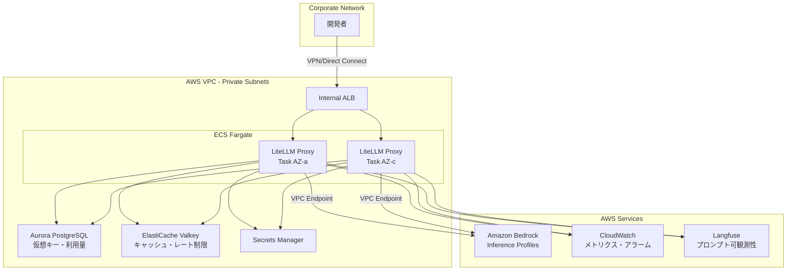

## ブログ概要（Summary）

本記事は [Building a Self-Service LLM Gateway with Amazon Bedrock and LiteLLM](https://aws.amazon.com/blogs/machine-learning/building-a-self-service-llm-gateway-with-amazon-bedrock-and-litellm/) の解説記事です。

AWSは2026年11月に公開したこのブログ記事で、Amazon Bedrock Application Inference ProfilesとオープンソースのLiteLLMプロキシを組み合わせ、社内開発者にセルフサービスでLLMアクセスを提供するリファレンスアーキテクチャを紹介している。LiteLLMをECS Fargate上で動作させ、OpenAI互換のAPIエンドポイントを通じてBedrockモデル（Claude、Nova等）を統一的に呼び出せる構成を提案している。開発者は仮想APIキーを発行し、個人ごとの利用量トラッキングと予算管理のもとでモデルにアクセスする仕組みである。

この記事は [Zenn記事: Fargate 32vCPU×LiteLLMで社内LLMゲートウェイをサーバーレス構築する](https://zenn.dev/0h_n0/articles/13b5175e562a56) の深掘りです。

## 情報源

- **種別**: 企業テックブログ（AWS Machine Learning Blog）
- **URL**: [https://aws.amazon.com/blogs/machine-learning/building-a-self-service-llm-gateway-with-amazon-bedrock-and-litellm/](https://aws.amazon.com/blogs/machine-learning/building-a-self-service-llm-gateway-with-amazon-bedrock-and-litellm/)
- **組織**: Amazon Web Services
- **発表日**: 2026年11月12日

## 技術的背景（Technical Background）

### LLMゲートウェイが必要とされる理由

企業がLLMを社内に展開する際、複数の課題が生じる。開発チームごとにAPIキーを直接管理すると、利用量の可視化やコスト配分が困難になる。また、Bedrock、OpenAI、Azure OpenAIなど複数プロバイダーのAPIを個別に扱うと、アプリケーションコードが特定のプロバイダーに密結合する。

LLMゲートウェイは、これらの課題を解決する中間層として機能する。すべてのLLMリクエストを単一のエンドポイントに集約し、認証・認可・利用量記録・レート制限を一元管理する。AWSはこのパターンを「セルフサービスLLMゲートウェイ」と位置づけ、LiteLLMをプロキシとして採用したリファレンスアーキテクチャを公開している。

### Amazon Bedrock Application Inference Profilesの役割

Bedrock Application Inference Profilesは、モデルへのアクセスをARN（Amazon Resource Name）で管理する仕組みである。AWSのブログによれば、Inference Profilesは以下の目的で使用される。

- **利用量トラッキング**: チームやプロジェクト単位でトークン使用量をCloudWatchメトリクスで追跡可能
- **コスト配分**: AWSのコスト配分タグと連携し、部門別コストを可視化
- **モデルルーティング**: 地理的プロファイル（特定リージョンに限定）またはグローバルプロファイル（商用リージョン全体）を設定可能

LiteLLMは、`claude-sonnet-4-6` のようなモデル名をInference Profile ARNに解決し、FargateタスクのIAMロールでBedrockに認証する。APIキーではなくIAMで認証するため、シークレット漏洩のリスクを低減できる。

### LiteLLMとは

LiteLLMは、100以上のLLMプロバイダーへのリクエストをOpenAI互換フォーマットに統一するオープンソースのプロキシサーバーである。AWSのブログでは、仮想APIキー発行、予算管理（トークン上限）、レート制限（RPM/TPM）、モデルルーティング、フォールバックの各機能が活用されている。

ただし、AWSのブログが明示しているように、セルフサービスのキー発行機能（SSO連携、監査ログ、委任管理）はLiteLLM Enterpriseライセンスが必要である。

## 実装アーキテクチャ（Architecture）

### 全体構成

AWSのブログおよびLiteLLM公式ドキュメントで説明されている構成は以下の通りである。



### ネットワーク設計のポイント

AWSのブログおよびClassmethodの実践記事では、Private Subnet配置、Internal ALB、VPC Endpoint（Bedrock Runtime/ECR/S3/Secrets Manager/CloudWatch Logs）の構成が推奨されている。Bedrock専用構成であればNAT Gatewayを排除しVPC Endpointのみで通信可能で、NAT Gatewayの月額コスト（約$32/月 + データ転送$0.062/GB）を削減できる。

### LiteLLM設定ファイルの構成

AWSのブログで紹介されている設定の主要部分を以下に示す。

```yaml
model_list:
  - model_name: "claude-sonnet-4.6"
    litellm_params:
      model: "bedrock/anthropic.claude-sonnet-4-6"
      aws_region_name: "ap-northeast-1"
  - model_name: "claude-opus-4.6"
    litellm_params:
      model: "bedrock/anthropic.claude-opus-4-6-v1"
      aws_region_name: "ap-northeast-1"
  - model_name: "nova-lite"
    litellm_params:
      model: "bedrock/amazon.nova-lite-v1:0"
      aws_region_name: "ap-northeast-1"

litellm_settings:
  drop_params: true
  set_verbose: false
  request_timeout: 600
  num_retries: 3

general_settings:
  master_key: "os.environ/LITELLM_MASTER_KEY"
  database_url: "os.environ/DATABASE_URL"
  store_model_in_db: true
```

**注意事項**: AWSのブログでは、Claude Sonnet 4.5以降のモデルはBedrock上で推論プロファイル（Inference Profile）経由での呼び出しが必須であると述べられている。LiteLLMは`aws_region_name`から適切なプロファイルを解決するが、直接指定する場合は`bedrock/jp.anthropic.claude-sonnet-4-6`のようにリージョンプレフィックスを付与する必要がある（2026年11月時点）。

### IAMロール設計

AWSのブログでは、Bedrock呼び出し権限を**タスクロール**に付与し、モデルARNを明示的に指定して最小権限を守る設計が推奨されている。

```hcl
resource "aws_iam_role_policy" "bedrock_invoke" {
  name = "bedrock-invoke"
  role = aws_iam_role.task_role.id
  policy = jsonencode({
    Version = "2012-10-17"
    Statement = [{
      Effect = "Allow"
      Action = [
        "bedrock:InvokeModel",
        "bedrock:InvokeModelWithResponseStream"
      ]
      Resource = [
        "arn:aws:bedrock:ap-northeast-1::foundation-model/anthropic.claude-sonnet-4-6",
        "arn:aws:bedrock:ap-northeast-1::foundation-model/anthropic.claude-opus-4-6-v1",
        "arn:aws:bedrock:ap-northeast-1::foundation-model/amazon.nova-lite-v1:0"
      ]
    }]
  })
}
```

Classmethodの記事でも、IAMポリシーでモデルARNを個別に指定する方式が採用されており、APIキーではなくIAM認証とすることでシークレット漏洩リスクを低減している。

### 予算管理とコスト追跡の注意点

ブログの解説記事（Remio.ai）によると、Bedrock Inference ProfilesのARNがLiteLLM内蔵のコストマップに一致しない場合、利用額が0として記録され、予算制限が機能しないケースが報告されている。対策として、LiteLLMの`custom_pricing`機能を使って入力・出力トークンの単価を明示的に設定する方法が紹介されている。

```yaml
model_list:
  - model_name: "claude-sonnet-4.6"
    litellm_params:
      model: "bedrock/anthropic.claude-sonnet-4-6"
      input_cost_per_token: 0.000003
      output_cost_per_token: 0.000015
```

また、予算とレート制限は独立した制御であり、同時リクエストが多い場合、使用量が記録される前に予算を一時的に超過する可能性がある。本番環境ではこの挙動を事前にテストすることが推奨されている。

### Auto Scalingの設定

AWSのブログでは、`ECSServiceAverageCPUUtilization`をターゲットにしたTarget Tracking Policy（`target_value = 60%`）が推奨されている。LiteLLMはAPIプロキシであるためCPU負荷は低い。Fargateはスケールトゥゼロ不可のため、最小でも1タスク分の課金が発生する。2 AZ分散で`min_capacity = 2`が推奨。

## Production Deployment Guide

### AWS実装パターン（コスト最適化重視）

**トラフィック量別の推奨構成**:

| 規模 | 月間リクエスト | 推奨構成 | 月額コスト（概算） | 主要サービス |
|------|--------------|---------|-------------------|------------|
| **Small** | ~3,000 (100/日) | Fargate最小構成 | $150-300 | Fargate(1vCPU/2GB×2) + RDS(db.t4g.micro) |
| **Medium** | ~30,000 (1,000/日) | Fargate + ElastiCache | $400-900 | Fargate(2vCPU/4GB×2) + Aurora Serverless v2 + ElastiCache |
| **Large** | 300,000+ (10,000/日) | Fargate + 高可用 | $1,500-3,500 | Fargate(4vCPU/8GB×4) + Aurora Multi-AZ + ElastiCache(Multi-AZ) |

**Small構成の詳細**（月額$150-300）:
- **Fargate**: ARM64(Graviton), 1vCPU/2GB × 2タスク（約$38×2 = $76/月）
- **RDS PostgreSQL**: db.t4g.micro, Single-AZ（約$15/月）
- **Secrets Manager**: 3シークレット（約$1.20/月）
- **Internal ALB**: 固定料金 + LCU（約$20/月）
- **VPC Endpoint**: bedrock-runtime 1個（約$10/月）
- **CloudWatch**: 基本監視（約$5/月）
- **Bedrock API利用料**: 別途従量課金

**Medium構成の詳細**（月額$400-900）:
- **Fargate**: ARM64, 2vCPU/4GB × 2タスク + Spot併用（約$150/月）
- **Aurora Serverless v2**: 0.5-4 ACU（約$80-200/月）
- **ElastiCache Valkey**: cache.t4g.micro × 1（約$15/月）
- **VPC Endpoints**: bedrock-runtime, ecr.api, secretsmanager, logs（約$40/月）
- **Langfuse**: セルフホスト or SaaS（約$50-100/月）
- **NAT Gateway**: 外部API利用時のみ（約$32/月 + データ転送）

**コスト試算の注意事項**:
- 上記は2026年11月時点のAWS ap-northeast-1（東京）リージョン料金に基づく概算値
- Bedrock API利用料（トークン課金）は含まれていない
- 実際のコストはトラフィックパターン、モデル選択、レスポンスサイズにより変動
- 最新料金は [AWS料金計算ツール](https://calculator.aws/) で確認を推奨

### Terraformインフラコード

**Small構成の主要リソース（Fargate + RDS + VPC Endpoint）**:

```hcl
resource "aws_vpc_endpoint" "bedrock_runtime" {
  vpc_id              = module.vpc.vpc_id
  service_name        = "com.amazonaws.ap-northeast-1.bedrock-runtime"
  vpc_endpoint_type   = "Interface"
  private_dns_enabled = true
  subnet_ids          = module.vpc.private_subnets
  security_group_ids  = [aws_security_group.vpc_endpoints.id]
}

resource "aws_iam_role_policy" "bedrock_invoke" {
  name = "bedrock-invoke"
  role = aws_iam_role.task_role.id
  policy = jsonencode({
    Version = "2012-10-17"
    Statement = [{
      Effect   = "Allow"
      Action   = ["bedrock:InvokeModel", "bedrock:InvokeModelWithResponseStream"]
      Resource = [
        "arn:aws:bedrock:ap-northeast-1::foundation-model/anthropic.claude-sonnet-4-6",
        "arn:aws:bedrock:ap-northeast-1::foundation-model/amazon.nova-lite-v1:0"
      ]
    }]
  })
}
```

**Large構成のポイント（Fargate Spot併用 + Aurora Serverless v2）**:

```hcl
resource "aws_ecs_service" "litellm_gateway" {
  name            = "litellm-gateway"
  cluster         = aws_ecs_cluster.litellm.id
  task_definition = aws_ecs_task_definition.litellm.arn
  desired_count   = 4

  capacity_provider_strategy {
    capacity_provider = "FARGATE"
    weight            = 1
    base              = 2
  }
  capacity_provider_strategy {
    capacity_provider = "FARGATE_SPOT"
    weight            = 3
  }
}

resource "aws_budgets_budget" "llm_monthly" {
  name         = "llm-gateway-monthly"
  budget_type  = "COST"
  limit_amount = "3500"
  limit_unit   = "USD"
  time_unit    = "MONTHLY"

  notification {
    comparison_operator        = "GREATER_THAN"
    threshold                  = 80
    threshold_type             = "PERCENTAGE"
    notification_type          = "ACTUAL"
    subscriber_email_addresses = ["ops@example.com"]
  }
}
```

### セキュリティベストプラクティス

- **ネットワーク**: Internal ALB + Private Subnet配置 + VPC Endpoint。パブリックIP付与禁止
- **認証**: IAMロールによるBedrock認証（APIキー不使用）。IAMポリシーでモデルARNを個別指定
- **シークレット**: Secrets Manager一元管理。環境変数へのハードコード禁止
- **暗号化**: RDS/ElastiCacheの保管時（KMS）・転送中（TLS）暗号化
- **監査**: CloudTrail有効化 + LiteLLMリクエストログのS3出力（Athena分析可能）

### 運用・監視設定

**CloudWatch Logs Insightsクエリ**:

```sql
-- モデル別のリクエスト数とトークン使用量（1時間単位）
fields @timestamp, model, input_tokens, output_tokens, user
| stats count(*) as requests,
        sum(input_tokens) as total_input,
        sum(output_tokens) as total_output
  by bin(1h), model

-- レイテンシ分析（P95/P99）
fields @timestamp, duration_ms, model
| stats pct(duration_ms, 95) as p95,
        pct(duration_ms, 99) as p99,
        avg(duration_ms) as avg_ms
  by bin(5m), model
| filter p99 > 5000
```

**CloudWatchアラーム**: ALBの5XXエラー率とP99レイテンシ（10秒超過）を監視し、SNS経由で通知する構成が推奨される。

**X-Rayトレーシング**: `aws_xray_sdk`の`patch_all()`でboto3を自動計装し、モデル名やトークン数をアノテーション・メタデータとして記録することで、リクエスト単位のコスト追跡が可能になる。

**Cost Explorer**: 日次でBedrock/ECS/RDSのサービス別コストを取得し、閾値超過時にSNS通知するスクリプトを定期実行する。

### コスト最適化チェックリスト

**リソース最適化**: Graviton(ARM64)でvCPU単価約20%削減、Fargate Spot併用（base=2でOn-Demand確保）、Aurora Serverless v2でアイドル時スケールダウン、EventBridge Schedulerで夜間desired_count削減

**LLMコスト削減**: Bedrock Batch APIで50%割引、Prompt Cachingで30-90%削減、モデル選択ロジック（簡易タスク→Nova Lite、複雑タスク→Claude Sonnet）、custom_pricing設定、max_tokens制限

**監視**: AWS Budgets（80%警告/100%アラート）、CloudWatch（CPU/5XX/P99）、Cost Anomaly Detection、日次コストレポート（SNS/Slack通知）

## パフォーマンス最適化（Performance）

### LiteLLMゲートウェイのリソース要件

AWSのブログでは、LiteLLMはAPIプロキシとして動作するため、CPU演算負荷が低いワークロードであると説明されている。ゲートウェイ型の場合、モデル推論自体はBedrock側で実行されるため、Fargateタスクには大きなリソースは不要である。

Zenn記事で指摘されているように、2vCPU/4GB程度で十分なケースが多い。ただし、Classmethodの実践記事では、LiteLLMイメージが512MBメモリ設定ではOOM Kill（exit 137）でヘルスチェックに失敗するケースが報告されている。最低1GBのメモリ割り当てが推奨される。

### レスポンスキャッシュの効果

ElastiCache Valkeyによるレスポンスキャッシュは、同一プロンプトへの繰り返しリクエストが多い環境で有効である。システムプロンプトが固定された社内チャットボットなどでは、キャッシュヒット率の向上によりBedrock API呼び出し回数を削減できる。

### VPC Endpointによるレイテンシ改善

Bedrock RuntimeへのVPC Endpointを配置することで、NAT Gateway経由のルーティングを回避し、ネットワークレイテンシを低減できる。VPC Endpointにはインターフェースエンドポイントの時間課金（$0.014/h ≒ 約$10/月）があるため、トラフィック量に応じてNAT Gatewayとのコスト比較が必要である。

## 運用での学び（Production Lessons）

### よくある問題と対策

AWSのブログおよび関連する実践記事から得られる運用知見をまとめる。

| 問題 | 原因 | 対策 |
|------|------|------|
| LiteLLMがOOM Kill | メモリ不足（512MB以下） | 最低1GB、推奨2GBのメモリ割り当て |
| 予算が0として記録 | Inference Profile ARNがコストマップ不一致 | custom_pricing設定でトークン単価を明示 |
| シークレットローテーション失敗 | ECSタスク起動時にのみ注入 | ローテーション後にタスク強制再デプロイ |
| Spot中断でサービスダウン | 全タスクがSpot配置 | base=2でOn-Demand最低確保 |
| RDS接続エラー | パスワードに予約文字 | LiteLLMは`quote_plus()`で処理するため生パスワードで可 |

### Langfuseトレースのデータ管理

ブログの解説記事によると、Langfuseのトレースにはプロンプト、レスポンス、使用量、タイミング情報が含まれるため、独自のデータ保持ポリシーとアクセス制御が必要である。サーバーサイドの機密データマスキングは非同期で実行されるため、中間ストレージにデータが一時的に保存される点に注意が必要である。

### Inference Profilesの制約

Inference Profilesはモデルアクセスの論理グループ化を提供するが、プロファイルごとに専用のBedrock容量が割り当てられるわけではない。AWSのBedrock利用枠（クォータ）はアカウント単位で適用されるため、複数のプロファイルが同一のクォータを共有する。大量のリクエストを処理する場合は、クォータ引き上げのリクエストが必要になる場合がある。

## 学術研究との関連（Academic Connection）

LLMゲートウェイの概念は、RouteLLM（Ong et al., arXiv:2406.18665, ICLR 2025）で提唱されたLLMルーティングの研究と関連する。RouteLLMでは、クエリの難易度に応じて安価なモデルと高性能なモデルを動的に切り替えることで、コストと品質のトレードオフを最適化する手法が提案されている。LiteLLMのモデルルーティング機能は、このような学術研究の実用的な実装の一つとみなせる。

また、ServerlessLLM（Fu et al., arXiv:2401.14351, OSDI '24）では、サーバーレス環境でのLLM推論を効率化するためのチェックポイントローディング最適化が研究されている。Fargate上でのLiteLLMゲートウェイは、推論自体はBedrock側で行うためチェックポイントローディングの問題は発生しないが、コンテナのコールドスタート最適化という共通の課題を持つ。

## まとめと実践への示唆

AWSが公開したLiteLLM + Bedrockゲートウェイのリファレンスアーキテクチャは、社内LLMアクセスを統一的に管理するための実用的なパターンを提示している。OpenAI互換APIによるプロバイダー抽象化、仮想キーによるセルフサービスアクセス、IAM認証によるセキュリティ強化が主要な設計ポイントである。

**導入時の判断ポイント**:
- セルフサービスキー発行にはLiteLLM Enterpriseライセンスが必要
- VPC Endpoint vs NAT Gatewayのコスト比較はトラフィック量に依存
- Inference ProfilesのARNとLiteLLMのコストマップの整合性確認が重要
- Graviton (ARM64) 採用でvCPU単価約20%削減が見込める

Zenn記事で紹介されている32vCPU構成はCPU推論パターン向けであり、本ブログのゲートウェイパターンでは2-4vCPU程度で十分動作する。ユースケースに応じてゲートウェイ型とCPU推論型を使い分けることが重要である。

## 参考文献

- **Blog URL**: [Building a Self-Service LLM Gateway with Amazon Bedrock and LiteLLM](https://aws.amazon.com/blogs/machine-learning/building-a-self-service-llm-gateway-with-amazon-bedrock-and-litellm/) - AWS Machine Learning Blog
- **LiteLLM AWS Deployment Guide**: [https://docs.litellm.ai/docs/proxy/deploy/cloud/aws](https://docs.litellm.ai/docs/proxy/deploy/cloud/aws)
- **Multi-Provider GenAI Gateway on AWS**: [https://aws.amazon.com/solutions/guidance/multi-provider-generative-ai-gateway-on-aws](https://aws.amazon.com/solutions/guidance/multi-provider-generative-ai-gateway-on-aws)
- **Classmethod実践記事**: [LiteLLM ProxyをECS Fargateにデプロイする構成をTerraform + ecspressoで組んでみた](https://dev.classmethod.jp/articles/litellm-proxy-on-fargate/)
- **RouteLLM**: [arXiv:2406.18665](https://arxiv.org/abs/2406.18665) - ICLR 2025
- **Related Zenn article**: [Fargate 32vCPU×LiteLLMで社内LLMゲートウェイをサーバーレス構築する](https://zenn.dev/0h_n0/articles/13b5175e562a56)
