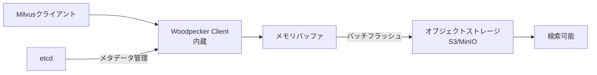
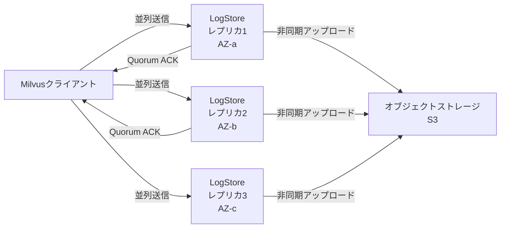

本記事は [https://milvus.io/blog/how-woodpecker-keeps-wal-writes-fast-and-retention-cheap-in-milvus-3-0.md](https://milvus.io/blog/how-woodpecker-keeps-wal-writes-fast-and-retention-cheap-in-milvus-3-0.md) の解説記事です。

## ブログ概要（Summary）

Milvus 3.0が導入したWoodpeckerは、従来のKafka/Pulsarへの外部依存を排除し、クラウドネイティブ環境に最適化された自前のWAL（Write-Ahead Log）である。Milvus開発チームは、Woodpeckerを「BookKeeperのアイデアを借りつつ、クラウドストレージとネットワーキングを前提にデータパスを再設計した」ものと説明している。Embedded mode（Milvus 2.6+）とService mode（Milvus 3.0+）の2モードを提供し、ワークロード特性に応じた書き込みレイテンシとインフラコストのトレードオフを制御可能にしている。

この記事は [Zenn記事: ベクトルDB書き込み性能徹底比較2026：リアルタイム更新×同時検索で変わる5製品の本番適性](https://zenn.dev/0h_n0/articles/c07ae2ade39a4e) の深掘りです。

## 情報源

- **種別**: 企業テックブログ（Milvus / Zilliz）
- **URL**: [https://milvus.io/blog/how-woodpecker-keeps-wal-writes-fast-and-retention-cheap-in-milvus-3-0.md](https://milvus.io/blog/how-woodpecker-keeps-wal-writes-fast-and-retention-cheap-in-milvus-3-0.md)
- **著者**: Zhenyuan Wei（Zilliz）
- **発表日**: 2026年9月2日
- **組織**: Zilliz（Milvus開発元）

## 技術的背景（Technical Background）

### WALが解決する3つのトレードオフ

ベクトルデータベースにおけるWALは、以下の3つの要素のトレードオフを管理する中核コンポーネントである。

1. **耐久性（Durability）**: 書き込みデータの永続化保証
2. **レイテンシ（Latency）**: クライアントへの応答速度
3. **コスト（Cost）**: ストレージとネットワークの運用費用

従来のMilvus（2.x系）では、このWALとしてKafkaまたはPulsarを外部依存として使用していた。Milvus開発チームは、クラウド環境における3つの課題を指摘している。

| 課題 | 詳細 |
|------|------|
| レプリケーショントラフィック | Cross-AZネットワークコストが運用費に直結 |
| ローカルSSDの費用 | オブジェクトストレージと比較して高コスト |
| リカバリとスケーリング | ノード動的交換時の復旧複雑度 |

これらの課題に対して、Woodpeckerは「Kafkaクラスタの管理が不要になる」設計を採用した。具体的には、Helm deploymentからKafka/Pulsarの個別インストール・運用が排除される。

### ベクトルDBにおけるWALの特殊要件

一般的なRDBMSのWALと異なり、ベクトルDBのWALには特有の要件がある。arXiv 2605.01260のサーベイ論文では、Milvusのアーキテクチャについて以下の点が指摘されている。

- WALが**唯一の信頼源（source of truth）**として機能する
- 各ログエントリにTSOタイムスタンプが付与され、スナップショット分離読み取りを実現
- **Growing Segment**（メモリ上の成長中セグメント）はbrute-force検索で即座に検索可能になる
- サイズ閾値に達すると**Sealed Segment**としてHNSW/IVFインデックスが構築される

つまり、WALの設計がそのままベクトル検索の書き込み可視化レイテンシに影響する。

## 実装アーキテクチャ（Architecture）

Woodpeckerは2つの動作モードを提供する。ワークロードのレイテンシ要件とインフラ予算に応じて選択する。

### Embedded mode（Milvus 2.6+）



Embedded modeでは、Milvusプロセス内にWoodpeckerクライアントが組み込まれる。専用のログサーバは存在しない。

**書き込みパス**:
1. クライアントが書き込みリクエストを送信
2. Woodpeckerクライアントがメモリ内にバッファリング
3. バッチ間隔に達するとオブジェクトストレージへフラッシュ
4. フラッシュ完了をもって書き込みACK

**バッチ間隔のデフォルト値**（Milvus公式ドキュメントによる）:

| ストレージバックエンド | バッチ間隔 |
|----------------------|----------|
| ローカルファイルシステム | 10 ms |
| MinIO等のオブジェクトストレージ | 200 ms |

Milvus公式ドキュメントでは、Embedded modeの書き込みレイテンシが「一般に200〜500ms」と記載されている箇所がある一方、バッチ間隔のデフォルト値との間に矛盾がある点に注意が必要である。

**利点**: インフラ構成が最小限。専用のログサーバが不要で、etcdとオブジェクトストレージのみで動作する。

**制約**: 書き込みACKがオブジェクトストレージへの到達を待つため、per-write レイテンシがバッチ間隔に束縛される。

### Service mode（Milvus 3.0+）



Service modeでは、クライアントとオブジェクトストレージの間にLogStoreレプリカが配置される。

**書き込みパス**:
1. クライアントがペイロードを**並列で**全レプリカに直接送信
2. **Quorum（過半数）のACK**を受信した時点で書き込み完了
3. オブジェクトストレージへのアップロードは**ACKパスの外**で非同期実行
4. 完了したセグメントは丸ごとオブジェクトストレージにアップロード

Milvus開発チームは、Service modeの書き込みレイテンシについて「同等ハードウェア上でミリ秒レンジを維持する」と説明している。クライアントがレプリカへ直接送信するため、ブローカーやリーダーを経由する従来方式と異なり、Quorumレプリケーションが**1ネットワークラウンドトリップ**で完了する。

**フェイルオーバー**: 障害発生時、生存レプリカが未アップロードのログデータをオブジェクトストレージにアップロードするため、交代レプリカはピアからの完全な履歴コピーを必要としない。

### 2モードの比較

| 項目 | Embedded mode | Service mode |
|------|--------------|--------------|
| 導入バージョン | Milvus 2.6+ | Milvus 3.0+ |
| 専用サーバ | 不要 | LogStoreレプリカが必要 |
| 書き込みレイテンシ | バッチ間隔依存（10〜200ms+） | ミリ秒レンジ（ブログ記載） |
| 耐久性保証 | オブジェクトストレージ到達時 | Quorum ACK時 |
| インフラコスト | 最小 | LogStore計算資源が追加 |
| 推奨用途 | 開発環境・小規模本番 | レイテンシ重視の本番環境 |

## パフォーマンス最適化（Performance）

### スループットベンチマーク

Milvus公式ブログ（別記事「We Replaced Kafka/Pulsar with a Woodpecker for Milvus」）では、単一ノード・単一クライアント・単一ログストリーム構成でのベンチマーク結果が報告されている。

| WALバックエンド | スループット (MB/s) | Kafka比 | Pulsar比 |
|---------------|-------------------|---------|---------|
| **Woodpecker (S3)** | 750 | 5.8倍 | 7.0倍 |
| **Woodpecker (ローカルFS)** | 450 | 3.5倍 | 4.2倍 |
| Kafka | 129.96 | 1.0倍 | — |
| Pulsar | 107 | — | 1.0倍 |
| **Woodpecker (MinIO)** | 71 | 0.5倍 | 0.7倍 |

S3モードでの750 MB/sという値は、Milvus開発チームによれば「S3の理論限界の約68%」に相当する。ただし、S3モードのレイテンシは166msであり、バッチ指向ワークロード向けのトレードオフである。

**注意事項**: これらのベンチマークはMilvus自身が実施したものであり、独立した第三者検証は確認されていない。Kafka/Pulsarとの比較もMilvusが設定した条件下で行われている。

### Cross-AZネットワークコスト削減

Milvus開発チームは、従来のブローカー仲介型WALとWoodpecker Service modeのCross-AZトラフィック量を以下のように比較している。

**前提条件**: 3 AZ構成、各AZに1レプリカ、クライアントは1つのAZ

| パス | ブローカー仲介型 | Woodpecker Service |
|------|---------------|-------------------|
| 書き込み | 平均 2 + 2/3 Cross-AZペイロードコピー | 2 Cross-AZペイロードコピー |
| 読み取り | 平均 2/3 がCross-AZ | 同一AZレプリカから読み取り可能 |

ブログの試算（20 MB/s定常、30日間）:
- **書き込みパスの節約**: 51,840 GB × $0.02/GB × 2/3 = **$691.20/月**
- **読み取りパスの節約**: 全ローカル読み取り時、同額の**$691.20/月**
- **合計Cross-AZ通信費削減**: 最大約**$1,382/月**

### ストレージコスト削減

72時間リテンション、20 MB/sでの書き込みの場合:

| アプローチ | データ量 | 月額コスト（例示レート） |
|----------|--------|----------------------|
| gp3 × 3レプリカ ($0.12/GB-月) | 15,552 GB | $1,866.24 |
| S3 Standard × 1コピー ($0.023/GB-月) | 5,184 GB | $119.23 |

差額は約**$1,747/月**。gp3はS3の約**15.7倍**のコストとブログでは試算されている。ただし、Service modeではLogStoreの計算資源、ローカル容量、オブジェクトストレージのリクエストコストが別途発生する点がブログでも注記されている。

## Production Deployment Guide

### AWS実装パターン（コスト最適化重視）

Milvus + Woodpeckerをベクトル検索基盤としてAWS上に構築する場合の推奨構成を示す。

| 規模 | 月間リクエスト | 推奨構成 | 月額コスト | 主要サービス |
|------|-------------|---------|-----------|------------|
| **Small** | ~3,000 (100/日) | Serverless | $200-400 | Lambda + Milvus Lite + S3 |
| **Medium** | ~30,000 (1,000/日) | ECS + Milvus Standalone | $500-1,200 | ECS Fargate + S3 + ElastiCache |
| **Large** | 300,000+ (10,000/日) | EKS + Milvus Distributed | $3,000-8,000 | EKS + S3 + Woodpecker Service |

**Small構成の詳細** (月額$200-400):
- **Lambda**: Milvus Lite（Embedded mode）をLambda Layers経由で利用（$30/月）
- **S3**: Woodpecker WAL + ベクトルストレージ（$20/月）
- **DynamoDB**: メタデータ管理、On-Demand（$10/月）
- **API Gateway**: REST API（$5/月）
- **注意**: Milvus Liteは100万ベクトル以下の小規模向け

**Medium構成の詳細** (月額$500-1,200):
- **ECS Fargate**: Milvus Standalone、2 vCPU / 8GB RAM × 2タスク（$200/月）
- **S3**: Woodpecker Embedded mode WAL（$30/月）
- **ElastiCache Redis**: メタデータキャッシュ、cache.t3.micro（$15/月）
- **etcd**: ECSタスクとして稼働（$50/月）
- **ALB**: ロードバランサ（$20/月）

**Large構成の詳細** (月額$3,000-8,000):
- **EKS**: Milvus Distributedクラスタ（コントロールプレーン$72/月）
- **EC2**: StreamingNode + QueryNode + DataNode（r6i.xlarge × 3-6台、$600-1,200/月）
- **Woodpecker Service mode**: LogStoreレプリカ × 3 AZ（$300/月）
- **S3**: WAL + セグメントストレージ（$100/月）
- **etcd**: 3ノードクラスタ（$150/月）

**コスト試算の注意事項**:
- 上記は2026年11月時点のAWS ap-northeast-1（東京）リージョン料金に基づく概算値
- 実際のコストはベクトル数、次元数、クエリパターンにより大きく変動
- 最新料金は [AWS料金計算ツール](https://calculator.aws/) で確認を推奨

### Terraformインフラコード

**Medium構成: ECS Fargate + Milvus Standalone + Woodpecker Embedded**

```hcl
module "vpc" {
  source  = "terraform-aws-modules/vpc/aws"
  version = "~> 5.0"

  name = "milvus-vpc"
  cidr = "10.0.0.0/16"
  azs  = ["ap-northeast-1a", "ap-northeast-1c"]
  private_subnets = ["10.0.1.0/24", "10.0.2.0/24"]
  public_subnets  = ["10.0.101.0/24", "10.0.102.0/24"]

  enable_nat_gateway = true
  single_nat_gateway = true
  enable_dns_hostnames = true
}

resource "aws_ecs_cluster" "milvus" {
  name = "milvus-cluster"

  setting {
    name  = "containerInsights"
    value = "enabled"
  }
}

resource "aws_ecs_task_definition" "milvus_standalone" {
  family                   = "milvus-standalone"
  network_mode             = "awsvpc"
  requires_compatibilities = ["FARGATE"]
  cpu                      = "2048"
  memory                   = "8192"
  execution_role_arn       = aws_iam_role.ecs_execution.arn
  task_role_arn            = aws_iam_role.milvus_task.arn

  container_definitions = jsonencode([{
    name  = "milvus"
    image = "milvusdb/milvus:v2.6-latest"
    portMappings = [{
      containerPort = 19530
      protocol      = "tcp"
    }]
    environment = [
      { name = "MILVUS_STORAGE_TYPE", value = "remote" },
      { name = "MINIO_ADDRESS",       value = "s3.ap-northeast-1.amazonaws.com" },
      { name = "MINIO_BUCKET_NAME",   value = aws_s3_bucket.milvus_data.id },
      { name = "WOODPECKER_ENABLED",  value = "true" },
      { name = "WOODPECKER_EMBEDDED", value = "true" }
    ]
    logConfiguration = {
      logDriver = "awslogs"
      options = {
        "awslogs-group"         = aws_cloudwatch_log_group.milvus.name
        "awslogs-region"        = "ap-northeast-1"
        "awslogs-stream-prefix" = "milvus"
      }
    }
  }])
}

resource "aws_s3_bucket" "milvus_data" {
  bucket = "milvus-woodpecker-data"
}

resource "aws_s3_bucket_server_side_encryption_configuration" "milvus_data" {
  bucket = aws_s3_bucket.milvus_data.id
  rule {
    apply_server_side_encryption_by_default {
      sse_algorithm = "aws:kms"
    }
  }
}

resource "aws_iam_role" "milvus_task" {
  name = "milvus-task-role"
  assume_role_policy = jsonencode({
    Version = "2012-10-17"
    Statement = [{
      Action    = "sts:AssumeRole"
      Effect    = "Allow"
      Principal = { Service = "ecs-tasks.amazonaws.com" }
    }]
  })
}

resource "aws_iam_role_policy" "milvus_s3" {
  role = aws_iam_role.milvus_task.id
  policy = jsonencode({
    Version = "2012-10-17"
    Statement = [{
      Effect   = "Allow"
      Action   = ["s3:GetObject", "s3:PutObject", "s3:DeleteObject", "s3:ListBucket"]
      Resource = [
        aws_s3_bucket.milvus_data.arn,
        "${aws_s3_bucket.milvus_data.arn}/*"
      ]
    }]
  })
}

resource "aws_cloudwatch_log_group" "milvus" {
  name              = "/ecs/milvus"
  retention_in_days = 30
}

resource "aws_cloudwatch_metric_alarm" "milvus_cpu" {
  alarm_name          = "milvus-cpu-high"
  comparison_operator = "GreaterThanThreshold"
  evaluation_periods  = 2
  metric_name         = "CPUUtilization"
  namespace           = "AWS/ECS"
  period              = 300
  statistic           = "Average"
  threshold           = 80
  alarm_description   = "Milvus CPU使用率が80%を超過"

  dimensions = {
    ClusterName = aws_ecs_cluster.milvus.name
    ServiceName = "milvus-standalone"
  }
}
```

**Large構成: EKS + Milvus Distributed + Woodpecker Service mode**

```hcl
module "eks" {
  source  = "terraform-aws-modules/eks/aws"
  version = "~> 20.0"

  cluster_name    = "milvus-distributed"
  cluster_version = "1.31"

  vpc_id     = module.vpc.vpc_id
  subnet_ids = module.vpc.private_subnets

  cluster_endpoint_public_access = true
  enable_cluster_creator_admin_permissions = true
}

resource "helm_release" "milvus" {
  name       = "milvus"
  repository = "https://zilliztech.github.io/milvus-helm"
  chart      = "milvus"
  namespace  = "milvus"
  create_namespace = true

  set {
    name  = "image.all.tag"
    value = "v3.0.3"
  }
  set {
    name  = "streaming.enabled"
    value = "true"
  }
  set {
    name  = "streaming.woodpecker.embedded"
    value = "false"
  }
  set {
    name  = "woodpecker.enabled"
    value = "true"
  }
  set {
    name  = "woodpecker.image.tag"
    value = "v0.1.46"
  }
  set {
    name  = "minio.enabled"
    value = "false"
  }
  set {
    name  = "externalS3.enabled"
    value = "true"
  }
  set {
    name  = "externalS3.bucketName"
    value = aws_s3_bucket.milvus_data.id
  }
  set {
    name  = "externalS3.region"
    value = "ap-northeast-1"
  }
}

resource "aws_budgets_budget" "milvus_monthly" {
  name         = "milvus-monthly-budget"
  budget_type  = "COST"
  limit_amount = "8000"
  limit_unit   = "USD"
  time_unit    = "MONTHLY"

  notification {
    comparison_operator        = "GREATER_THAN"
    threshold                  = 80
    threshold_type             = "PERCENTAGE"
    notification_type          = "ACTUAL"
    subscriber_email_addresses = ["ops@example.com"]
  }
}
```

### セキュリティベストプラクティス

1. **ネットワーク**: EKS `cluster_endpoint_public_access = false` を本番では設定。VPN/Direct Connect経由アクセス
2. **IAM**: S3アクセスは最小権限。`s3:*` ではなく必要なアクションのみ許可
3. **暗号化**: S3バケットはKMS暗号化必須。etcdデータもKMS暗号化
4. **シークレット**: Milvus認証情報はSecrets Managerに格納。環境変数ハードコード禁止
5. **監査**: CloudTrailでS3/EKS操作を記録。Config Rulesでリソース構成を監視

### 運用・監視設定

**CloudWatch Logs Insightsクエリ**:

```sql
-- Milvus WAL書き込みレイテンシ監視
fields @timestamp, @message
| filter @message like /woodpecker/
| stats avg(write_latency_ms) as avg_lat,
        pct(write_latency_ms, 99) as p99_lat
        by bin(5m)

-- セグメントフラッシュ頻度
fields @timestamp, @message
| filter @message like /segment sealed/
| stats count() as seal_count by bin(1h)
```

**CloudWatchアラーム（Python）**:

```python
import boto3

cloudwatch = boto3.client('cloudwatch')

cloudwatch.put_metric_alarm(
    AlarmName='milvus-wal-latency-spike',
    ComparisonOperator='GreaterThanThreshold',
    EvaluationPeriods=2,
    MetricName='WALWriteLatency',
    Namespace='Milvus/Woodpecker',
    Period=300,
    Statistic='p99',
    Threshold=500,
    ActionsEnabled=True,
    AlarmActions=['arn:aws:sns:ap-northeast-1:123456789:milvus-alerts'],
    AlarmDescription='Woodpecker WAL書き込みP99レイテンシが500msを超過'
)
```

**Cost Explorer日次レポート**:

```python
import boto3
from datetime import datetime, timedelta

ce = boto3.client('ce')

response = ce.get_cost_and_usage(
    TimePeriod={
        'Start': (datetime.now() - timedelta(days=1)).strftime('%Y-%m-%d'),
        'End': datetime.now().strftime('%Y-%m-%d')
    },
    Granularity='DAILY',
    Metrics=['UnblendedCost'],
    GroupBy=[{'Type': 'SERVICE', 'Key': 'SERVICE'}],
    Filter={
        'Tags': {
            'Key': 'Project',
            'Values': ['milvus-vectordb']
        }
    }
)

for result in response['ResultsByTime']:
    for group in result['Groups']:
        service = group['Keys'][0]
        cost = float(group['Metrics']['UnblendedCost']['Amount'])
        if cost > 50:
            print(f"⚠️ {service}: ${cost:.2f}/日")
```

### コスト最適化チェックリスト

**アーキテクチャ選択**:
- [ ] ~100万ベクトル → Milvus Lite/Standalone + Embedded mode
- [ ] ~1,000万ベクトル → Milvus Standalone + ECS Fargate
- [ ] 1億ベクトル以上 → Milvus Distributed + EKS + Service mode

**ストレージ最適化**:
- [ ] WALストレージはS3 Standard（Woodpecker前提）
- [ ] セグメントストレージはS3 Intelligent-Tiering検討
- [ ] etcdデータはEBSのgp3（IOPS設定注意）
- [ ] gp3のスナップショットライフサイクル設定（30日）

**ネットワーク最適化**:
- [ ] Service mode使用時はCross-AZ通信量を監視
- [ ] VPCエンドポイント（S3 Gateway）設定でNAT Gateway費用削減
- [ ] クライアントとLogStoreを同一AZに配置

**LLMコスト削減**（Milvusと連携するRAGパイプライン向け）:
- [ ] Bedrock Batch API使用（50%削減）
- [ ] Prompt Caching有効化（30-90%削減）
- [ ] Embedモデルは用途に応じて選択（Titan Embedding: $0.02/1K tokens）

**監視・アラート**:
- [ ] AWS Budgets月額予算設定
- [ ] CloudWatchでWALレイテンシ・セグメントフラッシュ監視
- [ ] S3リクエストコスト監視（PUT/GET回数）
- [ ] Cost Anomaly Detection有効化

## 運用での学び（Production Lessons）

### v3.0.1のデッドロック問題

Milvus v3.0.1のリリースノートでは、「ストリーミングサービスへの切り替え時にデッドロックが発生する」問題が修正されたことが記載されている。Woodpecker Service modeは設計としては安定性を目指しているが、初期バージョンでこの種の問題が顕在化していた点は、本番導入時の注意点として重要である。

### Embedded modeのレイテンシ不整合

公式ドキュメント間でEmbedded modeのレイテンシ記載に不整合がある。バッチ間隔が「ローカルFS 10ms、MinIO 200ms」とする記載と、「書き込みレイテンシは一般に200〜500ms」とする記載が共存している。本番導入前には、自社環境での実測が不可欠である。

### アップロードスループットの制約

Embedded modeでは、オブジェクトストレージへのアップロードスループットがインジェストレートに追いつかない場合、未アップロードセグメントがローカルディスクに蓄積される。ブログでは「1 GB/sで1時間遅延すると3.6 TBがローカルに滞留する」と試算されている。

### モニタリングの重要ポイント

| 監視項目 | 閾値例 | 対処方針 |
|---------|-------|---------|
| WAL書き込みレイテンシ（P99） | > 500ms | Embedded → Service mode移行検討 |
| ローカルディスク使用量 | > 80% | アップロードバックログ確認 |
| セグメント封印頻度 | 急増 | flushInterval調整 |
| Cross-AZトラフィック | 予算超過 | クライアントAZ配置見直し |

## 学術研究との関連（Academic Connection）

Milvus開発チームは、WoodpeckerがApache BookKeeperのアイデアを借りていると説明している。BookKeeperは分散ログサービスとして広く研究されているが、Woodpeckerとの主な違いは以下の点である。

- **BookKeeper**: ローカルディスクへの書き込みが主経路。レプリカ間の一貫性をBookie（専用ストレージサーバ）が保証
- **Woodpecker**: オブジェクトストレージを最終的な永続化先とし、ローカルディスクは一時バッファとして機能

arXiv 2605.01260のサーベイ論文「Write-Read Decoupling in Modern Large-Scale Search Engines」では、WALベースの書き込みパスを「ログ構造化書き込みパス」パターンとして分類し、Milvusのアーキテクチャ（Growing Segment + Sealed Segment）を代表例として取り上げている。同論文は「書き込み耐久性は即座に保証されるが、クエリ可視性はビルドパスに依存する」というトレードオフを指摘している。

また、arXiv 2606.08950「When More Cores Hurts」の実験では、Milvusの挿入スループットが16プロキシ/ストリーミングノードで約61,344 vec/sに達した後、それ以上の増加で低下することが報告されている。同論文はWALとストレージのレイテンシが挿入性能のボトルネックであるとしており、Woodpeckerによるこの制約の緩和が本番性能にどの程度影響するかは今後の独立検証が待たれる。

## まとめと実践への示唆

Woodpeckerは、Milvusの書き込みパスにおけるKafka/Pulsar依存を排除し、クラウドネイティブ環境でのコスト最適化と運用簡素化を実現するWALである。Milvus開発チームのベンチマークでは、S3バックエンドでKafkaの5.8倍、Pulsarの7倍のスループットが報告されている。ただし、以下の点に留意が必要である。

1. **ベンチマークの独立性**: 現時点でMilvus以外による独立検証は確認されていない
2. **Service modeの安定性**: v3.0.1のデッドロック問題が示すように、まだ成熟過程にある
3. **レイテンシの実測**: ドキュメント間の不整合があるため、自社環境での検証が不可欠
4. **コスト試算の前提**: ブログの試算は特定の前提（3AZ、20MB/s定常）に基づいており、自社ワークロードでの再計算が必要

ベクトルDBの書き込み性能を評価する際、WALの設計がインジェストスループットと検索可視化レイテンシの双方に直接影響する。Woodpeckerの設計思想——書き込みACKパスからオブジェクトストレージを分離し、Cross-AZトラフィックを最小化する——は、今後の他製品のWAL設計にも影響を与える可能性がある。

## 参考文献

- **Blog URL**: [How Woodpecker Keeps WAL Writes Fast and Retention Cheap in Milvus 3.0](https://milvus.io/blog/how-woodpecker-keeps-wal-writes-fast-and-retention-cheap-in-milvus-3-0.md)
- **Blog URL**: [We Replaced Kafka/Pulsar with a Woodpecker for Milvus](https://milvus.io/blog/we-replaced-kafka-pulsar-with-a-woodpecker-for-milvus.md)
- **Docs**: [Woodpecker Architecture](https://milvus.io/docs/woodpecker_architecture.md)
- **Docs**: [Use Woodpecker](https://milvus.io/docs/use-woodpecker.md)
- **arXiv**: [Write-Read Decoupling in Modern Large-Scale Search Engines (2605.01260)](https://arxiv.org/abs/2605.01260)
- **arXiv**: [When More Cores Hurts: The Vector Database Scaling Paradox in HPC (2606.08950)](https://arxiv.org/abs/2606.08950)
- **Related Zenn article**: [ベクトルDB書き込み性能徹底比較2026](https://zenn.dev/0h_n0/articles/c07ae2ade39a4e)

---

:::message
この記事はAI（Claude Code）により自動生成されました。内容の正確性については複数の情報源で検証していますが、実際の利用時は公式ドキュメントもご確認ください。
:::
