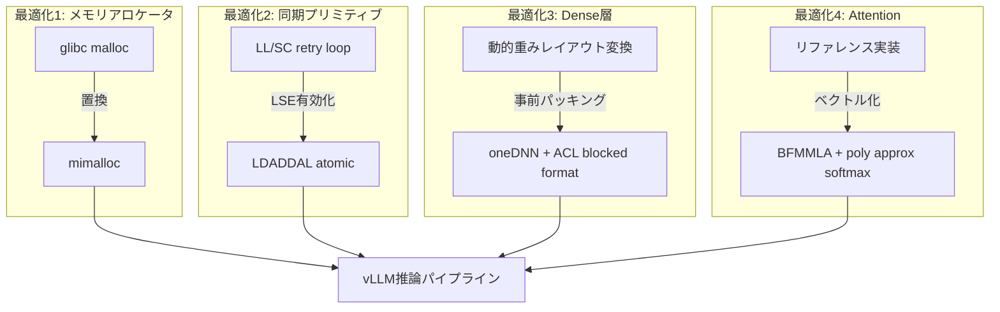

## ブログ概要（Summary）

本記事は [Optimizing vLLM on Arm CPUs](https://vllm.ai/blog/2026-07-29-optimizing-vllm-on-arm-cpus) の解説記事です。

vLLMプロジェクトのArmチームは、2025年10月に実施したArm CPU上でのvLLMベンチマークで期待を大きく下回る性能を観測したことを起点に、約9ヶ月にわたる最適化を実施した。その結果、BF16推論で最大2.7倍、INT8 W8A8量子化で最大4.8倍、INT8 W4A8量子化で最大6.2倍のスループット向上を達成したと報告している（いずれも2025年10月のBF16ベースラインとの比較）。最適化はメモリアロケータの置換、OpenMPの同期プリミティブ改善、GEMMカーネルの重み事前パッキング、Paged Attentionのベクトル化の4領域に分かれており、いずれもモデルアーキテクチャの変更を伴わないランタイムレベルの改善である。

この記事は [Zenn記事: Fargate 32vCPU×LiteLLMで社内LLMゲートウェイをサーバーレス構築する](https://zenn.dev/0h_n0/articles/13b5175e562a56) の深掘りです。Zenn記事で紹介されているパターン2（CPU推論型）において、Fargate上のGraviton（ARM64）でvLLMを実行する際のパフォーマンス特性と最適化手法を理解するための1次情報として位置づけられます。

## 情報源

- **種別**: 企業テックブログ（vLLMプロジェクト公式）
- **URL**: [https://vllm.ai/blog/2026-07-29-optimizing-vllm-on-arm-cpus](https://vllm.ai/blog/2026-07-29-optimizing-vllm-on-arm-cpus)
- **組織**: Arm Team（vLLMプロジェクト内のArm最適化チーム）
- **発表日**: 2026年7月29日
- **協力者**: Li Jiang（Intel、vLLM CPUバックエンド保守）、Sanket Kale（Fujitsu、初期Arm CPU対応）、Shreyas（Fujitsu、SVE256 INT8カーネル）

## 技術的背景（Technical Background）

### なぜArm CPUでのLLM推論が重要なのか

AWS Gravitonに代表されるArm Neoverse系プロセッサは、x86系と比較してvCPU単価が約20%安価である（Zenn記事より）。クラウド上でLLMのCPU推論を実行する場合、ARM64アーキテクチャを選択することでコスト効率を高められる。しかし、主要なLLM推論フレームワークの最適化は従来x86（特にAVX-512）を中心に進められており、Armバックエンドの性能は十分に引き出されていなかった。

vLLMはPagedAttentionを導入したことで知られるLLM推論エンジンであり、GPUでの高スループット推論で広く利用されている。しかしCPUバックエンド、特にArmアーキテクチャでの性能はGPU側ほど注力されていなかった。Armチームが2025年10月にベンチマークを実施したところ、実行時間の約80%がBF16のGEMM（General Matrix Multiply）演算を含むDense層に費やされており、GEMMカーネル単体の効率はすでにハードウェアの理論性能に近かったと報告している。

これは、ボトルネックがGEMMカーネル自体ではなく、**カーネル周辺のランタイムスタック**（メモリアロケータ、スレッド同期、フレームワークオーバーヘッド、Attentionカーネル、量子化実行パス）にあることを意味する。

### Arm Neoverse V2の主要な命令セット拡張

Graviton4はArm Neoverse V2アーキテクチャに基づいており、以下のISA拡張がLLM推論性能に直接関わる。

| 拡張 | 命令例 | 用途 |
|------|--------|------|
| **LSE（Large System Extensions）** | `LDADDAL`（アトミック加算） | 高コア数環境でのOpenMP同期 |
| **I8MM（Int8 Matrix Multiply）** | `SMMLA`（符号付き行列積和） | INT8量子化推論の高速化 |
| **SVE/SVE2** | 可変長ベクトル演算 | Attention・Softmaxのベクトル化 |
| **BF16** | BFloat16演算 | Dense層のGEMM |

特にI8MM拡張の`SMMLA`命令は、BF16のGEMM演算と比較して**理論上2倍の行列積スループット**を提供する（ブログより）。これがINT8量子化パスの大幅な性能向上の基盤となっている。

## 実装アーキテクチャ（Architecture）

Armチームが実施した最適化は、vLLMの推論パイプラインの4つのレイヤーに対応している。



### 最適化1: メモリアロケータの置換（mimalloc）

**問題**: PyTorchが使用するglibcのmallocは、大きなメモリブロックの再利用が非効率であり、スレッド数が増加するとページフォルトと競合が増大していた。

**解決策**: Armチームはmimalloc（Microsoftが開発したキャッシングアロケータ）をArm CPUにおけるPyTorchのデフォルトアロケータに設定した。従来はユーザーが`LD_PRELOAD`でアロケータを明示的に指定する必要があったが、この変更により設定不要で効果が得られるようになった。

**効果**: ブログによると、オフラインスループットが2.3倍、低同時実行数のサービングスループットが約7倍に向上したと報告されている。

### 最適化2: OpenMPの同期プリミティブ改善

**問題**: 高コア数（Neoverse V2ベース）環境でスケーリングが頭打ちになり、コア数を増やすと逆に性能が低下するケースが確認された。Paged Attentionカーネルのプロファイリングでは、実行時間の約74%がOpenMPの動的スケジューリング関数`gomp_iter_dynamic_next`に費やされていた。

この関数はアトミックなfetch-add操作を使用するが、Armの従来の実装ではLoad-Linked/Store-Conditional（LL/SC）のリトライループで実装されており、コア数が増えるとリトライが頻発して競合が激化する。

$$
T_{retry} \propto N_{cores} \times P_{collision}
$$

ここで $T_{retry}$ はリトライに費やされる総時間、$N_{cores}$ はコア数、$P_{collision}$ は1回のアトミック操作での衝突確率である。コア数が増えると $P_{collision}$ も増加するため、競合コストは超線形に増大する。

**解決策**: LSE（Large System Extensions）ハードウェアアトミクス（例: `LDADDAL`命令）を使用するlibgompをPyTorchのビルドに統合した。`LDADDAL`はハードウェアレベルでアトミック加算を実行するため、LL/SCのリトライループが不要になる。

**効果**: オフラインスループットが9%向上、低同時実行数でのTPOT（Time Per Output Token）が15%低減したと報告されている。

### 最適化3: Dense層の重み事前パッキング

**問題**: GEMMカーネルはブロック化された重みレイアウトを必要とするが、事前パッキングが行われていない場合、各推論呼び出し時にレイアウト変換コストが発生する。特に低同時実行数（バッチサイズが小さい）環境では、GEMM演算時間に対する変換オーバーヘッドの比率が大きくなる。

**解決策**: モデルウォームアップ時にBF16の重みをoneDNN（Arm Compute Library経由）のブロック形式に事前パッキングし、推論時に再利用するパスを有効化した。これはoneDNNの高速パスであり、Arm Compute Library for the Arm Architecture（ACL）によって加速される。

**効果**: オフラインスループットが16%向上、低同時実行数でのTPOTが60%低減したと報告されている。

### 最適化4: Paged Attentionのベクトル化

**問題**: vLLMのCPU向けPaged AttentionカーネルはArm向けに最適化されておらず、QK積・PV積やSoftmaxの指数関数がリファレンス実装にフォールバックしていた。また、Prefillフェーズでは別のパス（PyTorch SDPA）が使用されており、Chunked PrefillやPrefix CachingがArm CPUでは利用できなかった。

**解決策**:
- QK積とPV積にArm BFMMLA（BFloat16 Matrix Multiply-Accumulate）Advanced SIMD命令を使用するカスタムGEMMカーネルを実装
- Softmaxの指数関数をベクトル化された3次多項式近似に置換
- Paged AttentionをPrefillフェーズでも使用可能にし、Chunked PrefillとPrefix CachingをArmで有効化

Softmaxの指数関数近似について、3次多項式近似は以下の形式をとる:

$$
e^x \approx a_3 x^3 + a_2 x^2 + a_1 x + a_0 \quad (x \in [-\ln 2 / 2, \ln 2 / 2])
$$

実用上は範囲縮約（range reduction）を先に適用し、$x$を$[-\ln 2 / 2, \ln 2 / 2]$の範囲に変換してから多項式近似を適用する。この手法は精度と速度のトレードオフにおいて、Attention計算に十分な精度を維持しつつ大幅な高速化を実現する。

**効果**: Paged Attentionが最大4倍高速化、オフラインスループットが12%向上したと報告されている。

## 量子化推論パス（Quantization Paths）

### INT8 W8A8量子化

per-token Activation量子化とchannelwise Weight量子化の組み合わせで、oneDNNのJITカーネルがSVE128/SVE256上の`SMMLA`命令を使用する。

ブログによると、最適化済みBF16と比較して以下の性能向上が報告されている:
- スループット: 最大88%向上
- TPOT: 最大45%低減
- TTFT（Time To First Token）: 最大54%低減

対応する事前量子化チェックポイントとして、`RedHatAI/Meta-Llama-3.1-8B-quantized.w8a8`や`RedHatAI/whisper-large-v3-quantized.w8a8`がそのまま利用可能と記載されている。

### INT8 W4A8量子化

INT4重みとINT8アクティベーションの組み合わせで、KleidiAI INT4マイクロカーネルを使用する。KleidiAIはArmが開発したLLM推論向けの高性能カーネルライブラリである。

W8A8と比較して以下の性能向上が報告されている:
- スループット: 最大29%向上
- TPOT: 最大26%低減
- TTFT: 最大18%低減

低同時実行数（デコードがメモリバウンドとなる条件）で最大の効果が得られるとされている。これはW4A8による重みサイズの削減がメモリ帯域のボトルネックを緩和するためである。

### ベースラインからの累積改善

2025年10月のBF16ベースラインとの比較（ブログ記載の数値）:

| 構成 | スループット向上 | TPOT改善 | TTFT改善 |
|------|----------------|---------|---------|
| 最適化BF16 | 最大2.7倍 | — | — |
| INT8 W8A8 | 最大4.8倍 | 最大5.7倍 | — |
| INT8 W4A8 | 最大6.2倍 | 最大7.8倍 | 最大2.6倍 |

これらの数値はLlama 3.1 8Bモデルでの測定結果であり、モデルサイズや同時実行数によって異なる点に注意が必要である。

## Production Deployment Guide

### AWS実装パターン（コスト最適化重視）

Zenn記事で紹介されているFargate上のCPU推論パターン（パターン2）にvLLMを適用する場合の構成を、トラフィック量別に整理する。

**トラフィック量別の推奨構成**:

| 規模 | 月間リクエスト | 推奨構成 | 月額コスト目安 | 主要サービス |
|------|--------------|---------|-------------|------------|
| **Small** | ~3,000（100/日） | Fargate単体 | $80-200 | Fargate (4vCPU/16GB) + EFS |
| **Medium** | ~30,000（1,000/日） | Fargate + ALB | $400-1,000 | Fargate (8vCPU/32GB) ×2 + ALB + EFS |
| **Large** | 300,000+（10,000/日） | ECS on EC2 Graviton | $2,000-4,000 | c7g.4xlarge ×2-4 + ALB + EFS |

**Small構成の詳細**（月額$80-200）:
- **Fargate**: 4vCPU / 16GB ARM64（Graviton）、Llama 3.2 3B Q4_K_M想定（約$60/月）
- **EFS**: Elasticスループット（モデル保存、約$5/月）
- **CloudWatch**: 基本監視（約$5/月）
- **ECR**: コンテナイメージ保存（約$2/月）

**Medium構成の詳細**（月額$400-1,000）:
- **Fargate**: 8vCPU / 32GB ARM64 × 2タスク（Llama 3.1 8B W8A8想定、約$300/月）
- **ALB**: 内部ロードバランサー（約$20/月）
- **EFS**: Elasticスループット（約$10/月）
- **CloudWatch Container Insights**: Enhanced（約$15/月）

**Large構成の詳細**（月額$2,000-4,000）:
- **EC2 Graviton**: c7g.4xlarge（16vCPU/32GB）× 2-4台（Spot併用で約$800-1,600/月）
- Fargateの32vCPU上限を超えるスケールが必要な場合、EC2起動タイプに移行
- **ALB + Auto Scaling**: CPU使用率ベース（約$30/月）
- **EFS**: Elasticスループット（約$20/月）

**コスト試算の注意事項**:
- 上記は2026年11月時点のAWS ap-northeast-1（東京）リージョン料金に基づく概算値
- Fargate ARM64のvCPU単価は$0.03238/h（x86の$0.04048/hと比較して約20%安価）
- 実際のコストはモデルサイズ、同時実行数、稼働時間により変動する
- 最新料金は [AWS料金計算ツール](https://calculator.aws/) で確認を推奨

### Terraformインフラコード

**Small構成: Fargate + EFS（vLLM CPU推論）**

```hcl
module "vpc" {
  source  = "terraform-aws-modules/vpc/aws"
  version = "~> 5.0"

  name = "vllm-cpu-vpc"
  cidr = "10.0.0.0/16"
  azs  = ["ap-northeast-1a", "ap-northeast-1c"]
  private_subnets = ["10.0.1.0/24", "10.0.2.0/24"]

  enable_nat_gateway = false
  enable_dns_hostnames = true
}

resource "aws_iam_role" "ecs_task" {
  name = "vllm-cpu-task-role"

  assume_role_policy = jsonencode({
    Version = "2012-10-17"
    Statement = [{
      Action = "sts:AssumeRole"
      Effect = "Allow"
      Principal = { Service = "ecs-tasks.amazonaws.com" }
    }]
  })
}

resource "aws_iam_role_policy" "efs_access" {
  role = aws_iam_role.ecs_task.id
  policy = jsonencode({
    Version = "2012-10-17"
    Statement = [{
      Effect   = "Allow"
      Action   = ["elasticfilesystem:ClientMount", "elasticfilesystem:ClientWrite"]
      Resource = aws_efs_file_system.models.arn
    }]
  })
}

resource "aws_efs_file_system" "models" {
  creation_token  = "vllm-models"
  encrypted       = true
  throughput_mode  = "elastic"
}

resource "aws_ecs_task_definition" "vllm" {
  family                   = "vllm-cpu-inference"
  network_mode             = "awsvpc"
  requires_compatibilities = ["FARGATE"]
  cpu                      = "4096"
  memory                   = "16384"
  task_role_arn            = aws_iam_role.ecs_task.arn

  runtime_platform {
    cpu_architecture        = "ARM64"
    operating_system_family = "LINUX"
  }

  volume {
    name = "model-storage"
    efs_volume_configuration {
      file_system_id     = aws_efs_file_system.models.id
      root_directory     = "/models"
      transit_encryption = "ENABLED"
    }
  }

  container_definitions = jsonencode([{
    name  = "vllm-server"
    image = "vllm/vllm-cpu:latest"
    portMappings = [{ containerPort = 8000, protocol = "tcp" }]
    command = [
      "--model", "/models/Meta-Llama-3.2-3B-Instruct",
      "--host", "0.0.0.0",
      "--port", "8000",
      "--dtype", "bfloat16",
      "--max-model-len", "4096"
    ]
    mountPoints = [{
      sourceVolume  = "model-storage"
      containerPath = "/models"
      readOnly      = true
    }]
    healthCheck = {
      command     = ["CMD-SHELL", "curl -f http://localhost:8000/health || exit 1"]
      interval    = 30
      timeout     = 10
      retries     = 5
      startPeriod = 600
    }
    logConfiguration = {
      logDriver = "awslogs"
      options = {
        "awslogs-group"         = "/ecs/vllm-cpu"
        "awslogs-region"        = "ap-northeast-1"
        "awslogs-stream-prefix" = "inference"
      }
    }
  }])
}

resource "aws_cloudwatch_metric_alarm" "cpu_high" {
  alarm_name          = "vllm-cpu-high"
  comparison_operator = "GreaterThanThreshold"
  evaluation_periods  = 2
  metric_name         = "CPUUtilization"
  namespace           = "AWS/ECS"
  period              = 300
  statistic           = "Average"
  threshold           = 80
  alarm_description   = "vLLM CPU使用率80%超過"

  dimensions = {
    ClusterName = "vllm-cluster"
    ServiceName = "vllm-service"
  }
}
```

### セキュリティベストプラクティス

1. **ネットワーク**: 全タスクをPrivate Subnetに配置、VPC Endpoint経由でECR・CloudWatch Logsに接続
2. **IAM**: タスクロールに最小権限（EFSマウントのみ）、実行ロールにECRプル・ログ出力のみ
3. **暗号化**: EFS暗号化有効、転送中暗号化（TLS）有効
4. **イメージ管理**: ECRイメージスキャン有効化、イミュータブルタグ使用

### 運用・監視設定

**CloudWatch Logs Insights クエリ**:

```sql
-- vLLM推論レイテンシ分析: P95, P99
fields @timestamp, @message
| parse @message '"prompt_tokens":*,' as prompt_tokens
| parse @message '"generation_tokens":*,' as gen_tokens
| parse @message '"latency":*' as latency_ms
| stats pct(latency_ms, 95) as p95, pct(latency_ms, 99) as p99 by bin(5m)
```

**CloudWatch アラーム推奨設定**:
- メモリ使用率85%超過でアラート（OOM Killer予防、`MemoryUtilization` / Maximum / 60秒）
- CPU使用率70%超過でスケーリングトリガー（`CPUUtilization` / Average / 300秒）
- SNSトピック経由でSlack/メール通知


### コスト最適化チェックリスト

**アーキテクチャ選択**: ~100 req/日→Fargate ARM64 $80-200/月 / ~1000 req/日→Fargate×2 $400-1,000/月 / 10000+→EC2 Graviton $2,000-4,000/月

**リソース最適化**: Graviton選択で約20%削減、Fargate Spot併用、EFS Elastic、夜間desired_count=0

**推論コスト削減**: W8A8量子化でBF16比最大88%向上、W4A8でさらに29%向上、事前量子化チェックポイント活用、3-8Bモデル選択

**監視**: AWS Budgets（80%警告）、CloudWatch（メモリ85%/CPU70%）、Cost Anomaly Detection

## パフォーマンス最適化（Performance）

### vLLMをArm CPU上で最適に動作させるためのチューニングポイント

ブログの報告内容に基づき、Fargate/Graviton環境でvLLMを運用する際の実践的なチューニング指針を整理する。

**1. アロケータ・スレッド設定**

mimallocはPyTorchのArm CPUビルドでデフォルト有効のため追加設定不要。スレッド数はFargateのvCPU数に合わせる（`OMP_NUM_THREADS=8`等）。

**2. 量子化パスの選択指針**

| 条件 | 推奨パス | 理由 |
|------|---------|------|
| レイテンシ重視 | INT8 W4A8 | TPOT最小化（ブログ報告: 最大7.8倍改善） |
| スループット重視 | INT8 W8A8 | 安定した高スループット |
| 精度重視 | BF16 | 量子化なしで最高精度 |
| メモリ制約あり | INT8 W4A8 | 重みサイズ半減 |

**4. startPeriodの設定**

Zenn記事でも指摘されている通り、ヘルスチェックの`startPeriod`はモデルロード完了までの時間を十分にカバーする必要がある。vLLMはllama.cppと同様にモデルロード後にHTTPサーバーを起動するため、600秒以上を推奨する。

## 運用での学び（Production Lessons）

### ブログから読み取れる運用上の教訓

**1. ボトルネックは予想外の場所にある**

Armチームが最初にプロファイリングを行った結果、GEMMカーネル自体は十分に高速であり、ボトルネックはメモリアロケータやOpenMPの同期プリミティブなど、推論パイプラインの「周辺」にあった。これはCPU推論環境に特有の教訓であり、GPU環境ではカーネル自体の最適化が主要な改善源となることが多い。

**2. 量子化は段階的に導入する**

ブログの結果は、BF16 → INT8 W8A8 → INT8 W4A8と段階的に量子化を深めることで累積的な性能向上が得られることを示している。ただし、量子化に伴う精度劣化はタスクやモデルに依存するため、各段階で品質評価を実施することが重要である。

**3. エコシステムの協調が重要**

ブログのAcknowledgementsでは、Intel・Fujitsu・Armの3組織の協力が記載されている。vLLMのCPUバックエンドは単一ベンダーの取り組みではなく、エコシステム全体で推進されている。

## 学術研究との関連（Academic Connection）

### 関連する学術研究

- **PagedAttention（Kwon et al., 2023）**: vLLMの基盤技術。本ブログのPaged Attention最適化は、このアルゴリズムのArm向け実装改善に相当する
- **GPTQ / AWQ**: 重み量子化手法。ブログのW4A8パスはこれらの手法で量子化されたモデルに対応
- **KleidiAI（Arm）**: LLM推論向けの高性能カーネルライブラリ。arXiv:2501.00032で技術的詳細が報告されており、ブログのINT4マイクロカーネルの基盤となっている
- **FlashAttention（Dao et al., 2022）**: GPU向けのAttention最適化。ブログのPaged Attentionベクトル化は、類似の「メモリ効率の良いAttention計算」というコンセプトをCPU向けに展開したものと位置づけられる

### Zenn記事との関連

Zenn記事ではCPU推論パターン（パターン2）としてllama.cppを中心に解説しているが、vLLMも同様にArm CPUでのCPU推論に対応している。ブログの最適化結果は、Fargate + Graviton環境でvLLMを選択する場合の性能期待値を示す参考情報となる。llama.cppがGGUF形式の量子化モデルに特化しているのに対し、vLLMはHugging Face互換のチェックポイント（W8A8/W4A8）をそのまま利用できる点が差別化要因である。

## まとめと実践への示唆

Armチームによる約9ヶ月のvLLM最適化は、Arm CPU上でのLLM推論が実用的な性能レベルに達したことを示している。特にINT8 W4A8量子化パスでは2025年10月のベースラインから最大6.2倍のスループット向上が報告されており、Graviton + Fargateの組み合わせでCPU推論を行う際の選択肢として検討に値する。

ただし、数値はLlama 3.1 8Bでの測定結果であり、モデルにより改善幅は異なる。Fargateの32vCPU上限ではCPU推論が実用的なのは量子化済み3-8Bモデルに限られる（Zenn記事の指摘通り）。本番導入には対象モデルでの性能検証と量子化精度影響の評価を推奨する。

## 参考文献

- **Blog URL**: [Optimizing vLLM on Arm CPUs](https://vllm.ai/blog/2026-07-29-optimizing-vllm-on-arm-cpus)
- **vLLM CPU Installation**: [https://docs.vllm.ai/en/latest/getting_started/installation/cpu.html](https://docs.vllm.ai/en/latest/getting_started/installation/cpu.html)
- **KleidiAI**: [https://arxiv.org/abs/2501.00032](https://arxiv.org/abs/2501.00032)
- **Arm Learning Path (W8A8)**: [https://learn.arm.com/learning-paths/servers-and-cloud-computing/vllm-acceleration/](https://learn.arm.com/learning-paths/servers-and-cloud-computing/vllm-acceleration/)
- **Related Zenn article**: [https://zenn.dev/0h_n0/articles/13b5175e562a56](https://zenn.dev/0h_n0/articles/13b5175e562a56)
